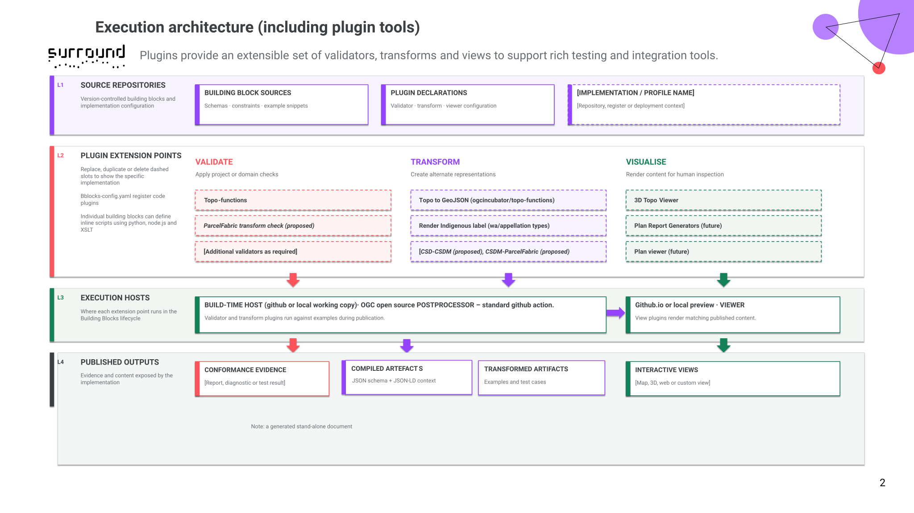

## Cadastral Survey Data Model - Western Australia Profile

This profile is the WA (Western Australia) of the Cadastral Survey Data Model (CSDM). This extends the [common ICSM Profile](https://icsm-au.github.io/3d-csdm-profile-icsm/) with Western Australia specific constraints.

It defines vocabulary bindings to WA specific vocabularies - and is extended directly, or via sub-profiles, with further data elements and business rules about content requirements.

[More information about the ways profiles are specified](https://ogcincubator.github.io/bblocks-docs/overview/profiles)

These constraints are defined in a **_machine-readable_** form to support:

- unambiguous interpretation
- conformance validation
- configuration of generic software to meet specific jurisdictional needs. (if implementers choose to use this option)


### extensions

Parcel appellation rules are defined for several Use Cases. 

## Architecture (development)

### Core specification

The core of the WA profile of CSDM is a **JSON schema**, published as an **OGC Building Block** that integrates the schema with a semantic model and richer rules. These rules include **vocabulary mappings** which allow content to be validated.

The key artefacts are thus:

The WA "core" profile - extending an ICSM profile, and extended by specific WA application profiles.

1. The published schema - at https://surroundaustralia.github.io/3d-csdm-profile-wa/build/annotated/profiles/wa/wa-core/schema.json
2. The JSON-LS context for this schema - at https://surroundaustralia.github.io/3d-csdm-profile-wa/build/annotated/profiles/wa/wa-core/context.jsonld
3. The Viewer that provides the online specification with supporting descriptions, examples etc at https://surroundaustralia.github.io/3d-csdm-profile-wa 
4. Vocabulary bindings at https://github.com/surroundaustralia/3d-csdm-profile-wa/tree/main/profiles

**Note that these resources are generated by the Building Blocks compilation process and cannot be manually edited. This also ensures that source syntax validation is automated and all embedded tests are executed against the examples.**

Other profiles that extend this are:

####  WA 3D profile

Viewer: https://surroundaustralia.github.io/3d-csdm-profile-wa/bblock/icsm.profiles.wa.wa-3d

#### WA liminal profile

Defines WA vocabularies 

Viewer: https://surroundaustralia.github.io/3d-csdm-profile-wa/bblock/icsm.profiles.wa.wa-liminal


### CSDM components

The CSDM is a modular specification based on OGC and other standards, implemented using JSON schema, with semantic annotation using JSON-LD to link schema elements to definitions and code lists.  This allows rules to be defined using the semantic model - and profiles to control content without modifying the schema patterns.

This diagram shows the WA Profile in development 


### Building Blocks (general architecture)

CSDM uses the [Building Blocks](https://ogcincubator.github.io/bblocks-docs/) specification publication framework supported by the OGC - this approach is being developed into the core mechanism to create new standards and better document existing ones. This is an evolving environment, the link above should be used to access updates on the official position as this progresses.

The overview of the functional components shows how a complete specification ecosystem exploits machine readable specifications. 


For the WA profile the supporting tooling, registers and AI assistants are less relevant - the focus is on the **example driven testing** and the **reuse of standards**


### Building Blocks implementation

The CSDM has been updated to exploit new capabilities in the Building Blocks framework:

- validators
- visualisations
- transforms

these can be chained - to test an element of CSDM it can be **transformed** into a form that can be **visualised** (e.g. GeoJSON)

Transforms can be in-line code snippets or managed re-usable software libraries.  The core of the 3D support for CSDM has been implemented in plugin components

The following diagram shows the broad architecture. 



For more information read the [Building Blocks](https://ogcincubator.github.io/bblocks-docs/) and the sources

### Vocabularies

**A vocabulary management system** is necessary for the long term, however a decision on providing this was deferred by the client, and the interim solution devised to support the initial CSDM development has been re-used.  This is not intended to be the permanent solution, CSDM only requires online accessible resources. Run-time (i.e. software) applications are likely to download these as part of configuration for a particular jurisdiction. There is currently no standard model for mapping vocabularies to schemas (although this is an active discussion within OGC and JSON schema working groups.) Hence the implementation architecture described here should be regarded as a short term workaround.


"Vocabulary bindings" are managed in the form of a CSV referencing the semantic element (defined by the JSON-LD mapping on the schema), and the "short form" of the vocabulary - e.g `vocabs:wa-survey-purpose`.  The ICSM vocabulary repository manages the content of these vocabularies - e.g. https://github.com/surroundaustralia/icsm-vocabs/blob/main/source/LandParcels/CSD-Header/wa-survey-purpose.csv

These CSV sources are used to generate online vocabulary sources in a standard semantic model called SKOS 

https://github.com/surroundaustralia/icsm-vocabs/blob/main/vocabs/LandParcels/CSD-Header/wa-survey-purpose.ttl 

```csv
Classes,Property,Range,Schemes
container:CSD,container:horizontalCRS,termtype:AllowableCoordinateReferenceSystem,vocabs:wa-crs http://www.opengis.net/def/crs/EPSG/0
container:CSD,container:verticalDatum,termtype:AllowableCoordinateReferenceSystem,vocabs:wa-vhd
container:CSD,container:purpose,surv:SurveyPurpose,vocabs:wa-survey-purpose
```