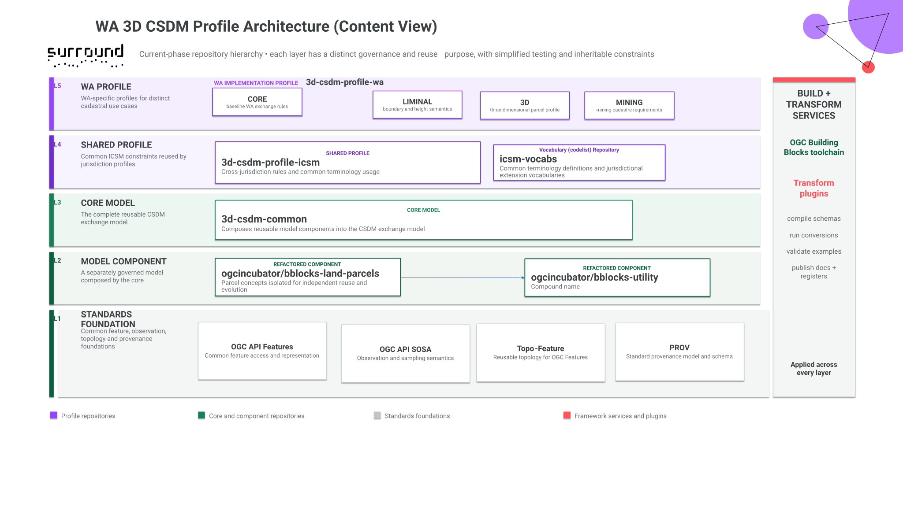
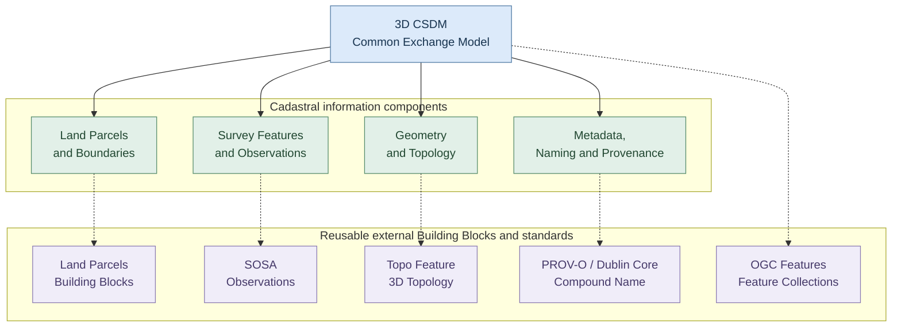
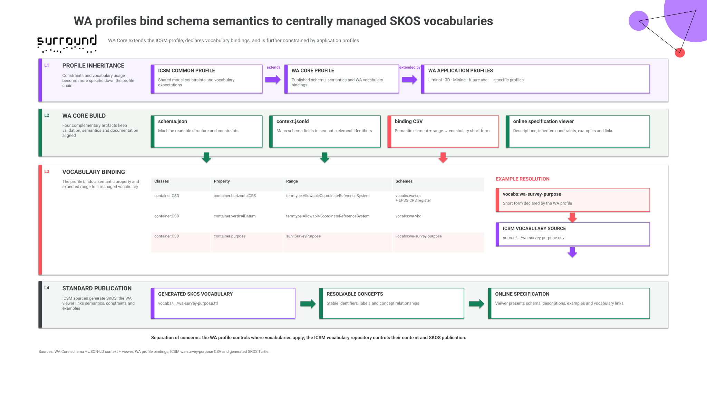
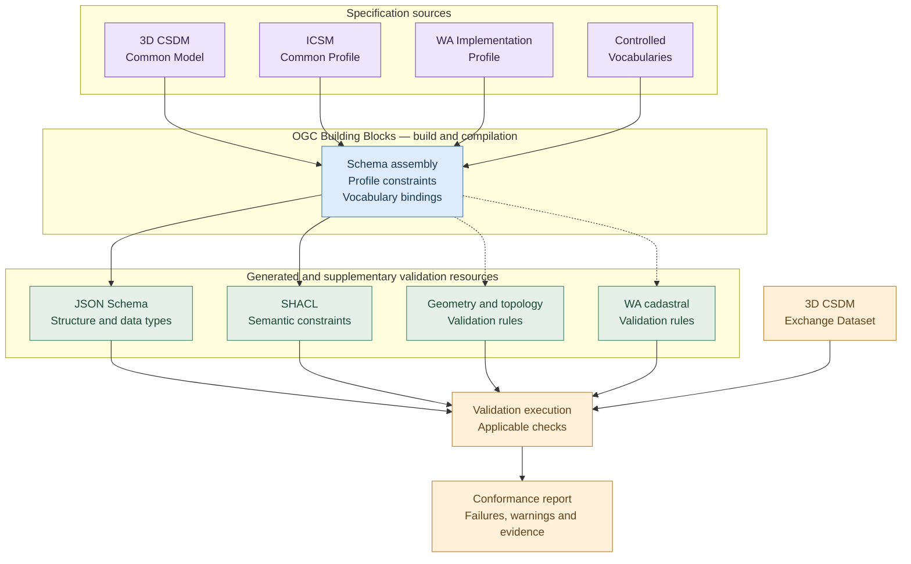
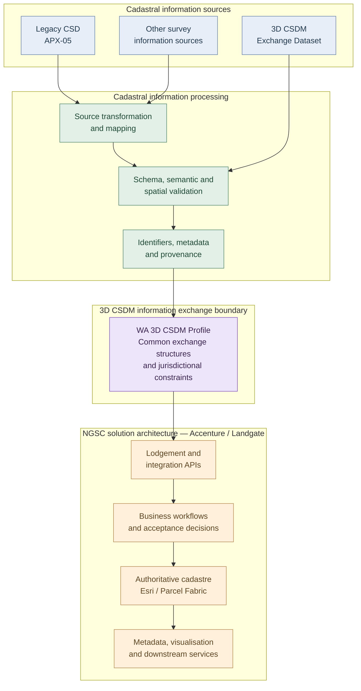

<!-- TITLE PAGE -->

#### Accenture Australia Pty Ltd

# Spatial WA – Next Generation Spatial Cadastre (NGSC)

## 3D CSDM Solution Architecture Contribution

Prepared by: Surround Australia Pty Ltd (SURROUND)

**Date:** 2026-11-02

<!-- TOC -->

## Table of Contents

1. [Purpose, scope, and responsibilities](#purpose-scope-and-responsibilities)
2. [Architectural overview](#architectural-overview)
3. [Architectural viewpoints](#architectural-viewpoints)
4. [Requirement-specific architecture contributions](#requirement-specific-architecture-contributions)
5. [Specifications and verification](#specifications-and-verification)
6. [Integration considerations and dependencies](#integration-considerations-and-dependencies)
7. [Summary](#summary)
8. [References](#references)

##### Revision history

| Version | Status | Date       | Author        | Description    |
|---------|--------|------------|---------------|----------------|
| 0.1     | Draft  | 2026-10-26 | Andrew Hunter | Report created |

<!-- CONTENT -->

## Purpose, scope, and responsibilities

### Purpose

This document consolidates SURROUND Australia Pty Ltd's (SURROUND) Cadastral Survey Data (CSD), 3D Cadastral Survey Data Model (3D CSDM), and metadata architecture contributions to the Western Australian Next Generation Spatial Cadastre (NGSC) project.

It identifies the information structures, specifications, technical artefacts, and integration dependencies relevant to SURROUND's allocated requirements. 
It supports Accenture's NGSC Solution Architecture and draws on the five requirements analysis deliverables prepared by SURROUND Pty Ltd [@hunter_deliverable_2025;@hunter_deliverable_2026a;@hunter_deliverable_2026b;@hunter_deliverable_2026c;@hunter_deliverable_2026d;], the [WA Implementation Profile](https://surroundaustralia.github.io/3d-csdm-profile-wa/), and associated technical developments.

### Contractual context and scope

Accenture engaged SURROUND to provide specialist cadastral information modelling, standards development, requirements analysis, and technical support.

Schedule 1 of the subcontract [@accenture_ngsc_subcontract_2025;] identifies 34 allocated requirements, comprising 15 classified as SURROUND Responsible and 19 as SURROUND Supporting.
The 34 requirements represent the original contractual allocation. 
Requirement NN01.02.026 was subsequently moved out of scope but remains included in the End of Project Report [@hunter_deliverable_2026e] for traceability. 
This architecture contribution addresses the 15 requirements classified as SURROUND Responsible.
For applicable Responsible requirements, Schedule 1 requires documentation of CSD, 3D CSDM, or metadata components in a Solution Architecture document, together with other specified technical deliverables.

This document addresses the architectural documentation requirement through the following areas:

- **Information architecture:** 3D CSDM structures, WA profile extensions, identifiers, metadata, provenance, and controlled vocabularies.
- **Geometry and topology:** Cadastral geometry, topological relationships, legal boundary definitions, and geometric constraints.
- **Data exchange:** Survey information exchange, legacy CSD transformation, and preservation of source observations.
- **Validation:** Structural, semantic, geometric, topological, and cadastral validation approaches.
- **Processing capabilities:** Relevant transformation, validation, visualisation, and reporting patterns.
- **Requirement traceability:** Relationships between requirements, specifications, technical artefacts, and dependencies.

Supporting requirements are included where relevant to architectural decisions or shared information components.

### Responsibilities and architectural boundaries

Accenture is responsible for the overall NGSC solution architecture, system development, and integration. 
Landgate retains responsibility for jurisdictional policy, business requirements, and authoritative cadastral decisions.

SURROUND's contribution concerns cadastral information structures, standards, technical specifications, validation approaches, and implementation guidance. 
The 3D CSDM defines an exchange model; it does not prescribe NGSC applications, Esri Parcel Fabric configuration, databases, security, transactions, or workflows.

Where requirements span both information modelling and system functions, this report identifies the information contribution and outstanding integration dependencies. 
Referenced technical artefacts are at varying stages of development and do not, by their inclusion, establish formal acceptance or operational readiness.

### Relationship to supporting documentation

This document is intended to complement Accenture's NGSC Solution Architecture.

The principal supporting materials are:

#### Table 1: Supporting documentation

| Reference                                                                                                                                                | Purpose                                                                                                                                                    |
|----------------------------------------------------------------------------------------------------------------------------------------------------------|------------------------------------------------------------------------------------------------------------------------------------------------------------|
| Subcontract Schedule 1                                                                                                                                   | Contractual requirements and deliverable obligations.                                                                                                      |
| Deliverables 1–5 [@hunter_deliverable_2025; @hunter_deliverable_2026a; @hunter_deliverable_2026b; @hunter_deliverable_2026c; @hunter_deliverable_2026d;] | Requirements analyses, 3D CSDM perspectives, proposed acceptance criteria, and dependencies.                                                               |
| End of Project Report [@hunter_deliverable_2026e;]                                                                                                       | Consolidated technical findings, architectural decisions, and recommendations, including requirements traceability matrix and technical artefact register. |
| Technical repositories                                                                                                                                   | Machine-readable specifications, datasets, validation resources, and supporting implementations.                                                           |

Requirement-specific details and outstanding decisions are cross-referenced to these sources rather than repeated here.

## Architectural overview

<!-- 
Explain the role of 3D CSDM, WA profiles, source-format transformation and NGSC integration boundaries.
-->

### Architecture context and scope

The 3D Cadastral Survey Data Model (3D CSDM) provides a standards-based exchange model for cadastral survey information, including 2D and 3D parcels, observations, spatial relationships, metadata, and provenance. 
It separates the representation of cadastral information from the systems used to manage it.

Three specification levels establish progressively specialised constraints:

- **3D CSDM common model:** Reusable cadastral information structures and JSON exchange encoding.
- **ICSM common profile:** Shared implementation constraints and conventions.
- **WA implementation profile:** Jurisdiction-specific rules, constraints, and controlled vocabulary bindings.

OGC Building Blocks support component reuse, schema assembly, automated testing, and documentation. 
[Figure 1](#figure-1-wa-3d-csdm-profile-architecture) places these specification levels within the broader architecture of model components, standards, and build services.

<figure class="fig fig-wide">
    
    <figcaption id="figure-1-wa-3d-csdm-profile-architecture">Figure 1: WA 3D CSDM Profile Architecture</figcaption>
</figure>

[Figure 1](#figure-1-wa-3d-csdm-profile-architecture) distinguishes standards foundations, independently governed components, the common exchange model, shared ICSM constraints, and WA-specific profiles. 
These are architectural roles rather than a literal dependency or inheritance sequence. 
Specialised WA profiles may introduce additional constraints for particular cadastral products.

The detailed schemas, semantic definitions, examples, and versioned dependencies are maintained in the [3D CSDM Common Model](https://github.com/icsm-au/3d-csdm-common), [ICSM Common Profile](https://github.com/icsm-au/3d-csdm-profile-icsm), and [WA Implementation Profile](https://surroundaustralia.github.io/3d-csdm-profile-wa/).

### Modular implementation and external standards

The 3D CSDM reuses external Building Blocks rather than redefining common feature, topology, observation, naming, and provenance structures. 
[Figure 2](#figure-2-modular-composition-and-external-dependencies) groups these dependencies by function, rather than depicting individual schema references.

<figure class="fig fig-wide">
    <figcaption id="figure-2-modular-composition-and-external-dependencies">Figure 2: Modular composition and external dependencies.  Solid arrows show conceptual composition; dashed arrows show reuse of external specifications. The relationships are explanatory, not a literal schema dependency graph.</figcaption>
</figure>

The principal external dependencies are:

- **Land Parcels:** Cadastral parcel concepts and relationships.
- **Topo Feature:** Explicit geometry and topology, including 3D structures.
- **OGC API Features** and **feature collections:** Common feature representations.
- **SOSA:** Survey observations and associated measurement semantics.
- **PROV:** Provenance and derivation.
- **Compound Name** and **Dublin Core Terms:** Structured names and metadata.

The published Building Block specifications record the actual dependency relationships and applicable versions. 
[Figure 2](#figure-2-modular-composition-and-external-dependencies) is a functional summary, not a normative dependency graph.

### NGSC information exchange boundary

Within NGSC, the 3D CSDM provides an exchange and interpretation model, not an operational storage schema. 
Legacy information, including WA APX-05, may require mapping and derivation; conforming 3D CSDM datasets may be ingested directly. 
Both pathways require source identification, appropriate validation, and provenance preservation.

The exchanged information can support plan lodgement, cadastral maintenance, visualisation, metadata management, and downstream services. 
Mapping into authoritative cadastral records, workflows, and Esri Parcel Fabric is an NGSC implementation responsibility. 
Exchange conformance does not establish legal authority or acceptance for lodgement.

## Architectural viewpoints

<!--
Summarise the Enterprise, Information, Computational, Engineering and Technology perspectives relevant to SURROUND's work.
-->

The architecture is described through five complementary viewpoints: Enterprise, Information, Computational, Engineering, and Technology. 
These viewpoints distinguish the information architecture contribution from the broader NGSC system design.

### Enterprise viewpoint

The 3D CSDM provides a common exchange structure for survey data producers, lodgement processes, cadastral maintenance, and downstream consumers. 
Landgate determines jurisdictional policy and authoritative cadastral outcomes; Accenture integrates the information capabilities into NGSC; SURROUND supplies the relevant modelling, specification, and verification contributions.

### Information viewpoint

The common model organises cadastral features, survey observations, spatial representations, identifiers, metadata, and provenance. 
It supports 2D and 3D parcels and explicit geometric and topological relationships through reuse of Topo Feature.

Specialised products, including WA built strata, may require legal boundary definitions tied to building elements or other reference features, multi-component parcels, and defined vertical extents. 
The model also distinguishes source observations from derived geometry and interpretation, with provenance supporting traceability.

#### Controlled vocabularies and semantic bindings

The 3D CSDM uses controlled vocabularies to provide consistent definitions and permitted values for cadastral information. 
These vocabularies are expressed using the W3C Simple Knowledge Organization System (SKOS), supporting shared terminology, semantic interoperability, and machine-readable validation.

The WA Core profile defines vocabulary bindings that associate information properties and their expected value types with managed vocabularies. 
As illustrated in [Figure 3](#figure-3-controlled-vocabularies), these bindings are maintained separately from the vocabulary definitions. 
The WA profile specifies where vocabularies apply, while the ICSM vocabulary repository maintains their content and supports publication as SKOS resources.

<figure class="fig fig-wide">
    
    <figcaption id="figure-3-controlled-vocabularies">Figure 3: WA 3D CSDM controlled vocabularies and semantic bindings</figcaption>
</figure>

This separation enables vocabulary terms to be governed and maintained independently of the schemas that use them. 
It also supports reuse across jurisdictional profiles, consistent interpretation of cadastral information, and validation against the applicable vocabulary constraints.

Vocabulary governance should distinguish jurisdiction-specific terminology from concepts suitable for national reuse. 
Proposed changes to shared vocabularies should be coordinated with the relevant standards custodians, while profile-specific bindings and constraints remain subject to the applicable profile governance arrangements.

The detailed bindings, vocabulary definitions, and published SKOS resources are maintained in the [WA Implementation Profile](https://surroundaustralia.github.io/3d-csdm-profile-wa/) and [ICSM Vocabularies repository](https://github.com/icsm-au/icsm-vocabs).

The [3D CSDM Common Model](https://surroundaustralia.github.io/3d-csdm-common/bblock/icsm.csdm.features.CSD), [ICSM Common Profile](https://surroundaustralia.github.io/3d-csdm-profile-icsm/bblock/icsm.profiles.common), and [WA Implementation Profile](https://surroundaustralia.github.io/3d-csdm-profile-wa/) specify the detailed properties, relationships, and vocabulary bindings.

### Computational viewpoint

Principal processing capabilities include source transformation, structural and semantic validation, geometric and topological checks, spatial derivation, visualisation, and reporting. 
These functions can be implemented as reusable components. 
For example, JSON Schema checks structure, while specialised tools such as `topo-functions` assess spatial relationships beyond schema validation. 
Requirement-specific applications are described in the [following section](#requirement-specific-architecture-contributions).

### Engineering viewpoint

The exchange specification provides a potential contract between independently implemented ingestion, transformation, validation, and cadastral services. 
The allocation of these capabilities to NGSC APIs, applications, transactions, and authoritative data management remains subject to Accenture's solution architecture.

### Technology viewpoint

OGC Building Blocks assemble JSON-based exchange schemas and related semantic resources. 
JSON Schema supports structural checks; JSON-LD and SHACL support semantic interpretation and constraints. 
Topo Feature and Python-based tools support specialised spatial processing. 
These technologies do not prescribe NGSC's application framework or storage platform; implementation details reside in the technical repositories.

## Requirement-specific architecture contributions

This section maps the 15 SURROUND Responsible requirements to their principal CSD/3D CSDM or metadata components, supporting artefacts, and NGSC integration dependencies. Requirements are grouped by shared architecture concerns; detailed analyses and proposed acceptance criteria remain in Deliverables 1–5 [@hunter_deliverable_2025;@hunter_deliverable_2026a;@hunter_deliverable_2026b;@hunter_deliverable_2026c;@hunter_deliverable_2026d;] and the End of Project Report [@hunter_deliverable_2026e;].

### Cadastral information exchange and transformation

The recommended information architecture uses the 3D CSDM and its Western Australian profile as the common representation for cadastral survey information exchange.
Existing CSD formats may be transformed into this representation, subject to defined mapping rules and preservation of source information.

#### Table 2: Cadastral information exchange and transformation architecture contributions

| Requirement                                                      | Architectural contribution                                                                                                | Supporting artefacts                                                                | Integration considerations and dependencies                                                      |
|------------------------------------------------------------------|---------------------------------------------------------------------------------------------------------------------------|-------------------------------------------------------------------------------------|--------------------------------------------------------------------------------------------------|
| **NF02.03.047**: Manually import lodged surveys                  | CSD/3D CSDM exchange structures, parcel identifiers, survey observations, spatial representations and provenance.         | WA 3D CSDM profile; common components; Deliverable 3 [@hunter_deliverable_2026b].   | Source matching, manual exception handling, validation, and authoritative dataset updates.       |
| **NF02.03.067**: Import 3D CSDM files to Mining Cadastre dataset | Common cadastral information structures with profile-specific constraints for mining cadastral information.               | 3D CSDM common components; WA profile; Deliverable 3 [@hunter_deliverable_2026b].   | Mining Cadastre product requirements, mapping, validation and record maintenance.                |
| **NN01.02.016**: Support 3D CSDM exchange specification          | Machine-readable information structures, schemas, semantic definitions, controlled vocabularies and validation resources. | WA profile; common components; ICSM vocabularies; OGC Building Blocks.              | Profile versions, supported product types, conformance requirements and application integration. |
| **NN01.02.017**: Support CSD format specification                | Legacy CSD information mappings, survey observation structures, identifiers and transformation provenance.                | APX-05 analysis; 3D CSDM specifications; Deliverable 3 [@hunter_deliverable_2026b]. | Transformation rules, incomplete records, information loss and conversion validation.            |

### Survey observations and control

The 3D CSDM provides structured representations of survey observations, points, survey marks, and associated reference information.
Processing requirements must distinguish original observations from derived information and preserve the basis for any calculations.

#### Table 3: Survey observations and control architecture contributions

| Requirement                                                         | Architectural contribution                                                                                        | Supporting artefacts                                                                     | Integration considerations and dependencies                                                            |
|---------------------------------------------------------------------|-------------------------------------------------------------------------------------------------------------------|------------------------------------------------------------------------------------------|--------------------------------------------------------------------------------------------------------|
| **NF02.03.059**: eField Records                                     | Survey observation structures, points, lines, angles, connections, and provenance information.                    | 3D CSDM common components; WA profile; Deliverable 3 [@hunter_deliverable_2026b].        | eField Records import, geographic placement, control-point creation and survey adjustment interfaces.  |
| **NF02.03.071**: Accept angles and bearings when a plan is imported | Representation of observed angles and azimuths, derived bearings, calculation provenance and quality information. | *Angles and Directions*; APX-05 technical advice; `angles-to-bearings` proof of concept. | Bearing derivation, incomplete networks, conflicting observations, uncertainty and quality thresholds. |
| **NF02.03.076**: Import non-geodetic control                        | Survey points, marks, observations, cadastral connections and associated identifiers.                             | 3D CSDM survey information structures; Deliverable 4 [@hunter_deliverable_2026c].        | Candidate identification, duplicate detection, Editor selection and authoritative record creation.     |
| **NF04.01.010**: API eField Records                                 | Information exchange structures for survey records, observations and associated reference information.            | 3D CSDM survey information structures; Deliverable 3 [@hunter_deliverable_2026b].        | API specification, authentication, data mapping, processing states and error handling.                 |

### 3D cadastral representation and visualisation

The WA 3D CSDM profile supports representation of multi-component 3D parcels, including built-strata schemes where legal boundaries may be defined relative to building elements or other reference features.

#### Table 4: 3D cadastral representation and visualisation architecture contributions

| Requirement                                     | Architectural contribution                                                             | Supporting artefacts                                                                                               | Integration considerations and dependencies                                                               |
|-------------------------------------------------|----------------------------------------------------------------------------------------|--------------------------------------------------------------------------------------------------------------------|-----------------------------------------------------------------------------------------------------------|
| **NF02.02.027**: 2D view of level in a building | 3D parcel solids, parcel components, vertical extents and derived horizontal sections. | WA built-strata profile; SP83687 example dataset; horizontal section viewer proof of concept; Topo Feature viewer. | Selection of levels and section elevations, graphical presentation, accuracy and application integration. |

The supporting technical developments demonstrate the derivation and visualisation of two-dimensional sections from structured 3D cadastral information.
They do not prescribe the NGSC user interface or rendering implementation.

### Metadata, naming, and standards compliance

The 3D CSDM provides source-level information concerning survey datasets, identifiers, coordinate reference information, purpose, and provenance.
Additional operational metadata, catalogue management, quality assessments, and feedback workflows are NGSC responsibilities.

#### Table 5: Metadata, naming, and standards compliance architecture contributions

| Requirement                                                                                   | Architectural contribution                                                                                              | Supporting artefacts                                                                            | Integration considerations and dependencies                                                     |
|-----------------------------------------------------------------------------------------------|-------------------------------------------------------------------------------------------------------------------------|-------------------------------------------------------------------------------------------------|-------------------------------------------------------------------------------------------------|
| **NF02.02.036**: Metadata for my NGSC dataset                                                 | Dataset identifiers, provenance and references supporting traceability between cadastral datasets and metadata records. | 3D CSDM metadata structures; Deliverable 5 [@hunter_deliverable_2026d].                         | Metadata feedback interface, catalogue linkage, issue-management workflow, ownership and audit. |
| **NF03.02.006**: Metadata for NGSC dataset                                                    | Source metadata structures and proposed mappings to NGSC catalogue information.                                         | 3D CSDM metadata structures; Deliverable 4 [@hunter_deliverable_2026c].                         | Authoritative NGSC Metadata Profile, catalogue ownership and metadata maintenance.              |
| **NF03.02.007**: Metadata adheres to specified standard                                       | Metadata schema constraints, controlled vocabularies and validation mechanisms.                                         | WA profile; OGC Building Blocks; Deliverable 3 [@hunter_deliverable_2026b].                     | Applicable metadata standards, profile versions, compliance validation and reporting.           |
| **NN01.02.015**: Align to Policies and Standards for Geographical Naming in Western Australia | Structured appellations using the `compoundName` pattern, with typed name components and jurisdictional vocabularies.   | WA profile appellation datatypes; ICSM vocabularies; Deliverable 2 [@hunter_deliverable_2026a]. | Authoritative naming policies, name sources, language attribution and NGSC record mapping.      |

### Plan lodgement and validation interfaces

The 3D CSDM defines the cadastral information exchanged through plan lodgement and validation interfaces.
The NGSC platform is responsible for implementing the associated APIs, workflows, transactions, and authoritative data management.

#### Table 6: Plan lodgement and validation interfaces architecture contributions

| Requirement                           | Architectural contribution                                                                         | Supporting artefacts                                                                                               | Integration considerations and dependencies                                                   |
|---------------------------------------|----------------------------------------------------------------------------------------------------|--------------------------------------------------------------------------------------------------------------------|-----------------------------------------------------------------------------------------------|
| **NF04.01.002**: API to lodge plan    | CSD/3D CSDM survey-package structures, identifiers, cadastral content and provenance.              | WA profile; exchange specifications; Deliverable 4 [@hunter_deliverable_2026c].                                    | API contract, lodgement workflows, source matching, record creation and transaction handling. |
| **NF04.01.004**: API to validate plan | Structural, semantic, geometric, topological and jurisdiction-specific cadastral validation rules. | WA profile; OGC Building Blocks validation resources; `topo-functions`; Deliverable 4 [@hunter_deliverable_2026c]. | Validation stages, API responses, error reporting, applicable rules and acceptance decisions. |

### Architectural dependencies and traceability

The tables identify common information and validation components used by multiple requirements. 
Supporting specifications should be maintained independently of individual application functions where practical. 
Outstanding decisions, including supported products, metadata profiles, transformation rules, and service responsibilities, are consolidated in the End of Project Report [@hunter_deliverable_2026e] and require reconciliation with Accenture's NGSC architecture.

## Specifications and verification
<!--
Reference schemas, ontologies, example datasets, validation rules, transformation specifications, tests and acceptance criteria.
-->
### Machine-readable specifications

OGC Building Blocks assemble common model components, ICSM and WA profile constraints, and vocabulary bindings into published schemas and semantic resources. 
Compiled implementation artefacts provide the practical basis for applying exchange requirements; their source definitions remain in the respective repositories.

[Figure 4](#figure-4-schema-profile-validation-architecture) distinguishes generated schema and semantic validation resources from supplementary spatial and jurisdiction-specific rules, which may require separate implementations.

<figure class="fig fig-wide">
    <figcaption id="figure-4-schema-profile-validation-architecture">Figure 4: Schema, profile and validation architecture.  The dashed connections to geometry, topology, and WA cadastral rules are intentional. They indicate that these rules are associated with the applicable specifications but are not necessarily generated automatically by the OGC Building Blocks toolchain.</figcaption>
</figure>

The validation resources shown in [Figure 4](#figure-4-schema-profile-validation-architecture) are complementary: passing structural checks does not establish geometric validity, jurisdictional compliance, or authoritative acceptance. 
Validation results should identify affected components and the specification or rule versions applied.

### Verification approach

Verification uses four complementary checks:

- **Syntactic and structural:** JSON encoding, required properties, types, and JSON Schema constraints.
- **Semantic and profile:** Controlled vocabularies and logical constraints, including those assessed using SHACL.
- **Geometric and topological:** Connectivity, closure, orientation, containment, and spatial relationships where applicable.
- **WA cadastral:** Jurisdiction-specific rules that may depend on external cadastral information, survey evidence, or policy.

The applicable checks depend on the dataset and encoding. 
Reports should distinguish failures from warnings and identify the affected data, applicable rule, and relevant version.

### Supporting implementations and evidence

The repositories provide schemas, sample datasets, tests, and validation implementations. 
In particular, [`topo-functions`](https://github.com/ogcincubator/topo-functions) supplies topology-related processing and validation capabilities. 
Proofs of concept also demonstrate processing of observations, 3D parcels, derived geometry, and horizontal sections.

These artefacts support architectural evaluation but do not establish operational readiness or formal NGSC acceptance. 
Integration testing, confirmed jurisdictional rules, and requirement-specific acceptance criteria remain necessary; see Deliverables 1–5 [@hunter_deliverable_2025;@hunter_deliverable_2026a;@hunter_deliverable_2026b;@hunter_deliverable_2026c;@hunter_deliverable_2026d].

A consolidated validation and conformance test suite is recommended to support NGSC implementation and ongoing profile maintenance. 
This should combine versioned specifications, representative cadastral datasets, applicable validation rules, expected outcomes, and automated reporting. 
The scope and acceptance baseline require agreement with Accenture and Landgate, consistent with decision AD-08 in the End of Project Report [@hunter_deliverable_2026e;].

**Principal references:** [WA Implementation Profile](https://surroundaustralia.github.io/3d-csdm-profile-wa/), [3D CSDM Common Model](https://github.com/icsm-au/3d-csdm-common), and [Topo Functions](https://github.com/ogcincubator/topo-functions).

## Integration considerations and dependencies
<!--
Identify the decisions that must be addressed within Accenture's Esri/Parcel Fabric solution.
-->
### NGSC integration boundaries

Integration requires explicit mapping between the 3D CSDM exchange representation and NGSC's authoritative information structures, including Esri Parcel Fabric. 
[Figure 5](#figure-5-3d-schema-exchange-boundaries) shows the conceptual interface between source processing, profile-based exchange, and NGSC services; it does not prescribe their sequence or deployment.

<figure class="fig fig-wide">
    <figcaption id="figure-5-3d-schema-exchange-boundaries">Figure 5: 3D CSDM information exchange and NGSC integration boundaries</figcaption>
</figure>

Mappings must address identifiers, parcels and boundaries, survey observations, geometry, metadata, and provenance. 
Where operational structures cannot directly represent exchanged information, the solution must determine how it is retained, referenced, or made accessible. 

> [Figure 5](#figure-5-3d-schema-exchange-boundaries) represents logical responsibilities, not a mandatory processing pipeline.

### Source transformation and information preservation

Legacy sources may require mapping or derivation into the 3D CSDM. 
Transformation rules must distinguish supplied observations from inferred or calculated results, particularly for bearings, parcel geometry, and 3D representations derived from incomplete evidence.

Integration processes must preserve source identity, derivation methods, limitations, and sufficient provenance for audit. 
Source matching, exceptions, information loss, and conversion testing require defined handling.

### Validation and authoritative acceptance

Exchange conformance and authoritative cadastral acceptance are separate decisions. 
NGSC must identify required validation stages, responsibility for review and acceptance, handling of errors and warnings, and the rule versions used to support reproducibility and audit.

### External specification dependencies

Shared Building Blocks, vocabularies, and model components evolve across repositories. 
Profile and component versions should therefore be managed together, with regression testing and change-impact assessment across affected profiles and consumers. 
The functional dependencies are summarised in [Figure 2](#figure-2-modular-composition-and-external-dependencies); authoritative details reside in the published specifications.

### Outstanding architectural decisions

The NGSC architecture must confirm supported exchange formats and cadastral products; source transformation and preservation rules; mappings to operational records; validation responsibilities and acceptance criteria; metadata and workflow integration; and support for specialised 3D legal boundary representations.

Requirement-level dependencies and decisions are recorded in Deliverables 1–5 [@hunter_deliverable_2025;@hunter_deliverable_2026a;@hunter_deliverable_2026b;@hunter_deliverable_2026c;@hunter_deliverable_2026d] and the End of Project Report [@hunter_deliverable_2026e]. 
Their resolution will determine how the 3D CSDM capabilities are incorporated into NGSC without changing the exchange model's technology-independent role.

The principal outstanding decisions are consolidated as AD-01 to AD-08 in the End of Project Report [@hunter_deliverable_2026e]. 
These address the 3D CSDM exchange architecture, profile and vocabulary governance, legacy transformation, geometry and cadastral validation, authoritative 3D boundaries, metadata governance, workflow integration, and technical acceptance.

The decision register identifies recommended directions and responsible organisations. 
It provides the basis for resolving the dependencies described in this document through Accenture's NGSC Solution Architecture and Landgate's jurisdictional decision-making processes.

## Summary

The 3D CSDM and its Western Australian implementation profile provide a standards-based information architecture for the representation, validation, and exchange of cadastral survey information within NGSC. 
The modular approach builds on reusable OGC Building Blocks, common information structures, and jurisdiction-specific constraints, supporting interoperability and reducing duplication across cadastral applications.

This report identifies the CSD, 3D CSDM, and metadata components relevant to SURROUND's 15 Responsible requirements, together with supporting technical artefacts and integration dependencies. 
The associated specifications, example datasets, and proof-of-concept developments demonstrate approaches to information exchange, transformation, geometric and topological validation, and three-dimensional cadastral representation.

The 3D CSDM establishes a common exchange model but does not prescribe NGSC's operational architecture or authoritative cadastral processes. 
Integration therefore requires further decisions concerning source transformation, mapping to Esri Parcel Fabric, validation responsibilities, metadata management, and the treatment of specialised cadastral representations.

The architecture contributions documented here provide a technical foundation for incorporation into Accenture's NGSC Solution Architecture. 
Outstanding implementation decisions and acceptance requirements remain subject to confirmation by Accenture and Landgate, with supporting detail provided in the requirements deliverables [@hunter_deliverable_2025;@hunter_deliverable_2026a;@hunter_deliverable_2026b;@hunter_deliverable_2026c;@hunter_deliverable_2026d], technical repositories, and End of Project Report [@hunter_deliverable_2026e].

## References

[Bibliography](architecture-contribution_refs.bib)
