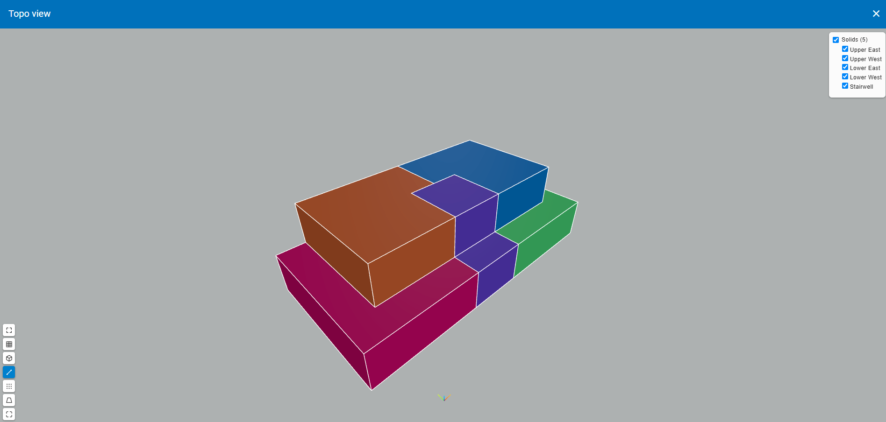
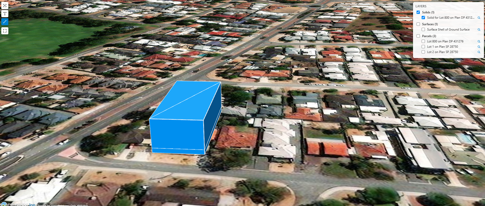
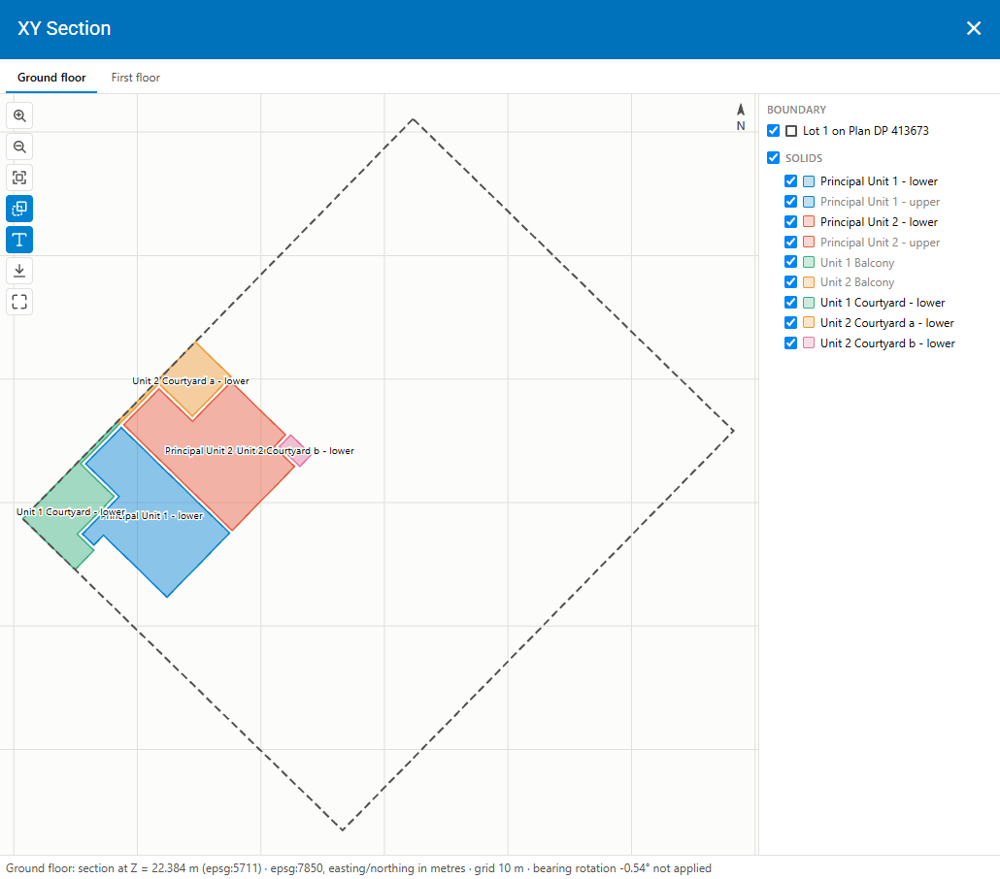
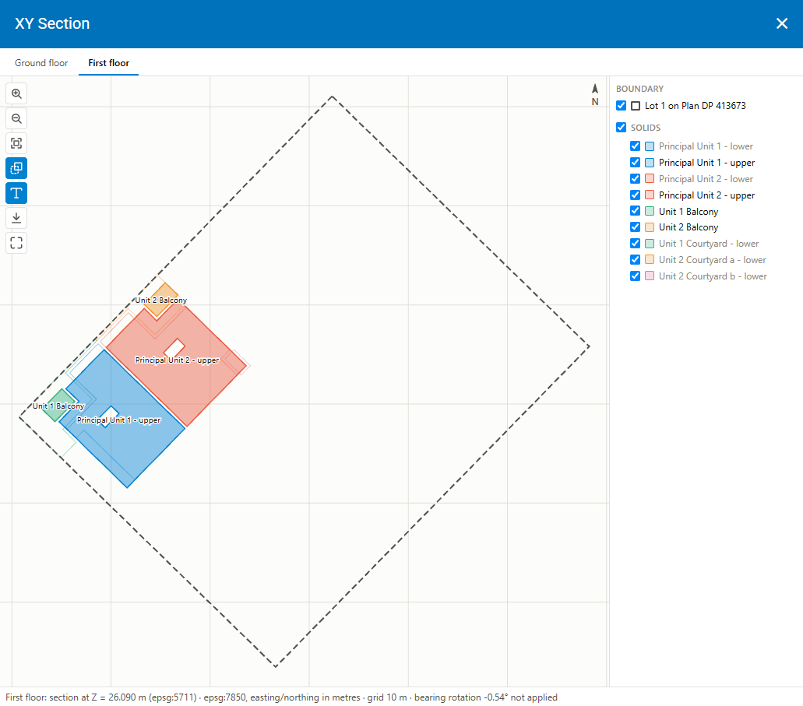
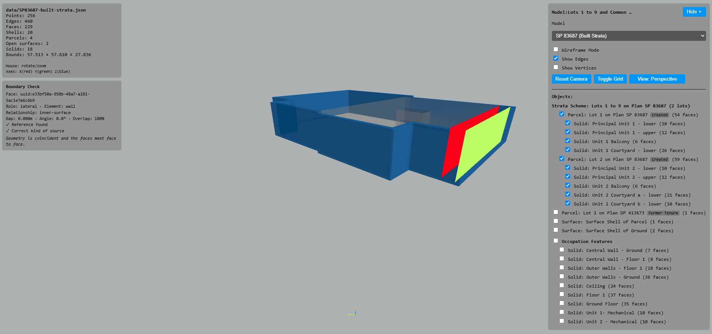
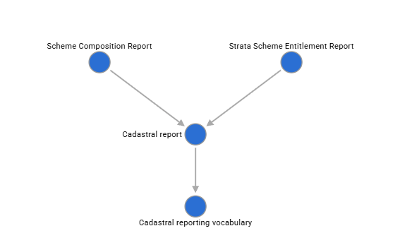
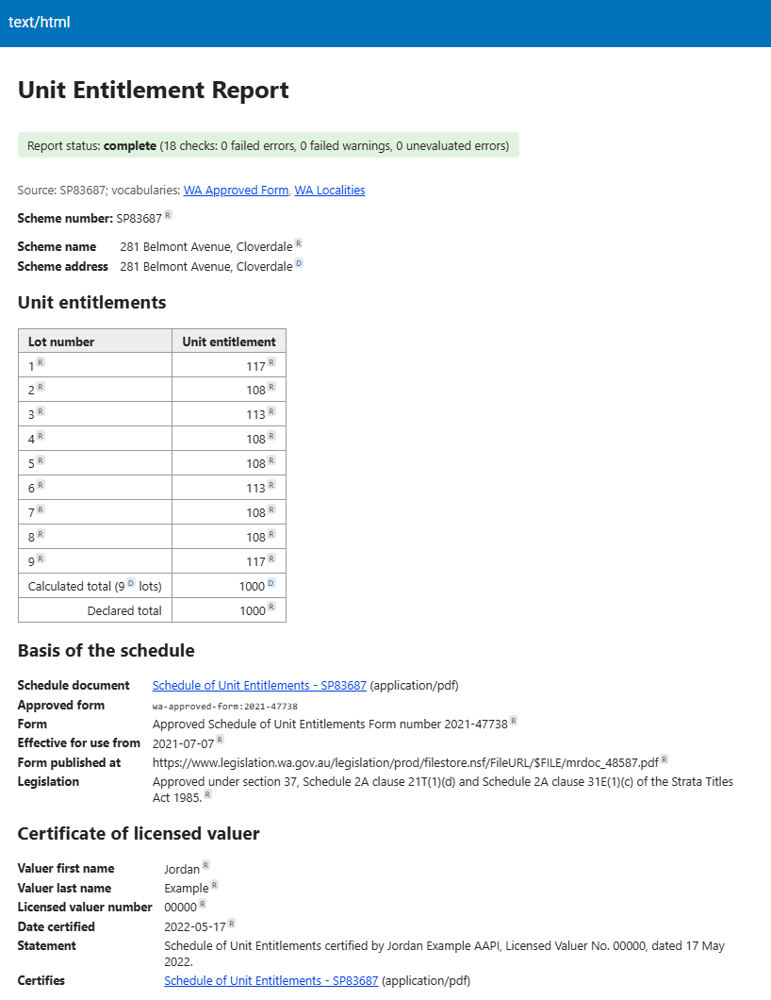

<!-- TITLE PAGE -->

#### Accenture Australia Pty Ltd

# Spatial WA – Next Generation Spatial Cadastre (NGSC)

## End of project report

Prepared by: 
Surround Australia Pty Ltd (SURROUND)

**Date:** 2026-11-02

<!--
Date: 2026-10-15
Convert to PDF using `print_to_pdf`
Organisation: Edge Geomatics Limited
-->

<!-- TOC -->

## Table of contents
1.  [Executive summary](#executive-summary)
2.  [Project context, scope, and approach](#project-context-scope-and-approach)
3.  [Deliverables and outcomes](#deliverables-and-outcomes)
4.  [Consolidated technical and strategic findings](#consolidated-technical-and-strategic-findings)
5.  [Strategic assessment: strengths, gaps, opportunities, and risks](#strategic-assessment-strengths-gaps-opportunities-and-risks)
6.  [Opportunities to strengthen NGSC delivery and capability](#opportunities-to-strengthen-ngsc-delivery-and-capability)
7.  [Implementation roadmap and engagement opportunities](#implementation-roadmap-and-engagement-opportunities)
8.  [Conclusions and recommended next steps](#conclusions-and-recommended-next-steps)
9.  [References](#references)
<!--
Sections 1–3 establish what was undertaken and delivered; 
Sections 4–5 explain what was learned and what remains uncertain; 
Sections 6–8 establish where the programme could go next and the value of doing so.
-->

##### Revision history

| Version | Status | Date       | Author        | Description  |
|---------|--------|------------|---------------|--------------|
| 0.1     | Draft  | 2026-10-15 | Andrew Hunter | Initial TOC  |
| 0.2     | Draft  | 2026-10-27 | Andrew Hunter | Draft Report |

This document is complete as of the date of presentation to Accenture. 

<!-- CONTENT -->

## Executive summary
<!-- 
2 - 3 pages

Summarise the engagement, the 34 requirement assessments, key findings and their contribution to NGSC implementation.
Emphasise reduced technical uncertainty, clarified responsibilities and an implementable approach to 3D cadastral information.
End with three to five priority recommendations: what should happen next and why it matters.

Do last
-->

## Project context, scope, and approach
<!-- 
2 - 3 pages

State SURROUND's objectives and its relationship to Accenture, Landgate and the NGSC programme.
Describe the methodology across the five deliverables: requirement interpretation, NGSC responsibilities, 3D CSDM alignment, technical constraints, acceptance criteria and dependencies.
Clarify the split of responsibility between SURROUND and the NGSC implementation team.
Show how contracted machine-readable specifications and other technical outputs were addressed, referencing artefacts where they exist.
-->

This section outlines SURROUND's role in the Western Australian Next Generation Spatial Cadastre (NGSC) project, its contractual responsibilities, and the approach adopted across the five deliverables. 
It also describes the requirements analysis methodology, supporting technical development, collaboration, and knowledge transfer.

### NGSC programme context and objectives

The Next Generation Spatial Cadastre (NGSC) project forms part of Landgate's broader Spatial WA programme. 
Its objectives include modernising cadastral information management, supporting the transition from two-dimensional to three-dimensional cadastral representations, improving data quality and validation, and enabling integration with contemporary spatial information systems.

Accenture is the prime contractor responsible for delivering the NGSC solution to Landgate. 
Accenture engaged SURROUND Australia to provide specialist cadastral information modelling, standards development, and technical advice, particularly concerning the Intergovernmental Committee on Surveying and Mapping (ICSM) [3D Cadastral Survey Data Model](https://icsm-au.github.io/3d-csdm/) (3D CSDM) [@atkinson_3d_2022;].

SURROUND's primary objective was to translate relevant NGSC requirements into standards-aligned information specifications suitable for implementation and testing. 
This involved identifying applicable standards, determining where Western Australian extensions were necessary, and highlighting dependencies on NGSC system design or business decisions.

A central consideration was that the 3D CSDM defines cadastral information for exchange, rather than the complete NGSC system. 
The work therefore distinguished information modelling responsibilities from the applications, services, and business processes needed to operate the spatial cadastre.

The broader objective was to establish a consistent, reusable standards-based foundation for NGSC development, with potential application beyond Western Australia.

### Contractual scope and responsibilities

SURROUND was engaged under a 12-month subcontract to Accenture. 
Its scope covered requirements analysis, specialist data design, co-design, development of CSDM profiles and specifications, technical constraint assessment, validation, and proposed acceptance criteria.

The Statement of Work distinguished between requirements for which SURROUND was responsible for specified CSD and 3D CSDM outputs and those where it provided specialist support to the Accenture implementation team.

For the nominated CSD and 3D CSDM requirements, contracted outputs included machine-readable schemas, ontologies, example datasets, validation rules, and transformation specifications, where applicable. 
Supporting documentation, test cases, and acceptance criteria were also required.

For other requirements, SURROUND provided technical advice on cadastral information modelling, standards, constraints, and dependencies, together with input to acceptance criteria.

Accenture retained overall responsibility for programme management, solution architecture, system development, integration, and delivery. 
Landgate retained responsibility for confirming business requirements, jurisdictional policy, and operational decisions. 
SURROUND's role was to inform these activities through specialist analysis and technical specifications.

This distinction was particularly important where requirements combined cadastral information modelling with NGSC functionality. 
For example, the 3D CSDM can define and validate cadastral information, while user interfaces, workflows, APIs, and operational controls remain NGSC implementation responsibilities.

Where requirements depended on unresolved business, policy, or architectural decisions, these were identified as dependencies rather than assuming decisions on behalf of Accenture or Landgate.

### Requirements analysis methodology

The five deliverables addressed 34 requirements covering cadastral data growth, standards, 3D representation, survey information, boundary management, metadata, validation, interfaces, and related business functions.

Although the reporting format evolved, the analysis followed six consistent considerations:

1. Requirement interpretation: Establish the intended business capability and identify ambiguities or gaps.
2. NGSC responsibilities: Identify the functionality expected of the NGSC applications, services, and workflows.
3. 3D CSDM alignment: Assess existing standards and identify necessary extensions or implementation patterns.
4. Technical constraints: Consider data availability, geometric integrity, validation, transformation, and interoperability.
5. Potential acceptance criteria: Define testable outcomes and verification methods without unnecessarily prescribing implementation design.
6. Dependencies and decisions: Identify outstanding business, policy, and technical matters requiring resolution.

Later deliverables adopted a consistent structure comprising the original WA requirement, analysis, NGSC System Perspective, 3D CSDM Perspective, and proposed acceptance criteria.

SURROUND prepared the requirements analysis and 3D CSDM perspective. 
The NGSC System Perspective was reserved for the implementation team, maintaining a clear distinction between information modelling and system design responsibilities.

Not all requirements could be resolved through information modelling alone. 
Issues involving metadata governance, lodgement workflows, system ownership, historical survey information, and certain 3D geometric operations required further decisions. 
Recording these dependencies was an important outcome, providing direction for subsequent design and implementation.

### Machine-readable specifications and technical outputs

Technical development accompanied the requirements analysis to support contracted machine-readable specifications and investigate practical implementation approaches.

Work included the Western Australian 3D CSDM profile, common model components, controlled vocabularies, cadastral example datasets, and topology and validation functions. 
Supporting proof-of-concept developments included 3D and sectional viewers, reporting components, topology validation tools, and survey calculation utilities.

These outputs were managed through GitHub repositories, providing traceable, reusable specifications, examples, validation rules, and supporting software. 
The principal workstreams included the WA 3D CSDM profile, ICSM vocabularies, common CSDM components, Topo Feature, and topology validation functions.

The technical artefacts complement the written requirements analysis and demonstrate potential implementation approaches. 
Their applicability, maturity, and relationship to individual contractual requirements are examined in later sections of this report.

### Engagement, collaboration, and knowledge transfer

SURROUND supported Accenture through specialist technical advice, collaborative requirements analysis, and standards-based development. 
The approach involved working with Accenture, its spatial implementation team, and Landgate to clarify requirements, technical considerations, and acceptance expectations.

Collaboration was necessary because cadastral requirements span several responsibilities. 
Survey and land administration practices establish the meaning of the information, standards define its representation and exchange, and the NGSC implementation determines how it is managed operationally.

The requirements reports, proposed acceptance criteria, documented dependencies, and technical examples provided a common reference for design discussions, implementation planning, and verification.

Knowledge transfer was supported through documentation, shared repositories and reusable examples and validation components. 
Technical development adopted open standards and the [OGC Building Blocks](https://ogcincubator.github.io/bblocks-docs/) [@ogc_ogc_2026;] approach, enabling specifications and supporting artefacts to be published, tested, and maintained independently of individual applications.

Collectively, the work established a reusable foundation for continued NGSC development and further refinement of the Australian 3D CSDM. 
Its longer-term value will depend on the adoption, integration, and verification of these outputs within the NGSC solution.

## Deliverables and outcomes

This section summarises SURROUND's five deliverables, covering 34 allocated requirements from the Western Australian Next Generation Spatial Cadastre (NGSC) Software Requirements Specification.
It outlines the principal outcomes, technical contributions, proposed acceptance criteria, and remaining dependencies.

The work established a structured interpretation of the requirements and a standards-based foundation for NGSC development.
Supporting technical work produced specifications, example datasets, validation capabilities, and proof-of-concept applications.

### Summary of the five deliverables

The five deliverables were undertaken progressively, reflecting the NGSC programme schedule and SURROUND's allocated requirements.
They covered foundational data standards and scalability through to cadastral information modelling, system interfaces, and 3D boundary management.

#### Table 1: The five deliverables
| Deliverable | Requirements | Principal focus                                                                                                                                 |
|-------------|--------------|-------------------------------------------------------------------------------------------------------------------------------------------------|
| 1           | 1            | NGSC data growth, scalability, transition to 3D and initial geometry and topology validation requirements.                                      |
| 2           | 10           | Geographical and Aboriginal naming, ABS Data Quality Framework and government data standards, including data governance and quality assessment. |
| 3           | 15           | Cadastral editing, 3D visualisation, survey data exchange, boundary relationships, workflows and APIs.                                          |
| 4           | 6            | Survey control and observations, metadata, plan lodgement, validation and boundary relationships.                                               |
| 5           | 2            | Metadata feedback workflows and 3D boundary alignment, including unresolved workflow and geometric constraints.                                 |
| **Total**   | **34**       |                                                                                                                                                 |

> **Note**: Requirement NN01.02.026, concerning Aboriginal naming and dual naming of geographic features, was moved out of scope in December 2025.

Deliverables 1 and 2 concentrated on foundational capabilities, including 3D data growth, geometric integrity, data quality, and standards compliance.
Deliverables 3 and 4 addressed operational requirements, particularly the exchange and management of survey information, boundary relationships, validation and system interfaces.
Deliverable 5 clarified two requirements requiring additional definition: metadata feedback workflows and geometric constraints for 3D boundary alignment.

Collectively, the deliverables clarified expected capabilities, identified applicable standards, and highlighted technical and business decisions required for implementation.

### Coverage of the 34 NGSC requirements

The five reports document the analysis of 34 allocated requirements, with the depth of assessment reflecting each requirement's relevance to the 3D CSDM and SURROUND's contracted responsibilities.
Coverage included cadastral information and survey observations; geometry, topology, and boundary relationships; data exchange; metadata and data quality; and operational workflows.

Several consistent findings emerged.

**The 3D CSDM provides a common foundation for cadastral information exchange.**
It supports structured representation of parcels, survey observations, geometry, topology, relationships, and provenance.
Western Australian profiles and business rules extend this foundation where jurisdiction-specific requirements apply.

**Cadastral information modelling and NGSC operational functionality have distinct responsibilities.**
The 3D CSDM describes the information being exchanged, while NGSC provides the applications, services, workflows, and controls needed to manage it.
Maintaining this distinction supports interoperability and avoids unnecessary extensions to the data model.

**Automation requires reliable information and controlled validation.**
Incomplete observations, ambiguous boundary relationships, or insufficient geometric constraints can produce uncertain outcomes.
These situations require defined business rules, exception handling or Editor intervention rather than automatic acceptance.

**Provenance and traceability are essential.**
Imported, converted, or modified cadastral information should remain linked to its source evidence and processing history.

The individual reports provide detailed assessments, proposed acceptance criteria, and outstanding issues.
A consolidated requirements traceability matrix is proposed for Appendix [X], linking requirements to deliverables, technical artefacts, and dependencies.

### Technical and architectural contributions

Technical development accompanied the requirements analysis to investigate implementation approaches and produce reusable specifications and components.

The principal contribution was the development and refinement of the Western Australian 3D CSDM profile.
This included cadastral geometry, boundary relationships, controlled vocabularies, and jurisdiction-specific representation requirements, particularly for complex built-strata parcels.

Other developments addressed topology and geometry validation, survey data exchange, visualisation, reporting, and survey processing.
Proof-of-concept applications were used to investigate 3D viewing, horizontal sections, and survey calculations.

The work adopted the [OGC Building Blocks](https://ogcincubator.github.io/bblocks-docs/) [@ogc_ogc_2026;] approach where applicable, supporting machine-readable schemas, semantic definitions, examples, and automated validation.

The GitHub repositories provide traceability to these developments:

#### Table 2: Technical outputs and principal repositories
| Technical output                                    | Principal repositories                 |
|-----------------------------------------------------|----------------------------------------|
| WA 3D CSDM profile, schemas and cadastral examples  | `3d-csdm-profile-wa`, `3d-csdm-common` |
| Controlled vocabularies and semantic definitions    | `icsm-vocabs`, `3d-csdm-profile-wa`    |
| Topological representation and validation functions | `topo-feature`, `topo-functions`       |
| 3D visualisation prototypes                         | `bblocks-viewer-topo-feature-plugin`   |

<!--
`bblocks-xy-section-viewer`, `bblocks-3d-csdm-reporting`, `angles-to-bearings`, and `bblocks-cesium-viewer` proof of concept private repositories to be discussed in next section, but only with images
-->

The contract also identified transformation specifications and testing for converting existing cadastral survey formats into 3D CSDM.
The requirements analyses established expected transformation behaviour, including validation, preservation of source information, and handling of incomplete records.

These repositories provide a technical foundation for NGSC development, although individual artefacts remain at different stages of maturity.
Further assessment is required to confirm their completeness, standards compliance, and readiness for implementation.

### Acceptance criteria and validation readiness

The five deliverables translated high-level requirements into more specific, testable acceptance criteria.
These generally identify expected capabilities, verification methods, and, in later deliverables, verification types.

The criteria address information and operational requirements, including 3D CSDM conformance, topology validation, preservation of survey evidence, handling invalid submissions, and expected workflow and API behaviour.

Supporting development produced example datasets, validation rules, and reusable checking functions that can help automated testing and reduce manual inspection.

An important distinction remains between **data conformance** and **system acceptance**.
Schemas and validators can establish compliance with structural, semantic, and geometric rules, but cannot demonstrate that operational workflows, performance, permissions, or system integration meet NGSC requirements.

The proposed acceptance criteria therefore provide a basis for implementation testing rather than evidence of completed or accepted NGSC functionality.
Final criteria and test cases require agreement with Accenture and Landgate, supported by representative test data and expected results.

### Status of outputs and remaining dependencies

The five deliverables document the requirements analysis and proposed acceptance criteria, supported by technical specifications, examples, and software components at varying stages of development.

The principal outstanding matters fall into three categories.

**Technical specification and validation readiness.**
Further work is required to confirm traceability between contracted requirements and machine-readable schemas, ontologies, example datasets, validation rules, transformation specifications, and standards-conformance evidence.

**NGSC implementation decisions.**
Several requirements depend on unresolved system architecture and business-process decisions, including metadata governance, plan lodgement, validation workflows, system ownership, APIs, and integration with other Landgate systems.
The NGSC System Perspective, reserved for the implementation team in Deliverables 3–5, remains incomplete in the supplied reports.

**Jurisdictional and geometric rules.**
Further definition is required for aspects of boundary alignment, legally defined 3D boundaries, historical survey information, and incomplete observations.

These dependencies require consideration during subsequent NGSC design and implementation.
Many reflect decisions reserved for Landgate or the implementation team rather than limitations of the 3D CSDM.

Overall, SURROUND's engagement established a foundation of requirements analysis and supporting technical development.
The next stage is to consolidate these outputs into an agreed implementation and validation baseline, resolve remaining dependencies, and confirm their integration into the NGSC solution.

## Consolidated technical and strategic findings
<!-- 
4 - 6 pages

Synthesise recurring issues across the 34 assessments: NGSC–3D CSDM alignment, legacy survey data transformation, 3D topology and boundary semantics, metadata governance, and the split between data-model and application-workflow responsibilities.

Include discussion of `bblocks-xy-section-viewer`, `bblocks-3d-csdm-reporting`, `angles-to-bearings`, and `bblocks-cesium-viewer` proof of concept private repositories

Include a decision register?
-->

## Consolidated technical and strategic findings

The analysis of the 34 NGSC requirements identified recurring technical and architectural issues extending beyond individual requirements.
These concern the adoption of the 3D CSDM, integration of legacy survey information, 3D boundary representation, validation, metadata governance, and the relationship between information standards and NGSC applications.

Supporting technical development investigated these issues through extensions to the 3D CSDM, machine-readable specifications, validation functions, and proof-of-concept applications.
This work provides a foundation for NGSC implementation while identifying decisions requiring further consideration by Landgate and the implementation team.

The principal finding is that a standards-based cadastral information model provides a consistent basis for data exchange and validation, but must be supported by clearly defined business rules, application workflows, and system architecture.

### 3D CSDM alignment and WA profile development

The 3D CSDM provides a foundation for representing and exchanging cadastral information required by NGSC.
Its principal value is the consistent representation of parcels, survey observations, geometry, topology, legal interests, and provenance independently of the applications that manage them.

The requirements analysis confirmed that much of the information needed by NGSC can be represented using the existing 3D CSDM.
However, Western Australian cadastral practices require additional constraints, controlled vocabularies, and implementation patterns.
These should be addressed through jurisdictional profiles rather than unnecessary changes to the common model.

Development of the [WA 3D CSDM profile](https://surroundaustralia.github.io/3d-csdm-profile-wa/) and [3D CSDM common components](https://surroundaustralia.github.io/3d-csdm-common/) has supported this approach.
Related work on the [ICSM LandParcels vocabularies](https://surroundaustralia.github.io/icsm-vocabs/) has provided a mechanism for defining and reusing consistent cadastral terminology.

An important outcome has been the investigation of complex 3D parcel representations, particularly *liminal parcels*, where vertical limits are defined relative to a reference surface, and built-strata schemes, where legal boundaries reference physical building elements.
These require more than geometric descriptions of parcel solids.
They must also express how boundaries are legally defined, including relationships to building elements, reference surfaces, and other cadastral boundaries.

The liminal and built-strata developments have explored these relationships through explicit boundary definitions, parcel components, derived geometry, and associated validation rules.
This work is relevant to NGSC requirements concerning 3D viewing, boundary relationships, independent boundaries, and editing of 3D cadastral geometry.

The broader architectural implication is that the 3D CSDM should remain the common information standard, with jurisdictional profiles providing additional semantics and validation rules.
Concepts with wider application should be considered for incorporation into the common model or shared vocabularies rather than remaining exclusively within the WA profile.
This approach supports national consistency, limits duplication, and provides a maintainable basis for future extensions.

### Cadastral data exchange and interoperability

Requirements concerning the import of lodged surveys, survey observations, mining cadastral information, and existing CSD formats identified the need for a consistent approach to data exchange.

The recommended architecture is to use the 3D CSDM as the normalised survey-package representation for downstream processing.
Native 3D CSDM datasets can be processed directly, while legacy CSD formats can be transformed at the system boundary.
This reduces the need for separate processing and validation pathways and provides a common basis for applying jurisdictional profiles and business rules.

**Transformation must preserve the meaning and evidence of the original survey information.**
Original observations, identifiers, quality information, reference information, and provenance should remain available wherever supported by the source data.

The analysis identified circumstances where legacy information may be incomplete, including missing bearings, incomplete observations, uncertain control connections, and absent vertical information.

The [angles-to-bearings](https://github.com/andrewhunter2066/angles-to-bearings) proof of concept investigates one aspect of this problem.
It explores the calculation of line bearings from survey observations, including known azimuths and angles measured between survey lines, as required by WA standard survey practice.
The work is relevant to requirement NF02.03.071: Accept angles and bearings when a plan is imported, and the broader processing of Western Australian [APX-05](https://www.landgate.wa.gov.au/land-and-property/land-transactions-hub/land-transaction-policy-and-procedure-guides/survey-and-plan/appendices/apx-05-digital-data-format-specification-version-2.0) survey information [@landgate_apx-05_2022;].

The development demonstrates the potential to recover mathematically derivable information from existing observations.
However, derived bearings must remain distinguishable from original survey measurements, with their derivation and supporting evidence recorded.

Requirements concerning cadastral connections to survey control also identified the need to accommodate complete 3D observations and controlled 2D fallback representations.
A 2D observation should not be treated as sufficient for 3D adjustment without the necessary vertical information.

Interoperability development has been supported by the [Topo Feature](https://surroundaustralia.github.io/topo-feature/) model and [topo-functions](https://github.com/ogcincubator/topo-functions).
These provide reusable approaches to representing, processing, and validating topological geometry independently of a particular cadastral application.

The strategic direction is to separate source-format ingestion from common cadastral validation and processing.
Further work is required to specify supported transformations, document information loss or unresolved source content, and establish representative conformance tests.

### 3D geometry, topology, and boundary representation

The transition to a three-dimensional spatial cadastre introduces geometric and topological requirements substantially more complex than those associated with conventional 2D parcels.

Deliverable 1 (NN06.02.001: NGSC data growth) identified the need for valid 3D geometry and topology as part of NGSC data growth.
Subsequent assessments extended these considerations to boundary editing, relationships, visualisation, survey import, and validation.

A recurring finding is that geometric validity and cadastral validity are related but distinct.
A parcel may be geometrically well-formed while its legal boundary definitions or relationships to adjoining parcels remain incorrect.

The technical development has therefore investigated geometric integrity, topological consistency, and cadastral boundary semantics, see [WA 3D CSDM Topology Rules](https://github.com/ogcincubator/topo-functions/blob/main/topo_validator/topology_rules.md).
The [topo-functions](https://github.com/ogcincubator/topo-functions) development provides reusable geometry processing and validation functions to support these assessments.

An important issue is the distinction between a boundary's coordinates and the legal basis on which it is defined.
For built-strata parcels, boundaries may reference the inner surface, outer surface, or centre plane of a building element rather than solely a fixed set of coordinates.

The WA profile development has explored how these relationships can be represented explicitly and associated with derived parcel geometry.
This supports validation and provides a basis for reconstructing or reviewing boundaries when referenced information changes.

Requirement NF02.03.073: Change alignment type for 3D edge, reinforced the importance of precise geometric semantics.
A 3D edge described as perpendicular to another edge is not uniquely determined without additional constraints, such as a reference plane, anchor point, or surface.
Similarly, parallel alignment requires enough information to establish the intended offset and resulting position.

These rules must be defined before reliable editing and acceptance criteria can be established.
A related decision is whether such relationships represent enduring legal boundary definitions or temporary editing constraints.
Only relationships with continuing cadastral significance necessarily require representation in the 3D CSDM encoding.

**Visualisation has also been an important part of the technical investigation.**

The [bblocks-viewer-topo-feature-plugin](https://github.com/ogcincubator/bblocks-viewer-topo-feature-plugin) provides interactive 3D visualisation of Topo Feature datasets using [Three.js](https://threejs.org).
It supports inspection of points, edges, faces, shells, and solids, with presentation controlled through configurable rendering rules.

A significant architectural feature is its independence from cadastral and jurisdiction-specific vocabularies.
Individual OGC Building Blocks can supply their own visualisation configurations without modifying the viewer software, allowing the component to support different information models and applications.

<figure class="fig fig-wide">
  
  <figcaption id="figure-1-topo-viewer">Figure 1: Topo-Feature Viewer</figcaption>
</figure>

[Figure 1](#figure-1-topo-viewer) shows the Topo Feature Viewer displaying five solids representing a two-storey building comprising four units and a common accessway.
The viewer supports navigation and control over the visibility of individual cadastral solids.

A similar proof of concept has been developed using [Cesium](https://cesium.com/) to investigate browser-based 3D cadastral visualisation with geographic context.

<figure class="fig fig-wide">
  
  <figcaption id="figure-2-cesium-viewer">Figure 2: Cesium Viewer</figcaption>
</figure>

[Figure 2](#figure-2-cesium-viewer) depicts a solid parcel with a footprint and vertical limits (`zMin` and `zMax`) defined relative to ground level.
Cesium imagery and terrain provide additional context for the parcel geometry.

A horizontal section viewer proof of concept (PoC) was also developed to investigate the generation of 2D sections from 3D cadastral information.
It directly supports requirement NF02.02.027: 2D view of level in a building, by deriving floor-based representations from the underlying 3D geometry.

<figure class="fig fig-wide">
  
  <figcaption id="figure-3-ground-floor">Figure 3: Ground floor; Lots 1 and 2 of Built Strata Plan with parent parcel outline</figcaption>
</figure>

[Figure 3](#figure-3-ground-floor) illustrates the ground-floor section generated from a 3D CSDM built-strata dataset.
Principal units, courtyards, and associated parcel components are distinguished by colour, with the parent parcel boundary shown as a dashed outline.
Users can select building levels and control the visibility of individual components.

<figure class="fig fig-wide">
  
  <figcaption id="figure-4-first-floor">Figure 4: First floor; Lots 1 and 2 of Built Strata Plan with ground floor and parent parcel outlines</figcaption>
</figure>

[Figure 4](#figure-4-first-floor) shows the corresponding first-floor section, including principal units, balconies, and outlines of ground-floor parcel components.
Together, Figures 3 and 4 demonstrate how individual building levels can be viewed while retaining their relationship to the wider cadastral structure.

The Topo Feature Viewer was also extended as a PoC to inspect built-strata boundary definitions and their relationships to referenced building elements.

<figure class="fig fig-wide">
  
  <figcaption id="figure-5-built-strata-bdy-def">Figure 5: Visualise built strata boundary definition</figcaption>
</figure>

[Figure 5](#figure-5-built-strata-bdy-def) illustrates the inspection of a boundary definition within built-strata dataset SP83687.
The selected cadastral boundary face is shown in red, its referenced building-element face in green, and the associated wall occupation feature in blue.
The wall has been displaced for visualisation, allowing the relationship between the selected faces to be inspected.
The diagnostic panel identifies the boundary relationship as `inner-surface` and reports geometric coincidence and validation results.

This capability demonstrates how visual inspection and automated diagnostics can support verification of complex 3D cadastral boundary definitions.

Collectively, the viewers demonstrate different presentation and inspection capabilities using a common information model.
They remain proof-of-concept developments requiring further work on performance, interaction, presentation conventions, and NGSC integration.

The principal finding is that geometry, topology, and legal boundary semantics must be considered together.
Visualisation and editing tools should support the interpretation of authoritative cadastral information without independently redefining its meaning.

### Metadata, data quality, and standards compliance

Metadata and data quality requirements were addressed across several deliverables, particularly Deliverable 2 and subsequent assessments concerning metadata standards, dataset metadata, and feedback.

The assessment of the Australian Bureau of Statistics Data Quality Framework and government standards highlighted the distinction between data quality characteristics and the mechanisms used to manage and demonstrate compliance.

The 3D CSDM provides source information, including dataset identifiers, survey purpose, coordinate reference information, provenance, and cadastral content.
However, it does not define the complete NGSC data catalogue or associated governance processes.

The NGSC Metadata Profile should establish required catalogue information, its relationship to source datasets, and applicable Spatial WA standards.
Where metadata can be derived from 3D CSDM information, the mapping should be explicit and repeatable.
Operational custodianship, quality assessments, maintenance status, and other catalogue information may need to be maintained by NGSC or responsible external systems.

Requirement NF02.02.036: Metadata for my NGSC dataset, demonstrated that metadata governance also requires operational functionality.
It combines an interface for reporting metadata issues with a managed workflow for their review and resolution.

The workflow must retain references to the catalogue record and, where appropriate, the underlying cadastral dataset.
The 3D CSDM can provide stable identifiers and source context without being extended to represent workflow states, assignments, or issue resolution.

The requirements analysis also identified the need for validation against nominated standards and profiles.
This may involve JSON Schema, semantic constraints, controlled vocabularies, and additional validation rules that cannot be adequately expressed through schema validation alone.

The OGC Building Blocks approach provides a framework for publishing these specifications, examples, and validation resources while distinguishing reusable standards components from jurisdiction-specific requirements.

The remaining challenge is to establish the authoritative NGSC Metadata Profile, allocate responsibility for maintaining individual metadata elements, and define how compliance will be tested and reported.

### Cadastral workflows, APIs, and system integration

The analysis of plan lodgement, validation, approval, cadastral editing, survey import, and associated APIs identified the need to distinguish cadastral information exchange from the business processes acting upon that information.

The 3D CSDM provides structured cadastral information, but does not define operational workflows, application states, permissions, or transaction management.

For example, importing a survey requires NGSC to identify the appropriate dataset, match existing records, apply business rules, resolve conflicts, and control changes to authoritative information.
The assessment of non-geodetic control import illustrates this distinction.
The 3D CSDM can identify candidate survey points and observations, while NGSC must determine which should be maintained and how duplicates or conflicts are resolved.
Where necessary, these decisions require Editor intervention.

Plan lodgement and validation also depend on agreed responsibilities across NGSC and other Landgate systems.
Their roles in receiving, examining, approving, and maintaining survey information must be established before API contracts and workflows can be finalised.

The analysis highlighted the importance of explicit workflow states, stable identifiers, versioning, validation reporting, and transaction integrity.
Multistep operations must avoid leaving incomplete or inconsistent records when processing fails.

**Cadastral reporting infrastructure provides a further example of separating structured information from application-specific outputs.**

A generic reporting tool was developed as a PoC to investigate whether the 3D CSDM contains the information required for Western Australian cadastral reports.
Its initial application to strata scheme entitlement reporting explored the transformation of structured cadastral information into a human-readable report.

The development established reusable reporting infrastructure using OGC Building Blocks.
It separates source-data interpretation, report-specific calculations and validation, and presentation.
A common Cadastral Report component provides shared report structures, provenance, validation results, and processing status, while specialised components support individual report types.

<figure class="fig fig-wide">
  
  <figcaption id="figure-6-report-bblock">Figure 6: Cadastral Reporting Building Block</figcaption>
</figure>

[Figure 6](#figure-6-report-bblock) illustrates the modular architecture of the reporting infrastructure.
Strata Scheme Entitlement and Scheme Composition reports build upon the common Cadastral Report component and shared reporting vocabulary.
This provides a reusable foundation for developing further cadastral reports without creating separate reporting infrastructure for each report type.

<figure class="fig fig-wide">
  
  <figcaption id="figure-7-ue-report">Figure 7: Potential Unit Entitlement Report</figcaption>
</figure>

[Figure 7](#figure-7-ue-report) shows a Unit Entitlement Report generated from a 3D CSDM dataset.
It includes scheme details, individual lot entitlements, calculated and declared totals, supporting documents, and licensed valuer certification information.
Automated validation results and source references provide transparency and traceability.

The reporting infrastructure has also been demonstrated through Scheme Composition reports and supports machine-readable report definitions, semantic validation, and HTML and CSV outputs.
This illustrates how NGSC could integrate consistent, traceable reporting into cadastral workflows and APIs using a common information model.

The [bblocks-land-parcels](https://github.com/ogcincubator/bblocks-land-parcels) development provides a further reference point for reusable land-parcel information components.

The broader architectural finding is that NGSC should use well-defined information standards at its interfaces while retaining responsibility for orchestration, transactions, business rules, and authoritative data management.
This separation supports maintainable applications and reduces dependence on particular implementation technologies.

### Cross-cutting dependencies and architectural decisions

The requirements analysis and supporting technical work identified decisions affecting multiple NGSC capabilities.
Resolving these independently risks duplication, inconsistent behaviour, and unnecessary extensions to the information model.

The following decision register consolidates the principal matters requiring further consideration.

#### Table 3: Consolidated architectural decisions requiring confirmation or further development

| ID | Architectural decision | Recommended direction | Primary responsibility |
|---|---|---|---|
| AD-01 | Role of 3D CSDM in NGSC information exchange | Adopt 3D CSDM as the normalised survey-package representation, with jurisdictional profiles and source-format transformations. | Accenture / Landgate |
| AD-02 | Governance of WA profile extensions and vocabularies | Maintain jurisdictional extensions in the WA profile and promote generally applicable concepts to shared standards. | Landgate / ICSM / standards custodians |
| AD-03 | Legacy CSD transformation and incomplete observations | Define supported transformations, provenance requirements, information-loss reporting, and controlled handling of unresolved observations. | Accenture / Landgate |
| AD-04 | Geometry, topology, and cadastral validation | Establish separate but coordinated geometric, topological, and cadastral rule sets, with agreed tolerances and validation outcomes. | Landgate / Accenture |
| AD-05 | Authoritative 3D boundary relationships | Define which geometric relationships represent legal boundary definitions and which are temporary editing constraints. | Landgate |
| AD-06 | NGSC Metadata Profile and governance | Confirm metadata standards, source mappings, catalogue ownership, quality rules, and feedback workflows. | Landgate / Accenture |
| AD-07 | Plan lodgement, validation, and approval architecture | Confirm system ownership, workflow boundaries, API contracts, and transaction responsibilities. | Accenture / Landgate |
| AD-08 | Technical specification and acceptance baseline | Establish requirement-to-artefact traceability, agreed test datasets, conformance evidence, and final acceptance criteria. | Accenture / SURROUND / Landgate |

Several decisions are interdependent.
For example, the adopted 3D CSDM profile determines the information available for validation, while the NGSC workflow architecture determines when validation occurs and how failures are managed.
Similarly, authoritative 3D boundary relationships affect information modelling, editing, topology validation, and visualisation.

The technical developments provide a basis for resolving these decisions through representative datasets, executable validation rules, and proof-of-concept implementations.
Final architectural choices must, however, be agreed within the broader NGSC design and governance framework.

The principal strategic opportunity is to consolidate this work into a reusable, standards-based cadastral information and validation capability.
This would enable NGSC to support different survey data sources and cadastral applications while maintaining consistent information structures, validation rules, and provenance.

The same foundation may support wider adoption of the 3D CSDM, particularly where the developments address common cadastral requirements rather than Western Australian practices alone.

The immediate priority is to resolve the cross-cutting decisions, confirm the maturity and applicability of the technical artefacts, and establish an agreed implementation and validation baseline.
This would provide a clearer pathway from requirements analysis and technical investigation to operational NGSC capabilities.

## Strategic assessment: strengths, gaps, opportunities, and risks
<!-- 
2 - 3 pages

Analyse the readiness of the NGSC programme to realise the capabilities addressed through this engagement.
-->

### Strengths and capabilities established

### Capability gaps and areas requiring further development

### Opportunities for further value creation

### Risks to delivery and long-term sustainability

## Opportunities to strengthen NGSC delivery and capability
<!-- 
4–5 pages

Identify discrete work packages that could be jointly considered by SURROUND and Accenture
-->

### Prioritisation principles

### WA 3D CSDM profile and standards development

### Validation, testing, and quality assurance

### Data transformation and migration

### 3D cadastre implementation and demonstrators

### Integration, governance, and capability development

## Implementation roadmap and engagement opportunities
<!-- 
2–3 pages

Translate the future work programme into practical phases.
-->

### Immediate priorities and decision points

### Medium-term development opportunities

### Longer-term strategic opportunities

### Potential delivery and collaboration arrangements

## Conclusions and recommended next steps
<!--
1–2 pages

Conclude with an assessment of the engagement's contribution to NGSC
-->

### Overall assessment

### Decisions and actions recommended

### Pathway to future collaboration

## References

[Click here for references](final-report_refs.bib)