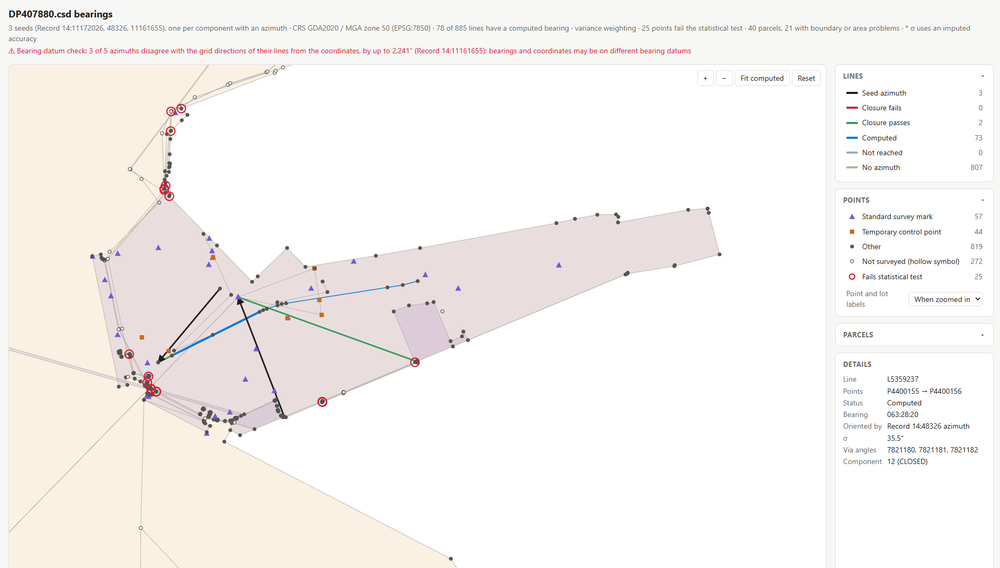

<!-- TITLE PAGE -->

#### Accenture Australia Pty Ltd

# Spatial WA – Next Generation Spatial Cadastre (NGSC)

## End of project report

Prepared by: 
Surround Australia Pty Ltd (SURROUND)

**Date:** 2026-11-02

<!--
Date: 2026-10-15
Convert to PDF using `print_to_pdf`
Organisation: Edge Geomatics Limited
-->

<!-- TOC -->

## Table of contents
1. [Executive summary](#executive-summary)
2. [Project context, scope, and approach](#project-context-scope-and-approach)
3. [Deliverables and outcomes](#deliverables-and-outcomes)
4. [Consolidated technical and strategic findings](#consolidated-technical-and-strategic-findings)
5. [Implementation roadmap and future opportunities](#implementation-roadmap-and-future-opportunities)
6. [Conclusions and recommended next steps](#conclusions-and-recommended-next-steps)
7. [References](#references)
8. [Appendices](#appendices)
<!--
Sections 1–3 establish what was undertaken and delivered; 
Sections 4–5 explain what was learned and what remains uncertain; 
Sections 6–8 establish where the programme could go next and the value of doing so.
-->

##### Revision history

| Version | Status | Date       | Author        | Description  |
|---------|--------|------------|---------------|--------------|
| 0.1     | Draft  | 2026-10-15 | Andrew Hunter | Initial TOC  |
| 0.2     | Draft  | 2026-10-27 | Andrew Hunter | Draft Report |

This document is complete as of the date of presentation to Accenture. 

<!-- CONTENT -->

## Executive summary
<!-- 
2 - 3 pages

Summarise the engagement, the 34 requirement assessments, key findings and their contribution to NGSC implementation.
Emphasise reduced technical uncertainty, clarified responsibilities and an implementable approach to 3D cadastral information.
End with three to five priority recommendations: what should happen next and why it matters.

Do last
-->

SURROUND Australia Pty Ltd (SURROUND) was engaged by Accenture Australia Pty Ltd to provide specialist cadastral information modelling, standards development, and technical advice in support of Landgate's Next Generation Spatial Cadastre (NGSC) project.
The engagement forms part of the broader Spatial WA programme, which aims to modernise cadastral information management, improve data quality and interoperability, and support the transition from two-dimensional to three-dimensional cadastral representations.

The engagement addressed **34 allocated requirements across five deliverables**, covering cadastral information standards, survey data exchange, geometry and topology, boundary management, metadata, validation, visualisation, workflows, and system interfaces.
One requirement concerning Aboriginal naming and dual naming was subsequently moved out of scope.

The primary objective was to translate relevant NGSC requirements into standards-aligned information specifications and implementation guidance, particularly through the Intergovernmental Committee on Surveying and Mapping (ICSM) 3D Cadastral Survey Data Model (3D CSDM) and its Western Australian profile.
The work also sought to identify technical constraints, clarify responsibilities, and establish proposed acceptance criteria suitable for subsequent implementation and verification.

### Principal outcomes

The five requirements assessments provided a structured interpretation of the allocated requirements, identifying applicable standards, information modelling requirements, technical considerations, and outstanding dependencies.
They distinguished capabilities supported by the 3D CSDM from those requiring implementation within NGSC applications, services, and business processes.

This distinction represents an important architectural outcome.
**The 3D CSDM provides a common standard for representing, exchanging, and validating cadastral information, but does not define the operational NGSC system.**
Accenture retains responsibility for the overall solution architecture and implementation, while Landgate retains responsibility for jurisdictional policy, business rules, and authoritative decisions.

Supporting technical development contributed to the Western Australian 3D CSDM profile, common information components, controlled vocabularies, example datasets, and geometric and topological validation functions.
The work adopted the Open Geospatial Consortium (OGC) Building Blocks approach where applicable, supporting the publication and reuse of machine-readable specifications, semantic definitions, examples, and validation resources.

Particular attention was given to complex 3D cadastral information.
Developments concerning liminal parcels and built-strata schemes investigated how legal boundaries can be defined relative to reference surfaces, building elements, and other cadastral features.
These approaches distinguish the legal basis of a boundary from its geometric representation and provide a foundation for deriving, validating, and visualising complex 3D parcels.

Proof-of-concept developments complemented the requirements analyses by demonstrating approaches to 3D visualisation, horizontal sectional views, boundary inspection, cadastral reporting, and the derivation of bearings from survey observations.
These investigations provided practical examples of how structured cadastral information could support NGSC functionality and helped clarify technical requirements that would otherwise remain largely conceptual.

### Key technical and architectural findings

The engagement identified several findings with implications extending beyond individual requirements.

**A consistent information architecture is essential for interoperability.**
The recommended approach is to use the 3D CSDM as the normalised representation for cadastral survey information, with legacy CSD formats transformed at the system boundary.
This would provide a common basis for validation and downstream processing while reducing the need for separate implementations for each source format.

**Survey evidence and provenance must be preserved.**
Transformation and automated processing should retain original observations, identifiers, quality information, and the basis for derived values wherever supported by the source data.
The investigation of bearing derivation from APX-05 observations demonstrated the importance of distinguishing observed survey information from values calculated using adjusted coordinates or incomplete observations.

**Geometric validity and cadastral validity are distinct.**
A geometrically valid parcel does not necessarily have legally correct boundary definitions or relationships.
The requirements analysis and supporting development identified the need for coordinated geometric, topological, and cadastral validation, including jurisdiction-specific rules for complex 3D boundaries.

**Information standards and operational responsibilities must remain clearly separated.**
The 3D CSDM can define survey information, metadata, boundary relationships, and validation requirements, while NGSC must manage workflows, permissions, transactions, authoritative records, and integration with other Landgate systems.
This distinction is particularly important for plan lodgement, approval, metadata management, survey import, and cadastral editing.

**Reusable specifications and validation capabilities offer longer-term value.**
The WA profile, common model components, vocabularies, and supporting tools provide a foundation for consistent implementation across NGSC.
Concepts with broader applicability may also contribute to national 3D CSDM development and related standards initiatives.

Collectively, these findings have **reduced technical uncertainty, clarified architectural and business responsibilities, and identified an implementable approach to managing three-dimensional cadastral information**.

### Implementation readiness and remaining dependencies

The engagement has established requirements analyses, proposed acceptance criteria, supporting technical specifications, and proof-of-concept developments that can inform NGSC design and implementation.

The associated development repositories remain works in progress, with individual artefacts at different stages of maturity.
Formal assessment of their completeness, standards compliance, and implementation readiness falls outside the scope of this engagement.

Several matters require further consideration before the full benefits of these developments can be realised.
These include confirmation of the NGSC information exchange architecture, completion of jurisdictional profiles and validation rules, treatment of incomplete historical survey information, and agreement on legally authoritative 3D boundary relationships.

Other dependencies concern metadata governance, plan lodgement and approval workflows, API responsibilities, integration with existing Landgate systems, and the establishment of agreed acceptance and conformance testing arrangements.

The requirements assessments and consolidated architectural decision register provide a basis for addressing these matters.
Many of the remaining decisions concern NGSC system design or Landgate business policy rather than limitations of the underlying cadastral information model.

### Priority recommendations

The immediate goal should be to consolidate the work undertaken and establish an agreed basis for NGSC implementation and verification.
Five priority actions are recommended.

1. **Resolve outstanding architectural and business decisions.**
   Confirm the information exchange architecture, system responsibilities, metadata governance, and rules governing authoritative 3D boundaries.
   This will reduce implementation uncertainty and avoid inconsistent decisions across individual NGSC capabilities.

2. **Align the technical findings with the NGSC Solution Architecture Document.**
   Incorporate relevant 3D CSDM profiles, information structures, validation requirements, and architectural constraints into the broader solution design.
   This will clarify how standards-based cadastral information is implemented through NGSC applications, services, and workflows.

3. **Establish a consistent validation and acceptance baseline.**
   Confirm proposed acceptance criteria, representative datasets, conformance tests, and validation responsibilities.
   This will provide a repeatable basis for assessing information quality and verifying NGSC requirements.

4. **Prioritise the adoption and refinement of existing technical components.**
   Review the WA profile, controlled vocabularies, topology validation functions, and supporting examples for their suitability within NGSC.
   Building upon these developments where appropriate will reduce duplication and protect the value of the work undertaken.

5. **Progress further development selectively.**
   Prioritise activities that address immediate implementation needs, resolve significant dependencies, or provide reusable capabilities across multiple requirements.
   Longer-term standards development and collaboration should be considered where there are clear benefits and agreed resources.

### Overall conclusion

The engagement has provided Accenture and Landgate with a clearer understanding of the information standards, technical constraints, and architectural decisions associated with implementing a modern 3D spatial cadastre.

The combination of requirements analysis, standards-based development, validation capabilities, and practical demonstrations establishes a foundation for subsequent NGSC implementation and the continued evolution of the 3D CSDM.

The recommended next step is to **consolidate and apply the capabilities already developed**, resolve the remaining architectural and jurisdictional decisions, and establish agreed verification arrangements.
This approach would support NGSC delivery while providing opportunities for broader reuse of the technical developments across WA business units.

## Project context, scope, and approach
<!-- 
2 - 3 pages

State SURROUND's objectives and its relationship to Accenture, Landgate and the NGSC programme.
Describe the methodology across the five deliverables: requirement interpretation, NGSC responsibilities, 3D CSDM alignment, technical constraints, acceptance criteria and dependencies.
Clarify the split of responsibility between SURROUND and the NGSC implementation team.
Show how contracted machine-readable specifications and other technical outputs were addressed, referencing artefacts where they exist.
-->

This section outlines SURROUND's role in the Western Australian Next Generation Spatial Cadastre (NGSC) project, its contractual responsibilities, and the approach adopted across the five deliverables. 
It also describes the requirements analysis methodology, supporting technical development, collaboration, and knowledge transfer.

### NGSC programme context and objectives

The Next Generation Spatial Cadastre (NGSC) project forms part of Landgate's broader Spatial WA programme. 
Its objectives include modernising cadastral information management, supporting the transition from 2D to 3D cadastral representations, improving data quality and validation, and enabling integration with contemporary spatial information systems.

Accenture is the prime contractor responsible for delivering the NGSC solution to Landgate. 
Accenture engaged SURROUND Australia to provide specialist cadastral information modelling, standards development, and technical advice, particularly concerning the Intergovernmental Committee on Surveying and Mapping (ICSM) [3D Cadastral Survey Data Model](https://icsm-au.github.io/3d-csdm/) (3D CSDM) [@atkinson_3d_2022;].

SURROUND's primary goal has been to translate relevant NGSC requirements into standards-aligned information specifications suitable for implementation and testing. 
This involved identifying applicable standards, determining where Western Australian extensions were necessary, and highlighting dependencies on NGSC system design or business decisions.

One of the main considerations was that the 3D CSDM defines cadastral information for exchange, rather than the complete NGSC system. 
The work therefore distinguished information modelling responsibilities from the applications, services, and business processes needed to operate the spatial cadastre.

The broader purpose of this work was to establish a consistent, reusable standards-based foundation for NGSC development, with consideration for potential application beyond Western Australia.

### Contract scope and responsibilities

SURROUND was engaged under a 12-month subcontract to Accenture. 
Its scope covered requirements analysis, specialist data design, co-design, development of CSDM profiles and specifications, technical constraint assessment, validation, and proposed acceptance criteria.

The Statement of Work distinguished between requirements for which SURROUND was responsible for specified CSD and 3D CSDM outputs and those where it provided specialist support to the Accenture implementation team.

For the nominated CSD and 3D CSDM requirements, contracted outputs included machine-readable schemas, ontologies, example datasets, validation rules, and transformation specifications, where applicable. 
Supporting documentation, test cases, and acceptance criteria were also required.

For other requirements, SURROUND provided technical advice on cadastral information modelling, standards, constraints, and dependencies, together with input to acceptance criteria.

Accenture retained overall responsibility for programme management, solution architecture, system development, integration, and delivery. 
Landgate retained responsibility for confirming business requirements, jurisdictional policy, and operational decisions. 
SURROUND's role was to inform these activities through specialist analysis and technical specifications.

**Contribution to solution architecture**

The NGSC Solution Architecture Document provides the overall architectural context for implementing the programme requirements, including applications, services, information structures, interfaces, workflows, and technical infrastructure.

SURROUND's contribution focused on the cadastral information architecture, particularly the 3D CSDM and its Western Australian profile, associated schemas, vocabularies, validation rules, and information exchange requirements.
The requirements analyses also identified architectural constraints, dependencies, and proposed acceptance criteria relevant to the NGSC solution design.

These outputs provide supporting material for incorporation into the broader NGSC Solution Architecture Document.
Responsibility for their integration into the overall solution architecture, including application design, system interactions, operational workflows, and technology decisions, rests with Accenture and the NGSC implementation team.

This distinction was particularly important where requirements combined cadastral information modelling with NGSC functionality. 
For example, the 3D CSDM can define and validate cadastral information, while user interfaces, workflows, APIs, and operational controls remain NGSC implementation responsibilities.

Where requirements depended on unresolved business, policy, or architectural decisions, these were identified as dependencies rather than assuming decisions on behalf of Accenture or Landgate.

### Requirements analysis methodology

The five deliverables addressed 34 requirements covering cadastral data growth, standards, 3D representation, survey information, boundary management, metadata, validation, interfaces, and related business functions.

Although the reporting format evolved, the analysis followed six consistent considerations:

1. Requirement interpretation: Establish the intended business capability and identify ambiguities or gaps.
2. NGSC responsibilities: Identify the functionality expected of the NGSC applications, services, and workflows.
3. 3D CSDM alignment: Assess existing standards and identify necessary extensions or implementation patterns.
4. Technical constraints: Consider data availability, geometric integrity, validation, transformation, and interoperability.
5. Potential acceptance criteria: Define testable outcomes and verification methods without unnecessarily prescribing implementation design.
6. Dependencies and decisions: Identify outstanding business, policy, and technical matters requiring resolution.

Later deliverables adopted a consistent structure comprising the original WA requirement, analysis, NGSC System Perspective, 3D CSDM Perspective, and proposed acceptance criteria.

SURROUND prepared the requirements analysis and 3D CSDM perspective. 
The NGSC System Perspective was reserved for the implementation team, maintaining a clear distinction between information modelling and system design responsibilities.

Not all requirements could be resolved through information modelling alone. 
Issues involving metadata governance, lodgement workflows, system ownership, historical survey information, and certain 3D geometric operations required further decisions. 
Recording these dependencies was an important outcome, providing direction for subsequent design and implementation.

### Machine-readable specifications and technical outputs

Technical development accompanied the requirements analysis to support contracted machine-readable specifications and investigate practical implementation approaches.

Work included the Western Australian 3D CSDM profile, common model components, controlled vocabularies, cadastral example datasets, and topology and validation functions. 
Supporting proof-of-concept developments included 3D and sectional viewers, reporting components, topology validation tools, and survey calculation utilities.

These outputs were managed through GitHub repositories, providing traceable, reusable specifications, examples, validation rules, and supporting software. 
The principal workstreams included the WA 3D CSDM profile, ICSM vocabularies, common CSDM components, Topo Feature, and topology validation functions.

The technical artefacts complement the written requirements analysis and demonstrate potential implementation approaches. 
Their applicability, maturity, and relationship to individual contractual requirements are examined in later sections of this report.

### Engagement, collaboration, and knowledge transfer

SURROUND supported Accenture through specialist technical advice, collaborative requirements analysis, and standards-based development. 
The approach involved working with Accenture, its spatial implementation team, and Landgate to clarify requirements, technical considerations, and acceptance expectations.

Collaboration was necessary because cadastral requirements span several responsibilities. 
Survey and land administration practices establish the meaning of the information, standards define its representation and exchange, and the NGSC implementation determines how it is managed operationally.

The requirements reports, proposed acceptance criteria, documented dependencies, and technical examples provided a common reference for design discussions, implementation planning, and verification.

Knowledge transfer was supported through documentation, shared repositories, reusable examples, and validation components. 
Technical development adopted open standards and the [OGC Building Blocks](https://ogcincubator.github.io/bblocks-docs/) [@ogc_ogc_2026;] approach, enabling specifications and supporting artefacts to be published, tested, and maintained independently of individual applications.

Collectively, the work established a reusable foundation for continued NGSC development and further refinement of the Australian 3D CSDM. 
Its longer-term value will depend on the adoption, integration, and verification of these outputs within the NGSC solution.

## Deliverables and outcomes

This section summarises SURROUND's five deliverables, covering 34 allocated requirements from the Western Australian Next Generation Spatial Cadastre (NGSC) Software Requirements Specification.
It outlines the principal outcomes, technical contributions, proposed acceptance criteria, and remaining dependencies.

The work established a structured interpretation of the requirements and a standards-based foundation for NGSC development.
Supporting technical work produced specifications, example datasets, validation capabilities, and proof-of-concept applications.

### Summary of the five deliverables

The five deliverables were undertaken progressively, reflecting the NGSC programme schedule and SURROUND's allocated requirements.
They covered foundational data standards and scalability through to cadastral information modelling, system interfaces, and 3D boundary management.

#### Table 1: The five deliverables
| Deliverable | Requirements | Principal focus                                                                                                                                 |
|-------------|--------------|-------------------------------------------------------------------------------------------------------------------------------------------------|
| 1           | 1            | NGSC data growth, scalability, transition to 3D and initial geometry and topology validation requirements.                                      |
| 2           | 10           | Geographical and Aboriginal naming, ABS Data Quality Framework and government data standards, including data governance and quality assessment. |
| 3           | 15           | Cadastral editing, 3D visualisation, survey data exchange, boundary relationships, workflows and APIs.                                          |
| 4           | 6            | Survey control and observations, metadata, plan lodgement, validation and boundary relationships.                                               |
| 5           | 2            | Metadata feedback workflows and 3D boundary alignment, including unresolved workflow and geometric constraints.                                 |
| **Total**   | **34**       |                                                                                                                                                 |

> **Note**: Requirement NN01.02.026, concerning Aboriginal naming and dual naming of geographic features, was moved out of scope in December 2025.

Deliverables 1 and 2 concentrated on foundational capabilities, including 3D data growth, geometric integrity, data quality, and standards compliance.
Deliverables 3 and 4 addressed operational requirements, particularly the exchange and management of survey information, boundary relationships, validation and system interfaces.
Deliverable 5 clarified two requirements requiring additional definition: metadata feedback workflows and geometric constraints for 3D boundary alignment.

Collectively, the deliverables described expected capabilities, identified applicable standards, and highlighted technical and business decisions required for implementation.

### Coverage of the 34 NGSC requirements

The five reports document the analysis of 34 allocated requirements, with the depth of assessment reflecting each requirement's relevance to the 3D CSDM and SURROUND's contracted responsibilities.
Coverage included cadastral information and survey observations; geometry, topology, and boundary relationships; data exchange; metadata and data quality; and operational workflows.

Several consistent findings emerged.

**The 3D CSDM provides a common foundation for cadastral information exchange.**
It supports structured representation of parcels, survey observations, geometry, topology, relationships, and provenance.
Western Australian profiles and business rules extend this foundation where jurisdiction-specific requirements apply.

**Cadastral information modelling and NGSC operational functionality have distinct responsibilities.**
The 3D CSDM describes the information being exchanged, while NGSC provides the applications, services, workflows, and controls needed to manage it.
Maintaining this distinction supports interoperability and avoids unnecessary extensions to the data model.

**Automation requires reliable information and controlled validation.**
Incomplete observations, ambiguous boundary relationships, or insufficient geometric constraints can produce uncertain outcomes.
These situations require defined business rules, exception handling or Editor intervention rather than automatic acceptance.

**Provenance and traceability are essential.**
Imported, converted, or modified cadastral information should remain linked to its source evidence and processing history.

The individual reports provide detailed assessments, proposed acceptance criteria, and outstanding issues.
A consolidated requirements traceability matrix is proposed for [Appendix 1](#appendix-1-requirements-traceability-matrix), linking requirements to deliverables, technical artefacts, and dependencies.

### Technical and architectural contributions

Technical development was undertaken in parallel to the requirements analysis to investigate implementation approaches and produce reusable specifications and components.

The primary contribution was the development and refinement of the Western Australian 3D CSDM profile.
This included cadastral geometry, boundary relationships, controlled vocabularies, and jurisdiction-specific representation requirements, particularly for complex 3D parcels.

Other developments addressed topology and geometry validation, survey data exchange, visualisation, reporting, and survey processing.
Proof-of-concept applications were used to investigate 3D viewing, horizontal sections, and survey calculations.

The work adopted the [OGC Building Blocks](https://ogcincubator.github.io/bblocks-docs/) [@ogc_ogc_2026;] approach where applicable, supporting machine-readable schemas, semantic definitions, examples, and automated validation.

The GitHub repositories provide traceability to these developments:

#### Table 2: Technical outputs and principal repositories
| Technical output                                    | Principal repositories                 |
|-----------------------------------------------------|----------------------------------------|
| WA 3D CSDM profile, schemas and cadastral examples  | `3d-csdm-profile-wa`, `3d-csdm-common` |
| Controlled vocabularies and semantic definitions    | `icsm-vocabs`, `3d-csdm-profile-wa`    |
| Topological representation and validation functions | `topo-feature`, `topo-functions`       |
| 3D visualisation prototypes                         | `bblocks-viewer-topo-feature-plugin`   |

<!--
`bblocks-xy-section-viewer`, `bblocks-3d-csdm-reporting`, `angles-to-bearings`, and `bblocks-cesium-viewer` proof of concept private repositories to be discussed in next section, but only with images
-->

`3d-csdm-profile-wa`, `3d-csdm-common`, `icsm-vocabs`, and `3d-csdm-profile-wa` were forked from the existing ICSM repositories.
They are managed by SURROUND on behalf of WA/Landgate.
`topo-feature` was forked from the existing OGC repository, and is managed by SURROUND.
`topo-functions` and `bblocks-viewer-topo-feature-plugin` are public OGC repositories.

These repositories contain ongoing development work and provide a technical foundation for NGSC implementation and future refinement of the 3D CSDM.
The artefacts are at varying stages of maturity, and their formal assessment for completeness, standards compliance, and implementation readiness falls outside the scope of this engagement.

### Acceptance criteria and validation readiness

The five deliverables translated high-level requirements into more specific, testable acceptance criteria.
These generally identify expected capabilities and verification methods.

The criteria address information and operational requirements, including 3D CSDM conformance, topology validation, preservation of survey evidence, handling invalid submissions, and expected workflow and API behaviour.

Supporting development produced example datasets, validation rules, and reusable checking functions that can help automated testing and reduce manual inspection.

An important distinction remains between **data conformance** and **system acceptance**.
Schemas and validators can establish compliance with structural, semantic, and geometric rules, but cannot demonstrate that operational workflows, performance, permissions, or system integration meet NGSC requirements.

The proposed acceptance criteria therefore provide a basis for implementation testing rather than evidence of completed or accepted NGSC functionality.
Final criteria and test cases require agreement with Accenture and Landgate, supported by representative test data and expected results.

### Status of outputs and remaining dependencies

The five deliverables document the requirements analysis and proposed acceptance criteria, supported by technical specifications, examples, and software components at varying stages of development.

Three areas have been identified for further development.

**Technical specification and validation readiness.**
Further work is required to confirm traceability between contracted requirements and machine-readable schemas, ontologies, example datasets, validation rules, transformation specifications, and standards-conformance evidence.

**NGSC implementation decisions.**
Several requirements depend on unresolved system architecture and business-process decisions, including metadata governance, plan lodgement, validation workflows, system ownership, APIs, and integration with other Landgate systems.
The NGSC System Perspective, to be completed by the implementation team, remains incomplete in Deliverable 3 - 5 reports.

**Jurisdictional and geometric rules.**
Further definition is required for aspects of boundary alignment, legally defined 3D boundaries, historical survey information, and incomplete observations.

These dependencies require consideration during subsequent NGSC design and implementation.
Many reflect decisions reserved for Landgate or the implementation team rather than limitations of the 3D CSDM.

Overall, SURROUND's engagement established a foundation of requirements analysis and supporting technical development.
The next stage is to consolidate these outputs into an agreed implementation and validation baseline, resolve remaining dependencies, and confirm their integration into the NGSC solution.

## Consolidated technical and strategic findings
<!-- 
4 - 6 pages

Synthesise recurring issues across the 34 assessments: NGSC–3D CSDM alignment, legacy survey data transformation, 3D topology and boundary semantics, metadata governance, and the split between data-model and application-workflow responsibilities.

Include discussion of `bblocks-xy-section-viewer`, `bblocks-3d-csdm-reporting`, `angles-to-bearings`, and `bblocks-cesium-viewer` proof of concept private repositories

Include a decision register?
-->

The analysis of the 34 NGSC requirements identified recurring technical and architectural issues extending beyond individual requirements.
These concern the adoption of the 3D CSDM, integration of legacy survey information, 3D boundary representation, validation, metadata governance, and the relationship between information standards and NGSC applications.

Supporting technical development investigated these issues through extensions to the 3D CSDM, machine-readable specifications, validation functions, and proof-of-concept applications.
This work provides a foundation for NGSC implementation while identifying decisions requiring further consideration by Landgate and the implementation team.

The principal finding is that a standards-based cadastral information model provides a consistent basis for data exchange and validation, but must be supported by clearly defined business rules, application workflows, and system architecture.

### 3D CSDM alignment and WA profile development

The 3D CSDM provides a basis for representing and exchanging cadastral information required by NGSC.
Its main value is the consistent representation of parcels, survey observations, geometry, topology, legal interests, and provenance independently of the applications that manage them.

The requirements analysis confirmed that much of the information needed by NGSC can be represented using the existing 3D CSDM.
However, Western Australian cadastral practices require additional constraints, controlled vocabularies, and implementation patterns.
These should be addressed through jurisdictional profiles rather than unnecessary changes to the common model.

Development of the [WA 3D CSDM profile](https://surroundaustralia.github.io/3d-csdm-profile-wa/) and [3D CSDM common components](https://surroundaustralia.github.io/3d-csdm-common/) has supported this approach with extensions covering datatypes for `compoundName` naming conventions, 2D-3D liminal representations, and strata boundary definition representations.
Related work on the [ICSM LandParcels vocabularies](https://surroundaustralia.github.io/icsm-vocabs/) has provided a mechanism for defining and reusing consistent cadastral terminology.

An important outcome has been the investigation of complex 3D parcel representations, particularly *liminal parcels*, where vertical limits are defined relative to a reference surface, and built-strata schemes, where legal boundaries reference physical building or structure elements.
These require more than geometric descriptions of parcel solids.
They must also express how boundaries are legally defined, including relationships to building elements, reference surfaces, and other cadastral boundaries.

The liminal and built-strata developments have explored these relationships through explicit boundary definitions, parcel components, derived geometry, and associated validation rules.
This work is relevant to NGSC requirements concerning 3D viewing, boundary relationships, independent boundaries, and editing of 3D cadastral geometry.

The broader architectural implication is that the 3D CSDM should remain the common information standard, with jurisdictional profiles providing additional semantics and validation rules.
Concepts with wider application should be considered for incorporation into the common model or shared vocabularies rather than remaining exclusively within the WA profile.
This approach supports national consistency, limits duplication, and provides a maintainable basis for future extensions.

### Cadastral data exchange and interoperability

Requirements concerning the import of lodged surveys, survey observations, mining cadastral information, and existing CSD formats identified the need for a consistent approach to data exchange.

The recommended architecture is to use the 3D CSDM as the normalised survey-package representation for downstream processing.
Native 3D CSDM datasets can be processed directly, while legacy CSD formats can be transformed at the system boundary.
This provides a common basis for applying jurisdictional profiles, validation rules, and business processes without maintaining separate processing pathways for each source format.

**Transformation must preserve the meaning and evidence of the original survey information.**
Original observations, identifiers, reference information, quality measures, and provenance should remain available wherever supported by the source data.
Legacy information may also be incomplete, including missing bearings or observations, uncertain control connections, and absent vertical information.

The derivation of bearings from survey observations was investigated in support of requirement NF02.03.071: Accept angles and bearings when a plan is imported.
An initial technical report, *Angles and Directions*, was provided to Accenture before the subcontract commenced.
This was followed by technical discussions, supplementary advice on survey observation quality and error propagation, and implementation recommendations.

The work highlighted an important distinction between cadastral surveying and conventional GIS processing.
In Western Australian cadastral practice, observed angles and distances provide the primary survey evidence, while coordinates are generally derived or adjusted from that evidence.
Bearings calculated directly from coordinates may therefore differ from those derived through the original observations.

The `angles-to-bearings` proof of concept (PoC) was developed and demonstrated to Accenture to aid their investigation of automated bearing derivation from observations contained in Western Australian [APX-05](https://www.landgate.wa.gov.au/land-and-property/land-transactions-hub/land-transaction-policy-and-procedure-guides/survey-and-plan/appendices/apx-05-digital-data-format-specification-version-2.0) datasets [@landgate_apx-05_2022;].
The approach represents survey observations as a connected network, allowing bearings to be propagated from known azimuths through observed angles.
It also supports investigation of alternative observation paths, network consistency, and incomplete or conflicting survey information.

<figure class="fig fig-wide">
  
  <figcaption id="figure-1-angles-to-bearings">Figure 1: Derivation of bearings from survey observations</figcaption>
</figure>

[Figure 1](#figure-1-angles-to-bearings) illustrates the `angles-to-bearings` proof of concept, displaying the derivation of cadastral line bearings from survey observations in a Western Australian APX-05 dataset (DP407880).
The interactive viewer distinguishes known azimuths, computed bearings, and survey lines lacking sufficient orientation information.
It also highlights test failures (statistical), network closure results, and potential inconsistencies between observed azimuths and coordinate-derived directions.
An inspection panel provided bearing values, uncertainty estimates, and the observation paths used in their derivation.

Additional technical advice addressed bearing uncertainty, error propagation, differences between grid bearings and observed azimuths, and the treatment of arcs and LineStrings where distances and directions refer to different geometric measures.

A central recommendation was to preserve the provenance of derived bearings, including their source observations, calculation method, orientation reference, and quality information.
Where observations are insufficient, geometry-derived bearings should be identified separately rather than treated as equivalent to observed survey evidence.

The PoC demonstrated an approach to processing legacy survey observations while retaining their cadastral meaning.
Further implementation requires agreement on quality thresholds, incomplete observation networks, and the treatment of alternative or inconsistent solutions.

Related requirements concerning cadastral connections to survey control identified the need to accommodate complete 3D observations and controlled 2D fallback representations.
A 2D observation should not be considered sufficient for 3D adjustment without the necessary vertical information.

Interoperability development has also been supported by the [Topo Feature](https://surroundaustralia.github.io/topo-feature/) model and [topo-functions](https://github.com/ogcincubator/topo-functions).
These provide reusable approaches to representing, processing, and validating topological geometry independently of particular cadastral applications. 
More details are provided in the following section.

The broader architectural recommendation is to separate source-format ingestion from common cadastral validation and processing.
Remaining work includes specifying supported transformations, recording information loss or unresolved source content, and establishing representative conformance tests.

### 3D geometry, topology, and boundary representation

The transition to a 3D spatial cadastre introduces geometric and topological requirements substantially more complex than those associated with conventional 2D parcels.

Deliverable 1 (NN06.02.001: NGSC data growth) identified the need for valid 3D geometry and topology as part of NGSC data growth.
Subsequent assessments extended these considerations to boundary editing, relationships, visualisation, survey import, and validation.

A recurring finding is that geometric validity and cadastral validity are related but distinct.
A parcel may be geometrically well-formed while its legal boundary definitions or relationships to adjoining parcels remain incorrect.

The technical development has therefore investigated geometric integrity, topological consistency, and cadastral boundary semantics, see [WA 3D CSDM Topology Rules](https://github.com/ogcincubator/topo-functions/blob/main/topo_validator/topology_rules.md).
The [topo-functions](https://github.com/ogcincubator/topo-functions) development provides reusable geometry processing and validation functions to support these assessments.

An important issue is the distinction between a boundary's coordinates and the legal basis on which it is defined.
For built-strata parcels, boundaries may reference the inner surface, outer surface, or centre plane of a building element rather than solely a fixed set of coordinates.

The WA profile development has explored how these relationships can be represented explicitly and associated with derived parcel geometry.
This supports validation and provides a basis for reconstructing or reviewing boundaries when referenced information changes.

Requirement NF02.03.073: Change alignment type for 3D edge, reinforced the importance of precise geometric semantics.
A 3D edge described as perpendicular to another edge is not uniquely determined without additional constraints, such as a reference plane, anchor point, or surface.
Similarly, parallel alignment requires enough information to establish the intended offset and resulting position.

These rules must be defined before reliable editing and acceptance criteria can be established.
A related decision is whether such relationships represent enduring legal boundary definitions or temporary editing constraints.
Only relationships with continuing cadastral significance necessarily require representation in the 3D CSDM encoding.

**Visualisation has also been an important part of the technical investigation.**

The [bblocks-viewer-topo-feature-plugin](https://github.com/ogcincubator/bblocks-viewer-topo-feature-plugin) provides interactive 3D visualisation for Topo Feature datasets using [Three.js](https://threejs.org).
It supports inspection of points, edges, faces, shells, and solids, with presentation controlled through configurable rendering rules.

A significant architectural feature is its independence from cadastral and jurisdiction-specific vocabularies.
Individual OGC Building Blocks can supply their own visualisation configurations without modifying the viewer software, allowing the component to support different information models and applications.

<figure class="fig fig-right">
  
  <figcaption id="figure-2-topo-viewer">Figure 2: Topo-Feature Viewer</figcaption>
</figure>

[Figure 2](#figure-2-topo-viewer) shows the Topo Feature Viewer displaying five solids representing a two-storey building comprising four units and a common accessway.
The viewer supports navigation and control over the visibility of individual cadastral solids.

A similar proof of concept has been developed using [Cesium](https://cesium.com/) to investigate browser-based 3D cadastral visualisation with geographic context.

[Figure 3](#figure-3-cesium-viewer) depicts a solid parcel with a footprint and vertical limits (`zMin` and `zMax`) defined relative to ground level.
Cesium imagery and terrain provide additional context for the parcel geometry.

<figure class="fig fig-right">
  
  <figcaption id="figure-3-cesium-viewer">Figure 3: Cesium Viewer</figcaption>
</figure>

A horizontal section viewer proof of concept (PoC) was also developed to investigate the generation of 2D sections from 3D cadastral information.
It directly supports requirement NF02.02.027: 2D view of level in a building, by deriving floor-based representations from the underlying 3D geometry.

<figure class="fig fig-wide">
  
  <figcaption id="figure-4-ground-floor">Figure 4: Ground floor; Lots 1 and 2 of Built Strata Plan with parent parcel outline</figcaption>
</figure>

[Figure 4](#figure-4-ground-floor) illustrates the ground-floor section generated from a 3D CSDM built-strata dataset.
Principal units, courtyards, and associated parcel components are distinguished by colour, with the parent parcel boundary shown as a dashed outline.
Users can select building levels and control the visibility of individual components.

<figure class="fig fig-wide">
  
  <figcaption id="figure-5-first-floor">Figure 5: First floor; Lots 1 and 2 of Built Strata Plan with ground floor and parent parcel outlines</figcaption>
</figure>

[Figure 5](#figure-5-first-floor) shows the corresponding first-floor section, including principal units, balconies, and outlines of ground-floor parcel components.
Together, Figures 4 and 5 demonstrate how individual building levels can be viewed while retaining their relationship to the wider cadastral structure.

The Topo Feature Viewer was also extended as a PoC to inspect built-strata boundary definitions and their relationships to referenced building elements.

[Figure 6](#figure-6-built-strata-bdy-def) illustrates the inspection of a boundary definition within built-strata dataset SP83687.
The selected cadastral boundary face is shown in red, its referenced building-element face in green, and the associated wall occupation feature in blue.
The wall has been displaced for visualisation, allowing the relationship between the selected faces to be inspected.
The diagnostic panel identifies the boundary relationship as `inner-surface` and reports geometric coincidence and validation results.

This capability demonstrates how visual inspection and automated diagnostics can support verification of complex 3D cadastral boundary definitions.

Collectively, the viewers demonstrate different presentation and inspection capabilities using a common information model.
They remain proof-of-concept developments requiring further work on performance, interaction, presentation conventions, and NGSC integration.

<figure class="fig fig-wide">
  
  <figcaption id="figure-6-built-strata-bdy-def">Figure 6: Visualise built strata boundary definition</figcaption>
</figure>

The principal finding is that geometry, topology, and legal boundary semantics must be considered together.
Visualisation and editing tools should support the interpretation of authoritative cadastral information without independently redefining its meaning.

### Metadata, data quality, and standards compliance

Metadata, naming, and data quality requirements were addressed across several deliverables, particularly Deliverable 2 and subsequent assessments concerning metadata standards, dataset metadata, and feedback.

The assessment of the Australian Bureau of Statistics Data Quality Framework and government standards highlighted the need for consistent information structures, defined quality measures, and mechanisms for demonstrating compliance.

Structured naming and appellations were investigated through the development of reusable WA profile datatypes, addressing requirements NN01.02.025: Support data standards from wa.gov.au; NN01.02.015: Geographical naming; and NN01.02.026: Aboriginal naming and dual naming, before the latter was moved out of scope.

The datatypes include [`crownAllotment`](https://surroundaustralia.github.io/3d-csdm-profile-wa/bblock/icsm.profiles.wa.datatypes.crownAllotment), [`lotOnPlan`](https://surroundaustralia.github.io/3d-csdm-profile-wa/bblock/icsm.profiles.wa.datatypes.lotOnPlan), [`miscellaneousTenure`](https://surroundaustralia.github.io/3d-csdm-profile-wa/bblock/icsm.profiles.wa.datatypes.miscellaneousTenure), [`parcelAppellation`](https://surroundaustralia.github.io/3d-csdm-profile-wa/bblock/icsm.profiles.wa.datatypes.parcelAppellation), and [`waAppellationNamespaces`](https://surroundaustralia.github.io/3d-csdm-profile-wa/bblock/icsm.profiles.wa.datatypes.waAppellationNamespaces).

These apply the reusable `compoundName` pattern, which represents a name as a set of components with defined functional roles that can be assembled into a single string using a template.
The pattern accommodates different naming conventions without requiring changes to the underlying information model.

Although initially applied to cadastral survey and parcel appellations, the approach can also support alternate and multilingual names, including dual naming of geographical features.
This provides a potential mechanism for implementing Western Australian naming policies while preserving individual name components and their meaning.

The approach also extends to addressing.
Both the WA addressing standard, based on AS/NZS 4819:2011 [@icsm_asnzs_2011;], and the newer [ICSM ANZ Address Model](https://icsm-au.github.io/addr-model/model.html), aligned with ISO 19160-1 [@iso_iso_2015;], can be represented using compound naming principles.
The ICSM model already adopts this approach, treating addresses as structured names comprising reusable, typed components.

The broader significance is the ability to apply consistent naming patterns across cadastral appellations, geographical names, and addresses.
Jurisdiction-specific requirements can be implemented through profiles, vocabularies, and templates, supporting standards alignment and reuse across NGSC and other Spatial WA applications.

Beyond individual data elements, standards compliance also depends on how datasets are described, governed, and maintained.
This introduces broader requirements for NGSC metadata management.

The 3D CSDM provides source information, including dataset identifiers, survey purpose, coordinate reference information, provenance, and cadastral content.
However, it does not define the complete NGSC data catalogue or its governance processes.

The NGSC Metadata Profile should establish required catalogue information, applicable standards, and mappings to source datasets.
Metadata derived from 3D CSDM information should be mapped consistently, while operational custodianship, quality assessments, maintenance status, and other catalogue information may require management by NGSC or external systems.

Requirement NF02.02.036: Metadata for my NGSC dataset, demonstrated that metadata governance also requires operational functionality.
It combines an interface for reporting metadata issues with a managed workflow for their review and resolution.

The workflow must retain references to the affected catalogue record and, where appropriate, the underlying cadastral dataset.
Stable identifiers and provenance from the 3D CSDM can support this traceability without extending the information model to represent workflow states, assignments, or issue resolution.

The requirements analysis also identified the need for validation against nominated standards and profiles.
This may involve JSON Schema, semantic constraints, controlled vocabularies, and additional rules that cannot be adequately expressed through structural validation alone.

The OGC Building Blocks approach provides a framework for publishing these specifications, examples, and validation resources while separating reusable standards components from jurisdiction-specific requirements.

The remaining priorities are to confirm the authoritative NGSC Metadata Profile, allocate responsibility for maintaining metadata, and establish agreed compliance testing and reporting arrangements.

### Cadastral workflows, APIs, and system integration

The analysis of plan lodgement, validation, approval, cadastral editing, survey import, and associated APIs identified the need to distinguish cadastral information exchange from the business processes acting upon that information.

The 3D CSDM provides structured cadastral information, but does not define operational workflows, application states, permissions, or transaction management.

For example, importing a survey requires NGSC to identify the appropriate dataset, match existing records, apply business rules, resolve conflicts, and control changes to authoritative information.
The assessment of non-geodetic control import illustrates this distinction.
The 3D CSDM can identify candidate survey points and observations, while NGSC must determine which should be maintained and how duplicates or conflicts are resolved.
Where necessary, these decisions require Editor intervention.

Plan lodgement and validation also depend on agreed responsibilities across NGSC and other Landgate systems.
Their roles in receiving, examining, approving, and maintaining survey information must be established before API contracts and workflows can be finalised.

The analysis highlighted the importance of explicit workflow states, stable identifiers, versioning, validation reporting, and transaction integrity.
Multistep operations must avoid leaving incomplete or inconsistent records when processing fails.

**Cadastral reporting infrastructure provides a further example of separating structured information from application-specific outputs.**

A generic reporting tool was developed as a PoC to investigate whether the 3D CSDM contains the information required for Western Australian cadastral reports.
Its initial application to strata scheme entitlement reporting explored the transformation of structured cadastral information into a human-readable report.

The development established reusable reporting infrastructure using OGC Building Blocks.
It separates source-data interpretation, report-specific calculations and validation, and presentation.
A common Cadastral Report component provides shared report structures, provenance, validation results, and processing status, while specialised components support individual report types.

<figure class="fig fig-left">
  
  <figcaption id="figure-7-report-bblock">Figure 7: Cadastral Reporting Building Block</figcaption>
</figure>

[Figure 7](#figure-7-report-bblock) illustrates the modular architecture of the reporting infrastructure.
Strata Scheme Entitlement and Scheme Composition reports build upon the common Cadastral Report component and shared reporting vocabulary.
This provides a reusable foundation for developing further cadastral reports without creating separate reporting infrastructure for each report type.

[Figure 8](#figure-8-ue-report) shows a Unit Entitlement Report generated from a 3D CSDM dataset.
It includes scheme details, individual lot entitlements, calculated and declared totals, supporting documents, and licensed valuer certification information.
Automated validation results and source references provide transparency and traceability.

The reporting infrastructure has also been demonstrated through Scheme Composition reports and supports machine-readable report definitions, semantic validation, and HTML and CSV outputs.
This illustrates how NGSC could integrate consistent, traceable reporting into cadastral workflows and APIs using a common information model.

<figure class="fig fig-wide">
  
  <figcaption id="figure-8-ue-report">Figure 8: Potential Unit Entitlement Report</figcaption>
</figure>

The [bblocks-land-parcels](https://github.com/ogcincubator/bblocks-land-parcels) development provides a further reference point for reusable land-parcel information components.

The broader architectural finding is that NGSC should use well-defined information standards at its interfaces while retaining responsibility for orchestration, transactions, business rules, and authoritative data management.
This separation supports maintainable applications and reduces dependence on particular implementation technologies.

### Cross-cutting dependencies and architectural decisions

The requirements analysis and supporting technical work identified decisions affecting multiple NGSC capabilities.
Resolving these independently risks duplication, inconsistent behaviour, and unnecessary extensions to the information model.

The following decision register consolidates the principal matters requiring further consideration.

#### Table 3: Consolidated architectural decisions requiring confirmation or further development

| ID | Architectural decision | Recommended direction | Primary responsibility |
|---|---|---|---|
| AD-01 | Role of 3D CSDM in NGSC information exchange | Adopt 3D CSDM as the normalised survey-package representation, with jurisdictional profiles and source-format transformations. | Accenture / Landgate |
| AD-02 | Governance of WA profile extensions, vocabularies and naming conventions | Maintain jurisdiction-specific constraints in the WA profile while reusing common patterns such as compoundName. Promote generally applicable concepts to shared standards and align cadastral naming, geographical naming and addressing where appropriate. | Landgate / ICSM / standards custodians |
| AD-03 | Legacy CSD transformation and incomplete observations | Define supported transformations, prioritise original survey observations over geometry-derived values, preserve derivation provenance and quality information, and establish rules for incomplete or inconsistent observation networks. | Accenture / Landgate |
| AD-04 | Geometry, topology, and cadastral validation | Establish separate but coordinated geometric, topological, and cadastral rule sets, with agreed tolerances and validation outcomes. | Landgate / Accenture |
| AD-05 | Authoritative 3D boundary relationships | Define which geometric relationships represent legal boundary definitions and which are temporary editing constraints. | Landgate |
| AD-06 | NGSC Metadata Profile and governance | Confirm metadata standards, source mappings, catalogue ownership, quality rules, and feedback workflows. | Landgate / Accenture |
| AD-07 | Plan lodgement, validation, and approval architecture | Confirm system ownership, workflow boundaries, API contracts, and transaction responsibilities. | Accenture / Landgate |
| AD-08 | Technical specification and acceptance baseline | Establish requirement-to-artefact traceability, agreed test datasets, conformance evidence, and final acceptance criteria. | Accenture / SURROUND / Landgate |

Several decisions are interdependent.
For example, the adopted 3D CSDM profile determines the information available for validation, while the NGSC workflow architecture determines when validation occurs and how failures are managed.
Similarly, authoritative 3D boundary relationships affect information modelling, editing, topology validation, and visualisation.

The technical developments provide a basis for resolving these decisions through representative datasets, executable validation rules, and proof-of-concept implementations.
Final architectural choices must, however, be agreed within the broader NGSC design and governance framework.

The principal strategic opportunity is to consolidate this work into a reusable, standards-based cadastral information and validation capability.
This would enable NGSC to support different survey data sources and cadastral applications while maintaining consistent information structures, validation rules, and provenance.

The same foundation may support wider adoption of the 3D CSDM, particularly where the developments address common cadastral requirements rather than Western Australian practices alone.

The immediate priority is to resolve the cross-cutting decisions, confirm the maturity and applicability of the technical artefacts, and establish an agreed implementation and validation baseline.
This would provide a clearer pathway from requirements analysis and technical investigation to operational NGSC capabilities.

## Implementation roadmap and future opportunities

The NGSC engagement has established a foundation of requirements analysis, standards-based specifications, validation capabilities, and supporting technical development.
It has also identified outstanding decisions and opportunities to strengthen implementation, extend functionality, and support wider adoption of the 3D CSDM across WA agencies.

The principal strengths are the established information model, developing WA profile, reusable validation components, and practical demonstrations of complex 3D cadastral capabilities.
The main gaps concern unresolved business rules, incomplete implementation specifications, integration with NGSC workflows, and agreement on validation and acceptance criteria.

Future work should be prioritised according to its contribution to NGSC delivery, dependencies on other programme decisions, and the potential to reuse existing technical components.
The opportunities outlined below are indicative and would require further discussion with Accenture and Landgate regarding priorities, responsibilities, resources, and funding.

### Immediate priorities and decisions

The immediate priority is to resolve outstanding matters that could affect NGSC design, implementation, or acceptance.

Many are relatively contained issues requiring agreed examples, clarification of business rules, or confirmation of architectural responsibilities.
Resolving these would reduce implementation uncertainty and provide a more complete basis for validation and testing.

Priority activities include:

- **Requirements and acceptance baseline:** Reconcile the 34 assessments with NGSC solution designs, resolve outstanding dependencies, and confirm acceptance criteria and supporting test cases.
- **WA 3D CSDM profile:** Finalise outstanding schema, vocabulary, and boundary-representation decisions, particularly for complex 3D parcels and jurisdiction-specific constraints.
- **Product-specific requirements:** Confirm required cadastral product types, representative datasets, and applicable validation rules, including outstanding cases such as community titles.
- **Solution architecture:** Incorporate the relevant 3D CSDM specifications and architectural findings into the NGSC Solution Architecture Document, resolving outstanding responsibilities for plan lodgement, validation, metadata, lifecycle events, and system integration..
- **Technical specifications:** Confirm the status and applicability of machine-readable schemas, ontologies, examples, validation rules, and transformation specifications.

These activities should be undertaken jointly with the relevant NGSC implementation and business teams.
SURROUND is able to provide specialist input where required.

### Targeted development and integration

The next phase would focus on converting existing technical work into components that can be reliably integrated, tested, and maintained within NGSC.

The highest-value opportunities are those that address multiple requirements or reduce duplication across the solution.

#### Table 4: Potential development and expected benefit

| Workstream                       | Potential development                                                                                                              | Expected benefit                                                                   |
|----------------------------------|------------------------------------------------------------------------------------------------------------------------------------|------------------------------------------------------------------------------------|
| 3D CSDM and WA profile           | Complete jurisdictional profiles, cadastral product definitions, and representative examples to address the Landgate gap analysis. | Consistent implementation of 3D cadastral information requirements.                |
| Validation and quality assurance | Extend topology and cadastral validators, establish regression datasets, and integrate validation reporting.                       | Repeatable verification and reduced risk of inconsistent cadastral data.           |
| Data transformation              | Develop and test CSD-to-3D CSDM transformations, including survey observations and incomplete legacy information.                  | Consistent processing of existing survey information with preserved provenance.    |
| 3D cadastral capabilities        | Refine built-strata representations, boundary derivation, sectional viewing, and inspection tools.                                 | Improved implementation and verification of complex 3D parcel requirements.        |
| System integration               | Support implementation of metadata mappings, lifecycle events, APIs, and validation workflows.                                     | Clearer integration between cadastral information standards and NGSC applications. |

The existing OGC Building Blocks, WA profile, and topology validation tools provide starting points for these activities.
Development should build upon these components where appropriate rather than establish separate solutions for each requirement.

A particular opportunity is to create a consolidated NGSC validation and conformance test suite.
This could bring together machine-readable specifications, representative datasets, expected validation outcomes, and automated reporting.

Such a capability would support both NGSC implementation testing and the ongoing maintenance of the WA 3D CSDM profile.

### Longer-term strategic opportunities

Beyond immediate implementation, the technical work provides opportunities to establish reusable cadastral information capabilities with broader application.

These include:

- **Standards development:** Promote generally applicable WA profile concepts into the ICSM 3D CSDM, common vocabularies, and relevant OGC or LADM standards.
- **Reusable information products:** Extend the reporting framework, transformation components, and validation tools to support additional cadastral products and jurisdictions.
- **3D cadastral capability:** Investigate automated derivation of 3D parcel geometry from legally defined spatial representations, reference surfaces, and approved elevation data.
- **Capability development:** Prepare consolidated technical documentation, tutorials, and interactive examples to support NGSC developers, Landgate staff, and future users.
- **Industry engagement:** Support consistent adoption of 3D CSDM by survey software providers, spatial system vendors, and other jurisdictions.

These opportunities could strengthen the sustainability of NGSC technical outputs while reducing the cost of future standards adoption and application development.

They should be considered selectively, with priority given to capabilities that offer demonstrable benefits to Landgate and align with broader national cadastral information initiatives.

### Delivery and collaboration approach

Progressing the roadmap requires coordination between Landgate as business owner, Accenture as NGSC implementation lead, and specialist standards and cadastral information contributors.

The immediate priorities should be addressed through existing NGSC design, governance, and implementation processes wherever practical.
This would help ensure that outstanding decisions are resolved within the appropriate business and architectural context.

Targeted technical activities could be organised as discrete work packages, each with an agreed scope, responsible parties, expected outputs, and acceptance criteria.
Potential contributions from SURROUND include specialist requirements clarification, standards development, machine-readable specifications, validation, technical demonstrators, and knowledge transfer.

Longer-term opportunities may be suitable for collaboration with ICSM, OGC, software vendors, or other jurisdictions where broader adoption would justify shared development.

Any additional work would be subject to agreed programme priorities, delivery arrangements, and available funding.

The recommended approach is to consolidate and adopt the capabilities already developed before undertaking new development.
This would protect the value of the current investment, address immediate implementation risks, and provide a foundation for the longer-term evolution of the NGSC and 3D CSDM.

## Conclusions and recommended next steps
<!--
1–2 pages

Conclude with an assessment of the engagement's contribution to NGSC
-->
The engagement has established a foundation of requirements analysis and technical development to support the implementation of the NGSC.
This section summarises the principal outcomes, identifies recommended actions to address outstanding decisions and dependencies, and considers opportunities for future collaboration.

### Overall assessment

SURROUND's engagement has provided a structured assessment of 34 NGSC requirements and contributed to the development of a standards-based foundation for 3D cadastral information management in Western Australia.

The five deliverables clarified the intended requirements, identified the contribution and limitations of the 3D CSDM, proposed acceptance criteria, and documented technical and architectural dependencies requiring further consideration.

Supporting technical development extended the Western Australian 3D CSDM profile, controlled vocabularies, geometric and topological validation capabilities, and representative cadastral datasets.
Additional proof-of-concept developments investigated survey observation processing, 3D visualisation, boundary interpretation, sectional viewing, and cadastral reporting.

An important outcome has been the distinction between the responsibilities of the cadastral information model and those of the NGSC platform.
The 3D CSDM provides a consistent structure for exchanging and validating cadastral information, while NGSC remains responsible for operational workflows, application services, transactions, and authoritative data management.

The work has also highlighted the importance of preserving survey evidence, provenance, and legally defined boundary relationships when transforming or processing cadastral information.
These considerations are particularly significant for legacy survey data and complex 3D cadastral representations.

Collectively, the engagement has reduced uncertainty surrounding several technically requirements and established reusable specifications, examples, and supporting software.
The development repositories remain works in progress, and their formal assessment for completeness, standards compliance, and implementation readiness falls outside the scope of this engagement.

### Decisions and actions recommended

The immediate priority is to consolidate the requirements analyses and technical developments into an agreed basis for NGSC implementation and verification.

The following actions are recommended:

1. **Confirm outstanding architectural decisions.**
   Resolve the dependencies identified in the consolidated decision register, particularly those concerning information exchange, authoritative boundary relationships, metadata governance, legacy survey transformation, and system responsibilities.

2. **Align information specifications with the NGSC solution architecture.**
   Incorporate the relevant 3D CSDM profiles, information structures, validation requirements, and architectural findings into the broader NGSC Solution Architecture Document.
   Complete the NGSC System Perspective for applicable requirements and confirm the allocation of responsibilities between system components.

3. **Establish an agreed validation and acceptance baseline.**
   Review the proposed acceptance criteria, identify representative test datasets, and confirm the validation methods and evidence required to demonstrate compliance with applicable standards and NGSC requirements.

4. **Prioritise the adoption of existing technical capabilities.**
   Assess the suitability of the WA profile, topology validation functions, controlled vocabularies, and supporting examples for integration into NGSC.
   Give priority to components that address multiple requirements and reduce duplication across the solution.

5. **Resolve remaining jurisdictional and business rules.**
   Confirm the policies and geometric constraints required for complex 3D boundaries, historical survey information, cadastral workflows, and other matters that cannot be resolved through information modelling alone.

These actions should be progressed through the existing NGSC design and governance arrangements, with decisions confirmed by the appropriate business and implementation authorities.

### Pathway to future collaboration

The work undertaken provides opportunities for continued collaboration between Accenture, Landgate, SURROUND, and relevant standards organisations.

The most immediate opportunities concern the refinement and adoption of existing specifications, validation capabilities, and representative datasets.
These could be progressed through targeted activities aligned with NGSC implementation priorities, subject to available resources and agreed delivery arrangements.

Longer-term opportunities include extending reusable cadastral reporting and validation components, developing additional jurisdictional profiles, improving legacy survey data transformations, and contributing generally applicable concepts to the national 3D CSDM and related international standards.

The use of open standards and OGC Building Blocks provides a practical foundation for collaboration beyond the NGSC programme, including opportunities for reuse by other jurisdictions and software providers.

**The recommended approach is to consolidate and apply the work already undertaken before committing to substantial new development.**
This would support NGSC implementation, preserve the value of the technical investment, and provide a sustainable foundation for the continued development of 3D cadastral information capabilities in Western Australia.

## References

[Click here for references](final-report_refs.bib)

## Appendices

### Appendix A: Requirements traceability matrix

This appendix provides consolidated traceability between the 34 NGSC requirements allocated across SURROUND's five deliverables, the supporting technical artefacts, and outstanding dependencies.

The matrix identifies relevant development outputs and architectural decisions but does not establish formal completion or acceptance of individual NGSC system capabilities.
References to technical repositories indicate relevant supporting work rather than confirmation that a complete implementation has been delivered.

The decision references (AD-01 to AD-08) correspond to [Table 3](#table-3-consolidated-architectural-decisions-requiring-confirmation-or-further-development), Consolidated architectural decisions requiring confirmation or further development.

#### Table A.1: Deliverable 1 NGSC data growth and 3D capability

| Requirement                       | Supporting technical artefacts                                                                                           | Outstanding dependencies                                                                                                      | Decisions           |
|-----------------------------------|--------------------------------------------------------------------------------------------------------------------------|-------------------------------------------------------------------------------------------------------------------------------|---------------------|
| **NN06.02.001:** NGSC data growth | WA 3D CSDM profile; common components; Topo Feature; `topo-functions`; 3D parcel examples and topology validation rules. | Confirm supported 3D geometry types, coverage targets, performance measures, migration approach and NGSC scalability testing. | AD-01, AD-04, AD-08 |

#### Table A.2: Deliverable 2 Data standards, naming, and quality

| Requirement                                        | Supporting technical artefacts                                                                                            | Outstanding dependencies                                                                                                        | Decisions           |
|----------------------------------------------------|---------------------------------------------------------------------------------------------------------------------------|---------------------------------------------------------------------------------------------------------------------------------|---------------------|
| **NN01.02.015:** Geographical naming               | WA profile appellation datatypes; `compoundName` pattern; ICSM LandParcels vocabularies.                                  | Confirm authoritative naming sources, applicable policies, language attribution, and mapping to NGSC records.                   | AD-02               |
| **NN01.02.018:** ABS DQF accessibility             | Deliverable 2 analysis and proposed acceptance criteria.                                                                  | Define metadata, discovery, access and reporting measures for assessing accessibility.                                          | AD-06, AD-08        |
| **NN01.02.019:** ABS DQF accuracy                  | Deliverable 2 analysis; 3D CSDM quality information; applicable geometry and topology validation functions.               | Agree quality measures, tolerances, authoritative evidence and reporting arrangements.                                          | AD-04, AD-06        |
| **NN01.02.020:** ABS DQF coherence                 | Deliverable 2 analysis; common CSDM components; controlled vocabularies and profile validation.                           | Define consistency checks across datasets, standards and cadastral information products.                                        | AD-02, AD-06        |
| **NN01.02.021:** ABS DQF institutional environment | Deliverable 2 analysis; provenance and metadata structures within 3D CSDM.                                                | Confirm custodianship, governance, quality responsibilities and supporting metadata.                                            | AD-06               |
| **NN01.02.022:** ABS DQF interpretability          | Deliverable 2 analysis; published schemas, semantic definitions, vocabularies and examples.                               | Confirm documentation, metadata and explanatory information required by NGSC users.                                             | AD-02, AD-06        |
| **NN01.02.023:** ABS DQF relevance                 | Deliverable 2 analysis and proposed assessment criteria.                                                                  | Define how dataset fitness for purpose and relevance will be assessed and documented.                                           | AD-06, AD-08        |
| **NN01.02.024:** ABS DQF timeliness                | Deliverable 2 analysis; applicable temporal and provenance information.                                                   | Establish currency, update frequency, publication and reporting measures.                                                       | AD-06               |
| **NN01.02.025:** Government data standards         | WA profile; reusable appellation datatypes; ICSM vocabularies; OGC Building Blocks publication and validation mechanisms. | Confirm applicable WA standards, conformance profiles, versioning and compliance evidence.                                      | AD-02, AD-06, AD-08 |
| **NN01.02.026:** Aboriginal naming and dual naming | `compoundName` pattern and WA appellation datatypes provide a potential technical approach.                               | **Moved out of scope in December 2025.** Any future implementation requires authoritative naming and language-governance rules. | AD-02               |

#### Table A.3: Deliverable 3 Cadastral editing, exchange, and workflows

| Requirement                                             | Supporting technical artefacts                                                                                   | Outstanding dependencies                                                                                            | Decisions           |
|---------------------------------------------------------|------------------------------------------------------------------------------------------------------------------|---------------------------------------------------------------------------------------------------------------------|---------------------|
| **NF02.02.027:** 2D view of building level              | WA built-strata profile and example datasets; Topo Feature viewer.                                               | Confirm floor-selection rules, section elevation, presentation conventions, accuracy and application integration.   | AD-01, AD-04        |
| **NF02.03.007:** Align boundary sections                | WA boundary relationship development; built-strata representation patterns; Topo Feature and validator.          | Define authoritative reference relationships, alignment rules, change propagation and validation.                   | AD-04, AD-05        |
| **NF02.03.008:** Independent boundaries                 | WA 3D CSDM profile; cadastral topology and boundary relationship examples.                                       | Confirm independent-boundary semantics, editing behaviour and validation constraints.                               | AD-04, AD-05        |
| **NF02.03.047:** Manually import lodged surveys         | 3D CSDM exchange specifications; WA profile; legacy CSD transformation requirements.                             | Confirm import pathways, source matching, validation, provenance, exceptions and workflow responsibilities.         | AD-01, AD-03, AD-07 |
| **NF02.03.059:** eField Records                         | 3D CSDM survey observation and provenance structures; relevant exchange specifications.                          | Define eField Records interfaces, source mappings, validation and processing workflow.                              | AD-01, AD-03, AD-07 |
| **NF02.03.061:** Define boundary by relationship        | WA profile boundary-definition work; built-strata examples; Topo Feature; `topo-functions`.                      | Confirm legally authoritative relationships, geometric derivation rules and change propagation.                     | AD-04, AD-05        |
| **NF02.03.067:** Import 3D CSDM to Mining Cadastre      | Common 3D CSDM structures; WA profile; profile-driven validation approach.                                       | Define Mining Cadastre profile, import rules, authoritative matching and operational workflow.                      | AD-01, AD-02, AD-07 |
| **NF02.03.071:** Accept angles and bearings             | *Angles and Directions* technical advice; APX-05 observation analysis and implementation notes.                  | Confirm bearing derivation rules, quality thresholds, provenance, incomplete networks and conflicting observations. | AD-03, AD-08        |
| **NF03.02.007:** Metadata conforms to standard          | 3D CSDM metadata structures; WA profile; OGC Building Blocks validation mechanisms.                              | Confirm NGSC Metadata Profile, catalogue mapping, validation and standards-version management.                      | AD-06, AD-08        |
| **NF04.01.003:** API to approve plan                    | 3D CSDM information requirements; Deliverable 3 analysis and proposed acceptance criteria.                       | Define approval authority, workflow states, legal effect, API contract and transaction responsibilities.            | AD-07               |
| **NF04.01.008:** Workflow to remove interest            | 3D CSDM legal-interest and provenance structures; Deliverable 3 analysis.                                        | Confirm business rules, authority, lifecycle events, history and transaction handling.                              | AD-07               |
| **NF04.01.009:** Open NGSC at specified view and extent | Topo Feature viewer; relevant 3D CSDM geometry examples.                                                         | Define application navigation parameters, supported views, extent interpretation and integration API.               | AD-01, AD-07        |
| **NF04.01.010:** API eField Records                     | 3D CSDM survey information structures; Deliverable 3 exchange analysis.                                          | Define API contract, authentication, data mapping, processing states and error handling.                            | AD-03, AD-07        |
| **NN01.02.016:** Support 3D CSDM exchange specification | 3D CSDM common components; WA profile; JSON schemas, vocabularies, examples and associated validation resources. | Confirm applicable profile versions, supported exchange products, conformance and integration testing.              | AD-01, AD-02, AD-08 |
| **NN01.02.017:** Support CSD format specification       | APX-05 format analysis; transformation requirements; angles-to-bearings supporting investigation.                | Define and test CSD-to-3D CSDM transformations, information preservation, exceptions and conformance.               | AD-03, AD-08        |

#### Table A.4: Deliverable 4 Survey control, metadata, and APIs

| Requirement                                               | Supporting technical artefacts                                                                               | Outstanding dependencies                                                                                     | Decisions           |
|-----------------------------------------------------------|--------------------------------------------------------------------------------------------------------------|--------------------------------------------------------------------------------------------------------------|---------------------|
| **NF02.03.045:** Cadastral connections to control network | 3D CSDM survey observations, points, vectors and provenance; supporting survey-quality analysis.             | Define supported 2D/3D observation forms, reference frames, quality thresholds and adjustment interfaces.    | AD-03, AD-08        |
| **NF02.03.076:** Import non-geodetic control              | 3D CSDM survey points, marks and observation structures; proposed validation and import criteria.            | Confirm candidate classification, duplicate detection, Editor approval and record-maintenance rules.         | AD-01, AD-07        |
| **NF03.02.006:** Metadata for NGSC dataset                | 3D CSDM dataset metadata and provenance.                                                                     | Confirm NGSC Metadata Profile, catalogue responsibilities, source mappings and quality requirements.         | AD-06               |
| **NF04.01.002:** API to lodge plan                        | 3D CSDM exchange requirements; WA profile; proposed validation and acceptance criteria.                      | Confirm API contract, system ownership and lodgement pathways, including historical and non-survey cases.    | AD-01, AD-07        |
| **NF04.01.004:** API to validate plan                     | WA profile; schemas and validation resources; `topo-functions`; cadastral validation rules.                  | Define validation stages, API responses, system-of-record responsibilities, test cases and acceptance rules. | AD-04, AD-07, AD-08 |
| **NF04.01.007:** Maintain boundary relationships API      | WA boundary relationship definitions; Topo Feature; built-strata examples and topology validation functions. | Confirm relationship lifecycle, source authority, geometry changes, API behaviour and transaction handling.  | AD-04, AD-05, AD-07 |

#### Table A.5: Deliverable 5 Metadata feedback and 3D boundary alignment

| Requirement                                        | Supporting technical artefacts                                                                                      | Outstanding dependencies                                                                                                                                        | Decisions    |
|----------------------------------------------------|---------------------------------------------------------------------------------------------------------------------|-----------------------------------------------------------------------------------------------------------------------------------------------------------------|--------------|
| **NF02.02.036:** Metadata feedback                 | 3D CSDM dataset identifiers and provenance.                                                                         | Define metadata feedback interface, proposed catalogue-to-dataset traceability pattern, matter-management workflow, ownership, states, audit and closure rules. | AD-06, AD-07 |
| **NF02.03.073:** Change alignment type for 3D edge | WA built-strata boundary-reference vocabulary and geometric derivation patterns; Topo Feature viewer and validator. | Define parallel/perpendicular 3D semantics, additional geometric constraints, authority of relationships and propagation rules.                                 | AD-04, AD-05 |

#### Table A.6: Summary and outstanding verification

| Deliverable | Allocated requirements | Requirements represented |
|:-----------:|:----------------------:|:------------------------:|
|      1      |           1            |            1             |
|      2      |           10           |            10            |
|      3      |           15           |            15            |
|      4      |           6            |            6             |
|      5      |           2            |            2             |
|  **Total**  |         **34**         |          **34**          |

All 34 allocated requirement identifiers are represented in this matrix.
Requirement NN01.02.026 is included for traceability but was moved out of scope.

<!--
The matrix demonstrates the relationship between the requirements analyses and relevant technical investigations.
It does not establish that each associated machine-readable specification, transformation, validator or NGSC application capability has been completed and accepted.

Before the matrix is used as a formal delivery baseline, the following should be confirmed:

1. The contractual responsibility classification for each requirement, distinguishing SURROUND Responsible from SURROUND Supporting.
2. The specific machine-readable artefacts associated with each requirement, including applicable versions and publication locations.
3. The status of representative datasets, automated tests, validation results and standards-conformance evidence.
4. The NGSC implementation team's completion of the System Perspective and any associated solution-design decisions.
5. The status and ownership of unresolved dependencies and the final agreement of acceptance criteria.

These checks would allow the matrix to become a maintained requirements-to-implementation traceability register without changing its underlying structure.

-->

## Appendix B: Technical artefact and documentation register

This appendix identifies the principal technical documents, specifications, development repositories, and supporting materials associated with SURROUND's engagement on the Next Generation Spatial Cadastre (NGSC) project.

It complements [Appendix A](#appendix-a-requirements-traceability-matrix), which links the 34 allocated requirements to the five deliverables, technical developments, and outstanding dependencies.

The register provides a reference for technical handover and for incorporating relevant CSD and 3D CSDM components into the broader NGSC Solution Architecture.
It distinguishes requirements documentation, reusable specifications, validation capabilities, and proof-of-concept developments.

The repositories contain work at varying stages of maturity.
They are considered to be live documents.
Their inclusion identifies relevant supporting artefacts rather than confirming completeness, formal standards conformance, acceptance, or readiness for operational deployment.

### B.1 Requirements analysis and contractual documentation

The principal contractual documentation comprises five requirements analysis reports covering the 34 allocated requirements.
These provide the requirement interpretation, applicable standards, technical constraints, 3D CSDM perspective, proposed acceptance criteria, and identified dependencies.

#### Table B.1: Deliverables

| Ref.   | Document                                          | Requirements covered       | Principal contribution                                                                                                                                                                                                                |
|--------|---------------------------------------------------|----------------------------|---------------------------------------------------------------------------------------------------------------------------------------------------------------------------------------------------------------------------------------|
| DOC-01 | Deliverable 1: NGSC data growth                   | NN06.02.001                | Data growth, 3D cadastral representation, geometry and topology considerations.                                                                                                                                                       |
| DOC-02 | Deliverable 2: Naming, data quality and standards | 10 allocated requirements  | Geographical naming, ABS Data Quality Framework, government standards and information governance.                                                                                                                                     |
| DOC-03 | Deliverable 3: Requirements analysis              | 15 requirements            | Cadastral editing, visualisation, survey information exchange, workflows, APIs and 3D CSDM alignment.                                                                                                                                 |
| DOC-04 | Deliverable 4: Requirements analysis              | 6 requirements             | Survey control, metadata, plan lodgement, validation and boundary relationships.                                                                                                                                                      |
| DOC-05 | Deliverable 5: Requirements analysis              | 2 requirements             | Metadata feedback workflows and 3D edge alignment requirements.                                                                                                                                                                       |
| DOC-06 | NGSC End of Project Report                        | All allocated requirements | Consolidated outcomes, technical findings, architectural decisions, dependencies and recommendations.                                                                                                                                 |
| DOC-07 | 3D CSDM Solution Architecture Contribution        | All allocated requirements | Consolidates the requirement-specific CSD and 3D CSDM architectural contributions, linking information models, technical specifications, validation capabilities, and supporting artefacts to the broader NGSC Solution Architecture. |

Requirement NN01.02.026, concerning Aboriginal naming and dual naming of geographical features, was moved out of scope in December 2025 but has been included for traceability.

The deliverable reports provide the primary reference for SURROUND's requirement-specific analyses.
For Deliverables 3–5, the NGSC System Perspective was reserved for completion by the Accenture implementation team.

### B.2 CSD and 3D CSDM specifications and supporting development

The following repositories contain the principal information specifications and reusable technical components relevant to the engagement.

#### Table B.2: GitHub Repositories 

| Ref.    | Repository or specification                                                      | Principal artefacts                                                                                                        | Relevant requirements                                                                  |
|---------|----------------------------------------------------------------------------------|----------------------------------------------------------------------------------------------------------------------------|----------------------------------------------------------------------------------------|
| SPEC-01 | [WA 3D CSDM Profile](https://github.com/surroundaustralia/3d-csdm-profile-wa)    | Jurisdictional schemas, Building Blocks, semantic definitions, controlled vocabularies, examples and validation resources. | NN01.02.016, NN01.02.025, NF02.03.061, NF02.03.067 and related requirements.           |
| SPEC-02 | [3D CSDM Common Components](https://github.com/surroundaustralia/3d-csdm-common) | Reusable 3D CSDM information structures and supporting specifications.                                                     | NN01.02.016, NN01.02.017 and requirements involving 3D CSDM exchange.                  |
| SPEC-03 | [ICSM Vocabularies](https://github.com/surroundaustralia/icsm-vocabs)            | Controlled vocabularies for cadastral terminology, classification and semantic consistency.                                | NN01.02.015, NN01.02.025 and requirements involving controlled terminology.            |
| SPEC-04 | [Topo Feature](https://github.com/ogcincubator/topo-feature)                     | Information structures for representing topological geometry and relationships.                                            | NN06.02.001, NF02.03.007, NF02.03.008, NF02.03.061 and related geometric requirements. |
| SPEC-05 | [Topo Functions](https://github.com/ogcincubator/topo-functions)                 | Geometry processing functions, topology validation rules and supporting tests.                                             | NN06.02.001, NF04.01.004 and requirements involving geometry or topology validation.   |

The WA profile and common components provide the principal basis for representing Western Australian cadastral information using the 3D CSDM.

Topo Feature and Topo Functions provide reusable approaches to geometric and topological representation and validation independently of a particular cadastral application.

**Published technical documentation**

The specifications and supporting material are available through the following publication sites:

- [WA 3D CSDM Profile](https://surroundaustralia.github.io/3d-csdm-profile-wa/)
- [3D CSDM Common Components](https://surroundaustralia.github.io/3d-csdm-common/)
- [ICSM Vocabularies](https://surroundaustralia.github.io/icsm-vocabs/)
- [Topo Feature](https://surroundaustralia.github.io/topo-feature/)
- [WA 3D CSDM Topology Rules](https://github.com/ogcincubator/topo-functions/blob/main/topo_validator/topology_rules.md)

These publications provide access to the relevant specifications, examples, terminology, and supporting technical documentation.

### B.3 WA profile extensions and representative cadastral information

Development of the WA profile included work addressing 3D cadastral representations and reusable information structures.

#### Table B.3: Technical development  

| Ref. | Technical development | Principal contribution | Relevant requirements |
|---|---|---|---|
| DATA-01 | WA appellation and `compoundName` datatypes | Structured cadastral naming using components with defined functional roles and templates. | NN01.02.015, NN01.02.025 and NN01.02.026 (out of scope). |
| DATA-02 | Liminal parcel representation | Parcel representations with vertical limits defined relative to reference surfaces. | NN06.02.001, NF02.03.008 and related 3D cadastral requirements. |
| DATA-03 | Built-strata boundary definitions | Legal boundary relationships to building elements, reference surfaces and parcel components. | NF02.03.007, NF02.03.008, NF02.03.061 and NF02.03.073. |
| DATA-04 | Built-strata example dataset SP83687 | Representative multi-component 3D parcels, boundary definitions, derived geometry and validation examples. | NF02.02.027, NF02.03.061, NF02.03.073 and related validation requirements. |
| DATA-05 | Topology validation examples | Test cases addressing geometric integrity, topological relationships and cadastral constraints. | NN06.02.001, NF04.01.004 and related requirements. |

These developments demonstrate approaches to representing cadastral information that cannot be adequately described through parcel coordinates alone.

The work also provides potential inputs to wider 3D CSDM development where the information structures are applicable beyond Western Australia.

### B.4 Supporting proof-of-concept developments

Proof-of-concept developments were undertaken to investigate technical feasibility, clarify implementation approaches, and demonstrate how structured cadastral information could support NGSC functionality.

#### Table B.4: Supporting development  

| Ref. | Repository or development | Principal capability | Relevant requirements |
|---|---|---|---|
| POC-01 | [Topo Feature Viewer](https://github.com/ogcincubator/bblocks-viewer-topo-feature-plugin) | Browser-based 3D visualisation of topological geometry, including cadastral solids, faces and boundary inspection. | NF02.02.027, NF02.03.061 and related 3D viewing requirements. |
| POC-02 | Horizontal Section Viewer | Generation of 2D floor and section representations from 3D cadastral geometry. | NF02.02.027. |
| POC-03 | Cesium Viewer | Visualisation of 3D cadastral parcels within geographic and terrain context. | 3D viewing and spatial presentation requirements. |
| POC-04 | Cadastral Reporting | Reusable report generation, including strata entitlement and scheme composition examples. | Cadastral information exchange, reporting and validation-related requirements. |
| POC-05 | Angles to Bearings | Bearing derivation from survey observations, network consistency checks and quality assessment. | NF02.03.071. |
| POC-06 | [Land Parcels Building Blocks](https://github.com/ogcincubator/bblocks-land-parcels) | Reusable land-parcel information components supporting standards-based representation. | Related cadastral information modelling requirements. |

These developments demonstrate possible implementation approaches but do not constitute completed NGSC application functionality.

Their integration into the Accenture/Esri solution would require separate assessment and agreement.

### B.5 Specialist technical advice and supporting reports

Additional technical material was prepared to investigate particular cadastral requirements and assist the implementation team.

#### Table B.5: Technical Advice  

| Ref.    | Document or material                                         | Principal subject                                                                                              | Relevant requirements                              |
|---------|--------------------------------------------------------------|----------------------------------------------------------------------------------------------------------------|----------------------------------------------------|
| TECH-01 | *Angles and Directions*                                      | Survey observation principles and bearing derivation from observed angles and azimuths.                        | NF02.03.071                                        |
| TECH-02 | *Angles and Directions — Response 1*                         | Differences                                                                                                    |                                                    |
| TECH-03 | *Back Bearing Quality*                                       | Relationships between coordinate uncertainty, line length and bearing precision.                               | NF02.03.071                                        |
| TECH-04 | Angles and Bearings implementation correspondence            | APX-05 processing, observation networks, grid convergence, validation, provenance and incomplete observations. | NF02.03.071                                        |
| TECH-05 | Built-strata technical examples and validation documentation | Boundary relationships, derived geometry, topology and cadastral validation.                                   | NF02.03.061, NF02.03.073 and related requirements. |

The bearing derivation work included technical discussions with Accenture and demonstration of the associated proof of concept demonstrations.

Additional correspondence and working notes may be included in the handover package where relevant and appropriate.

### B.6 Relationship to the NGSC Solution Architecture

The requirements reports, specifications, and supporting development provide material relevant to the CSD and 3D CSDM information architecture.

Their relationship to the broader NGSC Solution Architecture can be summarised as follows:

#### Table B.6: Architectural contributions

| Architectural perspective                  | Supporting artefacts                                                                   | Principal contribution                                                                                                 |
|--------------------------------------------|----------------------------------------------------------------------------------------|------------------------------------------------------------------------------------------------------------------------|
| Requirements and business context          | DOC-01 to DOC-07                                                                       | Requirement interpretations, business constraints, proposed acceptance criteria and implementation dependencies.       |
| Information architecture                   | SPEC-01 to SPEC-03; DATA-01 to DATA-04                                                 | CSD/3D CSDM structures, jurisdictional profiles, semantic definitions, identifiers, provenance and cadastral examples. |
| Logical processing and services            | SPEC-04, SPEC-05; POC-01 to POC-05                                                     | Approaches to geometry processing, validation, transformation, visualisation and reporting.                            |
| Specification engineering and verification | OGC Building Blocks publication processes; repository testing and validation resources | Machine-readable specification publication, automated checks and reusable validation approaches.                       |
| Technical standards                        | 3D CSDM, JSON Schema, JSON-LD, Topo Feature and OGC Building Blocks                    | Standards and technologies supporting interoperable cadastral information exchange.                                    |

These perspectives describe SURROUND's specialist technical contribution and are intended to complement Accenture's overall NGSC Solution Architecture.

They do not define the complete NGSC application, Esri Parcel Fabric implementation, infrastructure, security architecture, or operational system design.

### B.7 Handover status and outstanding references

This register identifies the principal technical artefacts referenced in the final report.

<!--
Before formal handover, the register should be supplemented with the applicable document filenames, repository paths, version references, and exported copies of the relevant material.

The following items require confirmation:

1. **Document versions:** Identify the final submitted revision of each requirements report and supporting technical document.
2. **Repository references:** Record relevant commits, tags, or release references, and distinguish applicable development branches from published specifications.
3. **Specific technical artefacts:** Identify the schemas, ontologies, example datasets, validation rules, transformations, and tests relevant to each applicable requirement.
4. **Transferable documentation:** Provide exported or archived copies of relevant repository documentation, including any GitHub, wiki, or related material prepared during the engagement.
5. **Access and maintenance:** Confirm access arrangements, repository ownership, and the location of transferred material.
6. **Solution Architecture contribution:** Confirm with Accenture how the requirement-specific CSD and 3D CSDM documentation should be incorporated into, or referenced by, the NGSC Solution Architecture Document.
-->
The register is intended to support technical handover and future use of the work undertaken.
It does not replace the detailed requirements reports or establish formal acceptance or implementation readiness of individual technical components.