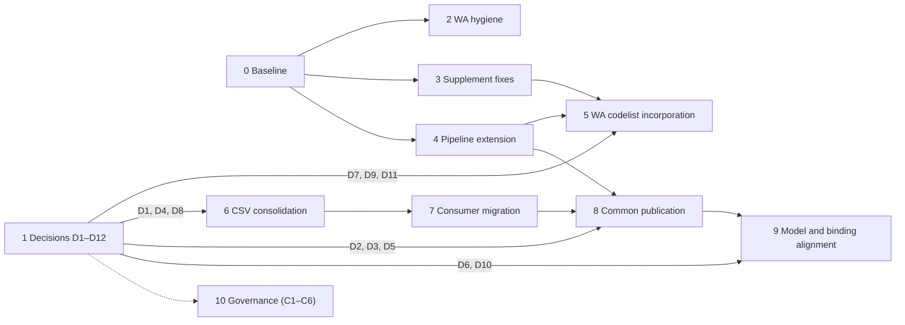

# 3D CSDM Vocabulary Remediation Plan

**Status:** Draft for review.
The plan has not started.
Nothing in it has been carried out, and no vocabulary, supplement, CSV draft, schema, namespace, binding or pipeline file was changed to prepare it.
**Date:** 2026-10-15
**Basis:** [`vocab-review.md`](vocab-review.md), cited below as "the review".
Section numbers (§5.x), activity IDs ([A1](vocab-review.md#activity-a1)–[A9](vocab-review.md#activity-a9), [B1](vocab-review.md#activity-b1)–[B5](vocab-review.md#activity-b5), [C1](vocab-review.md#activity-c1)–[C6](vocab-review.md#activity-c6)), finding IDs (F-xx) and decision IDs ([D1](vocab-review.md#decision-d1)–[D12](vocab-review.md#decision-d12)) refer to that document.

---

## 1. Purpose and approach

The review set out where each vocabulary should end up.
This plan sets out how to get there in a controlled order.
It is built around four rules.

1. **Decide before publishing.**
   Published IRIs are permanent, so every action that mints an IRI waits behind the decision that fixes its form ([D1](vocab-review.md#decision-d1)) and its owner ([D2](vocab-review.md#decision-d2), [D5](vocab-review.md#decision-d5)).
2. **Fix, then incorporate, then migrate.**
   Defects are corrected in staging.
   Corrected terms are then published.
   Consumers (examples, contexts, validators, skill) move to the published IRIs in the same release.
3. **Separate authority tracks.**
   WA-local work (Landgate authority) moves independently of work that needs ICSM approval.
   WA never publishes `wa-*` copies of concepts intended to be common (review [§5.9](vocab-review.md#59-implementation-roadmap), "Transitional arrangements").
4. **Every stage ends at a gate.**
   Each stage has entry criteria, exit criteria and a rollback route.
   The next stage does not start until the gate passes and the reviewer signs it off.

### Stage overview

| Stage | Name | Track | Authority | Review activities | Can start |
|---|---|---|---|---|---|
| [0](#stage-0--mobilisation-and-baseline) | Mobilisation and baseline | Both | Project | — | On approval of this plan |
| [1](#stage-1--governance-decisions) | Governance decisions | Both | ICSM, Landgate | [D1](vocab-review.md#decision-d1)–[D12](vocab-review.md#decision-d12) | With [Stage 0](#stage-0--mobilisation-and-baseline) |
| [2](#stage-2--wa-binding-and-data-hygiene) | WA binding and data hygiene | WA | WA-local | [A5](vocab-review.md#activity-a5), [A7](vocab-review.md#activity-a7) (part), [F-B1](vocab-review.md#finding-f-b1) | After [Stage 0](#stage-0--mobilisation-and-baseline) |
| [3](#stage-3--supplement-correction-staging) | Supplement correction (staging) | WA | WA-local | [A1](vocab-review.md#activity-a1) | After [Stage 0](#stage-0--mobilisation-and-baseline) |
| [4](#stage-4--uplift-pipeline-extension) | Uplift pipeline extension | Infra | ICSM repo maintainers | [A9](vocab-review.md#activity-a9) | After [Stage 0](#stage-0--mobilisation-and-baseline) |
| [5](#stage-5--wa-codelist-incorporation) | WA codelist incorporation | WA | WA-local, merged by ICSM maintainers | [A2](vocab-review.md#activity-a2), [A3](vocab-review.md#activity-a3), [A4](vocab-review.md#activity-a4) | Stages [3](#stage-3--supplement-correction-staging) and [4](#stage-4--uplift-pipeline-extension); [D7](vocab-review.md#decision-d7), [D9](vocab-review.md#decision-d9), [D11](vocab-review.md#decision-d11) for the affected terms |
| [6](#stage-6--csv-draft-consolidation-staging) | CSV draft consolidation (staging) | Common | WA (steward) | [A6](vocab-review.md#activity-a6), [A8](vocab-review.md#activity-a8) | [D1](vocab-review.md#decision-d1), [D4](vocab-review.md#decision-d4), [D8](vocab-review.md#decision-d8) |
| [7](#stage-7--consumer-migration-drafts) | Consumer migration (drafts) | WA, processWAData | WA-local, project | [A7](vocab-review.md#activity-a7) | [Stage 6](#stage-6--csv-draft-consolidation-staging) |
| [8](#stage-8--common-vocabulary-publication-icsm) | Common vocabulary publication | Common | ICSM | [B1](vocab-review.md#activity-b1), [B2](vocab-review.md#activity-b2) | [D2](vocab-review.md#decision-d2), [D3](vocab-review.md#decision-d3), [D5](vocab-review.md#decision-d5), and Stages [4](#stage-4--uplift-pipeline-extension), [6](#stage-6--csv-draft-consolidation-staging) and [7](#stage-7--consumer-migration-drafts) |
| [9](#stage-9--model-profile-and-binding-alignment) | Model, profile and binding alignment | Common, WA | ICSM, WA | [B3](vocab-review.md#activity-b3), [B4](vocab-review.md#activity-b4), [B5](vocab-review.md#activity-b5), WA SHACL subsets | [Stage 8](#stage-8--common-vocabulary-publication-icsm) ([B5](vocab-review.md#activity-b5) can run earlier) |
| [10](#stage-10--longer-term-governance-c1c6) | Longer-term governance | Common | ICSM | [C1](vocab-review.md#activity-c1)–[C6](vocab-review.md#activity-c6) | Independent; [C1](vocab-review.md#activity-c1) should start early |

The critical path is **[D1](vocab-review.md#decision-d1) → [Stage 6](#stage-6--csv-draft-consolidation-staging) → [Stage 7](#stage-7--consumer-migration-drafts) → [Stage 8](#stage-8--common-vocabulary-publication-icsm)**.
The WA codelist track (Stages [3](#stage-3--supplement-correction-staging) → [5](#stage-5--wa-codelist-incorporation)) is shorter and should finish first.

---

## 2. Repositories and artefacts in scope

| Repository | Role in this plan | Artefacts touched (when stages run) |
|---|---|---|
| `surroundaustralia/icsm-vocabs` (local checkout `sa-icsm-vocabs`; fork of `icsm-au/icsm-vocabs`) | Authoritative publication | `source/LandParcels/**/wa-*.csv`, `source/vocabs-uplift.yml`, `vocabs/LandParcels/**`, new `SpatialRepresentation/` folder, `tests/test_vocabs_validity.py` |
| `surroundaustralia/3d-csdm-profile-wa` | WA profile; staging area for drafts | `profiles/*-supplement.ttl`, `profiles/wa-vocab-bindings.*`, [`vocabs-uplift.yml`](https://github.com/icsm-au/icsm-vocabs/blob/main/source/vocabs-uplift.yml), `_sources/wa-{core,liminal,3d}/context.jsonld` and `bblock.json`, 33 example JSON files under `_sources/**/examples/`, `proposals/development/**/examples/`, `proposals/development/vocabularies/*.csv` |
| `icsm-au/3d-csdm-profile-icsm` | Common profile | `profiles/icsm-vocab-bindings.csv`, `_sources/icsm-3d/schema.json` |
| `ogcincubator/bblocks-land-parcels` | SRD BBlock | `_sources/spatialRepresentationDefinition/*`, `_sources/parcelSpatialRepresentationDefinition/*` |
| `surroundaustralia/3d-cadastre-model` | Core OWL | Occupation-type property, if [D5](vocab-review.md#decision-d5) is approved |
| `processWAData` | Implementation | `src/csdm_validator/{checks,profiles}/*`, `src/validate_vocab/*`, `.claude/skills/built-strata-spatial-representation/**` (scripts, references, fixtures, tests) |

**Consumers found by a read-only search** (to be re-checked in [Stage 0](#stage-0--mobilisation-and-baseline)):
- **Validators:** `checks/{parcel_geometry,height_description,derived_geometry,provenance}.py` and `profiles/wa_{height_described,height_described_ahd,jurisdictionally_bounded,derived_3d}.py`.
- **Vocabulary validation:** `validate_vocab/vocab_validation.py`.
- **Skill:** the `generate_` and `validate_spatial_representation.py` scripts, `references/{schema-status,generation-rules,built-strata-overview}.md`, and 3 test fixtures.
- **WA profile:** `wa-liminal` and `wa-3d` contexts; 7 `wa-liminal` examples, 7 `2-5d-liminal` proposal examples, and the built-strata `example-1.json` ([SP83687](../built-strata/examples/example-1.json)).

**Standing constraint for processWAData:** the profile repo stays canonical. processWAData keeps no copies of WA vocabularies or examples, and reads them through `WA_PROFILE_ROOT`.
The two implementation-local vocabularies ([Stage 6](#stage-6--csv-draft-consolidation-staging), [A8](vocab-review.md#activity-a8)) are the only vocabularies that will live in processWAData, because they describe its own pipeline.

---

## 3. Stage detail

### Stage 0 — Mobilisation and baseline

**Objective:** a clean, reproducible starting point that can be compared against later.

**Entry:** this plan is approved.

| #   | Task                                                                                                                                                                                                                                                                                              | Output                                                                                    |
|-----|---------------------------------------------------------------------------------------------------------------------------------------------------------------------------------------------------------------------------------------------------------------------------------------------------|-------------------------------------------------------------------------------------------|
| 0.1 | Resolve the CRLF-only working-tree noise in `sa-icsm-vocabs` (213 files) and `3d-csdm-profile-wa` (514 files): agree a `.gitattributes`/`core.autocrlf` setting and reset the trees so later diffs show only real changes. Do not commit line-ending changes in the same commits as content changes. | Clean `git status` in both repos                                                          |
| 0.2 | Decide what to do with the 6 uncommitted files in `bblocks-land-parcels` (SRD examples, `build.sh`, assets) before any SRD change.                                                                                                                                                                | Committed, stashed or discarded by their owner.  
 **_These can be discarded._** |
| 0.3 | Create one working branch per repository (e.g. `vocab-remediation/stage-N`). Record the base commits from review [§5.2](vocab-review.md#52-scope-and-methodology).                                                                                                                                                                            | Branch list                                                                               |
| 0.4 | **Baseline snapshot.** For each example, capture every vocabulary-valued field with its JSON path. Re-use the extraction method from review Pass 1.                                                                                                                                               | `baseline-vocab-usage.csv` (proposals dir)                                                |
| 0.5 | **Baseline test run.** Run `icsm-vocabs/tests/test_vocabs_validity.py`, the BBlock build/validation for WA and ICSM, and the processWAData `pytest` suites (validator, `validate_vocab`, skill tests). Record pass/fail counts.                                                                   | Baseline test report                                                                      |
| 0.6 | **Change register.** Start a register with one row per term action from review [§5.5](vocab-review.md#55-supplementary-term-integration-matrix-43-terms) (43 rows) and [§5.6](vocab-review.md#56-new-csv-vocabulary-integration-matrix) (25 CSVs). Columns: review ref, stage, status, PR link, approver.                                                                                                                          | `vocab-remediation-register.csv`                                                          |
| 0.7 | Confirm the contacts who approve on behalf of ICSM, Landgate and the repository maintainers.                                                                                                                                                                                                      | Named approvers per authority                                                             |

**Exit gate:** clean trees, baseline recorded, register created, approvers named.
**Rollback:** not applicable (no content changes).

---

### Stage 1 — Governance decisions

> **Status (2026-10-16):** [D1](vocab-review.md#decision-d1)–[D12](vocab-review.md#decision-d12) decided by the Surround team for this organisation phase; see [`vocab-review.md`](vocab-review.md) [§5.10](vocab-review.md#510-decisions).
> Custodians confirm at submission.

**Objective:** obtain the decisions that block IRI minting and term content.
This runs alongside Stages [2](#stage-2--wa-binding-and-data-hygiene)–[4](#stage-4--uplift-pipeline-extension), which do not depend on it.

**Entry:** [Stage 0.7](#task-0-7) has named the approvers.

| Decision | Blocks | Authority | Decision pack contents | Needed by |
|---|---|---|---|---|
| **[D1](vocab-review.md#decision-d1)** notation/URI convention | Stages [5](#stage-5--wa-codelist-incorporation) (new WA terms), [6](#stage-6--csv-draft-consolidation-staging), [8](#stage-8--common-vocabulary-publication-icsm) | ICSM (common), WA (WA vocabularies) | Options (a)–(c); the ambiguous-code list (`ahd`, `rs`, `ns`); `@id` minting in [`vocabs-uplift.yml`](https://github.com/icsm-au/icsm-vocabs/blob/main/source/vocabs-uplift.yml) (slug of `notation`) | **First.** Start of [Stage 6](#stage-6--csv-draft-consolidation-staging) |
| **[D2](vocab-review.md#decision-d2)** SRD BBlock ownership | Stages [8](#stage-8--common-vocabulary-publication-icsm), [9](#stage-9--model-profile-and-binding-alignment) | ICSM | [F-G1](vocab-review.md#finding-f-g1) and [F-G2](vocab-review.md#finding-f-g2) evidence; proposed BBlock identifier change away from `icsm.profiles.wa.*`; WA interim stewardship terms | Start of [Stage 8](#stage-8--common-vocabulary-publication-icsm) |
| **[D3](vocab-review.md#decision-d3)** common vocabulary repository | [Stage 8](#stage-8--common-vocabulary-publication-icsm) | ICSM | `icsm-vocabs` folder proposal (`SpatialRepresentation/`) | Start of [Stage 8](#stage-8--common-vocabulary-publication-icsm) |
| **[D4](vocab-review.md#decision-d4)** extent/boundary-state structure | [Stage 6](#stage-6--csv-draft-consolidation-staging) | ICSM (SRD owner); WA can propose | Shared-concept table ([F-D4](vocab-review.md#finding-f-d4)); collection vs multi-scheme example | Start of [Stage 6](#stage-6--csv-draft-consolidation-staging) |
| **[D5](vocab-review.md#decision-d5)** [`component-role`](component-role.csv), [`occupation-feature`](occupation-feature.ttl) as common | [Stage 8](#stage-8--common-vocabulary-publication-icsm) ([B2](vocab-review.md#activity-b2)) | ICSM, with Landgate input | Definitions; IFC mapping table; core anchors | Start of [Stage 8](#stage-8--common-vocabulary-publication-icsm) |
| **[D6](vocab-review.md#decision-d6)** strata scheme typing | [Stage 9](#stage-9--model-profile-and-binding-alignment) ([B3](vocab-review.md#activity-b3)) | WA (interim), ICSM (target) | `icsm-3d` featureType constraint; `EstateParcel` class definition | [Stage 9](#stage-9--model-profile-and-binding-alignment) |
| **[D7](vocab-review.md#decision-d7)** strata interests | [Stage 5](#stage-5--wa-codelist-incorporation) (2 terms) | Landgate | Tenure instrument question; entitlement-as-property proposal | Before those terms are incorporated |
| **[D8](vocab-review.md#decision-d8)** building-surface synonyms | [Stage 6](#stage-6--csv-draft-consolidation-staging) ([`boundary-reference`](boundary-reference.csv)) | Landgate survey practice, then ICSM | Synonym pairs; [SP83687](../built-strata/examples/example-1.json) statute wording | Start of [Stage 6](#stage-6--csv-draft-consolidation-staging) |
| **[D9](vocab-review.md#decision-d9)** endorsing authority | [Stage 5](#stage-5--wa-codelist-incorporation) (3 terms) | Landgate | The three conflicting definitions; Strata Titles Act s15 citation | Before those terms are incorporated |
| **[D10](vocab-review.md#decision-d10)** `limitRole`/`boundaryRole`; "vertical" naming | [Stage 9](#stage-9--model-profile-and-binding-alignment) ([B4](vocab-review.md#activity-b4)) | ICSM | Property usage evidence | [Stage 9](#stage-9--model-profile-and-binding-alignment) |
| **[D11](vocab-review.md#decision-d11)** `derived-boundary` points | [Stage 5](#stage-5--wa-codelist-incorporation) (1 term) | Landgate | Method-vs-purpose rationale; 256-point usage evidence | Before that term is moved |
| **[D12](vocab-review.md#decision-d12)** implementation vocabularies | [Stage 6](#stage-6--csv-draft-consolidation-staging) ([A8](vocab-review.md#activity-a8)) | Project / WA | — | Start of [Stage 6](#stage-6--csv-draft-consolidation-staging) (low risk; recommended answer can be assumed) |

**Exit gate:** each decision is recorded in the WA [`decisions-register.md`](../built-strata/decisions-register.md) (WA decisions) or the ICSM equivalent, with date and approver.
A stage can begin once its own blocking decisions are recorded, without waiting for every decision.
**Fallback if a decision stalls:**
- **[D1](vocab-review.md#decision-d1):** nothing new can be minted.
  Stages [2](#stage-2--wa-binding-and-data-hygiene)–[4](#stage-4--uplift-pipeline-extension) can still finish.
- **[D2](vocab-review.md#decision-d2)/[D5](vocab-review.md#decision-d5):** [Stage 8](#stage-8--common-vocabulary-publication-icsm) cannot run.
  Apply the review's fallback only by explicit agreement: publish as `experimental` under the final common IRIs with ICSM consent.
  Do not publish `wa-*` duplicates.
- **[D7](vocab-review.md#decision-d7), [D9](vocab-review.md#decision-d9), [D11](vocab-review.md#decision-d11):** incorporate the other terms and leave these as supplements.

---

### Stage 2 — WA binding and data hygiene

> **Status (2026-10-18): mostly done.**
> [2.1](#task-2-1) and [2.2](#task-2-2) by cleanup [Stage 9](HANDOFF.md#cleanup-stage-9): the bindings JSON was regenerated from the CSV, and the `wa-vector-type`, `wa-interest` and `wa-mines` prefixes were removed from the `wa-core`, `waAppellationNamespaces` and `wa-mining` contexts.
> [2.3](#task-2-3) is done for `wa-pt-method` (renamed to `wa-surveypoint-method` in Stage 9); the `wa-core` context keeps `wa-annotation-role` as an alias for its examples.
> [2.4](#task-2-4): done: 2026-10-19; the field was removed as redundant with "usedProcedure." `wa-angle-derivation:M` stays a local value (decided 2026-10-16, [`vocab-review.md`](vocab-review.md) [§5.10](vocab-review.md#510-decisions)).
> [2.5](#task-2-5) was done in cleanup [Stage 5](HANDOFF.md#cleanup-stage-5), with `vertical-extent-status:dfld` mapped to `legally-defined` ([`crosswalk/value-aliases.csv`](crosswalk/value-aliases.csv)).
> [2.6](#task-2-6) is open; the missing `icsm-survey-type` belongs to ICSM ([B5](vocab-review.md#activity-b5)).

**Objective:** remove broken references that do not depend on any decision.

**Entry:** [Stage 0](#stage-0--mobilisation-and-baseline) complete.

| # | Task | Files | Review ref |
|---|---|---|---|
| 2.1 | Remove stale entries for `wa-angle-type`, `wa-distance-type` and `wa-equipment-type` from [`wa-vocab-bindings.csv.json`](../../../profiles/wa-vocab-bindings.csv.json), or regenerate it from the CSV. | [`profiles/wa-vocab-bindings.csv.json`](../../../profiles/wa-vocab-bindings.csv.json) | [F-B1](vocab-review.md#finding-f-b1), [A5](vocab-review.md#activity-a5) |
| 2.2 | Remove the undefined `wa-vector-type` and `wa-interest` prefixes from the `wa-core` context, or point them at existing vocabularies. | [`_sources/wa-core/context.jsonld`](../../../_sources/wa-core/context.jsonld) | [F-B1](vocab-review.md#finding-f-b1), [A5](vocab-review.md#activity-a5) |
| 2.3 | Use one prefix per namespace: [`wa-annotation`](https://linked.data.gov.au/def/csdm/wa-annotation) (drop `wa-annotation-role`) and [`wa-surveypoint-method`](https://linked.data.gov.au/def/csdm/wa-surveypoint-method) (drop `wa-pt-method`). Update the examples that use the dropped prefixes. | WA contexts, examples | [A5](vocab-review.md#activity-a5) |
| 2.4 | Resolve `wa-angle-derivation:`. Identify the intended vocabulary or remove the field from the examples. If a new vocabulary is needed, raise it as a new decision rather than minting it here. | examples | [F-B1](vocab-review.md#finding-f-b1) |
| 2.5 | Fix `vertical-extent-status:dfld` in examples and `wa_derived_3d.py` to use [`geometry-legal-status:dfld`](crosswalk/vocab-crosswalk.csv). That is where the code exists today, so this change does not anticipate [Stage 6](#stage-6--csv-draft-consolidation-staging). | examples, `src/csdm_validator/profiles/wa_derived_3d.py` | [F-B2](vocab-review.md#finding-f-b2), [A7](vocab-review.md#activity-a7) (part) |
| 2.6 | Raise an issue in `3d-csdm-profile-icsm` for the missing `icsm-survey-type` binding target. The fix itself is [B5](vocab-review.md#activity-b5) ([Stage 9](#stage-9--model-profile-and-binding-alignment)), unless ICSM accepts it now. | issue only | [F-B1](vocab-review.md#finding-f-b1), [B5](vocab-review.md#activity-b5) |

**Verification:**
- Rerun the WA BBlock build and validation, and the processWAData tests.
  There should be no new failures compared with the baseline.
- Diff the vocabulary-usage snapshot against the baseline.
  Only the intended prefix and code changes should appear.

**Exit gate:** checks pass; register rows updated; PRs merged in `3d-csdm-profile-wa` and `processWAData`.
**Rollback:** revert the PRs.
No published IRI is affected.

---

### Stage 3 — Supplement correction (staging)

> **Status (2026-10-16): done** by cleanup [Stage 2](HANDOFF.md#cleanup-stage-2).
> Four supplements were deleted (`computed`, `derived-boundary`, [`wa-survey-type:ct`](crosswalk/vocab-crosswalk.csv), the two strata interest types), `wa-occ-supplement.ttl` became the common [`occupation-feature.ttl`](occupation-feature.ttl), and the remaining supplements were corrected (tasks [3.1](#task-3-1)–[3.8](#task-3-8), including [D9](vocab-review.md#decision-d9)).

**Objective:** make every supplement structurally valid and consistent with its parent, so [Stage 5](#stage-5--wa-codelist-incorporation) is a mechanical transfer.
The supplements remain staging files throughout this stage.

**Entry:** [Stage 0](#stage-0--mobilisation-and-baseline) complete.
[D1](vocab-review.md#decision-d1) is not needed, because these terms extend existing WA vocabularies that already use kebab-case.

| # | Task | Supplement | Review ref |
|---|---|---|---|
| 3.1 | Fix [`wa-occ`](crosswalk/vocab-crosswalk.csv) dangling top-concept and [`skos:broader`](https://www.w3.org/2009/08/skos-reference/skos.html#broader) IRIs (`:Building`, `:BuildingElement`, `:Structure` → kebab). Keeps the interim file valid even though it will move ([Stage 8](#stage-8--common-vocabulary-publication-icsm)). | [`wa-occ`](crosswalk/vocab-crosswalk.csv) | [F-Q1](vocab-review.md#finding-f-q1) |
| 3.2 | Add [`skos:ConceptScheme`](https://www.w3.org/2009/08/skos-reference/skos.html#ConceptScheme) to [`wa-approved-form`](../../../profiles/wa-approved-form-supplement.ttl). Make [`dcterms:source`](https://www.dublincore.org/specifications/dublin-core/dcmi-terms/terms/source/) an IRI. Fix the `BA14` label. Normalise `15c`/"15C". Retarget [`dcterms:type`](https://www.dublincore.org/specifications/dublin-core/dcmi-terms/terms/type/) to `scheme-ue` and `scheme-record-form`. | [`wa-approved-form`](../../../profiles/wa-approved-form-supplement.ttl) | [F-Q1](vocab-review.md#finding-f-q1), [§5.4.2](vocab-review.md#542-supplements) |
| 3.3 | Change the 6 camelCase documentation-type IRIs to kebab-case. Add `skos:broader scheme-form` to `scheme-by-laws` and `scheme-notice`. Rewrite the `scheme-notice` definition. Fix the regulation citation on `csd`. | `wa-survey-documentation` | [§5.5](vocab-review.md#55-supplementary-term-integration-matrix-43-terms) |
| 3.4 | Remove empty `skos:altLabel ""`. | [`wa-interest-type`](https://linked.data.gov.au/def/csdm/wa-interest-type), [`wa-parcel-purpose`](https://linked.data.gov.au/def/csdm/wa-parcel-purpose) | [F-Q1](vocab-review.md#finding-f-q1) |
| 3.5 | Rewrite the [`wa-parcel-purpose:strata-scheme`](../../../profiles/wa-parcel-purpose-supplement.ttl) definition as a purpose, not a class. | [`wa-parcel-purpose`](https://linked.data.gov.au/def/csdm/wa-parcel-purpose) | [§5.4.2](vocab-review.md#542-supplements) |
| 3.6 | Correct "Strata Title Act" to "[Strata Titles Act 1985](https://www.legislation.wa.gov.au/legislation/statutes.nsf/main_mrtitle_938_homepage.html)". | [`wa-survey-purpose`](https://linked.data.gov.au/def/csdm/wa-survey-purpose) | [§5.4.2](vocab-review.md#542-supplements) |
| 3.7 | Add [`skos:related`](https://www.w3.org/2009/08/skos-reference/skos.html#related) links between each annotation and its document type, and to [`vertical-definition-type:brb`](crosswalk/vocab-crosswalk.csv). The link to the draft `brb` stays in staging until [Stage 8](#stage-8--common-vocabulary-publication-icsm). | [`wa-annotation`](https://linked.data.gov.au/def/csdm/wa-annotation) | [§5.5](vocab-review.md#55-supplementary-term-integration-matrix-43-terms) |
| 3.8 | Add definitions to the 4 undefined [`wa-annotation`](https://linked.data.gov.au/def/csdm/wa-annotation) terms. Mark the 3 [D9](vocab-review.md#decision-d9)-dependent terms (`strata-plan-endorsement`, `strata-plan-endorsement-certificate`, `15c`) as held. | [`wa-annotation`](https://linked.data.gov.au/def/csdm/wa-annotation), `wa-survey-documentation`, [`wa-approved-form`](../../../profiles/wa-approved-form-supplement.ttl) | [F-Q2](vocab-review.md#finding-f-q2), [D9](vocab-review.md#decision-d9) |
| 3.9 | Add a SHACL/rdflib check to CI (or a script in the WA repo): every supplement parses; every [`skos:broader`](https://www.w3.org/2009/08/skos-reference/skos.html#broader)/`hasTopConcept` target exists; every concept has a prefLabel and definition; there are no empty literals. | new check script | — |

**Verification:**
- Check 3.9 passes on all 10 supplements.
- Check that no IRI, prefLabel or notation in a supplement collides with its parent scheme.
  Rerun the review's collision script.

**Exit gate:** corrected supplements merged in `3d-csdm-profile-wa`; register rows show "ready to incorporate" or "held (Dx)".
**Rollback:** revert.
The supplements are unpublished.

---

### Stage 4 — Uplift pipeline extension

> **Status (2026-10-16): partly done** on branch `vocab-cleanup/uplift-altlabel` in `sa-icsm-vocabs` (not pushed).
> 4.1–4.3: `altlabel` is split on `|` for every CSV; `broader`, `related` and `scopenote` are mapped for draft-format CSVs (those with a `broader` column), leaving the free-text `related` column of published CSVs unmapped.
> 4.4 is not needed: under [D1](vocab-review.md#decision-d1) the uplift mints IRIs from kebab-case notations.
> 4.5 was already done.
> 4.6: the WA profile copy matches the fork; the ICSM profile copy was not changed.

**Objective:** make the `icsm-vocabs` uplift able to express what the new and corrected vocabularies need, before anything new goes through it.

**Entry:** [Stage 0](#stage-0--mobilisation-and-baseline) complete.
An `icsm-vocabs` maintainer has agreed to review the change.

| # | Task | File | Review ref |
|---|---|---|---|
| 4.1 | Map a `related` column to [`skos:related`](https://www.w3.org/2009/08/skos-reference/skos.html#related). | [`icsm-vocabs/source/vocabs-uplift.yml`](https://github.com/icsm-au/icsm-vocabs/blob/main/source/vocabs-uplift.yml) | [F-P1](vocab-review.md#finding-f-p1), [A9](vocab-review.md#activity-a9) |
| 4.2 | Split `altlabel` on one agreed separator. Pick one (e.g. `\|`) and document it. | same | [F-P1](vocab-review.md#finding-f-p1) |
| 4.3 | Support a `broader` column, emitting [`skos:broader`](https://www.w3.org/2009/08/skos-reference/skos.html#broader) plus the inverse or `hasTopConcept` as the vocpub profile requires. | same | [F-P1](vocab-review.md#finding-f-p1) |
| 4.4 | Support an explicit `id` column. When present it sets `@id`, instead of slugging the notation. This makes [D1](vocab-review.md#decision-d1) option (c) possible. | same | [D1](vocab-review.md#decision-d1) |
| 4.5 | Fail, rather than silently using `…/notdefined`, when a CSV has no `csMapping` entry. | same | [F-P1](vocab-review.md#finding-f-p1) |
| 4.6 | Mirror the changes in [`3d-csdm-profile-wa/vocabs-uplift.yml`](../../../vocabs-uplift.yml) and [`3d-csdm-profile-icsm/vocabs-uplift.yml`](https://github.com/icsm-au/3d-csdm-profile-icsm/blob/main/vocabs-uplift.yml), or record that those copies are retired. | both profile repos | [A9](vocab-review.md#activity-a9) |
| 4.7 | **Regression test:** run the extended uplift over every existing source CSV and confirm the output TTL is graph-isomorphic to the current `vocabs/` tree. Use rdflib `isomorphic`. | `icsm-vocabs/tests` | — |

**Verification:**
- 4.7 isomorphism passes for all 79 vocabularies.
- `test_vocabs_validity.py` (vocpub 4.10) passes.
- A fixture CSV exercising `related`, `broader`, `id` and multi-altLabel produces the expected triples.

**Exit gate:** pipeline PR merged in `icsm-vocabs`.
**Note:** `uplift-on-push.yml` currently runs only on `workflow_dispatch` (the push trigger is commented out).
[Stage 5](#stage-5--wa-codelist-incorporation) and [Stage 8](#stage-8--common-vocabulary-publication-icsm) publications therefore need a maintainer to trigger them manually, or generated TTL to be committed.
Agree which before [Stage 5](#stage-5--wa-codelist-incorporation).
**Rollback:** revert the pipeline PR.
Existing output is unchanged by construction (4.7).

---

### Stage 5 — WA codelist incorporation

> **Status (2026-10-16): ready, not started.**
> The supplement terms are corrected and each disposition is recorded ([`vocab-review.md`](vocab-review.md) [§5.5](vocab-review.md#55-supplementary-term-integration-matrix-43-terms), [`crosswalk/vocab-crosswalk.csv`](crosswalk/vocab-crosswalk.csv)).
> Incorporating them into the `icsm-vocabs` CSVs is for the uplift owner.

**Objective:** move the corrected WA supplement terms into published WA vocabularies, update the WA profile in the same release, and retire the supplement files.

**Entry:** Stages [3](#stage-3--supplement-correction-staging) and [4](#stage-4--uplift-pipeline-extension) complete.
The publication trigger is agreed.
For held terms, [D7](vocab-review.md#decision-d7), [D9](vocab-review.md#decision-d9) and [D11](vocab-review.md#decision-d11) are recorded, or those terms stay held.

| # | Task | Terms | Target | Review ref |
|---|---|---|---|---|
| 5.1 | Add the incorporate terms as CSV rows in `icsm-vocabs/source/LandParcels/**/wa-*.csv` and run the uplift. | 16 (8 annotation, 6 documentation type, 1 parcel purpose, 1 survey purpose), minus any still held by [D9](vocab-review.md#decision-d9) | [`wa-annotation`](https://linked.data.gov.au/def/csdm/wa-annotation), [`wa-survey-documentation-type`](https://linked.data.gov.au/def/csdm/wa-survey-documentation-type), [`wa-parcel-purpose`](https://linked.data.gov.au/def/csdm/wa-parcel-purpose), [`wa-survey-purpose`](https://linked.data.gov.au/def/csdm/wa-survey-purpose) | [A2](vocab-review.md#activity-a2) |
| 5.2 | Create [`wa-approved-form`](../../../profiles/wa-approved-form-supplement.ttl), either as a new `csMapping` and CSV or as hand-authored TTL (agree which). | 4 (`15c` held on [D9](vocab-review.md#decision-d9)) | `vocabs/LandParcels/CSD-Header/wa-approved-form.ttl` | [A3](vocab-review.md#activity-a3) |
| 5.3 | Relocate [`wa-survey-type:ct`](crosswalk/vocab-crosswalk.csv) to [`wa-survey-documentation-type:certificate-of-title`](../../../profiles/wa-survey-documentation-supplement.ttl). This is already one of the 6 documentation-type terms, so no separate term is added. | 1 | — | [§5.5](vocab-review.md#55-supplementary-term-integration-matrix-43-terms) |
| 5.4 | After [D11](vocab-review.md#decision-d11): add a WA method concept narrower than [`wa-surveypoint-method:G`](https://linked.data.gov.au/def/csdm/wa-surveypoint-method/G), and change the 256 `derived-boundary` points to an existing boundary purpose plus the new method. | 1 | [`wa-surveypoint-method`](https://linked.data.gov.au/def/csdm/wa-surveypoint-method) | [D11](vocab-review.md#decision-d11) |
| 5.5 | After [D7](vocab-review.md#decision-d7): incorporate, reuse `ct`, or drop the two interest types. Move entitlement values to properties. | 2 | [`wa-interest-type`](https://linked.data.gov.au/def/csdm/wa-interest-type) | [D7](vocab-review.md#decision-d7) |
| 5.6 | Do not incorporate `computed`, `built-strata-plan`, `unitEntitlementSchedule` or `recordOfStrataTitlesScheme`. Update examples to the reused terms. | 4 | — | [A4](vocab-review.md#activity-a4) |
| 5.7 | **WA profile, same release:** add binding rows for [`wa-annotation`](https://linked.data.gov.au/def/csdm/wa-annotation), [`wa-survey-documentation-type`](https://linked.data.gov.au/def/csdm/wa-survey-documentation-type), [`wa-interest-type`](https://linked.data.gov.au/def/csdm/wa-interest-type), [`wa-surveypoint-method`](https://linked.data.gov.au/def/csdm/wa-surveypoint-method) and [`wa-approved-form`](../../../profiles/wa-approved-form-supplement.ttl); add the missing context prefixes; remove incorporated supplements from `wa-liminal` `shaclClosures`; make `condition` optional when the form is unmarked. | — | `profiles/wa-vocab-bindings.*`, `_sources/wa-*/` | [A2](vocab-review.md#activity-a2), [A4](vocab-review.md#activity-a4), [F-B3](vocab-review.md#finding-f-b3) |
| 5.8 | **Examples, same release:** move every use of a supplement IRI (camelCase → kebab, `ct`, `computed`, `unitEntitlementSchedule`, etc.) to the published IRI. | — | 33 examples + built-strata example | [A4](vocab-review.md#activity-a4) |
| 5.9 | **processWAData, same release:** update any validator or skill reference to the changed IRIs. | — | `src/csdm_validator`, skill | — |
| 5.10 | Delete each supplement file once all of its terms are published or dispositioned. Keep held terms in a reduced supplement. [`wa-occ`](crosswalk/vocab-crosswalk.csv) stays until [Stage 8](#stage-8--common-vocabulary-publication-icsm). | — | `profiles/*-supplement.ttl` | [A2](vocab-review.md#activity-a2) |

**Release coupling:**
- The `icsm-vocabs` PR (5.1–5.5) merges and publishes first.
- The `3d-csdm-profile-wa` and `processWAData` PRs (5.6–5.10) merge immediately afterwards.
  They are tested against the published TTL, not the supplements.

**Verification:**
- `test_vocabs_validity.py` passes.
- Each incorporated IRI resolves, or appears in the generated TTL if resolution lags.
- The WA BBlock build passes with the supplements removed from `shaclClosures`.
- The vocabulary-usage diff against the baseline shows only the IRI moves listed in the register.
- No example references a `*-supplement` term that has been retired.

**Exit gate:** register rows for the 43 supplement terms are all "done" or "held (Dx)"; [`wa-occ`](crosswalk/vocab-crosswalk.csv) (15) is shown as "awaiting [Stage 8](#stage-8--common-vocabulary-publication-icsm)".
**Rollback:**
- Before publication: revert.
- After publication: new IRIs are `experimental`.
  If a term is wrong, mark it [`owl:deprecated`](https://www.w3.org/TR/owl2-syntax/#Annotation_Properties) with [`dcterms:isReplacedBy`](https://www.dublincore.org/specifications/dublin-core/dcmi-terms/terms/isReplacedBy/).
  Never delete it or reuse its IRI.

---

### Stage 6 — CSV draft consolidation (staging)

> **Status (2026-10-16): done** by cleanup Stages [3](HANDOFF.md#cleanup-stage-3)–[4](HANDOFF.md#cleanup-stage-4): 25 CSVs became 16 drafts plus the local [`wa-prov-role`](wa-prov-role.csv), all in one normalised format, with [`crosswalk/vocab-crosswalk.csv`](crosswalk/vocab-crosswalk.csv), [`vertical-extent-status.collections.ttl`](vertical-extent-status.collections.ttl) and draft scheme metadata in `meta/`.

**Objective:** turn the 25 CSV drafts into the 16 publishable drafts plus 2 local lists, with final IRIs and pipeline mappings.
Nothing is published in this stage.

**Entry:** [D1](vocab-review.md#decision-d1), [D4](vocab-review.md#decision-d4) and [D8](vocab-review.md#decision-d8) recorded.
[D12](vocab-review.md#decision-d12) recorded or its recommended answer assumed.
[Stage 4](#stage-4--uplift-pipeline-extension) merged, so that the CSV columns `id`, `broader`, `related` and `altlabel` are supported.

| # | Task | Inputs → outputs | Review ref |
|---|---|---|---|
| 6.1 | Agree and document the CSV column set (`id`, `notation`, `preflabel`, `altlabel`, `definition`, `broader`, `related`, `source`) and the separator. | Template | [A6](vocab-review.md#activity-a6) |
| 6.2 | Merge duplicates: [`icsm-vertical-direction`](crosswalk/vocab-crosswalk.csv) → [`vertical-direction`](vertical-direction.csv); [`vertical-limit-role`](crosswalk/vocab-crosswalk.csv) → [`boundary-role`](boundary-role.csv); [`wa-resolution-status`](crosswalk/vocab-crosswalk.csv) → [`computability-status`](computability-status.csv); [`wa-strata-component-role`](crosswalk/vocab-crosswalk.csv) → [`component-role`](component-role.csv). | 8 → 4 | [F-D1](vocab-review.md#finding-f-d1)–[F-D3](vocab-review.md#finding-f-d3) |
| 6.3 | Combine [`vertical-extent-status`](vertical-extent-status.csv) and [`vertical-boundary-state`](crosswalk/vocab-crosswalk.csv) per [D4](vocab-review.md#decision-d4). Remove `dfv`, `a3d`, and `uca`/`ucb` at boundary level. | 2 → 1 (with 2 collections) | [F-D4](vocab-review.md#finding-f-d4), [D4](vocab-review.md#decision-d4) |
| 6.4 | Split [`height-reference`](height-reference.csv): keep 8 levels; drop AHD (use vertical CRS); move 6 building-surface terms to [`boundary-reference`](boundary-reference.csv). | 1 → 1 (8 terms) | [F-A1](vocab-review.md#finding-f-a1) |
| 6.5 | Build [`boundary-reference`](boundary-reference.csv) from `building-`, `cadastral-` and [`relative-height-reference`](crosswalk/vocab-crosswalk.csv). Apply the [D8](vocab-review.md#decision-d8) synonym merges as altLabels. Model `projection` as an interim concept. Add `offset-from-surface`. | 3 → 1 | [F-A3](vocab-review.md#finding-f-a3), [D8](vocab-review.md#decision-d8) |
| 6.6 | Rename the `icsm-` drafts: [`source-scope`](source-scope.csv), [`reference-kind`](reference-kind.csv), [`derivation-mechanism`](derivation-mechanism.csv), [`derived-geometry-status`](derived-geometry-status.csv). Reduce derived-geometry status to `generated`/`not-generated` (+ optional `generation-failed`). | 4 renamed | [F-N3](vocab-review.md#finding-f-n3) |
| 6.7 | Apply [D1](vocab-review.md#decision-d1) to every draft: kebab-case `id`; keep the old code as [`skos:notation`](https://www.w3.org/2009/08/skos-reference/skos.html#notation) or altLabel; fix `ahd`, `rs` and `ns`. | all 16 | [F-N1](vocab-review.md#finding-f-n1), [F-N2](vocab-review.md#finding-f-n2) |
| 6.8 | Fix content: the `coordinate-z-role:referenceSurface` definition; [`reference-kind`](reference-kind.csv) altLabels; `brb` broader `gbr`; the [`computability-status`](computability-status.csv) hierarchy; the [`vertical-value-type`](vertical-value-type.csv) scope note. | as listed | [§5.4.3](vocab-review.md#543-csv-vocabularies-spatial-representation-family) |
| 6.9 | Add `csMapping` entries for the 16 drafts with final IRIs `https://linked.data.gov.au/def/csdm/<name>`, held in the WA proposals area (or a branch of `icsm-vocabs`) without being uplifted to `vocabs/`. | 16 entries | [A6](vocab-review.md#activity-a6) |
| 6.10 | Moveed `boundary-coverage` and [`wa-prov-role`](wa-prov-role.csv) to processWAData as implementation-local vocabularies (documented, not published). Map `source-csd-file` to the documentation type `csd` if needed. | 2 | [A8](vocab-review.md#activity-a8), [D12](vocab-review.md#decision-d12) |
| 6.11 | Produce a **concept crosswalk**: every old draft IRI (25 CSVs, 138 terms) → new IRI or "removed (reason)". This drives [Stage 7](#stage-7--consumer-migration-drafts). | `vocab-crosswalk.csv` | — |
| 6.12 | Dry-run the uplift locally on the 16 drafts and validate the output with vocpub 4.10. Do not commit the output into `vocabs/`. | Dry-run report | — |

**Verification:**
- The crosswalk covers all 138 terms.
- The dry-run output passes vocpub.
- No two drafts share a concept meaning (repeat the review's Pass 2 comparison).
- Notation and IRI style is uniform.

**Exit gate:** the consolidated drafts are merged into `proposals/development/vocabularies/`.
The retired CSVs are deleted in the same PR, and the crosswalk records them.
**Rollback:** revert.
Nothing is published.

---

### Stage 7 — Consumer migration (drafts)

> **Status (2026-10-16): done** for the WA profile examples, viewer data and contexts (cleanup [Stage 5](HANDOFF.md#cleanup-stage-5)) and for processWAData (cleanup [Stage 6](HANDOFF.md#cleanup-stage-6), where regenerating SP83687 reproduces the migrated example exactly).
> Other consumer repositories are still to be scanned.

**Objective:** move every consumer to the consolidated draft IRIs, so [Stage 8](#stage-8--common-vocabulary-publication-icsm) publishes vocabularies that are already in use and tested.

**Entry:** [Stage 6](#stage-6--csv-draft-consolidation-staging) merged; crosswalk available.

| # | Task | Files |
|---|---|---|
| 7.1 | Update `wa-liminal` and `wa-3d` contexts: one prefix per consolidated vocabulary; remove retired prefixes (e.g. [`icsm-vertical-direction`](crosswalk/vocab-crosswalk.csv)). | `_sources/wa-{liminal,3d}/context.jsonld` |
| 7.2 | Apply the crosswalk to all examples. Fix the `buildingElementType: height-reference:ns` misuse (3× in SP83687); done by removing it, because those limits reference a ground surface, not an occupation feature. | `_sources/**/examples/*.json`, `proposals/development/**/examples/*.json` |
| 7.3 | Update the validators to the new codes. Remove the `cmp`/`rjr` drift. Unify derived-geometry status values. | `src/csdm_validator/checks/*.py`, `profiles/wa_*.py`, `validate_vocab/vocab_validation.py` |
| 7.4 | Update the skill: `_vocab.py` and `references/schema-status.md`, `generation-rules.md`, [`built-strata-overview.md`](../built-strata/built-strata-overview.md); generator and validator scripts; fixtures and tests. | `.claude/skills/built-strata-spatial-representation/**` |
| 7.5 | Update [`built-strata-bblock-scope-note.md`](../built-strata/built-strata-bblock-scope-note.md) and [`decisions-register.md`](../built-strata/decisions-register.md) to the consolidated names. Resolved the `boundaryCoverage` true/false vs 3-term mismatch. | `proposals/development/built-strata/*` |
| 7.6 | Add a check (CI or test) that every vocabulary-valued value in every example resolves to a concept in the published vocabularies, the consolidated drafts or the local lists. This stops future drift ([F-B2](vocab-review.md#finding-f-b2)). | processWAData `validate_vocab` or WA repo script |

**Verification:**
- 7.6 passes for every example.
- The processWAData test suites and the WA BBlock build match the baseline or improve on it.
- The vocabulary-usage diff matches the crosswalk exactly.

**Exit gate:** PRs merged in `3d-csdm-profile-wa` and `processWAData` together.
**Rollback:** revert both PRs together.

---

### Stage 8 — Common vocabulary publication (ICSM)

> **Note (2026-10-16):** under [D3](vocab-review.md#decision-d3) the common vocabularies are part of the 3D CSDM core model; agree with the uplift owner whether `icsm-vocabs` remains the publication route.

**Objective:** publish the SR family and the two common domain vocabularies at their final IRIs.
This removes the namespace presumption ([F-G2](vocab-review.md#finding-f-g2)).

**Entry:** [D2](vocab-review.md#decision-d2), [D3](vocab-review.md#decision-d3) and [D5](vocab-review.md#decision-d5) recorded; Stages [4](#stage-4--uplift-pipeline-extension), [6](#stage-6--csv-draft-consolidation-staging) and [7](#stage-7--consumer-migration-drafts) complete; ICSM reviewer assigned.

| # | Task | Target | Review ref |
|---|---|---|---|
| 8.1 | Submit an ICSM review pack: the 15 SR drafts, the crosswalk, the dry-run report and the decisions. | ICSM | [B1](vocab-review.md#activity-b1) |
| 8.2 | Publish the 15 SR vocabularies (`experimental`) through the uplift. | `icsm-vocabs/vocabs/LandParcels/SpatialRepresentation/` | [B1](vocab-review.md#activity-b1) |
| 8.3 | Publish [`component-role`](component-role.csv) and [`occupation-feature`](occupation-feature.ttl). The second is built from the [`wa-occ`](crosswalk/vocab-crosswalk.csv) supplement, with fixes from [Stage 3](#stage-3--supplement-correction-staging), `slab`/`ceiling` definition corrections and [`skos:closeMatch`](https://www.w3.org/2009/08/skos-reference/skos.html#closeMatch) to IFC 4.3. Settle the IFC IRI form first (review [§5.7](vocab-review.md#57-cross-vocabulary-findings), "Potential improvements"). | `…/Parcels/`, `…/SurveyFeatures/` | [B2](vocab-review.md#activity-b2) |
| 8.4 | Retire `wa-occ-supplement.ttl`. Update examples from [`wa-occ:`](crosswalk/vocab-crosswalk.csv) to [`occupation-feature:`](occupation-feature.ttl), and add the context prefix (done 2026-10-16). | WA profile, examples | [§5.5](vocab-review.md#55-supplementary-term-integration-matrix-43-terms) |
| 8.5 | Add the cross-scheme [`skos:related`](https://www.w3.org/2009/08/skos-reference/skos.html#related) links that were held in staging, e.g. [`wa-annotation:boundary-definition-statement`](../../../profiles/wa-annotation-supplement.ttl) ↔ [`vertical-definition-type:brb`](crosswalk/vocab-crosswalk.csv). | `icsm-vocabs` WA CSVs | [Stage 3.7](#task-3-7) |
| 8.6 | Confirm the published IRIs resolve at `linked.data.gov.au`. Raise redirects with the resolver owner if they do not. | — | [F-G2](vocab-review.md#finding-f-g2) |

**Verification:**
- vocpub passes.
- Every IRI in the WA contexts for these vocabularies resolves, or is present in published TTL.
- 7.6 passes against published TTL instead of drafts.

**Exit gate:** ICSM approval recorded; publication merged; draft CSVs in the WA proposals directory replaced by a pointer to `icsm-vocabs`.
**Rollback:** after publication, deprecate rather than delete (as in [Stage 5](#stage-5--wa-codelist-incorporation)).

---

### Stage 9 — Model, profile and binding alignment

**Objective:** make the models and profiles enforce the published vocabularies.

**Entry:** [Stage 8](#stage-8--common-vocabulary-publication-icsm) complete.
[D6](vocab-review.md#decision-d6) and [D10](vocab-review.md#decision-d10) recorded where needed.
[B5](vocab-review.md#activity-b5) can run as soon as ICSM accepts it.

| # | Task | Target | Review ref |
|---|---|---|---|
| 9.1 | SRD ontology/context/schema: `resolutionStatus` and `derivedGeometryStatus` become object properties with `@vocab`. Add generic SHACL binding each `sr:` property to its vocabulary. Move identifiers off `icsm.profiles.wa.*`. | `bblocks-land-parcels` SRD | [B4](vocab-review.md#activity-b4), [D2](vocab-review.md#decision-d2) |
| 9.2 | SRD-parcel extension: add `limits[]`, `components[]` and `sourceBasis.scope` structures. Consolidate `limitRole`/`boundaryRole` per [D10](vocab-review.md#decision-d10). | SRD-parcel BBlock | [B4](vocab-review.md#activity-b4), [D10](vocab-review.md#decision-d10) |
| 9.3 | ICSM common profile: add binding rows for the common vocabularies; fix `icsm-survey-type`. | `icsm-vocab-bindings.csv` | [B5](vocab-review.md#activity-b5) |
| 9.4 | Allow `ParcelAggregate`/`EstateParcel` as a `featureType` ([D6](vocab-review.md#decision-d6) (c)). | `icsm-3d/schema.json` | [B3](vocab-review.md#activity-b3) |
| 9.5 | Core model: add the occupation-type property if [D5](vocab-review.md#decision-d5) is approved. | `3d-cadastre-model` | [B2](vocab-review.md#activity-b2) |
| 9.6 | WA profile SHACL subsets: e.g. no `l3d`, allowed [`computability-status`](computability-status.csv) per representation class, `brb` requires a `boundary-definition-statement` annotation. Add WA binding rows for the SR family. | WA profile | [§5.8](vocab-review.md#58-recommended-target-architecture) |
| 9.7 | Decide whether [`wa-parcel-purpose:strata-scheme`](../../../profiles/wa-parcel-purpose-supplement.ttl) stays as a plain purpose once 9.4 lands. | WA | [D6](vocab-review.md#decision-d6) |

**Verification:**
- The BBlock builds for SRD, ICSM and WA pass.
- Negative tests show each SHACL subset rejects a disallowed value.
- 7.6 passes.

**Exit gate:** each repository's PR approved by its authority.
**Rollback:** revert per repository.
Vocabularies are unaffected.

---

### Stage 10 — Longer-term governance (C1–C6)

Not scheduled in detail.
**[C1](vocab-review.md#activity-c1)** (lifecycle, change requests, deprecation policy) should start during [Stage 1](#stage-1--governance-decisions), because Stages [5](#stage-5--wa-codelist-incorporation) and [8](#stage-8--common-vocabulary-publication-icsm) rely on its deprecation rule.
**[C2](vocab-review.md#activity-c2)** (SKOS mappings from jurisdictional to `icsm-*` concepts), **[C3](vocab-review.md#activity-c3)** (validation BBlock), **[C4](vocab-review.md#activity-c4)** (`boundaryDefinitions` rename), **[C5](vocab-review.md#activity-c5)** ([`wa-parcel-type`](https://linked.data.gov.au/def/csdm/wa-parcel-type) and [`wa-survey-type`](https://linked.data.gov.au/def/csdm/wa-survey-type) clean-up) and **[C6](vocab-review.md#activity-c6)** (a jurisdiction-neutral plan endorsement parent concept) follow once [Stage 9](#stage-9--model-profile-and-binding-alignment) is done.

---

## 4. Cross-cutting controls

| Control | Applies to | Rule |
|---|---|---|
| IRI permanence | Stages [5](#stage-5--wa-codelist-incorporation), [8](#stage-8--common-vocabulary-publication-icsm) | Never delete or reuse a published IRI. Correct by [`owl:deprecated`](https://www.w3.org/TR/owl2-syntax/#Annotation_Properties) + [`dcterms:isReplacedBy`](https://www.dublincore.org/specifications/dublin-core/dcmi-terms/terms/isReplacedBy/). |
| Release coupling | Stages [5](#stage-5--wa-codelist-incorporation), [7](#stage-7--consumer-migration-drafts), [8](#stage-8--common-vocabulary-publication-icsm) | Vocabulary, profile and implementation PRs merge as one release, tested together. |
| No interim WA duplicates | Stages [5](#stage-5--wa-codelist-incorporation)–[8](#stage-8--common-vocabulary-publication-icsm) | No `wa-*` publication of concepts destined for common vocabularies, except by the explicitly agreed fallback (review [§5.9](vocab-review.md#59-implementation-roadmap)). |
| Canonical sources | All | processWAData reads WA vocabularies and examples from `WA_PROFILE_ROOT` and `icsm-vocabs`; it keeps no copies. |
| Register discipline | All | Every term action gets one register row, updated in the PR that performs it. |
| Line endings | All | No CRLF-only churn mixed into content commits ([Stage 0.1](#task-0-1)). |
| Test parity | All | Each stage ends with test results equal to or better than the baseline. Any regression is explained in the PR. |

## 5. Risks

| Risk | Effect | Mitigation |
|---|---|---|
| [D1](vocab-review.md#decision-d1) or [D2](vocab-review.md#decision-d2) delayed | Critical path stalls | Finish Stages [2](#stage-2--wa-binding-and-data-hygiene)–[5](#stage-5--wa-codelist-incorporation) meanwhile; [Stage 6](#stage-6--csv-draft-consolidation-staging) can draft against the recommended [D1](vocab-review.md#decision-d1) option but not merge |
| ICSM declines common ownership ([D2](vocab-review.md#decision-d2)/[D5](vocab-review.md#decision-d5)) | SR family needs another home | Re-plan [Stage 8](#stage-8--common-vocabulary-publication-icsm) with the chosen owner. The crosswalk and consolidated drafts carry over; only IRIs change, and none are yet published |
| Pipeline change alters existing output | Unintended republication of 79 vocabularies | [Stage 4.7](#task-4-7) isomorphism test is a hard gate |
| Manual publication trigger | Published TTL lags the merged CSV | Agree the trigger before [Stage 5](#stage-5--wa-codelist-incorporation); verify the generated TTL in the PR |
| Consumer drift during migration | Examples and validators disagree | Release coupling plus [check 7.6](#task-7-6) |
| Landgate decisions ([D7](vocab-review.md#decision-d7)–[D9](vocab-review.md#decision-d9), [D11](vocab-review.md#decision-d11)) slow | A few terms held | These terms are isolated; the rest proceeds |
| Uncommitted SRD changes in `bblocks-land-parcels` | Conflicts in [Stage 9](#stage-9--model-profile-and-binding-alignment) | Resolve in [Stage 0.2](#task-0-2) |

## 6. Traceability to the review

| Review item | Stage |
|---|---|
| [A1](vocab-review.md#activity-a1) | [3](#stage-3--supplement-correction-staging) |
| [A2](vocab-review.md#activity-a2), [A3](vocab-review.md#activity-a3), [A4](vocab-review.md#activity-a4) | [5](#stage-5--wa-codelist-incorporation) |
| [A5](vocab-review.md#activity-a5) | [2](#stage-2--wa-binding-and-data-hygiene) |
| [A6](vocab-review.md#activity-a6) | [6](#stage-6--csv-draft-consolidation-staging) |
| [A7](vocab-review.md#activity-a7) | [2](#stage-2--wa-binding-and-data-hygiene) (`dfld`), [7](#stage-7--consumer-migration-drafts) (rest) |
| [A8](vocab-review.md#activity-a8) | [6](#stage-6--csv-draft-consolidation-staging) |
| [A9](vocab-review.md#activity-a9) | [4](#stage-4--uplift-pipeline-extension) |
| [B1](vocab-review.md#activity-b1), [B2](vocab-review.md#activity-b2) | [8](#stage-8--common-vocabulary-publication-icsm) |
| [B3](vocab-review.md#activity-b3), [B4](vocab-review.md#activity-b4) | [9](#stage-9--model-profile-and-binding-alignment) |
| [B5](vocab-review.md#activity-b5) | [2](#stage-2--wa-binding-and-data-hygiene) (issue), [9](#stage-9--model-profile-and-binding-alignment) (fix) |
| [C1](vocab-review.md#activity-c1)–[C6](vocab-review.md#activity-c6) | [10](#stage-10--longer-term-governance-c1c6) ([C1](vocab-review.md#activity-c1) started in [1](#stage-1--governance-decisions)) |
| [D1](vocab-review.md#decision-d1)–[D12](vocab-review.md#decision-d12) | [1](#stage-1--governance-decisions) |
| [F-D1](vocab-review.md#finding-f-d1)–[F-D4](vocab-review.md#finding-f-d4), [F-A1](vocab-review.md#finding-f-a1), [F-A3](vocab-review.md#finding-f-a3), [F-N1](vocab-review.md#finding-f-n1)–[F-N3](vocab-review.md#finding-f-n3) | [6](#stage-6--csv-draft-consolidation-staging) |
| [F-D5](vocab-review.md#finding-f-d5), [F-D6](vocab-review.md#finding-f-d6), [F-A2](vocab-review.md#finding-f-a2), [F-Q1](vocab-review.md#finding-f-q1), [F-Q2](vocab-review.md#finding-f-q2) | [3](#stage-3--supplement-correction-staging), [5](#stage-5--wa-codelist-incorporation) |
| [F-D7](vocab-review.md#finding-f-d7) | [10](#stage-10--longer-term-governance-c1c6) ([C2](vocab-review.md#activity-c2)) |
| [F-B1](vocab-review.md#finding-f-b1) | [2](#stage-2--wa-binding-and-data-hygiene) |
| [F-B2](vocab-review.md#finding-f-b2) | [2](#stage-2--wa-binding-and-data-hygiene), [7](#stage-7--consumer-migration-drafts) |
| [F-B3](vocab-review.md#finding-f-b3) | [5](#stage-5--wa-codelist-incorporation) |
| [F-P1](vocab-review.md#finding-f-p1) | [4](#stage-4--uplift-pipeline-extension) |
| [F-G1](vocab-review.md#finding-f-g1), [F-G2](vocab-review.md#finding-f-g2) | [1](#stage-1--governance-decisions) ([D2](vocab-review.md#decision-d2)), [8](#stage-8--common-vocabulary-publication-icsm), [9](#stage-9--model-profile-and-binding-alignment) |

## 7. Points for the reviewer to confirm

1. The stage order, particularly running the WA codelist track (Stages [3](#stage-3--supplement-correction-staging)–[5](#stage-5--wa-codelist-incorporation)) ahead of the common-vocabulary track.
2. Whether the change register and crosswalk should live in `proposals/development/vocabularies/` or elsewhere.
3. The publication route for Stages [5](#stage-5--wa-codelist-incorporation) and [8](#stage-8--common-vocabulary-publication-icsm): manual workflow dispatch or committed generated TTL.
4. Whether [Stage 6](#stage-6--csv-draft-consolidation-staging) may proceed on the recommended [D1](vocab-review.md#decision-d1) option (c) as a working assumption before [D1](vocab-review.md#decision-d1) is formally recorded, with merging held until it is.
5. Who leads each repository's PRs, given that `icsm-vocabs`, `3d-csdm-profile-icsm` and `bblocks-land-parcels` are maintained outside the WA project.
