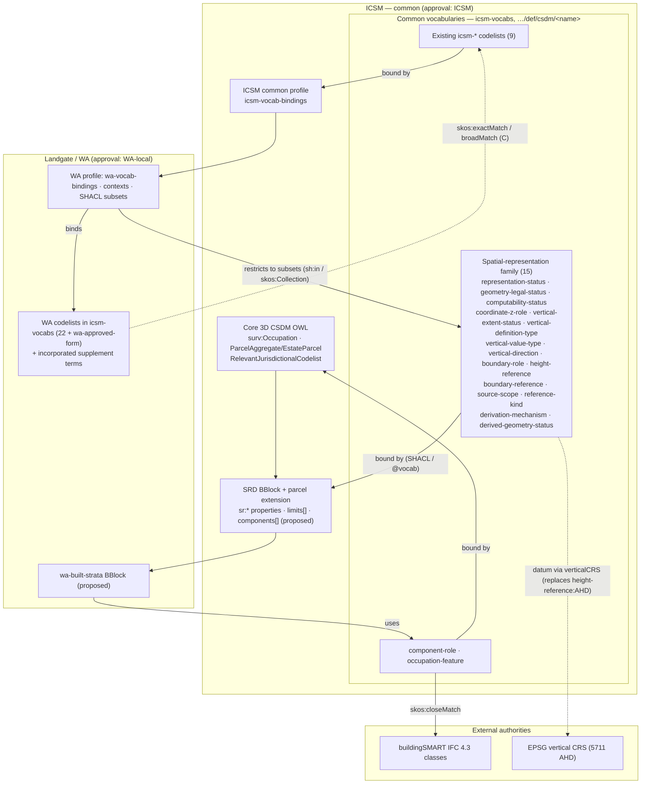

# 3D CSDM Vocabulary Review, Rationalisation and Integration Plan

**Status:** Review and planning document.
It changes no vocabulary, supplement, CSV draft, schema, namespace or binding.
**Date:** 2026-10-15
**Updated:** 2026-10-16.
The Surround team's decisions are recorded in [§5.10](#510-decisions), and the dispositions they change are marked in place.
**Scope:** ICSM `icsm-vocabs` LandParcels vocabularies, WA profile `*-supplement.ttl` files, and WA proposed CSV vocabularies.

---

## 5.1 Executive summary

### What was reviewed

| Source | Location | Vocabularies | Terms |
|---|---|---|---|
| Published ICSM vocabularies | `icsm-vocabs/vocabs/LandParcels/**` | 79 (9 `icsm-`, 22 `wa-`, 24 `vic-`, 24 `nz-`) | ≈ 9,900 (mostly admin units) |
| WA supplementary Turtle | `3d-csdm-profile-wa/profiles/*-supplement.ttl` | 10 files (8 extend published schemes; 2 define new schemes) | **43 proposed terms** |
| WA proposed CSV vocabularies | `3d-csdm-profile-wa/proposals/development/vocabularies/*.csv` | 25 | 138 |

### Key findings

1. **None of the published vocabularies is "approved".**
   All 79 carry `reg-statuses/experimental`.
   This makes it cheaper to correct things now, and it means nothing is locked in by publication status.
2. **The CSV drafts already use the common ICSM namespace, not a WA one.**
   `wa-liminal/context.jsonld` and `wa-3d/context.jsonld` map eleven of them to `https://linked.data.gov.au/def/csdm/<name>/`, which has no `wa-` prefix.
   Examples and validators depend on these IRIs, but nothing is published there.
   The URIs therefore already presume ICSM-level ownership, which WA cannot grant itself.
3. **The binding points belong to a generic BBlock, not to WA.**
   Most CSV vocabularies populate properties of the *Spatial Representation Definition* (SRD) BBlock.
   That block describes itself as "not specific to parcels".
   It lives in `ogcincubator/bblocks-land-parcels` with `register: icsm-csdm`, yet its identifiers are `icsm.profiles.wa.datatypes.*`.
   **Who owns the SRD BBlock is the most important unresolved governance question.**
4. **Confirmed duplicates.**
   [`vertical-direction`](vertical-direction.csv) ≡ [`icsm-vertical-direction`](crosswalk/vocab-crosswalk.csv).
   [`component-role`](component-role.csv) ≈ [`wa-strata-component-role`](crosswalk/vocab-crosswalk.csv).
   [`boundary-role`](boundary-role.csv) ⊃ [`vertical-limit-role`](crosswalk/vocab-crosswalk.csv).
   [`vertical-extent-status`](vertical-extent-status.csv) and [`vertical-boundary-state`](crosswalk/vocab-crosswalk.csv) share 5 concepts.
   [`wa-resolution-status`](crosswalk/vocab-crosswalk.csv) overlaps [`computability-status`](computability-status.csv).
   Supplement terms `unitEntitlementSchedule` and `recordOfStrataTitlesScheme` duplicate the existing `scheme-ue` and `scheme-record-form`.
5. **Some vocabularies are internally incoherent.**
   [`height-reference`](height-reference.csv) mixes three kinds of concept: reference levels, a vertical datum (AHD) and building surfaces.
   The worked example shows the effect: `buildingElementType: height-reference:ns`.
   Three CSV vocabularies (`building-`, `cadastral-` and [`relative-height-reference`](crosswalk/vocab-crosswalk.csv)) all populate the single `relationship` property.
6. **Some supplement terms sit in the wrong scheme.**
   [`wa-survey-type:ct`](crosswalk/vocab-crosswalk.csv) ("Certificate of Title") is a document, not a survey type.
   [`wa-monument-condition:computed`](crosswalk/vocab-crosswalk.csv) repeats what form, state and method already say: across 256 points it always co-occurs with [`wa-monument-form:cadastral-point-unmarked`](https://linked.data.gov.au/def/csdm/wa-monument-form/cadastral-point-unmarked), [`wa-monument-state:unmarked`](https://linked.data.gov.au/def/csdm/wa-monument-state/unmarked) and [`wa-surveypoint-method:G`](https://linked.data.gov.au/def/csdm/wa-surveypoint-method/G).
7. **Defects block incorporation as-is.**
   - [`wa-occ`](crosswalk/vocab-crosswalk.csv)'s top concepts are minted as `:building`, but `hasTopConcept` and [`skos:broader`](https://www.w3.org/2009/08/skos-reference/skos.html#broader) refer to `:Building`, `:BuildingElement` and `:Structure`.
     Those three IRIs are dangling, so all 12 hierarchy links are broken.
   - [`wa-approved-form`](../../../profiles/wa-approved-form-supplement.ttl) declares no [`skos:ConceptScheme`](https://www.w3.org/2009/08/skos-reference/skos.html#ConceptScheme).
   - Notation styles are mixed: camelCase, kebab-case and opaque codes (`a2d`, `rrs`, `dfld`).
   - The uplift pipeline drops `related` and does not split `altlabel`.
8. **Implementation drift already exists.**
   - Examples use `vertical-extent-status:dfld`, but that code exists only in [`geometry-legal-status`](geometry-legal-status.csv).
   - The validators reference codes absent from the CSVs (`cmp`, `rjr`).
   - `wa-angle-derivation:` and `wa-pt-method:` appear in examples but are declared nowhere.

### Major recommendations

- **Keep all 79 published vocabularies at their URIs.**
  Incorporate the WA codelist supplement terms into their WA parents in `icsm-vocabs`, after the defect fixes and de-duplication in [§5.5](#55-supplementary-term-integration-matrix-43-terms).
- **Turn the CSV drafts into one common "spatial representation" (SR) vocabulary family.**
  The 25 CSVs become 15 SR vocabularies, 1 common [`component-role`](component-role.csv) and 2 implementation-local lists; 7 are retired by merge.
  ICSM 3D CSDM should own it through the SRD BBlock, and it should be published in `icsm-vocabs` under the `…/def/csdm/<name>` IRIs already used in contexts.
  This needs merges, a split of [`height-reference`](height-reference.csv), and a single notation/URI convention fixed **before** first publication.
- **Create two common domain vocabularies:**
  - [`component-role`](component-role.csv): merge of the two [component-role](component-role.csv) CSVs.
  - [`occupation-feature`](occupation-feature.ttl): from [`wa-occ`](crosswalk/vocab-crosswalk.csv), mapped to IFC.

  Both concepts are general and already have core-model anchors (`surv:Occupation`, `container:occupationFeatures`, `EstateParcel`).
- **Create one WA-only vocabulary, [`wa-approved-form`](../../../profiles/wa-approved-form-supplement.ttl)** (Landgate form versions).
- **Keep processing vocabularies out of the domain model.**
  `boundary-coverage` and [`wa-prov-role`](wa-prov-role.csv) describe the generation pipeline.
  They should stay implementation-local (processWAData / a future validation BBlock) and not be published.
  Decided 2026-10-16 ([D12](#decision-d12)): [`wa-prov-role`](wa-prov-role.csv) stays local; `boundary-coverage` is removed and replaced by the boolean `fullBoundaryCoverage`.

### Implications for the ongoing update

- Do **not** upload the CSVs into the uplift pipeline as they stand.
  With no `csMapping` entry they would receive the base `https://icsm.gov.au/csdm/vocabs/notdefined`, their notations would become permanent URIs, and `related` would be lost.
- WA codelist supplements can proceed now, but only after the corrections in [§5.5](#55-supplementary-term-integration-matrix-43-terms).
  Several supplement IRIs are camelCase and will change.
- Examples, `wa-built-strata` drafts and `processWAData` validators must be updated in the same release as the vocabulary changes.

### Governance decisions needing agreement

1. Who owns the SRD BBlock and its vocabulary family: ICSM, the OGC incubator, or WA as interim steward.
   See [D2](#decision-d2) (decided 2026-10-16).
2. The URI and notation convention for new vocabularies.
   See [D1](#decision-d1) (decided 2026-10-16).
3. Whether ICSM will publish [`component-role`](component-role.csv) and [`occupation-feature`](occupation-feature.ttl) as common vocabularies.
   See [D5](#decision-d5) (Surround position decided 2026-10-16; ICSM to confirm).
4. Landgate policy items that decide individual terms: strata interests, endorsement authority, and surface synonyms.
   See [D7](#decision-d7)–[D9](#decision-d9) (decided 2026-10-16).

---

## 5.2 Scope and methodology

### Repositories and state (reproducibility)

| Repository | Path (WSL) | Branch / commit | Working tree |
|---|---|---|---|
| `surroundaustralia/icsm-vocabs` (fork of `icsm-au/icsm-vocabs`) | `/mnt/c/Users/Andrew/Documents/GitHub/sa-icsm-vocabs` | `main` @ `ceb7a2c` (2026-10-13) | 213 files flagged modified; **CRLF-only** |
| `surroundaustralia/3d-csdm-profile-wa` | `…/3d-csdm-profile-wa` | `main` @ `62e4809` (2026-10-13), in sync with `origin/main` | 514 files flagged; **CRLF-only** |
| `ogcincubator/bblocks-land-parcels` (SRD BBlocks) | `…/bblocks-land-parcels` | `master` @ `45addd0` (2026-09-21) | 4 files with real uncommitted changes (`build.sh`, assets). Reviewed at working-tree state. Don't have write access to repo, but diffs are irrelevant at this stage. |
| `icsm-au/3d-csdm-profile-icsm` (common profile) | `…/3d-csdm-profile-icsm` | `main` @ `f85d524` (2025-04-08) | clean |
| `surroundaustralia/3d-cadastre-model` (core OWL model) | `…/3d-cadastre-model` | `main` @ `494bad5` (2024-04-09) | clean |
| `processWAData` (implementation) | this repo | `feat/scope-note-vocabulary-forms` @ `614ee10` | clean |

**Correction (2026-10-15).**
This review was first run against the upstream `icsm-au/icsm-vocabs` checkout (`…/GitHub/icsm-vocabs`, `main` @ `944c464`) instead of the intended local fork `sa-icsm-vocabs`.
A rerun of the analysis (`wa-vocab-audit` in processWAData) against `sa-icsm-vocabs` @ `ceb7a2c` produced identical findings.
The published vocabularies differ in one concept only: the upstream copy of [`wa-procedure-used:measured`](https://linked.data.gov.au/def/csdm/wa-procedure-used/measured) has a mis-parsed definition, which the fork corrects.
The fork has also replaced the [`vocabs-uplift.yml`](https://github.com/icsm-au/icsm-vocabs/blob/main/source/vocabs-uplift.yml) workflows with `scripts/build_vocabs.py` and `build-vocabs.yml`, so pipeline statements in [§5.7](#57-cross-vocabulary-findings) ([F-P1](#finding-f-p1)) and [§5.9](#59-implementation-roadmap) ([A9](#activity-a9)) describe the upstream pipeline and need rechecking against the fork.
Repository-relative paths in this document (`icsm-vocabs/vocabs/…`) name the GitHub repository and apply unchanged to the fork.

### Supporting documentation

- `3d-csdm-profile-wa/proposals/development/built-strata/`:
  - [`built-strata-bblock-scope-note.md`](../built-strata/built-strata-bblock-scope-note.md)
  - [`decisions-register.md`](../built-strata/decisions-register.md)
  - [`built-strata-questions.md`](../built-strata/built-strata-questions.md)
  - [`examples/example-1.json`](../built-strata/examples/example-1.json) ([SP83687](../built-strata/examples/example-1.json))
- `3d-csdm-profile-wa/_sources/wa-{core,liminal,3d,mining}/`: `bblock.json`, `context.jsonld`, `schema.json`, examples.
- `bblocks-land-parcels/_sources/{spatialRepresentationDefinition,parcelSpatialRepresentationDefinition}/`: schema, ontology, context, description.
- `3d-csdm-profile-{wa,icsm}/profiles/*-vocab-bindings.csv`, `*-vocab-labels.csv`, [`vocabs-uplift.yml`](https://github.com/icsm-au/icsm-vocabs/blob/main/source/vocabs-uplift.yml).
- `processWAData/src/csdm_validator`, `src/validate_vocab`, and `.claude/skills/built-strata-spatial-representation/` (`_vocab.py`, `references/schema-status.md`).
- Published sites:
  - https://icsm-au.github.io/3d-csdm/ lists the modules Parcels, Common Patterns, Container, Geometry Primitives, Survey Features, Survey Provenance and Survey Observations, and the ICSM/NZ/WA/VIC profiles.
    It says nothing about codelist governance.
  - The WA profile site is JavaScript-rendered, so the local [`build/register.json`](../../../build/register.json) was used instead.
    It lists 10 BBlocks, all `under-development` v0.1.

### Assessment approach

- **Pass 1 ([§5.4](#54-detailed-vocabulary-assessments)).**
  Every Turtle file was parsed with rdflib 7.6 and every CSV with Python `csv`.
  Concepts, notations and namespaces were extracted programmatically.
  For each term the review checked IRI collisions, label and notation collisions, dangling references and cross-scheme mappings.
  Every vocabulary-valued property in the worked examples was extracted with its JSON path to establish actual use.
- **Pass 2 ([§5.7](#57-cross-vocabulary-findings)–5.9).**
  The vocabularies were compared by property they populate, by meaning (definition text) and against the core OWL model classes.

### Limitations

- No ICSM governance documents (terms of reference, change process) were found in the repositories.
  The ownership recommendations are therefore architectural, not procedural.
- Equivalences are judged from definitions.
  Several depend on Landgate survey-practice or legal confirmation, and these are flagged.
- The published `icsm-vocabs` web site was not compared byte-for-byte with the local checkout.
  Local `main` is level with `origin/main`.
- The validity of statutory references in WA terms (Acts, regulations, form numbers) was not checked against legislation.

---

## 5.3 Consolidated vocabulary inventory and recommendations

### 5.3.1 Published vocabularies (`icsm-vocabs`), 79

All are SKOS ConceptSchemes with status `experimental`, flat lists (no [`skos:broader`](https://www.w3.org/2009/08/skos-reference/skos.html#broader)), and no cross-scheme SKOS mappings.
"Bindings" are those declared in [`3d-csdm-profile-wa/profiles/wa-vocab-bindings.csv`](../../../profiles/wa-vocab-bindings.csv) (WA) and `3d-csdm-profile-icsm/profiles/icsm-vocab-bindings.csv` (ICSM).
Other profiles' bindings were out of scope.
Several `wa-` vocabularies are additionally used through `wa-core/context.jsonld` prefixes and `shaclClosures` without a binding row ([§5.7](#57-cross-vocabulary-findings), [F-B3](#finding-f-b3)).

| Vocabulary | Current location — scheme IRI | Terms | Status | Recommended owner/location | Recommended action | Current bindings | Confidence |
|---|---|---|---|---|---|---|---|
| ICSM Administrative Unit Types ([`icsm-admin-unit-type.ttl`](https://github.com/icsm-au/icsm-vocabs/blob/main/vocabs/LandParcels/CSD-Header/icsm-admin-unit-type.ttl)) | [`icsm-vocabs/vocabs/LandParcels/CSD-Header/icsm-admin-unit-type.ttl`](https://github.com/icsm-au/icsm-vocabs/blob/main/vocabs/LandParcels/CSD-Header/icsm-admin-unit-type.ttl) — `…/def/csdm/icsm-admin-unit-type` | 6 | Published, `experimental` | ICSM (common codelist) | Retain; add jurisdictional SKOS mappings (C) | ICSM: `container:adminUnit` | High |
| NZ CSD Annotation ([`nz-annotation.ttl`](https://github.com/icsm-au/icsm-vocabs/blob/main/vocabs/LandParcels/CSD-Header/nz-annotation.ttl)) | [`icsm-vocabs/vocabs/LandParcels/CSD-Header/nz-annotation.ttl`](https://github.com/icsm-au/icsm-vocabs/blob/main/vocabs/LandParcels/CSD-Header/nz-annotation.ttl) — `…/def/csdm/nz-annotation` | 1 | Published, `experimental` | LINZ/NZ (content), hosted in icsm-vocabs | Retain | n/a (other profile) | High |
| NZ Compound Coordinate Reference Systems ([`nz-compound-crs.ttl`](https://github.com/icsm-au/icsm-vocabs/blob/main/vocabs/LandParcels/CSD-Header/nz-compound-crs.ttl)) | [`icsm-vocabs/vocabs/LandParcels/CSD-Header/nz-compound-crs.ttl`](https://github.com/icsm-au/icsm-vocabs/blob/main/vocabs/LandParcels/CSD-Header/nz-compound-crs.ttl) — `…/def/csdm/nz-compound-crs` | 1 | Published, `experimental` | LINZ/NZ (content), hosted in icsm-vocabs | Retain | n/a (other profile) | High |
| NZ Coordinate Reference Systems ([`nz-crs.ttl`](https://github.com/icsm-au/icsm-vocabs/blob/main/vocabs/LandParcels/CSD-Header/nz-crs.ttl)) | [`icsm-vocabs/vocabs/LandParcels/CSD-Header/nz-crs.ttl`](https://github.com/icsm-au/icsm-vocabs/blob/main/vocabs/LandParcels/CSD-Header/nz-crs.ttl) — `…/def/csdm/nz-crs` | 54 | Published, `experimental` | LINZ/NZ (content), hosted in icsm-vocabs | Retain | n/a (other profile) | High |
| NZ Land Districts ([`nz-land-district.ttl`](https://github.com/icsm-au/icsm-vocabs/blob/main/vocabs/LandParcels/CSD-Header/nz-land-district.ttl)) | [`icsm-vocabs/vocabs/LandParcels/CSD-Header/nz-land-district.ttl`](https://github.com/icsm-au/icsm-vocabs/blob/main/vocabs/LandParcels/CSD-Header/nz-land-district.ttl) — `…/def/csdm/nz-land-district` | 12 | Published, `experimental` | LINZ/NZ (content), hosted in icsm-vocabs | Retain | n/a (other profile) | High |
| NZ Survey Class ([`nz-survey-class.ttl`](https://github.com/icsm-au/icsm-vocabs/blob/main/vocabs/LandParcels/CSD-Header/nz-survey-class.ttl)) | [`icsm-vocabs/vocabs/LandParcels/CSD-Header/nz-survey-class.ttl`](https://github.com/icsm-au/icsm-vocabs/blob/main/vocabs/LandParcels/CSD-Header/nz-survey-class.ttl) — `…/def/csdm/nz-survey-class` | 4 | Published, `experimental` | LINZ/NZ (content), hosted in icsm-vocabs | Retain | n/a (other profile) | High |
| NZ types of Survey Documentation ([`nz-survey-documentation-type.ttl`](https://github.com/icsm-au/icsm-vocabs/blob/main/vocabs/LandParcels/CSD-Header/nz-survey-documentation-type.ttl)) | [`icsm-vocabs/vocabs/LandParcels/CSD-Header/nz-survey-documentation-type.ttl`](https://github.com/icsm-au/icsm-vocabs/blob/main/vocabs/LandParcels/CSD-Header/nz-survey-documentation-type.ttl) — `…/def/csdm/nz-survey-documentation-type` | 67 | Published, `experimental` | LINZ/NZ (content), hosted in icsm-vocabs | Retain | n/a (other profile) | High |
| NZ Survey Purpose ([`nz-survey-purpose.ttl`](https://github.com/icsm-au/icsm-vocabs/blob/main/vocabs/LandParcels/CSD-Header/nz-survey-purpose.ttl)) | [`icsm-vocabs/vocabs/LandParcels/CSD-Header/nz-survey-purpose.ttl`](https://github.com/icsm-au/icsm-vocabs/blob/main/vocabs/LandParcels/CSD-Header/nz-survey-purpose.ttl) — `…/def/csdm/nz-survey-purpose` | 55 | Published, `experimental` | LINZ/NZ (content), hosted in icsm-vocabs | Retain | n/a (other profile) | High |
| NZ Survey Type ([`nz-survey-type.ttl`](https://github.com/icsm-au/icsm-vocabs/blob/main/vocabs/LandParcels/CSD-Header/nz-survey-type.ttl)) | [`icsm-vocabs/vocabs/LandParcels/CSD-Header/nz-survey-type.ttl`](https://github.com/icsm-au/icsm-vocabs/blob/main/vocabs/LandParcels/CSD-Header/nz-survey-type.ttl) — `…/def/csdm/nz-survey-type` | 6 | Published, `experimental` | LINZ/NZ (content), hosted in icsm-vocabs | Retain | n/a (other profile) | High |
| NZ Territorial Authorities ([`nz-territorial-authority.ttl`](https://github.com/icsm-au/icsm-vocabs/blob/main/vocabs/LandParcels/CSD-Header/nz-territorial-authority.ttl)) | [`icsm-vocabs/vocabs/LandParcels/CSD-Header/nz-territorial-authority.ttl`](https://github.com/icsm-au/icsm-vocabs/blob/main/vocabs/LandParcels/CSD-Header/nz-territorial-authority.ttl) — `…/def/csdm/nz-territorial-authority` | 80 | Published, `experimental` | LINZ/NZ (content), hosted in icsm-vocabs | Retain | n/a (other profile) | High |
| NZ Vertical Height Datums ([`nz-vhd.ttl`](https://github.com/icsm-au/icsm-vocabs/blob/main/vocabs/LandParcels/CSD-Header/nz-vhd.ttl)) | [`icsm-vocabs/vocabs/LandParcels/CSD-Header/nz-vhd.ttl`](https://github.com/icsm-au/icsm-vocabs/blob/main/vocabs/LandParcels/CSD-Header/nz-vhd.ttl) — `…/def/csdm/nz-vhd` | 14 | Published, `experimental` | LINZ/NZ (content), hosted in icsm-vocabs | Retain | n/a (other profile) | High |
| VIC CSD Annotation ([`vic-annotation.ttl`](https://github.com/icsm-au/icsm-vocabs/blob/main/vocabs/LandParcels/CSD-Header/vic-annotation.ttl)) | [`icsm-vocabs/vocabs/LandParcels/CSD-Header/vic-annotation.ttl`](https://github.com/icsm-au/icsm-vocabs/blob/main/vocabs/LandParcels/CSD-Header/vic-annotation.ttl) — `…/def/csdm/vic-annotation` | 41 | Published, `experimental` | Victoria (content), hosted in icsm-vocabs | Retain | n/a (other profile) | High |
| VIC Counties ([`vic-county.ttl`](https://github.com/icsm-au/icsm-vocabs/blob/main/vocabs/LandParcels/CSD-Header/vic-county.ttl)) | [`icsm-vocabs/vocabs/LandParcels/CSD-Header/vic-county.ttl`](https://github.com/icsm-au/icsm-vocabs/blob/main/vocabs/LandParcels/CSD-Header/vic-county.ttl) — `…/def/csdm/vic-county` | 37 | Published, `experimental` | Victoria (content), hosted in icsm-vocabs | Retain | n/a (other profile) | High |
| VIC Coordinate Reference Systems ([`vic-crs.ttl`](https://github.com/icsm-au/icsm-vocabs/blob/main/vocabs/LandParcels/CSD-Header/vic-crs.ttl)) | [`icsm-vocabs/vocabs/LandParcels/CSD-Header/vic-crs.ttl`](https://github.com/icsm-au/icsm-vocabs/blob/main/vocabs/LandParcels/CSD-Header/vic-crs.ttl) — `…/def/csdm/vic-crs` | 4 | Published, `experimental` | Victoria (content), hosted in icsm-vocabs | Retain | n/a (other profile) | High |
| VIC Local Government Areas ([`vic-local-government-area.ttl`](https://github.com/icsm-au/icsm-vocabs/blob/main/vocabs/LandParcels/CSD-Header/vic-local-government-area.ttl)) | [`icsm-vocabs/vocabs/LandParcels/CSD-Header/vic-local-government-area.ttl`](https://github.com/icsm-au/icsm-vocabs/blob/main/vocabs/LandParcels/CSD-Header/vic-local-government-area.ttl) — `…/def/csdm/vic-local-government-area` | 87 | Published, `experimental` | Victoria (content), hosted in icsm-vocabs | Retain | n/a (other profile) | High |
| VIC Localities ([`vic-locality.ttl`](https://github.com/icsm-au/icsm-vocabs/blob/main/vocabs/LandParcels/CSD-Header/vic-locality.ttl)) | [`icsm-vocabs/vocabs/LandParcels/CSD-Header/vic-locality.ttl`](https://github.com/icsm-au/icsm-vocabs/blob/main/vocabs/LandParcels/CSD-Header/vic-locality.ttl) — `…/def/csdm/vic-locality` | 2957 | Published, `experimental` | Victoria (content), hosted in icsm-vocabs | Retain | n/a (other profile) | High |
| VIC Parishes ([`vic-parish.ttl`](https://github.com/icsm-au/icsm-vocabs/blob/main/vocabs/LandParcels/CSD-Header/vic-parish.ttl)) | [`icsm-vocabs/vocabs/LandParcels/CSD-Header/vic-parish.ttl`](https://github.com/icsm-au/icsm-vocabs/blob/main/vocabs/LandParcels/CSD-Header/vic-parish.ttl) — `…/def/csdm/vic-parish` | 2004 | Published, `experimental` | Victoria (content), hosted in icsm-vocabs | Retain | n/a (other profile) | High |
| VIC types of Survey Documentation ([`vic-survey-documentation-type.ttl`](https://github.com/icsm-au/icsm-vocabs/blob/main/vocabs/LandParcels/CSD-Header/vic-survey-documentation-type.ttl)) | [`icsm-vocabs/vocabs/LandParcels/CSD-Header/vic-survey-documentation-type.ttl`](https://github.com/icsm-au/icsm-vocabs/blob/main/vocabs/LandParcels/CSD-Header/vic-survey-documentation-type.ttl) — `…/def/csdm/vic-survey-documentation-type` | 49 | Published, `experimental` | Victoria (content), hosted in icsm-vocabs | Retain | n/a (other profile) | High |
| VIC Survey Purpose ([`vic-survey-purpose.ttl`](https://github.com/icsm-au/icsm-vocabs/blob/main/vocabs/LandParcels/CSD-Header/vic-survey-purpose.ttl)) | [`icsm-vocabs/vocabs/LandParcels/CSD-Header/vic-survey-purpose.ttl`](https://github.com/icsm-au/icsm-vocabs/blob/main/vocabs/LandParcels/CSD-Header/vic-survey-purpose.ttl) — `…/def/csdm/vic-survey-purpose` | 39 | Published, `experimental` | Victoria (content), hosted in icsm-vocabs | Retain | n/a (other profile) | High |
| VIC Survey Type ([`vic-survey-type.ttl`](https://github.com/icsm-au/icsm-vocabs/blob/main/vocabs/LandParcels/CSD-Header/vic-survey-type.ttl)) | [`icsm-vocabs/vocabs/LandParcels/CSD-Header/vic-survey-type.ttl`](https://github.com/icsm-au/icsm-vocabs/blob/main/vocabs/LandParcels/CSD-Header/vic-survey-type.ttl) — `…/def/csdm/vic-survey-type` | 3 | Published, `experimental` | Victoria (content), hosted in icsm-vocabs | Retain | n/a (other profile) | High |
| VIC Townships ([`vic-township.ttl`](https://github.com/icsm-au/icsm-vocabs/blob/main/vocabs/LandParcels/CSD-Header/vic-township.ttl)) | [`icsm-vocabs/vocabs/LandParcels/CSD-Header/vic-township.ttl`](https://github.com/icsm-au/icsm-vocabs/blob/main/vocabs/LandParcels/CSD-Header/vic-township.ttl) — `…/def/csdm/vic-township` | 949 | Published, `experimental` | Victoria (content), hosted in icsm-vocabs | Retain | n/a (other profile) | High |
| VIC Vertical Height Datums ([`vic-vhd.ttl`](https://github.com/icsm-au/icsm-vocabs/blob/main/vocabs/LandParcels/CSD-Header/vic-vhd.ttl)) | [`icsm-vocabs/vocabs/LandParcels/CSD-Header/vic-vhd.ttl`](https://github.com/icsm-au/icsm-vocabs/blob/main/vocabs/LandParcels/CSD-Header/vic-vhd.ttl) — `…/def/csdm/vic-vhd` | 1 | Published, `experimental` | Victoria (content), hosted in icsm-vocabs | Retain | n/a (other profile) | High |
| WA CSD Annotation ([`wa-annotation.ttl`](https://github.com/icsm-au/icsm-vocabs/blob/main/vocabs/LandParcels/CSD-Header/wa-annotation.ttl)) | [`icsm-vocabs/vocabs/LandParcels/CSD-Header/wa-annotation.ttl`](https://github.com/icsm-au/icsm-vocabs/blob/main/vocabs/LandParcels/CSD-Header/wa-annotation.ttl) — `…/def/csdm/wa-annotation` | 8 | Published, `experimental` | Landgate/WA (content), hosted in icsm-vocabs | Retain; incorporate 8 supplement terms ([§5.5](#55-supplementary-term-integration-matrix-43-terms)) | none in WA/ICSM binding CSVs | High |
| WA Coordinate Reference Systems ([`wa-crs.ttl`](https://github.com/icsm-au/icsm-vocabs/blob/main/vocabs/LandParcels/CSD-Header/wa-crs.ttl)) | [`icsm-vocabs/vocabs/LandParcels/CSD-Header/wa-crs.ttl`](https://github.com/icsm-au/icsm-vocabs/blob/main/vocabs/LandParcels/CSD-Header/wa-crs.ttl) — `…/def/csdm/wa-crs` | 56 | Published, `experimental` | Landgate/WA (content), hosted in icsm-vocabs | Retain | WA: `container:horizontalCRS` | High |
| WA Local Government Districts ([`wa-local-government.ttl`](https://github.com/icsm-au/icsm-vocabs/blob/main/vocabs/LandParcels/CSD-Header/wa-local-government.ttl)) | [`icsm-vocabs/vocabs/LandParcels/CSD-Header/wa-local-government.ttl`](https://github.com/icsm-au/icsm-vocabs/blob/main/vocabs/LandParcels/CSD-Header/wa-local-government.ttl) — `…/def/csdm/wa-local-government` | 139 | Published, `experimental` | Landgate/WA (content), hosted in icsm-vocabs | Retain | WA: `container:adminUnit` | High |
| WA Localities ([`wa-locality.ttl`](https://github.com/icsm-au/icsm-vocabs/blob/main/vocabs/LandParcels/CSD-Header/wa-locality.ttl)) | [`icsm-vocabs/vocabs/LandParcels/CSD-Header/wa-locality.ttl`](https://github.com/icsm-au/icsm-vocabs/blob/main/vocabs/LandParcels/CSD-Header/wa-locality.ttl) — `…/def/csdm/wa-locality` | 1715 | Published, `experimental` | Landgate/WA (content), hosted in icsm-vocabs | Retain | WA: `container:adminUnit` | High |
| WA Survey Documentation ([`wa-survey-documentation-type.ttl`](https://github.com/icsm-au/icsm-vocabs/blob/main/vocabs/LandParcels/CSD-Header/wa-survey-documentation-type.ttl)) | [`icsm-vocabs/vocabs/LandParcels/CSD-Header/wa-survey-documentation-type.ttl`](https://github.com/icsm-au/icsm-vocabs/blob/main/vocabs/LandParcels/CSD-Header/wa-survey-documentation-type.ttl) — `…/def/csdm/wa-survey-documentation-type` | 18 | Published, `experimental` | Landgate/WA (content), hosted in icsm-vocabs | Retain; incorporate 9 supplement terms ([§5.5](#55-supplementary-term-integration-matrix-43-terms)) | none in WA/ICSM binding CSVs | High |
| WA Survey Purpose ([`wa-survey-purpose.ttl`](https://github.com/icsm-au/icsm-vocabs/blob/main/vocabs/LandParcels/CSD-Header/wa-survey-purpose.ttl)) | [`icsm-vocabs/vocabs/LandParcels/CSD-Header/wa-survey-purpose.ttl`](https://github.com/icsm-au/icsm-vocabs/blob/main/vocabs/LandParcels/CSD-Header/wa-survey-purpose.ttl) — `…/def/csdm/wa-survey-purpose` | 22 | Published, `experimental` | Landgate/WA (content), hosted in icsm-vocabs | Retain; incorporate 1 supplement term ([§5.5](#55-supplementary-term-integration-matrix-43-terms)) | WA: `container:purpose` | High |
| WA CSD Survey Type ([`wa-survey-type.ttl`](https://github.com/icsm-au/icsm-vocabs/blob/main/vocabs/LandParcels/CSD-Header/wa-survey-type.ttl)) | [`icsm-vocabs/vocabs/LandParcels/CSD-Header/wa-survey-type.ttl`](https://github.com/icsm-au/icsm-vocabs/blob/main/vocabs/LandParcels/CSD-Header/wa-survey-type.ttl) — `…/def/csdm/wa-survey-type` | 15 | Published, `experimental` | Landgate/WA (content), hosted in icsm-vocabs | Retain; incorporate 1 supplement term ([§5.5](#55-supplementary-term-integration-matrix-43-terms)) | WA: `container:surveyType` | High |
| WA Height Datums ([`wa-vhd.ttl`](https://github.com/icsm-au/icsm-vocabs/blob/main/vocabs/LandParcels/CSD-Header/wa-vhd.ttl)) | [`icsm-vocabs/vocabs/LandParcels/CSD-Header/wa-vhd.ttl`](https://github.com/icsm-au/icsm-vocabs/blob/main/vocabs/LandParcels/CSD-Header/wa-vhd.ttl) — `…/def/csdm/wa-vhd` | 1 | Published, `experimental` | Landgate/WA (content), hosted in icsm-vocabs | Retain | WA: `container:verticalDatum` | High |
| ICSM Parcel State ([`icsm-parcel-state.ttl`](https://github.com/icsm-au/icsm-vocabs/blob/main/vocabs/LandParcels/Parcels/icsm-parcel-state.ttl)) | [`icsm-vocabs/vocabs/LandParcels/Parcels/icsm-parcel-state.ttl`](https://github.com/icsm-au/icsm-vocabs/blob/main/vocabs/LandParcels/Parcels/icsm-parcel-state.ttl) — `…/def/csdm/icsm-parcel-state` | 16 | Published, `experimental` | ICSM (common codelist) | Retain; add jurisdictional SKOS mappings (C) | ICSM: `parcel:state` | High |
| NZ Memorial Types ([`nz-interest-type.ttl`](https://github.com/icsm-au/icsm-vocabs/blob/main/vocabs/LandParcels/Parcels/nz-interest-type.ttl)) | [`icsm-vocabs/vocabs/LandParcels/Parcels/nz-interest-type.ttl`](https://github.com/icsm-au/icsm-vocabs/blob/main/vocabs/LandParcels/Parcels/nz-interest-type.ttl) — `…/def/csdm/nz-interest-type` | 4 | Published, `experimental` | LINZ/NZ (content), hosted in icsm-vocabs | Retain | n/a (other profile) | High |
| NZ Parcel Purpose ([`nz-parcel-purpose.ttl`](https://github.com/icsm-au/icsm-vocabs/blob/main/vocabs/LandParcels/Parcels/nz-parcel-purpose.ttl)) | [`icsm-vocabs/vocabs/LandParcels/Parcels/nz-parcel-purpose.ttl`](https://github.com/icsm-au/icsm-vocabs/blob/main/vocabs/LandParcels/Parcels/nz-parcel-purpose.ttl) — `…/def/csdm/nz-parcel-purpose` | 10 | Published, `experimental` | LINZ/NZ (content), hosted in icsm-vocabs | Retain | n/a (other profile) | High |
| NZ Parcel State ([`nz-parcel-state.ttl`](https://github.com/icsm-au/icsm-vocabs/blob/main/vocabs/LandParcels/Parcels/nz-parcel-state.ttl)) | [`icsm-vocabs/vocabs/LandParcels/Parcels/nz-parcel-state.ttl`](https://github.com/icsm-au/icsm-vocabs/blob/main/vocabs/LandParcels/Parcels/nz-parcel-state.ttl) — `…/def/csdm/nz-parcel-state` | 7 | Published, `experimental` | LINZ/NZ (content), hosted in icsm-vocabs | Retain | n/a (other profile) | High |
| NZ Parcel Type ([`nz-parcel-type.ttl`](https://github.com/icsm-au/icsm-vocabs/blob/main/vocabs/LandParcels/Parcels/nz-parcel-type.ttl)) | [`icsm-vocabs/vocabs/LandParcels/Parcels/nz-parcel-type.ttl`](https://github.com/icsm-au/icsm-vocabs/blob/main/vocabs/LandParcels/Parcels/nz-parcel-type.ttl) — `…/def/csdm/nz-parcel-type` | 6 | Published, `experimental` | LINZ/NZ (content), hosted in icsm-vocabs | Retain | n/a (other profile) | High |
| NZ Secondary Parcel Purpose ([`nz-secondary-parcel-purpose.ttl`](https://github.com/icsm-au/icsm-vocabs/blob/main/vocabs/LandParcels/Parcels/nz-secondary-parcel-purpose.ttl)) | [`icsm-vocabs/vocabs/LandParcels/Parcels/nz-secondary-parcel-purpose.ttl`](https://github.com/icsm-au/icsm-vocabs/blob/main/vocabs/LandParcels/Parcels/nz-secondary-parcel-purpose.ttl) — `…/def/csdm/nz-secondary-parcel-purpose` | 13 | Published, `experimental` | LINZ/NZ (content), hosted in icsm-vocabs | Retain | n/a (other profile) | High |
| NZ Secondary Parcel Type ([`nz-secondary-parcel-type.ttl`](https://github.com/icsm-au/icsm-vocabs/blob/main/vocabs/LandParcels/Parcels/nz-secondary-parcel-type.ttl)) | [`icsm-vocabs/vocabs/LandParcels/Parcels/nz-secondary-parcel-type.ttl`](https://github.com/icsm-au/icsm-vocabs/blob/main/vocabs/LandParcels/Parcels/nz-secondary-parcel-type.ttl) — `…/def/csdm/nz-secondary-parcel-type` | 2 | Published, `experimental` | LINZ/NZ (content), hosted in icsm-vocabs | Retain | n/a (other profile) | High |
| NZ Secondary Purpose ([`nz-secondary-purpose.ttl`](https://github.com/icsm-au/icsm-vocabs/blob/main/vocabs/LandParcels/Parcels/nz-secondary-purpose.ttl)) | [`icsm-vocabs/vocabs/LandParcels/Parcels/nz-secondary-purpose.ttl`](https://github.com/icsm-au/icsm-vocabs/blob/main/vocabs/LandParcels/Parcels/nz-secondary-purpose.ttl) — `…/def/csdm/nz-secondary-purpose` | 18 | Published, `experimental` | LINZ/NZ (content), hosted in icsm-vocabs | Retain | n/a (other profile) | High |
| VIC Memorial Types ([`vic-interest-type.ttl`](https://github.com/icsm-au/icsm-vocabs/blob/main/vocabs/LandParcels/Parcels/vic-interest-type.ttl)) | [`icsm-vocabs/vocabs/LandParcels/Parcels/vic-interest-type.ttl`](https://github.com/icsm-au/icsm-vocabs/blob/main/vocabs/LandParcels/Parcels/vic-interest-type.ttl) — `…/def/csdm/vic-interest-type` | 98 | Published, `experimental` | Victoria (content), hosted in icsm-vocabs | Retain | n/a (other profile) | High |
| VIC Parcel Purpose ([`vic-parcel-purpose.ttl`](https://github.com/icsm-au/icsm-vocabs/blob/main/vocabs/LandParcels/Parcels/vic-parcel-purpose.ttl)) | [`icsm-vocabs/vocabs/LandParcels/Parcels/vic-parcel-purpose.ttl`](https://github.com/icsm-au/icsm-vocabs/blob/main/vocabs/LandParcels/Parcels/vic-parcel-purpose.ttl) — `…/def/csdm/vic-parcel-purpose` | 8 | Published, `experimental` | Victoria (content), hosted in icsm-vocabs | Retain | n/a (other profile) | High |
| VIC Parcel State ([`vic-parcel-state.ttl`](https://github.com/icsm-au/icsm-vocabs/blob/main/vocabs/LandParcels/Parcels/vic-parcel-state.ttl)) | [`icsm-vocabs/vocabs/LandParcels/Parcels/vic-parcel-state.ttl`](https://github.com/icsm-au/icsm-vocabs/blob/main/vocabs/LandParcels/Parcels/vic-parcel-state.ttl) — `…/def/csdm/vic-parcel-state` | 6 | Published, `experimental` | Victoria (content), hosted in icsm-vocabs | Retain | n/a (other profile) | High |
| VIC Parcel Type ([`vic-parcel-type.ttl`](https://github.com/icsm-au/icsm-vocabs/blob/main/vocabs/LandParcels/Parcels/vic-parcel-type.ttl)) | [`icsm-vocabs/vocabs/LandParcels/Parcels/vic-parcel-type.ttl`](https://github.com/icsm-au/icsm-vocabs/blob/main/vocabs/LandParcels/Parcels/vic-parcel-type.ttl) — `…/def/csdm/vic-parcel-type` | 4 | Published, `experimental` | Victoria (content), hosted in icsm-vocabs | Retain | n/a (other profile) | High |
| VIC Secondary Parcel Purpose ([`vic-secondary-parcel-purpose.ttl`](https://github.com/icsm-au/icsm-vocabs/blob/main/vocabs/LandParcels/Parcels/vic-secondary-parcel-purpose.ttl)) | [`icsm-vocabs/vocabs/LandParcels/Parcels/vic-secondary-parcel-purpose.ttl`](https://github.com/icsm-au/icsm-vocabs/blob/main/vocabs/LandParcels/Parcels/vic-secondary-parcel-purpose.ttl) — `…/def/csdm/vic-secondary-parcel-purpose` | 6 | Published, `experimental` | Victoria (content), hosted in icsm-vocabs | Retain | n/a (other profile) | High |
| WA Memorial Types ([`wa-interest-type.ttl`](https://github.com/icsm-au/icsm-vocabs/blob/main/vocabs/LandParcels/Parcels/wa-interest-type.ttl)) | [`icsm-vocabs/vocabs/LandParcels/Parcels/wa-interest-type.ttl`](https://github.com/icsm-au/icsm-vocabs/blob/main/vocabs/LandParcels/Parcels/wa-interest-type.ttl) — `…/def/csdm/wa-interest-type` | 87 | Published, `experimental` | Landgate/WA (content), hosted in icsm-vocabs | Retain; incorporate 2 supplement terms ([§5.5](#55-supplementary-term-integration-matrix-43-terms)) | none in WA/ICSM binding CSVs | High |
| WA Primary Parcel Purpose ([`wa-parcel-purpose.ttl`](https://github.com/icsm-au/icsm-vocabs/blob/main/vocabs/LandParcels/Parcels/wa-parcel-purpose.ttl)) | [`icsm-vocabs/vocabs/LandParcels/Parcels/wa-parcel-purpose.ttl`](https://github.com/icsm-au/icsm-vocabs/blob/main/vocabs/LandParcels/Parcels/wa-parcel-purpose.ttl) — `…/def/csdm/wa-parcel-purpose` | 20 | Published, `experimental` | Landgate/WA (content), hosted in icsm-vocabs | Retain; incorporate 1 supplement term ([§5.5](#55-supplementary-term-integration-matrix-43-terms)) | WA: `parcel:purpose` | High |
| WA Parcel State ([`wa-parcel-state.ttl`](https://github.com/icsm-au/icsm-vocabs/blob/main/vocabs/LandParcels/Parcels/wa-parcel-state.ttl)) | [`icsm-vocabs/vocabs/LandParcels/Parcels/wa-parcel-state.ttl`](https://github.com/icsm-au/icsm-vocabs/blob/main/vocabs/LandParcels/Parcels/wa-parcel-state.ttl) — `…/def/csdm/wa-parcel-state` | 11 | Published, `experimental` | Landgate/WA (content), hosted in icsm-vocabs | Retain | WA: `parcel:state` | High |
| WA Parcel Type ([`wa-parcel-type.ttl`](https://github.com/icsm-au/icsm-vocabs/blob/main/vocabs/LandParcels/Parcels/wa-parcel-type.ttl)) | [`icsm-vocabs/vocabs/LandParcels/Parcels/wa-parcel-type.ttl`](https://github.com/icsm-au/icsm-vocabs/blob/main/vocabs/LandParcels/Parcels/wa-parcel-type.ttl) — `…/def/csdm/wa-parcel-type` | 5 | Published, `experimental` | Landgate/WA (content), hosted in icsm-vocabs | Retain | WA: `parcel:type` | High |
| WA Secondary Parcel Purpose ([`wa-secondary-parcel-purpose.ttl`](https://github.com/icsm-au/icsm-vocabs/blob/main/vocabs/LandParcels/Parcels/wa-secondary-parcel-purpose.ttl)) | [`icsm-vocabs/vocabs/LandParcels/Parcels/wa-secondary-parcel-purpose.ttl`](https://github.com/icsm-au/icsm-vocabs/blob/main/vocabs/LandParcels/Parcels/wa-secondary-parcel-purpose.ttl) — `…/def/csdm/wa-secondary-parcel-purpose` | 60 | Published, `experimental` | Landgate/WA (content), hosted in icsm-vocabs | Retain | WA: `parcel:purpose` | High |
| WA Secondary Parcel Type ([`wa-secondary-parcel-type.ttl`](https://github.com/icsm-au/icsm-vocabs/blob/main/vocabs/LandParcels/Parcels/wa-secondary-parcel-type.ttl)) | [`icsm-vocabs/vocabs/LandParcels/Parcels/wa-secondary-parcel-type.ttl`](https://github.com/icsm-au/icsm-vocabs/blob/main/vocabs/LandParcels/Parcels/wa-secondary-parcel-type.ttl) — `…/def/csdm/wa-secondary-parcel-type` | 4 | Published, `experimental` | Landgate/WA (content), hosted in icsm-vocabs | Retain | WA: `parcel:type` | High |
| WA secondary Parcel Purpose ([`wa-secondary-purpose.ttl`](https://github.com/icsm-au/icsm-vocabs/blob/main/vocabs/LandParcels/Parcels/wa-secondary-purpose.ttl)) | [`icsm-vocabs/vocabs/LandParcels/Parcels/wa-secondary-purpose.ttl`](https://github.com/icsm-au/icsm-vocabs/blob/main/vocabs/LandParcels/Parcels/wa-secondary-purpose.ttl) — `…/def/csdm/wa-secondary-purpose` | 68 | Published, `experimental` | Landgate/WA (content), hosted in icsm-vocabs | Retain | none in WA/ICSM binding CSVs | High |
| ICSM Angle Types ([`icsm-angle-type.ttl`](https://github.com/icsm-au/icsm-vocabs/blob/main/vocabs/LandParcels/SurveyObservations/icsm-angle-type.ttl)) | [`icsm-vocabs/vocabs/LandParcels/SurveyObservations/icsm-angle-type.ttl`](https://github.com/icsm-au/icsm-vocabs/blob/main/vocabs/LandParcels/SurveyObservations/icsm-angle-type.ttl) — `…/def/csdm/icsm-angle-type` | 6 | Published, `experimental` | ICSM (common codelist) | Retain; add jurisdictional SKOS mappings (C) | ICSM: `surv:angleType` | High |
| ICSM Distance Type ([`icsm-distance-type.ttl`](https://github.com/icsm-au/icsm-vocabs/blob/main/vocabs/LandParcels/SurveyObservations/icsm-distance-type.ttl)) | [`icsm-vocabs/vocabs/LandParcels/SurveyObservations/icsm-distance-type.ttl`](https://github.com/icsm-au/icsm-vocabs/blob/main/vocabs/LandParcels/SurveyObservations/icsm-distance-type.ttl) — `…/def/csdm/icsm-distance-type` | 8 | Published, `experimental` | ICSM (common codelist) | Retain; add jurisdictional SKOS mappings (C) | ICSM: `surv:distanceType` | High |
| ICSM Equipment Type ([`icsm-equipment-type.ttl`](https://github.com/icsm-au/icsm-vocabs/blob/main/vocabs/LandParcels/SurveyObservations/icsm-equipment-type.ttl)) | [`icsm-vocabs/vocabs/LandParcels/SurveyObservations/icsm-equipment-type.ttl`](https://github.com/icsm-au/icsm-vocabs/blob/main/vocabs/LandParcels/SurveyObservations/icsm-equipment-type.ttl) — `…/def/csdm/icsm-equipment-type` | 15 | Published, `experimental` | ICSM (common codelist) | Retain; add jurisdictional SKOS mappings (C) | none in WA/ICSM binding CSVs | High |
| ICSM Survey Procedures ([`icsm-procedure-used.ttl`](https://github.com/icsm-au/icsm-vocabs/blob/main/vocabs/LandParcels/SurveyObservations/icsm-procedure-used.ttl)) | [`icsm-vocabs/vocabs/LandParcels/SurveyObservations/icsm-procedure-used.ttl`](https://github.com/icsm-au/icsm-vocabs/blob/main/vocabs/LandParcels/SurveyObservations/icsm-procedure-used.ttl) — `…/def/csdm/icsm-procedure-used` | 7 | Published, `experimental` | ICSM (common codelist) | Retain; add jurisdictional SKOS mappings (C) | ICSM: [`sosa:usedProcedure`](https://www.w3.org/TR/vocab-ssn/#SOSAusedProcedure) | High |
| NZ Survey Procedures ([`nz-procedure-used.ttl`](https://github.com/icsm-au/icsm-vocabs/blob/main/vocabs/LandParcels/SurveyObservations/nz-procedure-used.ttl)) | [`icsm-vocabs/vocabs/LandParcels/SurveyObservations/nz-procedure-used.ttl`](https://github.com/icsm-au/icsm-vocabs/blob/main/vocabs/LandParcels/SurveyObservations/nz-procedure-used.ttl) — `…/def/csdm/nz-procedure-used` | 6 | Published, `experimental` | LINZ/NZ (content), hosted in icsm-vocabs | Retain | n/a (other profile) | High |
| NZ Vector Purpose ([`nz-vector-purpose.ttl`](https://github.com/icsm-au/icsm-vocabs/blob/main/vocabs/LandParcels/SurveyObservations/nz-vector-purpose.ttl)) | [`icsm-vocabs/vocabs/LandParcels/SurveyObservations/nz-vector-purpose.ttl`](https://github.com/icsm-au/icsm-vocabs/blob/main/vocabs/LandParcels/SurveyObservations/nz-vector-purpose.ttl) — `…/def/csdm/nz-vector-purpose` | 7 | Published, `experimental` | LINZ/NZ (content), hosted in icsm-vocabs | Retain | n/a (other profile) | High |
| VIC Survey Procedures ([`vic-procedure-used.ttl`](https://github.com/icsm-au/icsm-vocabs/blob/main/vocabs/LandParcels/SurveyObservations/vic-procedure-used.ttl)) | [`icsm-vocabs/vocabs/LandParcels/SurveyObservations/vic-procedure-used.ttl`](https://github.com/icsm-au/icsm-vocabs/blob/main/vocabs/LandParcels/SurveyObservations/vic-procedure-used.ttl) — `…/def/csdm/vic-procedure-used` | 18 | Published, `experimental` | Victoria (content), hosted in icsm-vocabs | Retain | n/a (other profile) | High |
| VIC Vector Purpose ([`vic-vector-purpose.ttl`](https://github.com/icsm-au/icsm-vocabs/blob/main/vocabs/LandParcels/SurveyObservations/vic-vector-purpose.ttl)) | [`icsm-vocabs/vocabs/LandParcels/SurveyObservations/vic-vector-purpose.ttl`](https://github.com/icsm-au/icsm-vocabs/blob/main/vocabs/LandParcels/SurveyObservations/vic-vector-purpose.ttl) — `…/def/csdm/vic-vector-purpose` | 4 | Published, `experimental` | Victoria (content), hosted in icsm-vocabs | Retain | n/a (other profile) | High |
| VIC Vector Quality ([`vic-vector-quality.ttl`](https://github.com/icsm-au/icsm-vocabs/blob/main/vocabs/LandParcels/SurveyObservations/vic-vector-quality.ttl)) | [`icsm-vocabs/vocabs/LandParcels/SurveyObservations/vic-vector-quality.ttl`](https://github.com/icsm-au/icsm-vocabs/blob/main/vocabs/LandParcels/SurveyObservations/vic-vector-quality.ttl) — `…/def/csdm/vic-vector-quality` | 2 | Published, `experimental` | Victoria (content), hosted in icsm-vocabs | Retain | n/a (other profile) | High |
| WA Survey Procedures ([`wa-procedure-used.ttl`](https://github.com/icsm-au/icsm-vocabs/blob/main/vocabs/LandParcels/SurveyObservations/wa-procedure-used.ttl)) | [`icsm-vocabs/vocabs/LandParcels/SurveyObservations/wa-procedure-used.ttl`](https://github.com/icsm-au/icsm-vocabs/blob/main/vocabs/LandParcels/SurveyObservations/wa-procedure-used.ttl) — `…/def/csdm/wa-procedure-used` | 11 | Published, `experimental` | Landgate/WA (content), hosted in icsm-vocabs | Retain | WA: [`sosa:usedProcedure`](https://www.w3.org/TR/vocab-ssn/#SOSAusedProcedure) | High |
| WA Vector Purpose ([`wa-vector-purpose.ttl`](https://github.com/icsm-au/icsm-vocabs/blob/main/vocabs/LandParcels/SurveyObservations/wa-vector-purpose.ttl)) | [`icsm-vocabs/vocabs/LandParcels/SurveyObservations/wa-vector-purpose.ttl`](https://github.com/icsm-au/icsm-vocabs/blob/main/vocabs/LandParcels/SurveyObservations/wa-vector-purpose.ttl) — `…/def/csdm/wa-vector-purpose` | 128 | Published, `experimental` | Landgate/WA (content), hosted in icsm-vocabs | Retain | WA: `surv:vectorPurpose` | High |
| NZ Point Quality Classes ([`nz-point-class.ttl`](https://github.com/icsm-au/icsm-vocabs/blob/main/vocabs/LandParcels/SurveyPoints/accuracy/nz-point-class.ttl)) | [`icsm-vocabs/vocabs/LandParcels/SurveyPoints/accuracy/nz-point-class.ttl`](https://github.com/icsm-au/icsm-vocabs/blob/main/vocabs/LandParcels/SurveyPoints/accuracy/nz-point-class.ttl) — `…/def/csdm/nz-point-class` | 13 | Published, `experimental` | LINZ/NZ (content), hosted in icsm-vocabs | Retain | n/a (other profile) | High |
| VIC Point Quality Classes ([`vic-point-class.ttl`](https://github.com/icsm-au/icsm-vocabs/blob/main/vocabs/LandParcels/SurveyPoints/accuracy/vic-point-class.ttl)) | [`icsm-vocabs/vocabs/LandParcels/SurveyPoints/accuracy/vic-point-class.ttl`](https://github.com/icsm-au/icsm-vocabs/blob/main/vocabs/LandParcels/SurveyPoints/accuracy/vic-point-class.ttl) — `…/def/csdm/vic-point-class` | 7 | Published, `experimental` | Victoria (content), hosted in icsm-vocabs | Retain | n/a (other profile) | High |
| ICSM Monument Condition ([`icsm-condition.ttl`](https://github.com/icsm-au/icsm-vocabs/blob/main/vocabs/LandParcels/SurveyPoints/condition/icsm-condition.ttl)) | [`icsm-vocabs/vocabs/LandParcels/SurveyPoints/condition/icsm-condition.ttl`](https://github.com/icsm-au/icsm-vocabs/blob/main/vocabs/LandParcels/SurveyPoints/condition/icsm-condition.ttl) — `…/def/csdm/icsm-monument-condition` | 39 | Published, `experimental` | ICSM (common codelist) | Retain; add jurisdictional SKOS mappings (C) | ICSM: `surv:condition` | High |
| NZ Monument Condition ([`nz-condition.ttl`](https://github.com/icsm-au/icsm-vocabs/blob/main/vocabs/LandParcels/SurveyPoints/condition/nz-condition.ttl)) | [`icsm-vocabs/vocabs/LandParcels/SurveyPoints/condition/nz-condition.ttl`](https://github.com/icsm-au/icsm-vocabs/blob/main/vocabs/LandParcels/SurveyPoints/condition/nz-condition.ttl) — `…/def/csdm/nz-monument-condition` | 18 | Published, `experimental` | LINZ/NZ (content), hosted in icsm-vocabs | Retain | n/a (other profile) | High |
| VIC Monument Condition ([`vic-condition.ttl`](https://github.com/icsm-au/icsm-vocabs/blob/main/vocabs/LandParcels/SurveyPoints/condition/vic-condition.ttl)) | [`icsm-vocabs/vocabs/LandParcels/SurveyPoints/condition/vic-condition.ttl`](https://github.com/icsm-au/icsm-vocabs/blob/main/vocabs/LandParcels/SurveyPoints/condition/vic-condition.ttl) — `…/def/csdm/vic-monument-condition` | 20 | Published, `experimental` | Victoria (content), hosted in icsm-vocabs | Retain | n/a (other profile) | High |
| WA Monument Condition ([`wa-condition.ttl`](https://github.com/icsm-au/icsm-vocabs/blob/main/vocabs/LandParcels/SurveyPoints/condition/wa-condition.ttl)) | [`icsm-vocabs/vocabs/LandParcels/SurveyPoints/condition/wa-condition.ttl`](https://github.com/icsm-au/icsm-vocabs/blob/main/vocabs/LandParcels/SurveyPoints/condition/wa-condition.ttl) — `…/def/csdm/wa-monument-condition` | 6 | Published, `experimental` | Landgate/WA (content), hosted in icsm-vocabs | Retain; incorporate 1 supplement term ([§5.5](#55-supplementary-term-integration-matrix-43-terms)) | WA: `surv:condition` | High |
| NZ Monument Form ([`nz-monument-type.ttl`](https://github.com/icsm-au/icsm-vocabs/blob/main/vocabs/LandParcels/SurveyPoints/monument/nz-monument-type.ttl)) | [`icsm-vocabs/vocabs/LandParcels/SurveyPoints/monument/nz-monument-type.ttl`](https://github.com/icsm-au/icsm-vocabs/blob/main/vocabs/LandParcels/SurveyPoints/monument/nz-monument-type.ttl) — `…/def/csdm/nz-monument-form` | 14 | Published, `experimental` | LINZ/NZ (content), hosted in icsm-vocabs | Retain | n/a (other profile) | High |
| VIC Monument Form ([`vic-monument-type.ttl`](https://github.com/icsm-au/icsm-vocabs/blob/main/vocabs/LandParcels/SurveyPoints/monument/vic-monument-type.ttl)) | [`icsm-vocabs/vocabs/LandParcels/SurveyPoints/monument/vic-monument-type.ttl`](https://github.com/icsm-au/icsm-vocabs/blob/main/vocabs/LandParcels/SurveyPoints/monument/vic-monument-type.ttl) — `…/def/csdm/vic-monument-form` | 32 | Published, `experimental` | Victoria (content), hosted in icsm-vocabs | Retain | n/a (other profile) | High |
| WA Monument Form ([`wa-monument-type.ttl`](https://github.com/icsm-au/icsm-vocabs/blob/main/vocabs/LandParcels/SurveyPoints/monument/wa-monument-type.ttl)) | [`icsm-vocabs/vocabs/LandParcels/SurveyPoints/monument/wa-monument-type.ttl`](https://github.com/icsm-au/icsm-vocabs/blob/main/vocabs/LandParcels/SurveyPoints/monument/wa-monument-type.ttl) — `…/def/csdm/wa-monument-form` | 34 | Published, `experimental` | Landgate/WA (content), hosted in icsm-vocabs | Retain | WA: `surv:form` | High |
| WA Survey Point Creation Method ([`wa-surveypoint-method.ttl`](https://github.com/icsm-au/icsm-vocabs/blob/main/vocabs/LandParcels/SurveyPoints/other/wa-surveypoint-method.ttl)) | [`icsm-vocabs/vocabs/LandParcels/SurveyPoints/other/wa-surveypoint-method.ttl`](https://github.com/icsm-au/icsm-vocabs/blob/main/vocabs/LandParcels/SurveyPoints/other/wa-surveypoint-method.ttl) — `…/def/csdm/wa-surveypoint-method` | 7 | Published, `experimental` | Landgate/WA (content), hosted in icsm-vocabs | Retain | none in WA/ICSM binding CSVs | High |
| ICSM Survey Point Purpose ([`icsm-purpose.ttl`](https://github.com/icsm-au/icsm-vocabs/blob/main/vocabs/LandParcels/SurveyPoints/purpose/icsm-purpose.ttl)) | [`icsm-vocabs/vocabs/LandParcels/SurveyPoints/purpose/icsm-purpose.ttl`](https://github.com/icsm-au/icsm-vocabs/blob/main/vocabs/LandParcels/SurveyPoints/purpose/icsm-purpose.ttl) — `…/def/csdm/icsm-surveypoint-purpose` | 13 | Published, `experimental` | ICSM (common codelist) | Retain; add jurisdictional SKOS mappings (C) | ICSM: `surv:purpose` | High |
| NZ Survey Point Purpose ([`nz-purpose.ttl`](https://github.com/icsm-au/icsm-vocabs/blob/main/vocabs/LandParcels/SurveyPoints/purpose/nz-purpose.ttl)) | [`icsm-vocabs/vocabs/LandParcels/SurveyPoints/purpose/nz-purpose.ttl`](https://github.com/icsm-au/icsm-vocabs/blob/main/vocabs/LandParcels/SurveyPoints/purpose/nz-purpose.ttl) — `…/def/csdm/nz-surveypoint-purpose` | 20 | Published, `experimental` | LINZ/NZ (content), hosted in icsm-vocabs | Retain | n/a (other profile) | High |
| VIC Survey Point Purpose ([`vic-purpose.ttl`](https://github.com/icsm-au/icsm-vocabs/blob/main/vocabs/LandParcels/SurveyPoints/purpose/vic-purpose.ttl)) | [`icsm-vocabs/vocabs/LandParcels/SurveyPoints/purpose/vic-purpose.ttl`](https://github.com/icsm-au/icsm-vocabs/blob/main/vocabs/LandParcels/SurveyPoints/purpose/vic-purpose.ttl) — `…/def/csdm/vic-surveypoint-purpose` | 10 | Published, `experimental` | Victoria (content), hosted in icsm-vocabs | Retain | n/a (other profile) | High |
| WA Survey Point Purpose ([`wa-purpose.ttl`](https://github.com/icsm-au/icsm-vocabs/blob/main/vocabs/LandParcels/SurveyPoints/purpose/wa-purpose.ttl)) | [`icsm-vocabs/vocabs/LandParcels/SurveyPoints/purpose/wa-purpose.ttl`](https://github.com/icsm-au/icsm-vocabs/blob/main/vocabs/LandParcels/SurveyPoints/purpose/wa-purpose.ttl) — `…/def/csdm/wa-surveypoint-purpose` | 43 | Published, `experimental` | Landgate/WA (content), hosted in icsm-vocabs | Retain; incorporate 1 supplement term ([§5.5](#55-supplementary-term-integration-matrix-43-terms)) | WA: `surv:purpose` | High |
| ICSM Monument State ([`icsm-state.ttl`](https://github.com/icsm-au/icsm-vocabs/blob/main/vocabs/LandParcels/SurveyPoints/state/icsm-state.ttl)) | [`icsm-vocabs/vocabs/LandParcels/SurveyPoints/state/icsm-state.ttl`](https://github.com/icsm-au/icsm-vocabs/blob/main/vocabs/LandParcels/SurveyPoints/state/icsm-state.ttl) — `…/def/csdm/icsm-monument-state` | 4 | Published, `experimental` | ICSM (common codelist) | Retain; add jurisdictional SKOS mappings (C) | none in WA/ICSM binding CSVs | High |
| NZ Monument State ([`nz-state.ttl`](https://github.com/icsm-au/icsm-vocabs/blob/main/vocabs/LandParcels/SurveyPoints/state/nz-state.ttl)) | [`icsm-vocabs/vocabs/LandParcels/SurveyPoints/state/nz-state.ttl`](https://github.com/icsm-au/icsm-vocabs/blob/main/vocabs/LandParcels/SurveyPoints/state/nz-state.ttl) — `…/def/csdm/nz-monument-state` | 6 | Published, `experimental` | LINZ/NZ (content), hosted in icsm-vocabs | Retain | n/a (other profile) | High |
| VIC Monument State ([`vic-state.ttl`](https://github.com/icsm-au/icsm-vocabs/blob/main/vocabs/LandParcels/SurveyPoints/state/vic-state.ttl)) | [`icsm-vocabs/vocabs/LandParcels/SurveyPoints/state/vic-state.ttl`](https://github.com/icsm-au/icsm-vocabs/blob/main/vocabs/LandParcels/SurveyPoints/state/vic-state.ttl) — `…/def/csdm/vic-monument-state` | 3 | Published, `experimental` | Victoria (content), hosted in icsm-vocabs | Retain | n/a (other profile) | High |
| WA Monument State ([`wa-state.ttl`](https://github.com/icsm-au/icsm-vocabs/blob/main/vocabs/LandParcels/SurveyPoints/state/wa-state.ttl)) | [`icsm-vocabs/vocabs/LandParcels/SurveyPoints/state/wa-state.ttl`](https://github.com/icsm-au/icsm-vocabs/blob/main/vocabs/LandParcels/SurveyPoints/state/wa-state.ttl) — `…/def/csdm/wa-monument-state` | 11 | Published, `experimental` | Landgate/WA (content), hosted in icsm-vocabs | Retain | WA: `surv:state` | High |

Purpose by vocabulary group (to avoid repeating it per row):

- **CSD-Header:** survey metadata codelists.
  Admin units, CRSs and height datums, survey type, purpose and documentation type, and annotations.
- **Parcels:** parcel state, purpose and type, and interest (memorial) type.
- **SurveyObservations:** angle, distance, equipment, procedure, and vector purpose and quality.
- **SurveyPoints:** monument condition, form and state, survey point purpose, point class, and point creation method.

`SurveyPoints/surveypointvocab.md` is documentation, not a vocabulary.

**Cleanup status (2026-10-16, updated 2026-10-18).**
The dispositions in [§5.3.2](#532-supplementary-turtle-vocabularies-10-files), [§5.3.3](#533-proposed-csv-vocabularies-25-files), [§5.5](#55-supplementary-term-integration-matrix-43-terms) and [§5.6](#56-new-csv-vocabulary-integration-matrix) were carried out by the WA vocabulary cleanup (Stages [2](HANDOFF.md#cleanup-stage-2)-[4](HANDOFF.md#cleanup-stage-4)) and applied to the examples and processWAData (Stages [5](HANDOFF.md#cleanup-stage-5)-[6](HANDOFF.md#cleanup-stage-6)).
Each old term's outcome is in [`crosswalk/vocab-crosswalk.csv`](crosswalk/vocab-crosswalk.csv) (181 rows), and the status columns in [§5.5](#55-supplementary-term-integration-matrix-43-terms) and [§5.6](#56-new-csv-vocabulary-integration-matrix) summarise it.
The 25 CSVs are now 16 drafts plus the local [`wa-prov-role`](wa-prov-role.csv), and [`wa-occ`](crosswalk/vocab-crosswalk.csv) is the common [`occupation-feature.ttl`](occupation-feature.ttl).
Publication remains with the custodians; see [`HANDOFF.md`](HANDOFF.md).

The handover fixes (cleanup [Stage 9](HANDOFF.md#cleanup-stage-9), 2026-10-18) resolved most of [F-B1](#finding-f-b1) and [A5](#activity-a5).
The stale [`wa-vocab-bindings.csv.json`](../../../profiles/wa-vocab-bindings.csv.json) was regenerated from the CSV, the undefined `wa-vector-type`, `wa-interest` and `wa-mines` prefixes were removed from the contexts, and `wa-pt-method:` became [`wa-surveypoint-method:`](https://linked.data.gov.au/def/csdm/wa-surveypoint-method).
Still open are the missing `icsm-survey-type` ([B5](#activity-b5)), the `wa-annotation-role` alias kept for the `wa-core` examples.
The seven placeholder [`wa-survey-documentation-type`](https://linked.data.gov.au/def/csdm/wa-survey-documentation-type) definitions ([F-Q2](#finding-f-q2)) have drafted replacements in the `sa-icsm-vocabs` source CSV; they are still to be confirmed and published (HANDOFF section 6).
The audit also found 16 example values in no vocabulary that this review did not list (for example `wa-vector-purpose:I`); they are mapped in [`crosswalk/value-aliases.csv`](crosswalk/value-aliases.csv), and `wa-parcel-type:road`, `wa-parcel-type:miscellaneous` and `icsm-distance-type:grid` were added to the published vocabularies.

### 5.3.2 Supplementary Turtle vocabularies, 10 files

| Vocabulary | Current location | Purpose | Status | Recommended owner/location | Recommended action | Recommended bindings | Rationale | Conf. |
|---|---|---|---|---|---|---|---|---|
| [`wa-annotation-supplement.ttl`](../../../profiles/wa-annotation-supplement.ttl) (8) | `3d-csdm-profile-wa/profiles/` → `…/wa-annotation` | Plan annotations (regulation certificates, strata certifications, height/boundary statements) | Supplement; file marked "TEMPORARY" | Landgate; `icsm-vocabs` [`wa-annotation`](https://linked.data.gov.au/def/csdm/wa-annotation) | **Incorporate** all 8 | `annotations[].role` (WA); add a `wa-vocab-bindings` row | Jurisdictional plan annotations, like `vic-`/[`nz-annotation`](https://linked.data.gov.au/def/csdm/nz-annotation). No collisions. | High |
| [`wa-approved-form-supplement.ttl`](../../../profiles/wa-approved-form-supplement.ttl) (4) | as above → `…/wa-approved-form` (**new scheme, no ConceptScheme declared**) | Approved Landgate form versions | Supplement (new vocab) | Landgate; new `icsm-vocabs` [`wa-approved-form`](../../../profiles/wa-approved-form-supplement.ttl) | **Create** (after fixes) | `supportingDocuments[].conformsTo` (WA) | Form versions are WA-statutory instances. Their [`dcterms:type`](https://www.dublincore.org/specifications/dublin-core/dcmi-terms/terms/type/) links to document types are a good pattern. | High |
| `wa-interest-type-supplement.ttl` (2) | → `…/wa-interest-type` | Strata scheme / strata lot interests | Supplement | Landgate | **Reject** ([D7](#decision-d7), decided 2026-10-16) | — | Definitions describe entitlement *values*, not interest types. Entitlements become scheme and lot parcel properties; `strata-lot` duplicated `ct`. | High |
| `wa-monument-condition-supplement.ttl` (1) | → `…/wa-monument-condition` | `computed` virtual point | Supplement | — | **Do not incorporate; reuse existing** | — | Condition is the physical state of a mark. Form, state and method already express "unmarked, calculated". | High |
| `wa-occ-supplement.ttl` (15) | → `…/wa-occ` (new scheme) | Occupation feature types (building elements, structures) | Supplement (new vocab) | **ICSM** (Survey Features); new common [`occupation-feature`](occupation-feature.ttl) | **Relocate → Create common**; map to IFC | `occupationFeatures[].featureType`; `limits[].buildingElementType` (proposed) | General concepts already anchored in core `surv:Occupation`. Decision register #11 says to align with IFC. | Medium |
| [`wa-parcel-purpose-supplement.ttl`](../../../profiles/wa-parcel-purpose-supplement.ttl) (1) | → `…/wa-parcel-purpose` | `strata-scheme` | Supplement | Landgate | **Incorporate (interim, definition fixed)** | `parcelPurpose` | Stopgap until `ParcelAggregate` is a legal `featureType` ([D6](#decision-d6)) | Medium |
| `wa-purpose-supplement.ttl` (1) | → `…/wa-surveypoint-purpose` | `derived-boundary` | Supplement | Landgate | **Defer / relocate** to [`wa-surveypoint-method`](https://linked.data.gov.au/def/csdm/wa-surveypoint-method) | `points[].methodEstablished` | "Derived" is a creation method, not a purpose | Medium |
| [`wa-survey-documentation-supplement.ttl`](../../../profiles/wa-survey-documentation-supplement.ttl) (9) | → `…/wa-survey-documentation-type` | Strata document types | Supplement | Landgate | **Mixed**: 6 incorporate, 3 reuse/map existing | `supportingDocuments[].role` | Two duplicate existing terms. Notation style must match the parent (kebab-case). | High |
| [`wa-survey-purpose-supplement.ttl`](../../../profiles/wa-survey-purpose-supplement.ttl) (1) | → `…/wa-survey-purpose` | `subdivision-t-sts` | Supplement; marked "TEMPORARY" | Landgate | **Incorporate** | `container:purpose` (already bound) | Genuine WA statutory purpose | High |
| `wa-survey-type-supplement.ttl` (1) | → `…/wa-survey-type` | `ct` | Supplement | — | **Relocate** → [`wa-survey-documentation-type:certificate-of-title`](../../../profiles/wa-survey-documentation-supplement.ttl) | `sourceAuthorityType` / `supportingDocuments[].role` | Category error: a title is not a survey type | High |

### 5.3.3 Proposed CSV vocabularies, 25 files

"SR family" means the recommended common spatial-representation vocabulary family.
Its owner is the SRD BBlock owner, recommended to be ICSM 3D CSDM ([D2](#decision-d2)), with `icsm-vocabs` as the authoritative location and IRIs `https://linked.data.gov.au/def/csdm/<name>`.

| Vocabulary (file) | Purpose | Terms | Status | Recommended owner/location | Action | Recommended bindings | Rationale | Conf. |
|---|---|---|---|---|---|---|---|---|
| [`representation-status.csv`](representation-status.csv) | Overall 2D/2.5D/3D representation class | 6 | CSV draft; prefix in WA contexts | SR family | **Create** | `sr:representationStatus` | Generic; property exists in SRD | High |
| [`geometry-legal-status.csv`](geometry-legal-status.csv) | Which geometry is legally authoritative | 7 | CSV draft | SR family | **Create** | `sr:geometryLegalStatus` (feature and `referenceSurfaces[]`) | Generic; property exists | High |
| [`computability-status.csv`](computability-status.csv) | Whether values/geometry can be computed | 9 | CSV draft | SR family | **Create + absorb** [`wa-resolution-status`](crosswalk/vocab-crosswalk.csv); add hierarchy | `sr:computabilityStatus`, `sr:resolutionStatus` | Assessment state is a legitimate modelled state. Same concepts at two levels. | Medium |
| [`coordinate-z-role.csv`](coordinate-z-role.csv) | Meaning of z ordinate | 7 | CSV draft | SR family | **Create** (fix `referenceSurface` definition) | `sr:zValueRole` | Generic | High |
| [`vertical-extent-status.csv`](vertical-extent-status.csv) | Legal/source state of whole vertical extent | 10 | CSV draft | SR family | **Merge** with [`vertical-boundary-state`](crosswalk/vocab-crosswalk.csv) into one scheme with two [`skos:Collection`](https://www.w3.org/2009/08/skos-reference/skos.html#Collection)s; move `dfv` and `a3d` out | `sr:verticalExtentStatus` | 5 shared concepts. `dfv`/`a3d` duplicate [`geometry-legal-status`](geometry-legal-status.csv). | Medium |
| `vertical-boundary-state.csv` | State of each upper/lower boundary | 10 | CSV draft | SR family | **Merge** (as above); drop `uca`/`ucb` (direction implicit) | `sr:boundaryState` | Same concepts, finer granularity | Medium |
| [`vertical-definition-type.csv`](vertical-definition-type.csv) | Kind of source definition | 5 | CSV draft | SR family | **Create**; `brb` narrower of `gbr`; rename `ahd` notation | `sr:definitionType` | Generic. `brb` is not WA-specific (NSW/VIC strata use building-referenced boundaries). | High |
| [`vertical-value-type.csv`](vertical-value-type.csv) | How `value` is expressed | 4 | CSV draft | SR family | **Create** (document orthogonality to definition type) | `sr:valueType` | Orthogonal, e.g. a jurisdictional rule expressed as an offset | Medium |
| [`vertical-direction.csv`](vertical-direction.csv) | above / below / coincident | 3 | CSV draft | SR family | **Create** (survivor of merge) | `sr:direction`; `limits[].heightOffset.offsetDirection` (proposed) | Generic | High |
| `icsm-vertical-direction.csv` | identical to above | 3 | CSV draft | — | **Merge** into [`vertical-direction`](vertical-direction.csv); retire | — | Byte-identical content | High |
| `vertical-limit-role.csv` | upper / lower limit | 2 | CSV draft | — | **Merge** into [`boundary-role`](boundary-role.csv); retire | — | Subsumed by [`boundary-role`](boundary-role.csv) | High |
| [`boundary-role.csv`](boundary-role.csv) | lower / upper / lateral | 3 | CSV draft | SR family | **Create** (survivor) | `sr:limitRole`; `limits[].boundaryRole` (proposed) | "Lateral" is not a vertical limit, so the broader name is right | High |
| [`height-reference.csv`](height-reference.csv) | Reference levels, datum, building surfaces | 15 | CSV draft | SR family | **Split**: keep 8 levels; AHD → reuse EPSG/[`wa-vhd`](https://linked.data.gov.au/def/csdm/wa-vhd); 6 building-surface terms → [`boundary-reference`](boundary-reference.csv) × [`occupation-feature`](occupation-feature.ttl) | `sr:heightReference`, `sr:surfaceType` | Mixed abstraction levels; misuse seen in example | High |
| `building-boundary-reference.csv` | Surface of a building element taken as a boundary | 10 | CSV draft | SR family | **Merge** into common [`boundary-reference`](boundary-reference.csv); collapse synonyms ([D8](#decision-d8)) | `limits[].relationship` (proposed) | General strata survey terminology | Medium |
| `cadastral-boundary-reference.csv` | 2D title boundary used as 3D face | 1 | CSV draft | SR family | **Merge** into [`boundary-reference`](boundary-reference.csv) | as above | Same property, same role | High |
| `relative-height-reference.csv` | above / below surface | 2 | CSV draft | — | **Merge** into [`boundary-reference`](boundary-reference.csv) as one `offset-from-surface` concept; direction via [`vertical-direction`](vertical-direction.csv) | as above | Encodes direction twice | Medium |
| [`component-role.csv`](component-role.csv) | Role of a component within a multipart parcel | 8 | CSV draft | **ICSM** (Parcels) | **Merge** with [`wa-strata-component-role`](crosswalk/vocab-crosswalk.csv) → common [`component-role`](component-role.csv) | `derivedGeometry.components[].componentRole` (proposed) | General volumetric parcel concept | Medium |
| `wa-strata-component-role.csv` | Same, kebab-case, 7 terms | 7 | CSV draft (used in example) | — | **Merge** (as above); WA subset via SHACL | — | Duplicate; definitions already generic | High |
| `icsm-scope.csv` | Level a source statement applies at | 6 | CSV draft | SR family (parcel extension) | **Create** as [`source-scope`](source-scope.csv) | `verticalBoundaryDefinitions[].source.scope` / `sourceBasis` (proposed) | Generic source applicability | Medium |
| `icsm-reference-kind.csv` | Kind of thing a limit references | 3 | CSV draft | SR family | **Create** as [`reference-kind`](reference-kind.csv); fix altLabels | `limits[].referenceKind` (proposed) | Generic discriminator | Medium |
| `icsm-mechanism.csv` | Geometric derivation mechanism | 5 | CSV draft | SR family (derivation section) | **Create** as [`derivation-mechanism`](derivation-mechanism.csv) | `limits[].geometricDerivation.mechanism` (proposed) | Reusable derivation capability; not cadastral domain | Medium |
| `icsm-derived-geometry-status.csv` | Whether derived geometry was generated | 3 | CSV draft | SR family | **Create**, reduce to `generated` / `not-generated` (+ optional `generation-failed`) | `sr:derivedGeometryStatus` (model change: datatype → object property) | `solid-generated` duplicates `geometryType` | Medium |
| `icsm-boundary-coverage.csv` | Whether authored limits cover all faces | 3 | CSV draft | — | **Remove** ([D12](#decision-d12), decided 2026-10-16): replaced by the boolean `fullBoundaryCoverage` | `components[].fullBoundaryCoverage` (skill-only) | Reconciliation/validation state. Scope note says values `true`/`false`, but the CSV has 3 terms. | Medium |
| `wa-resolution-status.csv` | resolved / unresolved | 2 | CSV draft | — | **Merge** into [`computability-status`](computability-status.csv) | `sr:resolutionStatus` | Duplicate concept, less informative | Medium |
| [`wa-prov-role.csv`](wa-prov-role.csv) | Roles in a conversion pipeline | 4 | CSV draft | **Implementation-local** (processing workflow) | **Defer** (keep local; do not publish in icsm-vocabs) | [`prov:hadRole`](https://www.w3.org/TR/prov-o/#hadRole) in WA examples | Mixes agent and entity roles; open-ended (examples use ~15 other bare roles) | Medium |

---

## 5.4 Detailed vocabulary assessments

Each assessment covers current state, terms, usage, relationships, owner, bindings, action and open issues, condensed where [§5.3](#53-consolidated-vocabulary-inventory-and-recommendations) already says enough.

### 5.4.1 Published vocabularies

**ICSM common codelists (9).**
These are [`icsm-admin-unit-type`](https://linked.data.gov.au/def/csdm/icsm-admin-unit-type), [`icsm-parcel-state`](https://linked.data.gov.au/def/csdm/icsm-parcel-state), [`icsm-angle-type`](https://linked.data.gov.au/def/csdm/icsm-angle-type), [`icsm-distance-type`](https://linked.data.gov.au/def/csdm/icsm-distance-type), [`icsm-equipment-type`](https://linked.data.gov.au/def/csdm/icsm-equipment-type), [`icsm-procedure-used`](https://linked.data.gov.au/def/csdm/icsm-procedure-used), [`icsm-monument-condition`](https://linked.data.gov.au/def/csdm/icsm-monument-condition), [`icsm-surveypoint-purpose`](https://linked.data.gov.au/def/csdm/icsm-surveypoint-purpose) and [`icsm-monument-state`](https://linked.data.gov.au/def/csdm/icsm-monument-state).

- They act as **label unions** of jurisdictional terms rather than as abstractions.
  All 6 [`wa-monument-condition`](https://linked.data.gov.au/def/csdm/wa-monument-condition) labels appear in [`icsm-monument-condition`](https://linked.data.gov.au/def/csdm/icsm-monument-condition), and 10 of 11 [`wa-parcel-state`](https://linked.data.gov.au/def/csdm/wa-parcel-state) labels appear in [`icsm-parcel-state`](https://linked.data.gov.au/def/csdm/icsm-parcel-state).
  The concepts are minted under separate IRIs with **no** [`skos:exactMatch`](https://www.w3.org/2009/08/skos-reference/skos.html#exactMatch) or `broadMatch`.
  The "common vocabulary + jurisdictional subset" pattern therefore exists only by duplicated labels, not by reuse.
- **Action:** Retain.
  Longer term (C), add [`skos:exactMatch`](https://www.w3.org/2009/08/skos-reference/skos.html#exactMatch)/`broadMatch` from jurisdictional concepts to ICSM concepts.
  Do not re-mint either side.
- **Binding defect:** `icsm-vocab-bindings.csv` binds `container:surveyType` to `vocabs:icsm-survey-type`, which **does not exist** in `icsm-vocabs`.

**WA codelists (22).**
Landgate owns the content and `icsm-vocabs` hosts it.
The core model types parcel state, purpose and type as `com:RelevantJurisdictionalCodelist`, which confirms the jurisdictional level is correct.
Observations:

- **Inconsistent filename vs IRI:** [`wa-monument-type.ttl`](https://github.com/icsm-au/icsm-vocabs/blob/main/vocabs/LandParcels/SurveyPoints/monument/wa-monument-type.ttl) → [`wa-monument-form`](https://linked.data.gov.au/def/csdm/wa-monument-form); [`wa-condition.ttl`](https://github.com/icsm-au/icsm-vocabs/blob/main/vocabs/LandParcels/SurveyPoints/condition/wa-condition.ttl) → [`wa-monument-condition`](https://linked.data.gov.au/def/csdm/wa-monument-condition); [`wa-purpose.ttl`](https://github.com/icsm-au/icsm-vocabs/blob/main/vocabs/LandParcels/SurveyPoints/purpose/wa-purpose.ttl) → [`wa-surveypoint-purpose`](https://linked.data.gov.au/def/csdm/wa-surveypoint-purpose); [`wa-state.ttl`](https://github.com/icsm-au/icsm-vocabs/blob/main/vocabs/LandParcels/SurveyPoints/state/wa-state.ttl) → [`wa-monument-state`](https://linked.data.gov.au/def/csdm/wa-monument-state).
  Keep the IRIs; renaming files is optional.
- **[`wa-parcel-type`](https://linked.data.gov.au/def/csdm/wa-parcel-type) mixes tenure and scheme kind.**
  It holds `freehold`/`crown`/`leasehold` alongside `community-titles-building-scheme`/`-land-scheme`.
  This matters for `strata-scheme` ([D6](#decision-d6)).
- **[`wa-survey-type`](https://linked.data.gov.au/def/csdm/wa-survey-type) mixes plan types with data or format types.**
  `csd`, `dsd`, `field-record` and `survey-sheet` sit alongside `strata-plan` and `deposited-plan`.
- **[`wa-survey-documentation-type`](https://linked.data.gov.au/def/csdm/wa-survey-documentation-type) has seven terms with the definition "Note: To be confirmed if part of final schema design".**
  These are placeholder definitions in a published vocabulary.
- **[`wa-secondary-purpose`](https://linked.data.gov.au/def/csdm/wa-secondary-purpose) (68) vs [`wa-secondary-parcel-purpose`](https://linked.data.gov.au/def/csdm/wa-secondary-parcel-purpose) (60)** share only 2 labels.
  They are distinct but confusingly named.
  Only the latter is bound.
- **[`wa-surveypoint-method`](https://linked.data.gov.au/def/csdm/wa-surveypoint-method)** has no WA binding row and no `wa-core` context prefix.
  It is used as `methodEstablished` under two prefixes ([`wa-surveypoint-method:`](https://linked.data.gov.au/def/csdm/wa-surveypoint-method) and the undeclared `wa-pt-method:`).
- **Action:** Retain all.
  Incorporate supplements per [§5.5](#55-supplementary-term-integration-matrix-43-terms).
  Fix bindings and prefixes (A).

**VIC (24) and NZ (24).**
These are out of WA authority and need no change.
They are relevant only as the precedent for jurisdictional annotation, document-type and purpose vocabularies, and as candidates for future SKOS mappings to common vocabularies.

### 5.4.2 Supplements

**[`wa-annotation`](https://linked.data.gov.au/def/csdm/wa-annotation) (8 terms).**
- `r-4` and `r-54` are WA regulation certificates, analogous to the existing `r-26a`.
- `height-limit-description` and `boundary-definition-statement` are plan statements.
  They are WA-encoded, but the concept is generic, so they are candidates for a future common annotation concept (C).
- The four certification annotations (`licensed-valuer-certification`, `building-approval-certification`, `strata-plan-endorsement`, `record-of-strata-titles-scheme`) record *that* a certificate is endorsed on the plan.
  They are distinct from the document types that *are* the certificates.
  Link each pair with [`skos:related`](https://www.w3.org/2009/08/skos-reference/skos.html#related).
- Usage: `annotations[].role` under the prefix [`wa-annotation-role:`](https://linked.data.gov.au/def/csdm/wa-annotation).
  The `wa-core` context aliases that prefix to the [`wa-annotation`](https://linked.data.gov.au/def/csdm/wa-annotation) namespace.
  `hasProvenance…surveyCertificate` uses [`wa-annotation:`](https://linked.data.gov.au/def/csdm/wa-annotation).
  Two prefixes for one namespace should be reduced to one.

**[`wa-approved-form`](../../../profiles/wa-approved-form-supplement.ttl) (4 terms, new).**
A register of Landgate-approved form versions, linked by [`dcterms:type`](https://www.dublincore.org/specifications/dublin-core/dcmi-terms/terms/type/) to document types, with validity intervals.
It is well designed in principle.
Required fixes:
- Add the [`skos:ConceptScheme`](https://www.w3.org/2009/08/skos-reference/skos.html#ConceptScheme).
- Add a pipeline `csMapping` or keep it as hand-authored TTL.
- `dcterms:source "wa-leg:…"` is an undeclared pseudo-CURIE literal.
  Make it an IRI.
- Retarget [`dcterms:type`](https://www.dublincore.org/specifications/dublin-core/dcmi-terms/terms/type/) to the de-duplicated document types (`scheme-ue`, `scheme-record-form`).
- The `BA14` label reads "form B14".
  Notation `15c` vs label "15C" needs a consistent case.
- The `15c` definition says "planning or local government", which conflicts with other definitions ([D9](#decision-d9)).
  Decided 2026-10-16: the plan is endorsed under section 15(4) by the WAPC or its authorised delegate, such as a local government exercising delegated authority.

**[`wa-interest-type`](https://linked.data.gov.au/def/csdm/wa-interest-type) (2 terms).**
- The parent is labelled "WA Memorial Types" and already contains `ct` (Certificate of Title).
- The proposed definitions ("Total value of a Strata Scheme entitlement", "per Strata Lot entitlement value") describe **unit entitlement quantities**.
  Those belong in properties such as `entitlementTotal` and `entitlementPortion` (decision register #9/#10), not in an interest type.
- If a WA strata lot is held under a Certificate of Title, `strata-lot` duplicates `ct`.
- **Decided 2026-10-16 ([D7](#decision-d7)):** neither term is added.
  Entitlements become properties of the scheme and lot parcels.
  Lots to be created carry no interest entry; `ct` interests are added once titles are registered.

**[`wa-monument-condition:computed`](crosswalk/vocab-crosswalk.csv).**
- Every one of the 256 uses co-occurs with form `cadastral-point-unmarked`, state `unmarked`, purpose `derived-boundary` and method `G` ("Graphical – CO-GO, calculated").
- A condition describes the physical state of a monument, and an unmarked point has no monument.
- Recommendation: omit `condition` when the form is unmarked.
  Have the WA profile SHACL make `condition` optional in that case.
  Do not add the term.
- It is currently loaded via `wa-liminal` `shaclClosures`, so removing it requires the example update.

**[`wa-occ`](crosswalk/vocab-crosswalk.csv) (15 terms, new).**
- **Concepts:** `building`, `building-element` (with `wall`, `slab`, `ceiling`, `roof`, `column`, `beam`, `stair`, `door`, `window`, `other-building-element`), and `structure` (with `fence`, `retaining-wall`).
- **Defects:**
  - Dangling top-concept and broader IRIs (case mismatch).
  - `slab` is defined to include roofs, which overlaps `roof`.
  - `ceiling` is a covering in IFC (`IfcCovering.CEILING`), not a structural element.
  - Language tags (`@en`) are used inconsistently with the parent vocabularies.
- **Core anchoring:** The core model already defines `surv:Occupation` ("fences, walls … buildings …"), `surv:Terrain ⊂ Occupation`, `surveyobs:DesignModel` (BIM) and `container:occupationFeatures`.
  It has **no** occupation-type property, which is a proposed model change.
- **Usage:** The worked example carries IFC `bimType` on each occupation feature, alongside `featureType: wa-occ:wall`.
- **Recommendation:** Create a common [`occupation-feature`](occupation-feature.ttl), with [`skos:closeMatch`](https://www.w3.org/2009/08/skos-reference/skos.html#closeMatch) to IFC 4.3 class IRIs and [`skos:related`](https://www.w3.org/2009/08/skos-reference/skos.html#related) to `surv:Terrain`.
  The concepts are construction-generic.
  Nothing in their definitions is WA law.

**[`wa-parcel-purpose:strata-scheme`](../../../profiles/wa-parcel-purpose-supplement.ttl).**
- The definition ("abstract parcel that aggregates…") describes the core class `EstateParcel ⊂ ParcelAggregate`, not a purpose.
- It is used because `icsm-3d` limits `featureType` to `PrimaryParcel`/`SecondaryParcel` (scope note [Q1](../built-strata/built-strata-bblock-scope-note.md#question-1)/[Q3](../built-strata/built-strata-bblock-scope-note.md#question-3)).
- Incorporate as a WA interim term, consistent with existing `strata-lot` and `common-property`, with a definition along the lines of "parcel representing the land and scheme of a strata titles scheme".
- Pursue the `ParcelAggregate` `featureType` with ICSM ([D6](#decision-d6)).

**[`wa-surveypoint-purpose:derived-boundary`](crosswalk/vocab-crosswalk.csv).**
A point's *purpose* is to mark a boundary ([`wa-surveypoint-purpose`](https://linked.data.gov.au/def/csdm/wa-surveypoint-purpose) already has `internal-boundary`, `road-boundary` and `3d-normal`).
"Derived from the SRD" is the creation method.
Options:
- (a) Use an existing boundary purpose plus [`wa-surveypoint-method:G`](https://linked.data.gov.au/def/csdm/wa-surveypoint-method/G).
- (b) If generated points must be distinguishable, add a WA method concept narrower than `G`.
  Preferred.

**[`wa-survey-documentation-type`](https://linked.data.gov.au/def/csdm/wa-survey-documentation-type) (9 terms).**
See [§5.5](#55-supplementary-term-integration-matrix-43-terms).
Notation must be kebab-case to match the parent; the supplement uses camelCase for 6 terms.
The supplement's `strataPlanEndorsementCertificate` (WAPC) conflicts with [`wa-annotation:strata-plan-endorsement`](../../../profiles/wa-annotation-supplement.ttl) (local government, s15(4)) and [`wa-approved-form:15c`](../../../profiles/wa-approved-form-supplement.ttl) (planning or local government), so [D9](#decision-d9) needs resolving.

**[`wa-survey-purpose:subdivision-t-sts`](../../../profiles/wa-survey-purpose-supplement.ttl).**
Incorporate.
Correct "Strata Title Act" to "[Strata Titles Act 1985](https://www.legislation.wa.gov.au/legislation/statutes.nsf/main_mrtitle_938_homepage.html)".

**[`wa-survey-type:ct`](crosswalk/vocab-crosswalk.csv).**
The definition is copied from Certificate of Title.
It is used only as `sourceAuthorityType: wa-survey-type:ct` in the liminal example, where the intended reference is a document.
Relocate to [`wa-survey-documentation-type:certificate-of-title`](../../../profiles/wa-survey-documentation-supplement.ttl).

### 5.4.3 CSV vocabularies (spatial representation family)

**Binding points that exist today.**
- The SRD ontology (`sr:` = `https://linked.data.gov.au/def/csdm/spatial-representation/`) defines these object properties with range [`skos:Concept`](https://www.w3.org/2009/08/skos-reference/skos.html#Concept): `representationStatus`, `geometryLegalStatus`, `computabilityStatus`, `zValueRole`, `verticalExtentStatus`, `boundaryState`, `definitionType`, `limitRole`, `valueType`, `direction`, `heightReference` and `surfaceType`.
  The SRD context maps them with `@type: @vocab`.
- `sr:resolutionStatus` and `sr:derivedGeometryStatus` are **datatype** (string) properties, so they cannot currently be bound to a vocabulary.
  Changing them is a proposed model change.
- The SRD schema has **no** enums or vocabulary constraints.
  Values are free strings described as "vocabulary-referencing".

**Binding points that do not exist yet.**
All `limits[]` fields, `components[]`, `source.scope`, `geometricDerivation`, `boundaryCoverage` and `occupationFeatures`.
They appear only in proposed work repo's and the `built-strata-spatial-representation` skill.

Individual assessments:

- **[`representation-status`](representation-status.csv).**
  A summary classification.
  `a3d` overlaps [`geometry-legal-status:l3d`](crosswalk/vocab-crosswalk.csv) (same fact at a different level), which is acceptable if documented with [`skos:related`](https://www.w3.org/2009/08/skos-reference/skos.html#related).
- **[`geometry-legal-status`](geometry-legal-status.csv).**
  It mixes legal authority (`a2d`, `l3d`, `dfld`) with purpose (`analytical`, `visualisationOnly`) and reliability (`approximate`, `observed`).
  It is coherent as "status of this geometry", so retain.
  Policy D-#1 (WA `l3d`) is a profile constraint, not a vocabulary change.
- **[`computability-status`](computability-status.csv).**
  - Make `requires-reference-surface`, `requires-vertical-crs`, `requires-source-rule` and `requires-boundary-definition` narrower than `not-computable`.
  - `partially-computable` and `computed` are fine.
  - `resolved` maps to `computable`, and `unresolved` maps to `not-computable`.
  - The liminal example already puts `requiresReferenceSurface` into `resolutionStatus`, which shows the shared range.
- **[`coordinate-z-role`](coordinate-z-role.csv).**
  The `referenceSurface` definition is truncated ("forms part of a terrain") and needs completing.
- **[`vertical-extent-status`](vertical-extent-status.csv) + [`vertical-boundary-state`](crosswalk/vocab-crosswalk.csv).**
  - Shared concepts: `undefined`, `notSupplied`, `notApplicable`, `unconstrainedAbove`, `unconstrainedBelow`.
  - `vertical-extent-status:derivedForVisualisation` and `:authoritative3D` restate [`geometry-legal-status:vo`](crosswalk/vocab-crosswalk.csv) and `:l3d`.
  - **Drift:** examples and the validator (`wa_derived_3d.py`) use `vertical-extent-status:dfld`, which does not exist.
  - Recommendation: one scheme with collections for extent-level and boundary-level states, bound to the respective properties via SHACL [`sh:in`](https://www.w3.org/TR/shacl/#InConstraintComponent).
    The alternative is in [D4](#decision-d4).
- **[`vertical-definition-type`](vertical-definition-type.csv).**
  - The notation `ahd` for `absoluteHeightDescription` misleadingly suggests the AHD datum.
    Rename to `absolute-height` or `abs`.
  - `brb` is a kind of `gbr`, so model it as narrower.
  - The built-strata limits include `lateral` roles.
    This makes "vertical" boundary definitions a misnomer, which is a model naming issue ([D10](#decision-d10)).
- **[`vertical-value-type`](vertical-value-type.csv).**
  Near 1:1 with definition types, but genuinely orthogonal: a Crown Grant depth rule (`jur`) is expressed as an offset (`off`).
  Retain, with a scope note.
- **[`height-reference`](height-reference.csv).**
  - Keep `ground-level`, `natural-surface`, `finished-surface`, `surface-level`, `floor-level`, `lowest-ground-floor-upper-surface-level` (narrower than `floor-level`; ask whether it is WA-specific), `ceiling-level` and `plate-height`.
  - Remove `AHD`.
    A datum is a vertical CRS (`verticalCRS: epsg:5711`; [`wa-vhd`](https://linked.data.gov.au/def/csdm/wa-vhd)), and `vertical-definition-type:absoluteHeightDescription` already covers it.
  - Remove `buildingSurface`, `wallSurface`, `floorSurface`, `ceilingSurface`, `roofSurface` and `boundaryPlane`.
    Each is a product of an element type and a surface relationship, so express it as `relationship` + `buildingElementType`.
- **[`boundary-reference`](boundary-reference.csv) (merged).**
  Combines the building surfaces, `title-boundary` and `offset-from-surface`.
  - Probable synonyms needing Landgate confirmation ([D8](#decision-d8)): `underSurface` ≈ `lowerSurface`, and `externalSurface` ≈ `outerSurface`.
    The [SP83687](../built-strata/examples/example-1.json) statute text uses "external surfaces", so prefer that as the prefLabel if merged.
  - `surface` and `plane` are generic fall-backs.
  - `projection` is a **modifier** ("projected continuation of …") rather than a surface.
    The interim is a concept with [`skos:related`](https://www.w3.org/2009/08/skos-reference/skos.html#related) to `surface` and `plane`.
    The target is a boolean or qualifier on the limit (proposed model change).
  - `centrePlane` (what the boundary is) is distinct from [`derivation-mechanism:wall-centre-plane`](derivation-mechanism.csv) (how it was computed).
    Keep both, linked by [`skos:related`](https://www.w3.org/2009/08/skos-reference/skos.html#related).
- **[`component-role`](component-role.csv) (merged).**
  - Definitions are already jurisdiction-neutral ("strata, condominium, or other volumetric parcel").
  - Keep 8 concepts: `principal-unit`, `car-bay`, `storage`, `balcony`, `courtyard`, `roof-space`, `private-use-area` and `other`.
  - Do **not** add an "exclusive-use common property" role.
    Decision register #13 recommends those areas are not part of the lot's `AggregateSolid`, so the concept would be a parcel or interest, not a component.
- **[`source-scope`](source-scope.csv), [`reference-kind`](reference-kind.csv), [`derivation-mechanism`](derivation-mechanism.csv) and [`derived-geometry-status`](derived-geometry-status.csv).**
  Generic.
  Drop the `icsm-` prefix from vocabulary names: the namespace already conveys ownership, and other ICSM vocabularies use the prefix only to distinguish them from jurisdictional variants.
  - [`reference-kind`](reference-kind.csv) altLabels "building element" and "spatial unit" are wrong, because they are narrower or different concepts.
  - [`source-scope`](source-scope.csv) notations need kebab-case (`parcel-part`, `boundary-part`).
- **`boundary-coverage` and [`wa-prov-role`](wa-prov-role.csv).**
  See [§5.6](#56-new-csv-vocabulary-integration-matrix).
  These are implementation concepts.
  `boundary-coverage` is removed in favour of a boolean ([D12](#decision-d12)).

---

## 5.5 Supplementary term integration matrix (43 terms)

No supplement IRI collides with a published IRI, and no prefLabel or notation collides within its target scheme.
The semantic duplicates below were found by comparing definitions.

"WA-local" means Landgate decides the content and the change is a PR to Landgate-owned `wa-*` content in the ICSM-hosted `icsm-vocabs` repository, merged by repository maintainers.
"ICSM" means a decision about common vocabularies or models.

| Source supplement | Term (IRI local name) | Nominated parent | Recommended destination | Action | Rationale / collisions | Approval | Cleanup status (2026-10-16) |
|---|---|---|---|---|---|---|---|
| [wa-annotation](https://linked.data.gov.au/def/csdm/wa-annotation) | `r-4` | [wa-annotation](https://linked.data.gov.au/def/csdm/wa-annotation) | [wa-annotation](https://linked.data.gov.au/def/csdm/wa-annotation) | Incorporate | WA regulation certificate; parallels `r-26a` | WA-local | Done ([Stage 2](HANDOFF.md#cleanup-stage-2)): kept, definition corrected where needed |
| [wa-annotation](https://linked.data.gov.au/def/csdm/wa-annotation) | `r-54` | [wa-annotation](https://linked.data.gov.au/def/csdm/wa-annotation) | [wa-annotation](https://linked.data.gov.au/def/csdm/wa-annotation) | Incorporate | As above | WA-local | Done ([Stage 2](HANDOFF.md#cleanup-stage-2)): kept, definition corrected where needed |
| [wa-annotation](https://linked.data.gov.au/def/csdm/wa-annotation) | `height-limit-description` | [wa-annotation](https://linked.data.gov.au/def/csdm/wa-annotation) | [wa-annotation](https://linked.data.gov.au/def/csdm/wa-annotation) | Incorporate; flag as common candidate | Generic plan statement; used in liminal examples | WA-local (ICSM later) | Done ([Stage 2](HANDOFF.md#cleanup-stage-2)): kept, definition corrected where needed |
| [wa-annotation](https://linked.data.gov.au/def/csdm/wa-annotation) | `boundary-definition-statement` | [wa-annotation](https://linked.data.gov.au/def/csdm/wa-annotation) | [wa-annotation](https://linked.data.gov.au/def/csdm/wa-annotation) | Incorporate; [`skos:related`](https://www.w3.org/2009/08/skos-reference/skos.html#related) [`vertical-definition-type:brb`](crosswalk/vocab-crosswalk.csv) | Records the strata boundary rule statement | WA-local | Done ([Stage 2](HANDOFF.md#cleanup-stage-2)): kept, definition corrected where needed |
| [wa-annotation](https://linked.data.gov.au/def/csdm/wa-annotation) | `licensed-valuer-certification` | [wa-annotation](https://linked.data.gov.au/def/csdm/wa-annotation) | [wa-annotation](https://linked.data.gov.au/def/csdm/wa-annotation) | Incorporate; [`skos:related`](https://www.w3.org/2009/08/skos-reference/skos.html#related) `scheme-ue` | Certification on plan ≠ document | WA-local | Done ([Stage 2](HANDOFF.md#cleanup-stage-2)): kept, definition corrected where needed |
| [wa-annotation](https://linked.data.gov.au/def/csdm/wa-annotation) | `building-approval-certification` | [wa-annotation](https://linked.data.gov.au/def/csdm/wa-annotation) | [wa-annotation](https://linked.data.gov.au/def/csdm/wa-annotation) | Incorporate; related `building-approval-certificate` | As above | WA-local | Done ([Stage 2](HANDOFF.md#cleanup-stage-2)): kept, definition corrected where needed |
| [wa-annotation](https://linked.data.gov.au/def/csdm/wa-annotation) | `strata-plan-endorsement` | [wa-annotation](https://linked.data.gov.au/def/csdm/wa-annotation) | [wa-annotation](https://linked.data.gov.au/def/csdm/wa-annotation) | Incorporate after [D9](#decision-d9) | Endorsing authority conflicts across 3 files | WA-local | Done ([Stage 2](HANDOFF.md#cleanup-stage-2)): kept, definition corrected where needed |
| [wa-annotation](https://linked.data.gov.au/def/csdm/wa-annotation) | `record-of-strata-titles-scheme` | [wa-annotation](https://linked.data.gov.au/def/csdm/wa-annotation) | [wa-annotation](https://linked.data.gov.au/def/csdm/wa-annotation) | Incorporate; related `scheme-record-form` | — | WA-local | Done ([Stage 2](HANDOFF.md#cleanup-stage-2)): kept, definition corrected where needed |
| [wa-approved-form](../../../profiles/wa-approved-form-supplement.ttl) | `2021-47738` | (new) [wa-approved-form](../../../profiles/wa-approved-form-supplement.ttl) | [wa-approved-form](../../../profiles/wa-approved-form-supplement.ttl) | Create scheme; incorporate | [`dcterms:type`](https://www.dublincore.org/specifications/dublin-core/dcmi-terms/terms/type/) → `scheme-ue` (not `unitEntitlementSchedule`) | WA-local | Done ([Stage 2](HANDOFF.md#cleanup-stage-2)): kept, definition corrected where needed |
| [wa-approved-form](../../../profiles/wa-approved-form-supplement.ttl) | `BA14` | (new) | [wa-approved-form](../../../profiles/wa-approved-form-supplement.ttl) | Create; fix label "B14" | — | WA-local | Done ([Stage 2](HANDOFF.md#cleanup-stage-2)): kept, definition corrected where needed |
| [wa-approved-form](../../../profiles/wa-approved-form-supplement.ttl) | `2020-27588-v3` | (new) | [wa-approved-form](../../../profiles/wa-approved-form-supplement.ttl) | Create | [`dcterms:type`](https://www.dublincore.org/specifications/dublin-core/dcmi-terms/terms/type/) → `scheme-record-form` | WA-local | Done ([Stage 2](HANDOFF.md#cleanup-stage-2)): kept, definition corrected where needed |
| [wa-approved-form](../../../profiles/wa-approved-form-supplement.ttl) | `15c` | (new) | [wa-approved-form](../../../profiles/wa-approved-form-supplement.ttl) | Create after [D9](#decision-d9); normalise case | Definition conflict | WA-local | Done ([Stage 2](HANDOFF.md#cleanup-stage-2)): kept, definition corrected where needed |
| [wa-interest-type](https://linked.data.gov.au/def/csdm/wa-interest-type) | `strata-scheme` | [wa-interest-type](https://linked.data.gov.au/def/csdm/wa-interest-type) | none; `entitlementTotal` on the scheme parcel | Reject ([D7](#decision-d7), decided 2026-10-16) | Definition describes entitlement total → `entitlementTotal` property | WA-local | Done ([Stage 2](HANDOFF.md#cleanup-stage-2)): rejected |
| [wa-interest-type](https://linked.data.gov.au/def/csdm/wa-interest-type) | `strata-lot` | [wa-interest-type](https://linked.data.gov.au/def/csdm/wa-interest-type) | none; `entitlementPortion` on the lot parcel; [`wa-interest-type:ct`](https://linked.data.gov.au/def/csdm/wa-interest-type/ct) once titles are registered | Reject ([D7](#decision-d7), decided 2026-10-16) | Duplicate of `ct` | WA-local | Done ([Stage 2](HANDOFF.md#cleanup-stage-2)): rejected |
| [wa-monument-condition](https://linked.data.gov.au/def/csdm/wa-monument-condition) | `computed` | [wa-monument-condition](https://linked.data.gov.au/def/csdm/wa-monument-condition) | none; reuse [`wa-monument-form:cadastral-point-unmarked`](https://linked.data.gov.au/def/csdm/wa-monument-form/cadastral-point-unmarked), [`wa-monument-state:unmarked`](https://linked.data.gov.au/def/csdm/wa-monument-state/unmarked), [`wa-surveypoint-method:G`](https://linked.data.gov.au/def/csdm/wa-surveypoint-method/G) | Reject / map | Not a condition; fully redundant in 256/256 uses | WA-local | Done ([Stage 2](HANDOFF.md#cleanup-stage-2)): replaced by [`wa-monument-condition:ok`](https://linked.data.gov.au/def/csdm/wa-monument-condition/ok) |
| [wa-occ](crosswalk/vocab-crosswalk.csv) | `building` | [wa-occ](crosswalk/vocab-crosswalk.csv) | common [`occupation-feature`](occupation-feature.ttl) | Relocate + Create | Fix IRI case (`:Building` dangling) | ICSM | Done ([Stage 2](HANDOFF.md#cleanup-stage-2)): moved to [`occupation-feature:building`](occupation-feature.ttl) |
| [wa-occ](crosswalk/vocab-crosswalk.csv) | `building-element` | [wa-occ](crosswalk/vocab-crosswalk.csv) | [occupation-feature](occupation-feature.ttl) | Relocate + Create | Fix `:BuildingElement` dangling | ICSM | Done ([Stage 2](HANDOFF.md#cleanup-stage-2)): moved to [`occupation-feature:building-element`](occupation-feature.ttl) |
| [wa-occ](crosswalk/vocab-crosswalk.csv) | `wall` | [wa-occ](crosswalk/vocab-crosswalk.csv) | [occupation-feature](occupation-feature.ttl) | Relocate; `closeMatch` IfcWall | — | ICSM | Done ([Stage 2](HANDOFF.md#cleanup-stage-2)): moved to [`occupation-feature:wall`](occupation-feature.ttl) |
| [wa-occ](crosswalk/vocab-crosswalk.csv) | `slab` | [wa-occ](crosswalk/vocab-crosswalk.csv) | [occupation-feature](occupation-feature.ttl) | Relocate; IfcSlab; drop "roof" from definition | Overlaps `roof` | ICSM | Done ([Stage 2](HANDOFF.md#cleanup-stage-2)): moved to [`occupation-feature:slab`](occupation-feature.ttl) |
| [wa-occ](crosswalk/vocab-crosswalk.csv) | `ceiling` | [wa-occ](crosswalk/vocab-crosswalk.csv) | [occupation-feature](occupation-feature.ttl) | Relocate; IfcCovering (CEILING) | Not structural | ICSM | Done ([Stage 2](HANDOFF.md#cleanup-stage-2)): moved to [`occupation-feature:ceiling`](occupation-feature.ttl) |
| [wa-occ](crosswalk/vocab-crosswalk.csv) | `roof` | [wa-occ](crosswalk/vocab-crosswalk.csv) | [occupation-feature](occupation-feature.ttl) | Relocate; IfcRoof | — | ICSM | Done ([Stage 2](HANDOFF.md#cleanup-stage-2)): moved to [`occupation-feature:roof`](occupation-feature.ttl) |
| [wa-occ](crosswalk/vocab-crosswalk.csv) | `column` | [wa-occ](crosswalk/vocab-crosswalk.csv) | [occupation-feature](occupation-feature.ttl) | Relocate; IfcColumn | — | ICSM | Done ([Stage 2](HANDOFF.md#cleanup-stage-2)): moved to [`occupation-feature:column`](occupation-feature.ttl) |
| [wa-occ](crosswalk/vocab-crosswalk.csv) | `beam` | [wa-occ](crosswalk/vocab-crosswalk.csv) | [occupation-feature](occupation-feature.ttl) | Relocate; IfcBeam | — | ICSM | Done ([Stage 2](HANDOFF.md#cleanup-stage-2)): moved to [`occupation-feature:beam`](occupation-feature.ttl) |
| [wa-occ](crosswalk/vocab-crosswalk.csv) | `stair` | [wa-occ](crosswalk/vocab-crosswalk.csv) | [occupation-feature](occupation-feature.ttl) | Relocate; IfcStair | — | ICSM | Done ([Stage 2](HANDOFF.md#cleanup-stage-2)): moved to [`occupation-feature:stair`](occupation-feature.ttl) |
| [wa-occ](crosswalk/vocab-crosswalk.csv) | `door` | [wa-occ](crosswalk/vocab-crosswalk.csv) | [occupation-feature](occupation-feature.ttl) | Relocate; IfcDoor | — | ICSM | Done ([Stage 2](HANDOFF.md#cleanup-stage-2)): moved to [`occupation-feature:door`](occupation-feature.ttl) |
| [wa-occ](crosswalk/vocab-crosswalk.csv) | `window` | [wa-occ](crosswalk/vocab-crosswalk.csv) | [occupation-feature](occupation-feature.ttl) | Relocate; IfcWindow | — | ICSM | Done ([Stage 2](HANDOFF.md#cleanup-stage-2)): moved to [`occupation-feature:window`](occupation-feature.ttl) |
| [wa-occ](crosswalk/vocab-crosswalk.csv) | `other-building-element` | [wa-occ](crosswalk/vocab-crosswalk.csv) | [occupation-feature](occupation-feature.ttl) | Relocate | — | ICSM | Done ([Stage 2](HANDOFF.md#cleanup-stage-2)): moved to [`occupation-feature:other-building-element`](occupation-feature.ttl) |
| [wa-occ](crosswalk/vocab-crosswalk.csv) | `structure` | [wa-occ](crosswalk/vocab-crosswalk.csv) | [occupation-feature](occupation-feature.ttl) | Relocate; fix `:Structure` dangling | — | ICSM | Done ([Stage 2](HANDOFF.md#cleanup-stage-2)): moved to [`occupation-feature:structure`](occupation-feature.ttl) |
| [wa-occ](crosswalk/vocab-crosswalk.csv) | `fence` | [wa-occ](crosswalk/vocab-crosswalk.csv) | [occupation-feature](occupation-feature.ttl) | Relocate | Named in core `surv:Occupation` definition | ICSM | Done ([Stage 2](HANDOFF.md#cleanup-stage-2)): moved to [`occupation-feature:fence`](occupation-feature.ttl) |
| [wa-occ](crosswalk/vocab-crosswalk.csv) | `retaining-wall` | [wa-occ](crosswalk/vocab-crosswalk.csv) | [occupation-feature](occupation-feature.ttl) | Relocate | — | ICSM | Done ([Stage 2](HANDOFF.md#cleanup-stage-2)): moved to [`occupation-feature:retaining-wall`](occupation-feature.ttl) |
| [wa-parcel-purpose](https://linked.data.gov.au/def/csdm/wa-parcel-purpose) | `strata-scheme` | [wa-parcel-purpose](https://linked.data.gov.au/def/csdm/wa-parcel-purpose) | [wa-parcel-purpose](https://linked.data.gov.au/def/csdm/wa-parcel-purpose) | Incorporate (interim, fixed definition) | Target: `ParcelAggregate`/`EstateParcel` feature type ([D6](#decision-d6)) | WA-local (+ICSM for [D6](#decision-d6)) | Done ([Stage 2](HANDOFF.md#cleanup-stage-2)): kept, definition corrected where needed |
| wa-purpose | `derived-boundary` (scheme [`wa-surveypoint-purpose`](https://linked.data.gov.au/def/csdm/wa-surveypoint-purpose)) | [wa-surveypoint-purpose](https://linked.data.gov.au/def/csdm/wa-surveypoint-purpose) | [wa-surveypoint-method](https://linked.data.gov.au/def/csdm/wa-surveypoint-method) (new narrower of `G`) + existing boundary purpose | Relocate / defer | Derivation ≠ purpose | WA-local | Done ([Stage 2](HANDOFF.md#cleanup-stage-2)): replaced by [`wa-surveypoint-purpose:internal-boundary`](https://linked.data.gov.au/def/csdm/wa-surveypoint-purpose/internal-boundary) |
| wa-survey-documentation | `csd` | [wa-survey-documentation-type](https://linked.data.gov.au/def/csdm/wa-survey-documentation-type) | [wa-survey-documentation-type](https://linked.data.gov.au/def/csdm/wa-survey-documentation-type) | Incorporate; [`skos:related`](https://www.w3.org/2009/08/skos-reference/skos.html#related) `3d-plan`, [`wa-survey-type:csd`](https://linked.data.gov.au/def/csdm/wa-survey-type/csd) | Fix regulation citation | WA-local | Done ([Stage 2](HANDOFF.md#cleanup-stage-2)): kept, definition corrected where needed |
| wa-survey-documentation | `certificate-of-title` | [wa-survey-documentation-type](https://linked.data.gov.au/def/csdm/wa-survey-documentation-type) | same | Incorporate; related [`wa-interest-type:ct`](https://linked.data.gov.au/def/csdm/wa-interest-type/ct) | Document ≠ interest | WA-local | Done ([Stage 2](HANDOFF.md#cleanup-stage-2)): kept, definition corrected where needed |
| wa-survey-documentation | `built-strata-plan` | [wa-survey-documentation-type](https://linked.data.gov.au/def/csdm/wa-survey-documentation-type) | reuse `2d-plan` (+ `surveyType: strata-plan`) | Map / do not incorporate | "Built strata" is a survey type, not a document form | WA-local | Done ([Stage 2](HANDOFF.md#cleanup-stage-2)): replaced by [`wa-survey-documentation-type:2d-plan`](https://linked.data.gov.au/def/csdm/wa-survey-documentation-type/2d-plan) |
| wa-survey-documentation | `unitEntitlementSchedule` | [wa-survey-documentation-type](https://linked.data.gov.au/def/csdm/wa-survey-documentation-type) | reuse **`scheme-ue`** | Map (duplicate) | Same concept; improve `scheme-ue` definition | WA-local | Done ([Stage 2](HANDOFF.md#cleanup-stage-2)): merged into [`wa-survey-documentation-type:scheme-ue`](https://linked.data.gov.au/def/csdm/wa-survey-documentation-type/scheme-ue) |
| wa-survey-documentation | `buildingApprovalCertificate` | [wa-survey-documentation-type](https://linked.data.gov.au/def/csdm/wa-survey-documentation-type) | same, as `building-approval-certificate` | Incorporate (kebab IRI) | — | WA-local | Done ([Stage 2](HANDOFF.md#cleanup-stage-2)): renamed to [`wa-survey-documentation-type:building-approval-certificate`](../../../profiles/wa-survey-documentation-supplement.ttl) |
| wa-survey-documentation | `strataPlanEndorsementCertificate` | [wa-survey-documentation-type](https://linked.data.gov.au/def/csdm/wa-survey-documentation-type) | same, as `strata-plan-endorsement-certificate` | Incorporate after [D9](#decision-d9) | Authority conflict | WA-local | Done ([Stage 2](HANDOFF.md#cleanup-stage-2)): renamed to [`wa-survey-documentation-type:strata-plan-endorsement-certificate`](../../../profiles/wa-survey-documentation-supplement.ttl) |
| wa-survey-documentation | `recordOfStrataTitlesScheme` | [wa-survey-documentation-type](https://linked.data.gov.au/def/csdm/wa-survey-documentation-type) | reuse **`scheme-record-form`** | Map (duplicate) | Definition also confuses the record with a lot's Second Schedule | WA-local | Done ([Stage 2](HANDOFF.md#cleanup-stage-2)): merged into [`wa-survey-documentation-type:scheme-record-form`](https://linked.data.gov.au/def/csdm/wa-survey-documentation-type/scheme-record-form) |
| wa-survey-documentation | `schemeByLaws` | [wa-survey-documentation-type](https://linked.data.gov.au/def/csdm/wa-survey-documentation-type) | same, as `scheme-by-laws`, broader `scheme-form` | Incorporate | Narrower of existing `scheme-form` | WA-local | Done ([Stage 2](HANDOFF.md#cleanup-stage-2)): renamed to [`wa-survey-documentation-type:scheme-by-laws`](../../../profiles/wa-survey-documentation-supplement.ttl) |
| wa-survey-documentation | `schemeNotices` | [wa-survey-documentation-type](https://linked.data.gov.au/def/csdm/wa-survey-documentation-type) | same, as `scheme-notice`, broader `scheme-form` | Incorporate; rewrite definition | Current definition is vague | WA-local | Done ([Stage 2](HANDOFF.md#cleanup-stage-2)): renamed to [`wa-survey-documentation-type:scheme-notice`](../../../profiles/wa-survey-documentation-supplement.ttl) |
| [wa-survey-purpose](https://linked.data.gov.au/def/csdm/wa-survey-purpose) | `subdivision-t-sts` | [wa-survey-purpose](https://linked.data.gov.au/def/csdm/wa-survey-purpose) | [wa-survey-purpose](https://linked.data.gov.au/def/csdm/wa-survey-purpose) | Incorporate; fix Act name | Genuine WA purpose | WA-local | Done ([Stage 2](HANDOFF.md#cleanup-stage-2)): kept, definition corrected where needed |
| [wa-survey-type](https://linked.data.gov.au/def/csdm/wa-survey-type) | `ct` | [wa-survey-type](https://linked.data.gov.au/def/csdm/wa-survey-type) | [`wa-survey-documentation-type:certificate-of-title`](../../../profiles/wa-survey-documentation-supplement.ttl) | Relocate | Category error; definition copied from title | WA-local | Done ([Stage 2](HANDOFF.md#cleanup-stage-2)): moved to [`wa-survey-documentation-type:certificate-of-title`](../../../profiles/wa-survey-documentation-supplement.ttl) |

**Totals (43 terms):**

| Action | Terms | Which |
|---|---|---|
| Incorporate into WA parent | 16 | 8 annotation, 6 documentation-type, 1 parcel-purpose, 1 survey-purpose (2 conditional on [D9](#decision-d9)) |
| Create in new WA vocabulary | 4 | [`wa-approved-form`](../../../profiles/wa-approved-form-supplement.ttl) |
| Relocate to a common vocabulary | 15 | [`wa-occ`](crosswalk/vocab-crosswalk.csv) → [`occupation-feature`](occupation-feature.ttl) |
| Relocate within WA | 2 | `ct`, `derived-boundary` |
| Map / reuse existing (do not add) | 4 | `computed`, `built-strata-plan`, `unitEntitlementSchedule`, `recordOfStrataTitlesScheme` |
| Reject ([D7](#decision-d7)) | 2 | `strata-scheme` and `strata-lot` interest types |

---

## 5.6 New CSV vocabulary integration matrix

| Proposed vocabulary (source) | Terms | Destination & owner | Disposition | Term-level exceptions | Recommended bindings | Governance decision | Dependencies | Cleanup status (2026-10-16) |
|---|---|---|---|---|---|---|---|---|
| [`representation-status`](representation-status.csv) (representation-status.csv) | 6 | SR family, ICSM, `icsm-vocabs` | Create | notation convention ([D1](#decision-d1)) | `sr:representationStatus`; `spatialRepresentationSummary.memberRepresentationStatuses` (proposed) | [D1](#decision-d1), [D2](#decision-d2) | SRD ownership | Done ([Stage 4](HANDOFF.md#cleanup-stage-4)): kebab notations; related to [`geometry-legal-status`](geometry-legal-status.csv) |
| [`geometry-legal-status`](geometry-legal-status.csv) | 7 | SR family | Create | — | `sr:geometryLegalStatus` | [D1](#decision-d1), [D2](#decision-d2); WA subset (no `l3d`) is a WA profile constraint | — | Done ([Stage 4](HANDOFF.md#cleanup-stage-4)): kebab notations; related to [`representation-status`](representation-status.csv) |
| [`computability-status`](computability-status.csv) (+ [wa-resolution-status](crosswalk/vocab-crosswalk.csv)) | 9 + 0 new | SR family | Create + Merge | `requires-*` narrower `not-computable`; map `resolved`/`unresolved` | `sr:computabilityStatus`, `sr:resolutionStatus` (→ object property) | [D2](#decision-d2); SRD model change | SRD ontology change | Done (Stages [3](HANDOFF.md#cleanup-stage-3)-[4](HANDOFF.md#cleanup-stage-4)): [`wa-resolution-status`](crosswalk/vocab-crosswalk.csv) absorbed; `requires-*` broader `not-computable` |
| [`coordinate-z-role`](coordinate-z-role.csv) | 7 | SR family | Create | fix `referenceSurface` definition | `sr:zValueRole` | [D1](#decision-d1), [D2](#decision-d2) | — | Done (Stages [3](HANDOFF.md#cleanup-stage-3)-[4](HANDOFF.md#cleanup-stage-4)): `reference-surface` definition completed; kebab notations |
| [`vertical-extent-status`](vertical-extent-status.csv) (+ [vertical-boundary-state](crosswalk/vocab-crosswalk.csv)) | 10 + 10 → ≈ 14 | SR family | Merge (2 collections) | remove `dfv`, `a3d`, `uca`/`ucb` at boundary level; add missing `dfld` mapping in examples | `sr:verticalExtentStatus`, `sr:boundaryState` | [D4](#decision-d4) | Example/validator fix | Done (Stages [3](HANDOFF.md#cleanup-stage-3)-[4](HANDOFF.md#cleanup-stage-4)): 13 concepts, two collections in [`vertical-extent-status.collections.ttl`](vertical-extent-status.collections.ttl) |
| [`vertical-definition-type`](vertical-definition-type.csv) | 5 | SR family | Create | `brb` broader `gbr`; rename `ahd` | `sr:definitionType` | [D1](#decision-d1), [D2](#decision-d2) | — | Done ([Stage 4](HANDOFF.md#cleanup-stage-4)): `building-referenced-boundary` broader `geometry-boundary-reference` |
| [`vertical-value-type`](vertical-value-type.csv) | 4 | SR family | Create | — | `sr:valueType` | [D2](#decision-d2) | — | Done ([Stage 4](HANDOFF.md#cleanup-stage-4)): definition fixed; scope notes and links to [`vertical-definition-type`](vertical-definition-type.csv) |
| [`vertical-direction`](vertical-direction.csv) (+ [icsm-vertical-direction](crosswalk/vocab-crosswalk.csv)) | 3 | SR family | Create + Merge | — | `sr:direction`; `limits[].heightOffset.offsetDirection` (proposed) | [D2](#decision-d2) | — | Done ([Stage 3](HANDOFF.md#cleanup-stage-3)): [`icsm-vertical-direction`](crosswalk/vocab-crosswalk.csv) removed as a duplicate |
| [`boundary-role`](boundary-role.csv) (+ [vertical-limit-role](crosswalk/vocab-crosswalk.csv)) | 3 | SR family | Create + Merge | `ll`→`lower`, `ul`→`upper` | `sr:limitRole`; `limits[].boundaryRole` (proposed; consolidate properties, [D10](#decision-d10)) | [D2](#decision-d2), [D10](#decision-d10) | — | Done ([Stage 3](HANDOFF.md#cleanup-stage-3)): [`vertical-limit-role`](crosswalk/vocab-crosswalk.csv) absorbed; `ll`/`ul` kept as altLabels |
| [`height-reference`](height-reference.csv) | 15 → 8 | SR family | Split | AHD → EPSG/[`wa-vhd`](https://linked.data.gov.au/def/csdm/wa-vhd); 6 building-surface terms → [`boundary-reference`](boundary-reference.csv) × [`occupation-feature`](occupation-feature.ttl) | `sr:heightReference`, `sr:surfaceType` | [D2](#decision-d2) | [`occupation-feature`](occupation-feature.ttl) | Done ([Stage 3](HANDOFF.md#cleanup-stage-3)): 8 levels kept; AHD and 6 building surfaces removed (see crosswalk) |
| [`boundary-reference`](boundary-reference.csv) (building-, cadastral-, [relative-height-reference](crosswalk/vocab-crosswalk.csv)) | 10 + 1 + 2 → ≈ 11 | SR family (parcel extension) | Merge | synonyms ([D8](#decision-d8)); `projection` qualifier; above/below → `offset-from-surface` + direction | `limits[].relationship` (proposed) | [D2](#decision-d2), [D8](#decision-d8) | Built-strata limit model in SRD-parcel | Done ([Stage 3](HANDOFF.md#cleanup-stage-3)): renamed; cadastral- and [relative-height-reference](crosswalk/vocab-crosswalk.csv) merged in; `offset-from-surface` added ([D8](#decision-d8)) |
| [`component-role`](component-role.csv) (+ [wa-strata-component-role](crosswalk/vocab-crosswalk.csv)) | 8 | **ICSM Parcels**, `icsm-vocabs` | Merge → Create | no exclusive-use-CP role | `derivedGeometry.components[].componentRole` (proposed) | [D5](#decision-d5) | components model | Done ([Stage 3](HANDOFF.md#cleanup-stage-3)): [`wa-strata-component-role`](crosswalk/vocab-crosswalk.csv) merged in ([D5](#decision-d5)) |
| [`source-scope`](source-scope.csv) ([icsm-scope](crosswalk/vocab-crosswalk.csv)) | 6 | SR family (parcel extension) | Create (rename) | kebab notations | `…source.scope` / `sourceBasis.scope` (proposed) | [D2](#decision-d2) | `sourceBasis` model | Done ([Stage 4](HANDOFF.md#cleanup-stage-4)): renamed from [`icsm-scope`](crosswalk/vocab-crosswalk.csv); kebab notations |
| [`reference-kind`](reference-kind.csv) ([icsm-reference-kind](crosswalk/vocab-crosswalk.csv)) | 3 | SR family | Create (rename) | fix altLabels | `limits[].referenceKind` (proposed) | [D2](#decision-d2) | limits model | Done ([Stage 4](HANDOFF.md#cleanup-stage-4)): renamed from [`icsm-reference-kind`](crosswalk/vocab-crosswalk.csv); wrong altLabels removed |
| [`derivation-mechanism`](derivation-mechanism.csv) ([icsm-mechanism](crosswalk/vocab-crosswalk.csv)) | 5 | SR family (derivation) | Create (rename) | — | `limits[].geometricDerivation.mechanism` (proposed) | [D2](#decision-d2) | — | Done ([Stage 4](HANDOFF.md#cleanup-stage-4)): renamed from [`icsm-mechanism`](crosswalk/vocab-crosswalk.csv) |
| [`derived-geometry-status`](derived-geometry-status.csv) ([icsm-derived-geometry-status](crosswalk/vocab-crosswalk.csv)) | 3 → 2(+1) | SR family | Create (reduced) | drop `solid-generated` (use `geometryType`) | `sr:derivedGeometryStatus` (→ object property) | [D2](#decision-d2); SRD model change | — | Done ([Stage 4](HANDOFF.md#cleanup-stage-4)): `generated`, `not-generated`, `generation-failed`; `solid-generated` merged |
| `boundary-coverage` ([icsm-boundary-coverage](crosswalk/vocab-crosswalk.csv)) | 3 | — | Remove ([D12](#decision-d12), decided 2026-10-16) | replaced by boolean `fullBoundaryCoverage` | skill only | — | — | Done ([Stage 3](HANDOFF.md#cleanup-stage-3)): removed; boolean `fullBoundaryCoverage` |
| [`wa-prov-role`](wa-prov-role.csv) | 4 | Implementation-local | Defer | map `source-csd-file` → documentation type `csd` if needed | [`prov:hadRole`](https://www.w3.org/TR/prov-o/#hadRole) in pipeline outputs | none (local) | — | Done ([Stage 4](HANDOFF.md#cleanup-stage-4)): kept local; normalised |

**Outcome for the 25 CSVs:**
- **15 become the SR family:** [`representation-status`](representation-status.csv), [`geometry-legal-status`](geometry-legal-status.csv), [`computability-status`](computability-status.csv), [`coordinate-z-role`](coordinate-z-role.csv), [`vertical-extent-status`](vertical-extent-status.csv), [`vertical-definition-type`](vertical-definition-type.csv), [`vertical-value-type`](vertical-value-type.csv), [`vertical-direction`](vertical-direction.csv), [`boundary-role`](boundary-role.csv), [`height-reference`](height-reference.csv), [`boundary-reference`](boundary-reference.csv) (from [`building-boundary-reference`](crosswalk/vocab-crosswalk.csv)), [`source-scope`](source-scope.csv), [`reference-kind`](reference-kind.csv), [`derivation-mechanism`](derivation-mechanism.csv) and [`derived-geometry-status`](derived-geometry-status.csv).
- **1 becomes a common domain vocabulary:** [`component-role`](component-role.csv).
  With [`occupation-feature`](occupation-feature.ttl) (from the [`wa-occ`](crosswalk/vocab-crosswalk.csv) supplement) there are 2 common domain vocabularies.
- **1 stays implementation-local:** [`wa-prov-role`](wa-prov-role.csv).
- **1 is removed:** `boundary-coverage`, replaced by the boolean `fullBoundaryCoverage` ([D12](#decision-d12), decided 2026-10-16).
- **7 are retired by merge:** [`icsm-vertical-direction`](crosswalk/vocab-crosswalk.csv), [`vertical-limit-role`](crosswalk/vocab-crosswalk.csv), [`vertical-boundary-state`](crosswalk/vocab-crosswalk.csv), [`cadastral-boundary-reference`](crosswalk/vocab-crosswalk.csv), [`relative-height-reference`](crosswalk/vocab-crosswalk.csv), [`wa-resolution-status`](crosswalk/vocab-crosswalk.csv) and [`wa-strata-component-role`](crosswalk/vocab-crosswalk.csv).
  None was published, so no deprecation is needed.

The only new WA vocabulary is [`wa-approved-form`](../../../profiles/wa-approved-form-supplement.ttl), which comes from a supplement.

---

## 5.7 Cross-vocabulary findings

### Confirmed (evidence in files)

| # | Finding | Evidence |
|---|---|---|
| <a id="finding-f-d1"></a>F-D1 | Identical vocabularies | [`vertical-direction.csv`](vertical-direction.csv) = `icsm-vertical-direction.csv`; both prefixes used (liminal vs built-strata examples) |
| <a id="finding-f-d2"></a>F-D2 | Duplicate vocabularies | [`component-role`](component-role.csv) vs [`wa-strata-component-role`](crosswalk/vocab-crosswalk.csv), same 7 concepts with camelCase vs kebab notations |
| <a id="finding-f-d3"></a>F-D3 | Subsumption | [`vertical-limit-role`](crosswalk/vocab-crosswalk.csv) {ll, ul} ⊂ [`boundary-role`](boundary-role.csv) {lower, upper, lateral}; CSVs cross-reference each other in `related` |
| <a id="finding-f-d4"></a>F-D4 | Shared concepts across schemes | [`vertical-extent-status`](vertical-extent-status.csv) ∩ [`vertical-boundary-state`](crosswalk/vocab-crosswalk.csv) = {und, ns, na, uca, ucb} |
| <a id="finding-f-d5"></a>F-D5 | Duplicate document types | `unitEntitlementSchedule` ≡ `scheme-ue`; `recordOfStrataTitlesScheme` ≈ `scheme-record-form`; `certificate-of-title` repeated in [`wa-survey-type`](https://linked.data.gov.au/def/csdm/wa-survey-type) supplement |
| <a id="finding-f-d6"></a>F-D6 | Redundant encoding | [`wa-monument-condition:computed`](crosswalk/vocab-crosswalk.csv) always with unmarked form, state and method G (256/256) |
| <a id="finding-f-d7"></a>F-D7 | Label unions without mappings | [`icsm-monument-condition`](https://linked.data.gov.au/def/csdm/icsm-monument-condition) ⊇ all [`wa-monument-condition`](https://linked.data.gov.au/def/csdm/wa-monument-condition) labels; [`icsm-parcel-state`](https://linked.data.gov.au/def/csdm/icsm-parcel-state) contains 10/11 [`wa-parcel-state`](https://linked.data.gov.au/def/csdm/wa-parcel-state) labels; no SKOS mappings anywhere in `icsm-vocabs` |
| <a id="finding-f-a1"></a>F-A1 | Mixed abstraction | [`height-reference`](height-reference.csv) (levels + datum + building surfaces); misuse `buildingElementType: height-reference:ns` (3×) in [SP83687](../built-strata/examples/example-1.json) |
| <a id="finding-f-a2"></a>F-A2 | Category errors | [`wa-survey-type:ct`](crosswalk/vocab-crosswalk.csv); [`wa-interest-type`](https://linked.data.gov.au/def/csdm/wa-interest-type) entitlement definitions; [`wa-parcel-purpose:strata-scheme`](../../../profiles/wa-parcel-purpose-supplement.ttl) definition is a class definition |
| <a id="finding-f-a3"></a>F-A3 | One property, three vocabularies | `limits[].relationship` takes `building-`, `cadastral-` and [`relative-height-reference`](crosswalk/vocab-crosswalk.csv) values |
| <a id="finding-f-n1"></a>F-N1 | Inconsistent notation and URI style | camelCase (`innerSurface`), kebab (`car-bay`), opaque codes (`a2d`, `rvcrs`). |
| <a id="finding-f-n2"></a>F-N2 | Misleading codes | [`vertical-definition-type:ahd`](crosswalk/vocab-crosswalk.csv) ≠ AHD; `rs` = referenceSurface (z-role) and roofSurface ([height-reference](height-reference.csv)); `ns` = naturalSurface and notSupplied |
| <a id="finding-f-n3"></a>F-N3 | `icsm-` prefix on WA-drafted vocabularies | 6 CSVs prefixed `icsm-`; scope note says the prefix assumption was "a late consideration" |
| <a id="finding-f-q1"></a>F-Q1 | Structural defects | [`wa-occ`](crosswalk/vocab-crosswalk.csv) dangling `:Building`, `:BuildingElement` and `:Structure` (12 broken broader links); [`wa-approved-form`](../../../profiles/wa-approved-form-supplement.ttl) lacks a ConceptScheme; empty `skos:altLabel ""` in interest-type and parcel-purpose supplements |
| <a id="finding-f-q2"></a>F-Q2 | Missing or placeholder definitions | 7 [`wa-survey-documentation-type`](https://linked.data.gov.au/def/csdm/wa-survey-documentation-type) terms "To be confirmed…"; [`wa-annotation`](https://linked.data.gov.au/def/csdm/wa-annotation) 4 terms with no definition; [`wa-monument-condition`](https://linked.data.gov.au/def/csdm/wa-monument-condition) and most [`icsm-monument-condition`](https://linked.data.gov.au/def/csdm/icsm-monument-condition) terms undefined |
| <a id="finding-f-b1"></a>F-B1 | Undefined or missing vocabularies referenced | `icsm-vocab-bindings` → `icsm-survey-type` (absent); [`wa-vocab-bindings.csv.json`](../../../profiles/wa-vocab-bindings.csv.json) → `wa-angle-type`, `wa-distance-type`, `wa-equipment-type` (absent; stale file); `wa-core` context → `wa-vector-type`, `wa-interest` (absent); examples → `wa-angle-derivation:`, `wa-pt-method:` (undeclared) |
| <a id="finding-f-b2"></a>F-B2 | Data/vocabulary drift | `vertical-extent-status:dfld` in examples and validator (not in vocabulary); validator codes `cmp`, `rjr` not in CSVs; derived-geometry status bare `notGenerated` vs [`icsm-derived-geometry-status:not-generated`](crosswalk/vocab-crosswalk.csv) |
| <a id="finding-f-b3"></a>F-B3 | Registration gaps | [`wa-annotation`](https://linked.data.gov.au/def/csdm/wa-annotation), [`wa-survey-documentation-type`](https://linked.data.gov.au/def/csdm/wa-survey-documentation-type), [`wa-interest-type`](https://linked.data.gov.au/def/csdm/wa-interest-type), [`wa-surveypoint-method`](https://linked.data.gov.au/def/csdm/wa-surveypoint-method), [`wa-occ`](crosswalk/vocab-crosswalk.csv) and [`wa-approved-form`](../../../profiles/wa-approved-form-supplement.ttl) have no binding rows; the latter three lack context prefixes; supplements are loaded only as `wa-liminal` `shaclClosures` (7 of 10) |
| <a id="finding-f-p1"></a>F-P1 | Pipeline limitations | [`vocabs-uplift.yml`](https://github.com/icsm-au/icsm-vocabs/blob/main/source/vocabs-uplift.yml) does not map `related`, does not split `altlabel` (so "a\|b\|c" becomes one literal), cannot express [`skos:broader`](https://www.w3.org/2009/08/skos-reference/skos.html#broader), and assigns `…/notdefined` to unmapped CSVs; CSV separators inconsistent (`\|` vs `;`) |
| <a id="finding-f-g1"></a>F-G1 | Ownership ambiguity | The SRD BBlock describes itself as generic, sits in `ogcincubator/bblocks-land-parcels`, uses `register: icsm-csdm`, ids `icsm.profiles.wa.datatypes.*`, and links to the WA repo |
| <a id="finding-f-g2"></a>F-G2 | Namespace presumption | WA contexts bind 11 CSV vocabularies to `…/def/csdm/<name>/` (the ICSM namespace pattern); the IRIs are unresolvable today |

**Status (2026-10-18):** [F-B1](#finding-f-b1) is resolved except for `icsm-survey-type`, and the [F-Q2](#finding-f-q2) placeholder definitions are drafted, by cleanup [Stage 9](HANDOFF.md#cleanup-stage-9); see the cleanup status in [§5.3](#53-consolidated-vocabulary-inventory-and-recommendations).

### Potential improvements (need further research)

- Common annotation concepts (`height-limit-description`, `boundary-definition-statement`) could be shared with VIC and NZ annotations.
  Requires a survey of those vocabularies.
- A common document-type core (certificate of title, plan, field record) with jurisdictional narrower terms.
- Whether `lowest-ground-floor-upper-surface-level` and `plate-height` are WA-specific.
- [`wa-parcel-type`](https://linked.data.gov.au/def/csdm/wa-parcel-type) tenure vs scheme-kind split ([D6](#decision-d6)).
- IFC IRI form and version for [`occupation-feature`](occupation-feature.ttl) mappings: buildingSMART identifiers vs the ifcOWL namespace.
  Decided 2026-10-16: buildingSMART identifiers, IFC 4.3.

---

## 5.8 Recommended target architecture

### Principles applied

1. **Ownership follows meaning; repository and namespace follow ownership, not authorship.**
   WA drafted the SR vocabularies, but their meaning is generic, so ICSM should own them.
   WA incubates them.
2. **Keep published IRIs.**
   Nothing published is renamed.
   New vocabularies take their final IRIs once, which is why [D1](#decision-d1) must come before publication.
3. **One concept, one IRI.**
   Jurisdictions constrain use through SHACL ([`sh:in`](https://www.w3.org/TR/shacl/#InConstraintComponent), or [`skos:inScheme`](https://www.w3.org/2009/08/skos-reference/skos.html#inScheme) on a [`skos:Collection`](https://www.w3.org/2009/08/skos-reference/skos.html#Collection)) and JSON Schema patterns in their profile.
   They add new concepts only for genuinely new meanings, linked by [`skos:broader`](https://www.w3.org/2009/08/skos-reference/skos.html#broader) or `broadMatch` to the common concept.
   A jurisdictional *label* for a common concept is a [`skos:altLabel`](https://www.w3.org/2009/08/skos-reference/skos.html#altLabel) (or a profile label file), not a new concept.
4. **Domain vs implementation.**
   - Domain and modelled-state vocabularies (representation, legal status, computability, boundary references, component roles, occupation types) are published.
   - Processing vocabularies (`boundary-coverage`, [`wa-prov-role`](wa-prov-role.csv)) stay with the implementation, or later with a validation/generation BBlock.
   - [`derivation-mechanism`](derivation-mechanism.csv) and [`derived-geometry-status`](derived-geometry-status.csv) sit with the SRD *derivation* section.
     That keeps them reusable without placing them in the cadastral core.

### Target organisation

| Layer | Owner | Authoritative location | Content |
|---|---|---|---|
| External | buildingSMART; EPSG | external IRIs | IFC classes (mapping targets for [`occupation-feature`](occupation-feature.ttl)); vertical CRS (replaces `height-reference:AHD`) |
| Core 3D CSDM modules | ICSM | `3d-cadastre-model` (OWL) | Classes `surv:Occupation`, `ParcelAggregate`/`EstateParcel`, `com:RelevantJurisdictionalCodelist`. **Proposed additions:** occupation type property; `ParcelAggregate` as a featureType (common profile schema) |
| Reusable BBlock: Spatial Representation Definition (+ parcel extension) | ICSM 3D CSDM ([D2](#decision-d2)); WA as interim steward | BBlock in `bblocks-land-parcels` or the ICSM register; ontology `sr:` | Properties `sr:*`; generic SHACL binding each `sr:` property to its SR vocabulary; proposed `limits[]`, `components[]`, `sourceBasis.scope` |
| Common vocabularies | ICSM | `icsm-vocabs/vocabs/LandParcels/SpatialRepresentation/` and `…/Parcels/`, `…/SurveyFeatures/`; IRIs `…/def/csdm/<name>` | 15 SR-family vocabularies, plus [`component-role`](component-role.csv) and [`occupation-feature`](occupation-feature.ttl); existing `icsm-*` codelists |
| ICSM common profile | ICSM | `3d-csdm-profile-icsm/profiles/icsm-vocab-bindings.csv` | Bindings for the common vocabularies; fix `icsm-survey-type` |
| WA profile | Landgate | [`3d-csdm-profile-wa/profiles/wa-vocab-bindings.csv`](../../../profiles/wa-vocab-bindings.csv), contexts, SHACL; `wa-built-strata` BBlock | WA codelist bindings; **subsets** of common vocabularies (e.g. WA forbids `l3d`, [`computability-status`](computability-status.csv) values allowed per representation class); built-strata rules (`brb` requires `boundary-definition-statement` annotation) |
| WA codelists | Landgate (content); ICSM repo hosting | `icsm-vocabs/vocabs/LandParcels/**/wa-*` | 22 existing + new [`wa-approved-form`](../../../profiles/wa-approved-form-supplement.ttl); supplement terms incorporated |



### How reuse works without duplication

- A WA dataset uses the common IRI (e.g. [`vertical-definition-type:brb`](crosswalk/vocab-crosswalk.csv)).
- The WA profile's SHACL limits `sr:definitionType` to the subset WA permits and adds WA rules.
  For example, `brb` must cite a `boundary-definition-statement` annotation.
- Another jurisdiction reuses the same concepts with its own subset.
- Where a jurisdiction needs a narrower legal meaning (e.g. a WA-specific height level), it mints `wa-<name>:term` with [`skos:broadMatch`](https://www.w3.org/2009/08/skos-reference/skos.html#broadMatch) to the common concept, rather than copying the common one.

### URI and namespace management

- **Published IRIs:** unchanged.
- **New common vocabularies:** `https://linked.data.gov.au/def/csdm/<name>`, with no jurisdiction prefix.
  These are the IRIs already present in WA contexts, keeping churn minimal.
- **New WA vocabularies:** `https://linked.data.gov.au/def/csdm/wa-<name>`.
- **Concept local names:** fixed by [D1](#decision-d1) before first publication.
  Retired CSV vocabularies were never published, so they need no deprecation.
  Update examples and code instead.
- **If a published concept ever has to move:** keep its IRI, mark it [`owl:deprecated`](https://www.w3.org/TR/owl2-syntax/#Annotation_Properties) with [`dcterms:isReplacedBy`](https://www.dublincore.org/specifications/dublin-core/dcmi-terms/terms/isReplacedBy/), and never reuse the IRI.

---

## 5.9 Implementation roadmap

### Sequence and dependencies

```
D1 (notation/URI convention) ─┐
D2 (SRD ownership) ───────────┼─► B1 publish SR family ─► A6/B4 update examples, contexts, validators
A1–A5 (WA codelist fixes) ────┘                              ▲
D5 (component/occupation) ────────► B2 publish common domain vocabs ┘
D6 (featureType) ─► B3 icsm-3d schema change ─► (optional) retire strata-scheme purpose workaround
```

### A. Immediate WA development (WA-local authority)

| # | Activity | Source | Target | Binding changes | Dependencies |
|---|---|---|---|---|---|
| <a id="activity-a1"></a>A1 | Fix supplement defects: kebab IRIs for documentation types; [`wa-approved-form`](../../../profiles/wa-approved-form-supplement.ttl) ConceptScheme; [`dcterms:source`](https://www.dublincore.org/specifications/dublin-core/dcmi-terms/terms/source/) IRIs; remove empty altLabels; fix [`wa-occ`](crosswalk/vocab-crosswalk.csv) dangling IRIs (even if relocating, for interim validity) | `profiles/*-supplement.ttl` | same (staging) | none | — |
| <a id="activity-a2"></a>A2 | Incorporate the 16 supplement terms marked Incorporate into WA codelists ([§5.5](#55-supplementary-term-integration-matrix-43-terms)) via the CSV source of `icsm-vocabs`; delete each supplement once it is published | supplements | `icsm-vocabs/source/LandParcels/**/wa-*.csv` → uplift | add [`wa-annotation`](https://linked.data.gov.au/def/csdm/wa-annotation), [`wa-survey-documentation-type`](https://linked.data.gov.au/def/csdm/wa-survey-documentation-type), [`wa-interest-type`](https://linked.data.gov.au/def/csdm/wa-interest-type) and [`wa-surveypoint-method`](https://linked.data.gov.au/def/csdm/wa-surveypoint-method) rows to [`wa-vocab-bindings.csv`](../../../profiles/wa-vocab-bindings.csv); remove supplements from `wa-liminal` `shaclClosures` | [D9](#decision-d9) for endorsement terms |
| <a id="activity-a3"></a>A3 | Create [`wa-approved-form`](../../../profiles/wa-approved-form-supplement.ttl) (hand-authored TTL or a new `csMapping` entry) | [`wa-approved-form-supplement.ttl`](../../../profiles/wa-approved-form-supplement.ttl) | `icsm-vocabs/vocabs/LandParcels/CSD-Header/wa-approved-form.ttl` | `conformsTo` binding; `wa-core` context prefix | [A1](#activity-a1) |
| <a id="activity-a4"></a>A4 | Do not incorporate `computed`, `ct`, `built-strata-plan`, `unitEntitlementSchedule` or `recordOfStrataTitlesScheme`; update examples to the reused terms | supplements | — | WA SHACL: `condition` optional when form is unmarked | [A2](#activity-a2) |
| <a id="activity-a5"></a>A5 | Clean WA binding artefacts: delete stale [`wa-vocab-bindings.csv.json`](../../../profiles/wa-vocab-bindings.csv.json) entries; one prefix per namespace ([`wa-annotation`](https://linked.data.gov.au/def/csdm/wa-annotation), not `wa-annotation-role`; [`wa-surveypoint-method`](https://linked.data.gov.au/def/csdm/wa-surveypoint-method), not `wa-pt-method`); remove `wa-vector-type`/`wa-interest` context entries or define them; resolve `wa-angle-derivation` | profiles, contexts | same | yes | — |
| <a id="activity-a6"></a>A6 | Consolidate the CSV drafts *in the proposals directory* to the target set (merge duplicates, split [`height-reference`](height-reference.csv), kebab notation, fixed definitions, explicit `id` column) and add `csMapping` entries that point at the intended IRIs. **Do not run the uplift into the published tree yet.** | 25 CSVs | 16 CSVs in `proposals/development/vocabularies/` (2 local ones move to `processWAData`) | none yet | [D1](#decision-d1) |
| <a id="activity-a7"></a>A7 | Fix data drift: `vertical-extent-status:dfld`; validator codes `cmp`/`rjr`; unify derived-geometry status values | examples, `processWAData/src/csdm_validator` | same | — | [A6](#activity-a6) |
| <a id="activity-a8"></a>A8 | Keep [`wa-prov-role`](wa-prov-role.csv) local and document it in `processWAData`; remove `boundary-coverage` ([D12](#decision-d12)) | CSVs | `processWAData` | none | — |
| <a id="activity-a9"></a>A9 | Extend the uplift pipeline: map `related` (→ [`skos:related`](https://www.w3.org/2009/08/skos-reference/skos.html#related)), split `altlabel` on one agreed separator, support `broader` | [`vocabs-uplift.yml`](https://github.com/icsm-au/icsm-vocabs/blob/main/source/vocabs-uplift.yml) (both repos) | same | — | before [B1](#activity-b1) |

**Status (2026-10-18):** [A5](#activity-a5) is done by cleanup [Stage 9](HANDOFF.md#cleanup-stage-9), except for the `wa-annotation-role` alias kept for the `wa-core` examples.

### B. Requires ICSM review or approval

| # | Activity | Target | Binding changes | Dependencies |
|---|---|---|---|---|
| <a id="activity-b1"></a>B1 | Publish the SR vocabulary family (experimental) | `icsm-vocabs/vocabs/LandParcels/SpatialRepresentation/` | SRD BBlock SHACL binding each `sr:` property; ICSM common profile binding rows; WA profile subsets | [D1](#decision-d1), [D2](#decision-d2), [A6](#activity-a6), [A9](#activity-a9) |
| <a id="activity-b2"></a>B2 | Publish [`component-role`](component-role.csv) and [`occupation-feature`](occupation-feature.ttl) (IFC mappings) | `icsm-vocabs/…/Parcels/`, `…/SurveyFeatures/` | proposed `components[].componentRole`; proposed occupation-type property on `surv:Occupation` / `occupationFeatures[]` | [D5](#decision-d5) |
| <a id="activity-b3"></a>B3 | Allow `ParcelAggregate` (or `EstateParcel`) as a `featureType` in `icsm-3d` | `3d-csdm-profile-icsm/_sources/icsm-3d/schema.json` | WA scheme parcels | [D6](#decision-d6) |
| <a id="activity-b4"></a>B4 | SRD model changes: `resolutionStatus` and `derivedGeometryStatus` → object properties with `@vocab`; add the `limits[]` / `components[]` / `sourceBasis.scope` structures; consider `limitRole`/`boundaryRole` consolidation | SRD BBlock ontology, schema, context | as listed | [D2](#decision-d2), [D10](#decision-d10) |
| <a id="activity-b5"></a>B5 | Fix `icsm-vocab-bindings` reference to the missing `icsm-survey-type` | ICSM profile | — | — |

### C. Longer-term architecture and governance

| # | Activity | Notes |
|---|---|---|
| <a id="activity-c1"></a>C1 | Agree a vocabulary governance process: status lifecycle (experimental → stable), change requests, deprecation ([`owl:deprecated`](https://www.w3.org/TR/owl2-syntax/#Annotation_Properties), [`dcterms:isReplacedBy`](https://www.dublincore.org/specifications/dublin-core/dcmi-terms/terms/isReplacedBy/)) | No governance documents found |
| <a id="activity-c2"></a>C2 | Add SKOS mappings from jurisdictional to `icsm-*` concepts (condition, state, purpose, parcel state); later consider common annotation and document-type cores | Removes label-union duplication without changing IRIs |
| <a id="activity-c3"></a>C3 | Decide whether a generation/validation BBlock should own derivation diagnostics and pipeline roles | Only if reuse emerges |
| <a id="activity-c4"></a>C4 | Rename `verticalBoundaryDefinitions` (now holding lateral limits) or introduce `boundaryDefinitions`, with migration | [D10](#decision-d10) |
| <a id="activity-c5"></a>C5 | Revisit [`wa-parcel-type`](https://linked.data.gov.au/def/csdm/wa-parcel-type) tenure vs scheme-kind mix and [`wa-survey-type`](https://linked.data.gov.au/def/csdm/wa-survey-type) format-vs-plan mix | WA codelist cleanup with deprecations |
| <a id="activity-c6"></a>C6 | Add a jurisdiction-neutral parent concept for plan endorsement (for example a plan endorsement certificate), with one narrower concept per governing legislation. The [Strata Titles Act 1985](https://www.legislation.wa.gov.au/legislation/statutes.nsf/main_mrtitle_938_homepage.html) terms (`strata-plan-endorsement-certificate`, [`wa-annotation:strata-plan-endorsement`](../../../profiles/wa-annotation-supplement.ttl), [`wa-approved-form:15c`](../../../profiles/wa-approved-form-supplement.ttl)) gain [`skos:broader`](https://www.w3.org/2009/08/skos-reference/skos.html#broader); endorsements of other development types under other legislation become siblings | Other development types follow a similar approval and endorsement process under different legislation; a common parent supports reuse in the 3D CSDM core without changing the existing terms |

### Transitional arrangements (vs target)

- **Until [B1](#activity-b1):**
  - The CSV drafts stay drafts in the WA proposals directory with their intended final IRIs.
  - Examples may use them, but WA must not publish duplicate `wa-*` versions of common concepts.
    Doing so would force a later deprecation and migration.
  - If WA needs resolvable IRIs before ICSM acts, the least-harm interim is ICSM-agreed publication as `experimental` under the final IRIs.
    Every published vocabulary already has that status.
- **[`wa-occ`](crosswalk/vocab-crosswalk.csv):** the same rule applies.
  Do not publish [`wa-occ`](crosswalk/vocab-crosswalk.csv) and then migrate.
  If timing forces it, publish [`wa-occ`](crosswalk/vocab-crosswalk.csv) with [`skos:exactMatch`](https://www.w3.org/2009/08/skos-reference/skos.html#exactMatch) to the common concepts and deprecate it later.
  That is the explicitly justified fallback, not the preferred path.
- **[`wa-parcel-purpose:strata-scheme`](../../../profiles/wa-parcel-purpose-supplement.ttl):** an interim term.
  It can remain after [B3](#activity-b3) as a WA purpose, but it no longer carries the "this is an aggregate" meaning.

---

## 5.10 Decisions

### Decisions taken (2026-10-16)

The Surround team took these decisions during the organisation phase, before the vocabularies go to their custodians.
Where the Authority column of the options table names ICSM or Landgate, the custodian confirms the decision at submission.
The options considered are kept in the table below this one.

| ID | Status | Decision | Effect on the vocabularies | Decided by | Date |
|---|---|---|---|---|---|
| <a id="decision-d1"></a>D1 | Decided | Kebab-case words for every draft notation (`not-computable`, `above`). The old code is kept as the first [`skos:altLabel`](https://www.w3.org/2009/08/skos-reference/skos.html#altLabel). | The uplift mints IRIs from the notation, so IRIs become kebab-case too; no explicit `id` column is needed. About 250 example values change. | Surround team | 2026-10-16 |
| <a id="decision-d2"></a>D2 | Decided | (a): 3D CSDM (core) owns the SRD BBlock and its vocabulary family, with WA as interim steward. LADM may ultimately become the steward. | Identifiers move off `icsm.profiles.wa.*` to the 3D CSDM core. | Surround team | 2026-10-16 |
| <a id="decision-d3"></a>D3 | Decided | Common vocabularies are part of the 3D CSDM core model, at `https://icsm-au.github.io/3d-csdm`. | Replaces the `icsm-vocabs` recommendation. The common vocabularies (the SR family, [`component-role`](component-role.csv), [`occupation-feature`](occupation-feature.ttl)) are maintained with the core model rather than in `icsm-vocabs`. | Surround team | 2026-10-16 |
| <a id="decision-d4"></a>D4 | Decided | (a): one [`vertical-extent-status`](vertical-extent-status.csv) scheme with two [`skos:Collection`](https://www.w3.org/2009/08/skos-reference/skos.html#Collection)s, one for extent and one for boundary state. | [`vertical-boundary-state`](crosswalk/vocab-crosswalk.csv) is retired. A sidecar [`vertical-extent-status.collections.ttl`](vertical-extent-status.collections.ttl) declares the collections until the pipeline supports them. `dfv` and `a3d` are removed (covered by [`geometry-legal-status`](geometry-legal-status.csv)); `uca`/`ucb` become `unconstrained-above`/`unconstrained-below` with broader `unconstrained`. | Surround team | 2026-10-16 |
| <a id="decision-d5"></a>D5 | Decided (Surround position) | Common [`component-role`](component-role.csv) and common [`occupation-feature`](occupation-feature.ttl) (renamed from `occupation-feature-type`). | [`occupation-feature`](occupation-feature.ttl) is hand-written TTL at [`proposals/development/vocabularies/occupation-feature.ttl`](occupation-feature.ttl), IRI `https://linked.data.gov.au/def/csdm/occupation-feature`, replacing `wa-occ-supplement.ttl`. IFC 4.3 [`skos:closeMatch`](https://www.w3.org/2009/08/skos-reference/skos.html#closeMatch) uses buildingSMART identifiers. [`wa-strata-component-role`](crosswalk/vocab-crosswalk.csv) merges into [`component-role`](component-role.csv). | Surround team; ICSM to confirm | 2026-10-16 |
| <a id="decision-d6"></a>D6 | Decided | (a) now: interim `parcelPurpose: strata-scheme`. (c) is the future target: a `ParcelAggregate`/`EstateParcel` featureType. | [`wa-parcel-purpose:strata-scheme`](../../../profiles/wa-parcel-purpose-supplement.ttl) is rewritten as a purpose. The `featureType` gap is raised with the 3D CSDM core. | Surround team | 2026-10-16 |
| <a id="decision-d7"></a>D7 | Decided | `strata-scheme` and `strata-lot` are not interest types. | `wa-interest-type-supplement.ttl` is rejected. `entitlementTotal` and `entitlementPortion` become properties of the scheme and lot parcels. Lots to be created carry no interest entry; [`wa-interest-type:ct`](https://linked.data.gov.au/def/csdm/wa-interest-type/ct) interests are added once titles are registered. `ct` stays as defined. | Surround team | 2026-10-16 |
| <a id="decision-d8"></a>D8 | Decided | Merge `under-surface` into `lower-surface` and `outer-surface` into `external-surface`, keeping the merged labels as altLabels. | [`boundary-reference:external-surface`](boundary-reference.csv) takes the [SP83687](../built-strata/examples/example-1.json) statute wording "external surface" as prefLabel, with altLabel "outer surface". | Surround team | 2026-10-16 |
| <a id="decision-d9"></a>D9 | Decided | Strata plans are endorsed under section 15(4) of the [Strata Titles Act 1985](https://www.legislation.wa.gov.au/legislation/statutes.nsf/main_mrtitle_938_homepage.html) by the WAPC or its authorised delegate, such as a local government exercising delegated authority. This applies to [`wa-annotation:strata-plan-endorsement`](../../../profiles/wa-annotation-supplement.ttl), [`wa-survey-documentation-type`](https://linked.data.gov.au/def/csdm/wa-survey-documentation-type) `strata-plan-endorsement-certificate` and [`wa-approved-form:15c`](../../../profiles/wa-approved-form-supplement.ttl). | All three definitions cite section 15(4) and name "the WAPC or its authorised delegate". Conditional strata subdivision approval (section 15), development approval and building certification are separate decisions. Examples name the body that endorsed; SP83687 uses [`wa-local-government:city-of-belmont`](https://linked.data.gov.au/def/csdm/wa-local-government/city-of-belmont) as the delegate. | Surround team | 2026-10-16 |
| <a id="decision-d10"></a>D10 | Decided | As recommended: consolidate `limitRole` and `boundaryRole` into one property and `boundaryDefinitions`, in the SRD-parcel extension. | [`boundary-role`](boundary-role.csv) serves both; [`vertical-limit-role`](crosswalk/vocab-crosswalk.csv) merges into it. Renaming `verticalBoundaryDefinitions` follows roadmap [C4](#activity-c4). | Surround team | 2026-10-16 |
| <a id="decision-d11"></a>D11 | Decided | Existing terms only: purpose [`wa-surveypoint-purpose:internal-boundary`](https://linked.data.gov.au/def/csdm/wa-surveypoint-purpose/internal-boundary) with method [`wa-surveypoint-method:G`](https://linked.data.gov.au/def/csdm/wa-surveypoint-method/G). | [`wa-surveypoint-purpose:derived-boundary`](crosswalk/vocab-crosswalk.csv) and [`wa-monument-condition:computed`](crosswalk/vocab-crosswalk.csv) are rejected; their supplements are deleted. | Surround team | 2026-10-16 |
| <a id="decision-d12"></a>D12 | Decided | [`wa-prov-role`](wa-prov-role.csv) stays local. [`icsm-boundary-coverage`](crosswalk/vocab-crosswalk.csv) is removed. | Components use the boolean `"fullBoundaryCoverage": true`, as the built-strata scope note describes. | Surround team | 2026-10-16 |

Other decisions taken by the Surround team on 2026-10-16:

- [`wa-survey-type:ct`](crosswalk/vocab-crosswalk.csv) is relocated to the existing [`wa-survey-documentation-type:certificate-of-title`](../../../profiles/wa-survey-documentation-supplement.ttl); `wa-survey-type-supplement.ttl` is deleted.
- [`wa-resolution-status`](crosswalk/vocab-crosswalk.csv) is absorbed into [`computability-status`](computability-status.csv); [`vertical-limit-role`](crosswalk/vocab-crosswalk.csv) into [`boundary-role`](boundary-role.csv); [`icsm-vertical-direction`](crosswalk/vocab-crosswalk.csv) into [`vertical-direction`](vertical-direction.csv); `building-`, `cadastral-` and [`relative-height-reference`](crosswalk/vocab-crosswalk.csv) into [`boundary-reference`](boundary-reference.csv).
- [`height-reference`](height-reference.csv) keeps its 8 levels.
  AHD moves to the vertical CRS (EPSG or [`wa-vhd`](https://linked.data.gov.au/def/csdm/wa-vhd)); the 6 building-surface terms become [`boundary-reference`](boundary-reference.csv) combined with an [`occupation-feature`](occupation-feature.ttl).
- [`derived-geometry-status`](derived-geometry-status.csv) keeps `generated` and `not-generated` and adds `generation-failed`.
- `wa-angle-derivation:M` ~~stays as a local value.~~ Superseded 2026-10-19: removed from the examples, because the observations already carry usedProcedure: wa-procedure-used:measured."
  It is the WA APX-05 CSD code read by `arc_comp`, equivalent to [`wa-procedure-used:measured`](https://linked.data.gov.au/def/csdm/wa-procedure-used/measured), and is not added to any vocabulary.
- `wa-surveypoint-purpose:boundary` in the examples becomes [`wa-surveypoint-purpose:internal-boundary`](https://linked.data.gov.au/def/csdm/wa-surveypoint-purpose/internal-boundary).
- Examples in `2-5d-liminal`, `built-strata`, `_sources/wa-liminal` and the threeJS viewer data, and the processWAData skill and validators, change in the same release as the vocabularies.

### Options considered (2026-10-15)

| ID | Issue | Alternatives | Recommendation | Rationale | Authority |
|---|---|---|---|---|---|
| <a id="option-d1"></a>D1 | Concept IRI/notation convention for new vocabularies | (a) keep opaque codes (`a2d`); (b) camelCase; (c) kebab-case words, codes kept as [`skos:notation`](https://www.w3.org/2009/08/skos-reference/skos.html#notation)/altLabel via an explicit `id` column | (c) | Matches most of `icsm-vocabs` (`former-tenure`, `cadastral-point-unmarked`); avoids `ahd`/`rs`/`ns` ambiguity. Cheap now, expensive after publication. | ICSM (common), WA (WA vocabularies) |
| <a id="option-d2"></a>D2 | Owner of the SRD BBlock and SR vocabulary family | (a) ICSM 3D CSDM; (b) OGC incubator land-parcels; (c) WA profile | (a), with WA as interim steward; identifiers moved off `icsm.profiles.wa.*` | Self-described as generic; binds ICSM-namespace IRIs; reusable across jurisdictions | ICSM |
| <a id="option-d3"></a>D3 | Repository location of common vocabularies | `icsm-vocabs` vs alongside the BBlock | `icsm-vocabs` | Single publication pipeline, catalogue and IRI resolution; the BBlock references them | ICSM |
| <a id="option-d4"></a>D4 | [`vertical-extent-status`](vertical-extent-status.csv) / [`vertical-boundary-state`](crosswalk/vocab-crosswalk.csv) | (a) one scheme + two collections; (b) two schemes sharing concepts (multi-`inScheme`); (c) keep separate duplicates | (a) | One concept per meaning; property-specific subsets via collections | ICSM (SRD owner) |
| <a id="option-d5"></a>D5 | [`component-role`](component-role.csv) and [`occupation-feature`](occupation-feature.ttl) as common vocabularies | common (ICSM) vs WA-only | common | Jurisdiction-neutral definitions; core anchors exist; IFC alignment | ICSM, with Landgate input |
| <a id="option-d6"></a>D6 | How a strata scheme is typed | (a) interim `parcelPurpose: strata-scheme`; (b) move to [`wa-parcel-type`](https://linked.data.gov.au/def/csdm/wa-parcel-type) alongside community schemes; (c) `ParcelAggregate`/`EstateParcel` featureType | (a) now, (c) target | (b) conflicts with single-valued tenure (`freehold`) | WA (a); ICSM (c) |
| <a id="option-d7"></a>D7 | Strata interests | remove `strata-scheme`/`strata-lot`; reuse `ct`; model entitlement as properties | reuse `ct` for lots if they are held by CT; scheme interest only if a distinct instrument; entitlements as properties | Interest types are instruments, not quantities | Landgate |
| <a id="option-d8"></a>D8 | Building-surface synonyms | merge `under`→`lower` and `external`→`outer`, or keep both | merge, keeping altLabels | Avoid near-duplicate concepts; statute wording kept as label | Landgate survey practice, then ICSM |
| <a id="option-d9"></a>D9 | Endorsing authority for strata plans (WAPC vs local government, s15) | — | resolve against the Strata Titles Act and the current form, then align 3 definitions | Three conflicting definitions | Landgate |
| <a id="option-d10"></a>D10 | `limitRole` vs `boundaryRole`; "vertical" naming with lateral limits | consolidate into one property and `boundaryDefinitions`; or keep both | consolidate in the SRD-parcel extension | One vocabulary ([`boundary-role`](boundary-role.csv)) already serves both | ICSM (SRD owner) |
| <a id="option-d11"></a>D11 | `derived-boundary` points | new purpose; new method narrower than `G`; existing terms only | method narrower than `G` | Purpose vs provenance separation | Landgate |
| <a id="option-d12"></a>D12 | Implementation vocabularies (`boundary-coverage`, [`wa-prov-role`](wa-prov-role.csv)) | publish common; publish WA; keep local | keep local | Pipeline states, open-ended role sets | Internal Project |

---

## Appendix: completeness check

| Location | Files found | Accounted for |
|---|---|---|
| `icsm-vocabs/vocabs/LandParcels/**/*.ttl` | 79 | [§5.3.1](#531-published-vocabularies-icsm-vocabs-79) (79 rows) |
| [`icsm-vocabs/vocabs/LandParcels/SurveyPoints/surveypointvocab.md`](https://github.com/icsm-au/icsm-vocabs/blob/main/vocabs/LandParcels/SurveyPoints/surveypointvocab.md) | 1 | Documentation; noted in [§5.3.1](#531-published-vocabularies-icsm-vocabs-79) |
| `3d-csdm-profile-wa/profiles/*-supplement.ttl` | 10 (43 concepts; no `*_supplement.ttl` exists) | [§5.3.2](#532-supplementary-turtle-vocabularies-10-files), all 43 terms in [§5.5](#55-supplementary-term-integration-matrix-43-terms) |
| `3d-csdm-profile-wa/profiles/` other files ([`wa-profile.ttl`](../../../profiles/wa-profile.ttl), [`wa-profile-shacl.ttl`](../../../profiles/wa-profile-shacl.ttl), [`wa-pointnames-shacl.ttl`](../../../profiles/wa-pointnames-shacl.ttl), `wa-vocab-bindings.*`, `wa-vocab-labels.*`) | 11 | Binding and profile artefacts, not vocabularies; reviewed in [§5.4](#54-detailed-vocabulary-assessments)/[§5.7](#57-cross-vocabulary-findings) |
| `3d-csdm-profile-wa/proposals/development/vocabularies/*.csv` | 25 (138 terms) | [§5.3.3](#533-proposed-csv-vocabularies-25-files) and [§5.6](#56-new-csv-vocabulary-integration-matrix) |

**Verification against the brief:**
- Every vocabulary file is inventoried.
- Each of the 43 supplement terms has a disposition.
- Each of the 25 CSVs has a disposition.
- Ownership ([§5.8](#58-recommended-target-architecture) table) is kept separate from bindings (the binding columns in [§5.3](#53-consolidated-vocabulary-inventory-and-recommendations), [§5.6](#56-new-csv-vocabulary-integration-matrix) and [§5.9](#59-implementation-roadmap)).
- Every change to centrally governed vocabularies or models is marked ICSM ([§5.5](#55-supplementary-term-integration-matrix-43-terms) "Approval", [§5.9](#59-implementation-roadmap) B).
- No model property is claimed to exist unless found in the SRD ontology/schema, the core OWL or profile schemas.
  Proposed properties are labelled "(proposed)".
