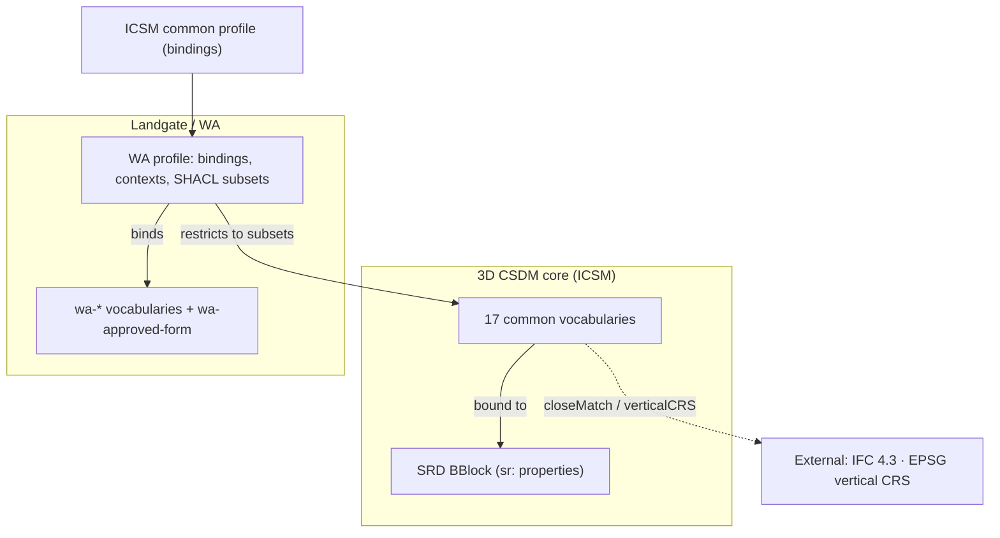

# WA Vocabulary rationalisation and uplift

**Status:** Draft, 2026-10-19.

**Audience:** reviewers ([@rob-metalinkage](https://github.com/rob-metalinkage)) of the vocabulary cleanup PRs and the owner of the `icsm-vocabs` uplift.

**Source:** the plain-language summary of [`vocab-review.md`](vocab-review.md) §5.3–§5.6 and §5.8, limited to the work needed to finish the uplift.

This document lists only vocabularies that still need work.
Published vocabularies that need no change are left out, as are the drafts and terms the review retired.
The full reasoning for each decision is in [`vocab-review.md`](vocab-review.md), and the old-to-new mapping for every term is in [`crosswalk/vocab-crosswalk.csv`](crosswalk/vocab-crosswalk.csv).

---

## 1. Summary

| Group                                  | What                                                                                                                                                                                                                                                                    |       Count | Where it is now                                                                                 | Where it goes (?)                                                         |
|----------------------------------------|-------------------------------------------------------------------------------------------------------------------------------------------------------------------------------------------------------------------------------------------------------------------------|------------:|-------------------------------------------------------------------------------------------------|---------------------------------------------------------------------------|
| New common vocabularies                | Spatial-representation (SR) family                                                                                                                                                                                                                                      |          15 | CSV drafts in this folder                                                                       | Publish as common 3D CSDM vocabularies **OR** `ogcincubator-land-parcels` |
| New common vocabularies                | [`component-role`](component-role.csv)                                                                                                                                                                                                                                  |           1 | CSV draft in this folder                                                                        | As above                                                                  |
| New common vocabularies                | [`occupation-feature`](occupation-feature.ttl)                                                                                                                                                                                                                          |           1 | Hand-written Turtle in this folder                                                              | As above                                                                  |
| Additions to published WA vocabularies | New terms for [`wa-annotation`](https://linked.data.gov.au/def/csdm/wa-annotation), [`wa-survey-documentation-type`](https://linked.data.gov.au/def/csdm/wa-survey-documentation-type) and [`wa-parcel-purpose`](https://linked.data.gov.au/def/csdm/wa-parcel-purpose) |    11 terms | `profiles/*-supplement.ttl`                                                                     | The existing WA vocabularies in `icsm-vocabs`                             |
| New WA vocabulary                      | [`wa-approved-form`](../../../profiles/wa-approved-form-supplement.ttl)                                                                                                                                                                                                 | 1 (4 terms) | [`profiles/wa-approved-form-supplement.ttl`](../../../profiles/wa-approved-form-supplement.ttl) | New WA vocabulary in `icsm-vocabs`                                        |

All drafts already use the conventions set in [D1](vocab-review.md#decision-d1): kebab-case notations (which become the concept IRIs), with any old code kept as the first `skos:altLabel`.

---

## 2. New common vocabularies

These describe ideas that are not specific to WA, so they are published once for all jurisdictions.
A jurisdiction can restrict which concepts it allows in its own profile rather than copying the vocabulary (see [section 5](#5-how-the-pieces-fit-together)).

IRIs follow the pattern `https://linked.data.gov.au/def/csdm/<name>`, with no jurisdiction prefix. 
They could equally be added to `ogcincubator.bblocks-land-parcel`.
The `https://linked.data.gov.au/def/csdm/<name>` pattern is the IRI the WA contexts and examples are assumed to already use. Is this correct?

### 2.1 Spatial-representation family

These vocabularies populate properties of the *Spatial Representation Definition* (SRD) BBlock, which describes how a parcel's 2D, 2.5D or 3D extent is represented.
"Model change" in the Binds to column means the property does not yet accept a vocabulary value and the SRD ontology needs updating.
"Proposed" means the property exists only in draft work and is not yet in the SRD schema.

| Vocabulary | What it describes | Concepts | Binds to | Notes |
|---|---|---:|---|---|
| [`representation-status`](representation-status.csv) | The overall class of representation: 2D, 2.5D, height-described, jurisdictionally bounded, derived 3D or authoritative 3D | 6 | `sr:representationStatus` | `skos:related` to [`geometry-legal-status`](geometry-legal-status.csv) |
| [`geometry-legal-status`](geometry-legal-status.csv) | Which geometry is legally authoritative, and how reliable a geometry is | 7 | `sr:geometryLegalStatus` | The WA profile does not allow `legal-3d`; that is a profile rule, not a vocabulary change |
| [`computability-status`](computability-status.csv) | Whether a vertical extent or geometry can be computed, and what is missing if not | 9 | `sr:computabilityStatus`; `sr:resolutionStatus` (model change) | The four `requires-*` concepts are narrower than `not-computable` |
| [`coordinate-z-role`](coordinate-z-role.csv) | What a `z` ordinate means (observation height, reference surface, legal boundary, …) | 7 | `sr:zValueRole` | |
| [`vertical-extent-status`](vertical-extent-status.csv) | The legal or source state of a parcel's vertical extent, and of each upper or lower boundary | 13 | `sr:verticalExtentStatus`, `sr:boundaryState` | Two `skos:Collection`s, one per property, in [`vertical-extent-status.collections.ttl`](vertical-extent-status.collections.ttl) ([D4](vocab-review.md#decision-d4)) |
| [`vertical-definition-type`](vertical-definition-type.csv) | The kind of source that defines a vertical limit (relative height, absolute height, jurisdictional rule, geometry reference, building-referenced boundary) | 5 | `sr:definitionType` | `building-referenced-boundary` is narrower than `geometry-boundary-reference` |
| [`vertical-value-type`](vertical-value-type.csv) | How a limit's value is expressed (offset, absolute height, geometry reference, rule expression) | 4 | `sr:valueType` | Close to `vertical-definition-type`; I think they are ok as is, but perhaps they should be conflated, see [open item 7](#7-open-items) |
| [`vertical-direction`](vertical-direction.csv) | Above, below or coincident with | 3 | `sr:direction`; `limits[].heightOffset.offsetDirection` (proposed) | |
| [`boundary-role`](boundary-role.csv) | Which part of the 3D boundary a limit sets: lower, upper or lateral | 3 | `sr:limitRole`; `limits[].boundaryRole` (proposed) | One property for both, per [D10](vocab-review.md#decision-d10) |
| [`height-reference`](height-reference.csv) | Reference levels a height is measured from (ground level, floor level, ceiling level, …) | 8 | `sr:heightReference`, `sr:surfaceType` | Specific datums (such as AHD) are not in this vocabulary; they are given by the vertical CRS |
| [`boundary-reference`](boundary-reference.csv) | The surface or plane a boundary follows (inner surface, external surface, centre plane, title boundary, offset from surface, …) | 10 | `limits[].relationship` (proposed) | Combined with an [`occupation-feature`](occupation-feature.ttl) to say *which* wall, floor or ceiling ([D8](vocab-review.md#decision-d8)) |
| [`source-scope`](source-scope.csv) | The level a source statement applies at (scheme, parcel, part of a parcel, boundary, part of a boundary, dataset) | 6 | `source.scope` / `sourceBasis.scope` (proposed) | |
| [`reference-kind`](reference-kind.csv) | The kind of thing a limit refers to: an occupation feature, a reference surface or a parcel | 3 | `limits[].referenceKind` (proposed) | |
| [`derivation-mechanism`](derivation-mechanism.csv) | How a boundary surface was computed (wall centre plane, face projection, surface offset, …) | 5 | `limits[].geometricDerivation.mechanism` (proposed) | Belongs to the SRD's derivation section |
| [`derived-geometry-status`](derived-geometry-status.csv) | Whether derived geometry was generated | 3 | `sr:derivedGeometryStatus` (model change) | `generated`, `not-generated`, `generation-failed` |

### 2.2 Common domain vocabularies

| Vocabulary | What it describes | Concepts | Binds to | Notes |
|---|---|---:|---|---|
| [`component-role`](component-role.csv) | The role of one component of a multipart (for example strata) parcel: principal unit, car bay, storage, balcony, courtyard, roof space, private use area, other | 8 | `derivedGeometry.components[].componentRole` (proposed) | Definitions are jurisdiction-neutral ([D5](vocab-review.md#decision-d5); ICSM to confirm) |
| [`occupation-feature`](occupation-feature.ttl) | Physical features a boundary can be referenced to: buildings and their elements (wall, slab, ceiling, roof, …) and other structures (fence, retaining wall) | 15 | `occupationFeatures[].featureType` (proposed) | Hand-written Turtle with a `skos:broader` hierarchy and `skos:closeMatch` to IFC 4.3 classes (buildingSMART identifiers) ([D5](vocab-review.md#decision-d5); ICSM to confirm) |

---

## 3. Changes to WA vocabularies

As Landgate owns the content of these vocabularies and `icsm-vocabs` hosts them.
None of the changes below has been made yet.

They are made in `sa-icsm-vocabs` (Surround's fork of `icsm-vocabs`) and I assume will reach `icsm-vocabs` through a PR from the fork.

The open `sa-icsm-vocabs` PR from `vocab-cleanup/uplift-altlabel` already adds some supplement terms, and the drafted definitions in [section 3.1](#31-new-terms-for-published-wa-vocabularies); those terms are not repeated here.

### 3.1 New terms for published WA vocabularies

| Vocabulary | New terms | Links to add |
|---|---|---|
| [`wa-annotation`](https://linked.data.gov.au/def/csdm/wa-annotation) | `r-54` (Regulation 54 survey certificate), `boundary-definition-statement`, `licensed-valuer-certification`, `building-approval-certification`, `strata-plan-endorsement`, `record-of-strata-titles-scheme` | Each certification is `skos:related` to the document type it certifies (for example `strata-plan-endorsement` ↔ `wa-survey-documentation-type:strata-plan-endorsement-certificate`). `boundary-definition-statement` is related to `vertical-definition-type:building-referenced-boundary` |
| [`wa-survey-documentation-type`](https://linked.data.gov.au/def/csdm/wa-survey-documentation-type) | `building-approval-certificate`, `strata-plan-endorsement-certificate`, `scheme-by-laws`, `scheme-notice` | `scheme-by-laws` and `scheme-notice` are narrower than the existing `scheme-form` |
| [`wa-parcel-purpose`](https://linked.data.gov.au/def/csdm/wa-parcel-purpose) | `strata-scheme` | Interim, until a strata scheme can be typed as a `ParcelAggregate` feature ([D6](vocab-review.md#decision-d6)) |

The source for each term is the matching `profiles/*-supplement.ttl` file.
The endorsement definitions follow [D9](vocab-review.md#decision-d9): the WAPC or its authorised delegate endorses under section 15(4) of the Strata Titles Act 1985.

The seven `wa-survey-documentation-type` concepts that had placeholder definitions ("To be confirmed …") now have drafted definitions in the source CSV on the `sa-icsm-vocabs` branch.
Landgate should confirm them before the vocabulary is rebuilt and published (see [`HANDOFF.md`](HANDOFF.md#6-still-open)).

**Format note.**
These three CSVs use the older five-column format, in which the `related` column is free text and is not turned into links.
To publish the `skos:related` and `skos:broader` links above, either convert the CSV to the seven-column draft format (`preflabel,definition,notation,altlabel,broader,related,scopenote`) or add the links in a hand-written sidecar.
Converting is simpler, but check that the existing free-text `related` values still read correctly as `scopenote` or are dropped deliberately.

### 3.2 New WA vocabulary: `wa-approved-form`

A register of Landgate-approved form versions, at `https://linked.data.gov.au/def/csdm/wa-approved-form`.

| Term | Label | Document type (`dcterms:type`) |
|---|---|---|
| `2021-47738` | Approved Schedule of Unit Entitlements form 2021-47738 | `scheme-ue` |
| `BA14` | Approved Building Approval Certificate form BA14 | `building-approval-certificate` |
| `2020-27588-v3` | Approved Record of Strata Titles Scheme 2020-27588-v3 | `scheme-record-form` |
| `15c` | Strata Plan Endorsement Certificate Form 15C | `strata-plan-endorsement-certificate` |

The supplement already declares the `skos:ConceptScheme` and uses IRIs for its sources.
Its `dcterms:type` links and validity dates cannot be expressed in the CSV uplift, so I assume it can be published as hand-written Turtle.
It binds to `supportingDocuments[].conformsTo` in the WA profile.

### 3.3 WA profile bindings

[`profiles/wa-vocab-bindings.csv`](../../../profiles/wa-vocab-bindings.csv) has no rows for these vocabularies, even though the examples use them:

- [`wa-annotation`](https://linked.data.gov.au/def/csdm/wa-annotation) (`annotations[].role`)
- [`wa-survey-documentation-type`](https://linked.data.gov.au/def/csdm/wa-survey-documentation-type) (`supportingDocuments[].role`)
- [`wa-surveypoint-method`](https://linked.data.gov.au/def/csdm/wa-surveypoint-method) (`points[].methodEstablished`)
- `wa-approved-form` (`supportingDocuments[].conformsTo`)

Add the rows once the vocabularies are published, and retire the matching `*-supplement.ttl` files.

---

## 4. Not for publication: `wa-prov-role`

[`wa-prov-role`](wa-prov-role.csv) lists roles in the WA CSD conversion pipeline that I have used for data creation (format converter, workflow orchestrator, source CSD file, source PDF file).
It describes how the data was produced, not the cadastre, so I think it stays with the local processing code ([D12](vocab-review.md#decision-d12)).
It sits in this folder beside the drafts but does not add it to `source/`.
Could be removed as it is strictly unnecessary for the WA profile.

---

## 5. How the pieces fit together

### Assumptions

1. **Owner follows meaning.**
   Surround drafted the SR family via a co-design process with Landgate, but the ideas are generic, so at least initially I think the 3D CSDM core owns them, with WA as interim steward ([D2](vocab-review.md#decision-d2)). They could equally be added to `land-parcels` as they are generic IMHO.
2. **(Assumed) Published IRIs never change.**
   New vocabularies get their final IRIs on first publication, which is why the kebab-style notation convention ([D1](vocab-review.md#decision-d1)) was adopted.
3. **One concept, one IRI.**
   A jurisdiction limits which common concepts it allows (with SHACL `sh:in` or a `skos:Collection`) rather than copying them.
   It mints its own concept only for a genuinely different meaning, linked to the common concept with `skos:broadMatch`.
4. **Domain, not process.**
   Vocabularies that describe the cadastre are published; vocabularies that describe the processing pipeline are not.

### Layers

| Layer               | Owner                              | Holds                                                                                                                                                                  |
|---------------------|------------------------------------|------------------------------------------------------------------------------------------------------------------------------------------------------------------------|
| External            | buildingSMART, EPSG                | IFC 4.3 classes (matched from `occupation-feature`); vertical CRSs such as AHD (EPSG:5711)                                                                             |
| 3D CSDM core        | ICSM                               | Core model classes; the SRD BBlock and its `sr:` properties; the 17 common vocabularies in [section 2](#2-new-common-vocabularies) ([D3](vocab-review.md#decision-d3)) |
| ICSM common profile | ICSM                               | Bindings from common properties to common vocabularies                                                                                                                 |
| WA vocabularies     | Landgate (hosted in `icsm-vocabs`) | Existing `wa-*` vocabularies, the additions in [section 3](#3-changes-to-wa-vocabularies) and `wa-approved-form`                                                       |
| WA profile          | Landgate                           | WA bindings, contexts and SHACL, including the WA subsets of common vocabularies (for example, no `geometry-legal-status:legal-3d`)                                    |

---

## 6. Assumed Publishing steps

For each CSV draft in [section 2](#2-new-common-vocabularies):

1. Copy the CSV and its scheme metadata ([`meta/<name>.meta.ttl`](meta/)) into `source/` in `icsm-vocabs`.
   Confirm the creator (`csdm-pg`), publisher (`icsm`) and status (`experimental`) in the metadata first.
2. Add a `csMapping` entry in `source/vocabs-uplift.yml`, for example
   `"boundary-reference.csv": { "uri": "https://linked.data.gov.au/def/csdm/boundary-reference", "label": "Boundary Reference", "type": "" }`,
   and decide whether the vocabulary gets a `termtype:` concept type, as the published ones do.
   Without an entry, the uplift gives the vocabulary a placeholder base IRI.
3. List the output in `manifest.ttl`.
4. Once built and validated against the manifest, move into `vocabs/`.

[`occupation-feature.ttl`](occupation-feature.ttl), [`vertical-extent-status.collections.ttl`](vertical-extent-status.collections.ttl) and `wa-approved-form` are published as Turtle, not through the CSV uplift.
`occupation-feature.ttl` still needs a creator, publisher and status.

> **Note** to take advantage of all `broader`, `related` and collection links resolving, the uplift process depends on [PR Vocab cleanup/uplift altlabel-#3](https://github.com/surroundaustralia/icsm-vocabs/pull/3) which updates `vocabs-uplift.yml` to split `|`-separated `altlabel`s, and map `broader`, `related` and `scopenote`.
> So that PR should be merged first if this capability is desirable.

---

## 7. Open items

| # | Item                                                                                                                                                                                                                                                                                                                                                             | Who decides        |
|---|------------------------------------------------------------------------------------------------------------------------------------------------------------------------------------------------------------------------------------------------------------------------------------------------------------------------------------------------------------------|--------------------|
| 1 | **Publication route for the common vocabularies.** [D3](vocab-review.md#decision-d3) places them with the 3D CSDM core model (`https://icsm-au.github.io/3d-csdm`) rather than in `icsm-vocabs`. Is this correct, or is `icsm-vocabs` the publication pipeline, and that the IRIs stay `…/def/csdm/<name>`.                                                      | ICSM, uplift owner |
| 2 | **Ownership.** Should the 3D CSDM core own the SRD block and the SR family ([D2](vocab-review.md#decision-d2)), and should `component-role` and `occupation-feature` be common ([D5](vocab-review.md#decision-d5)). My feeling is yes.                                                                                                                                            | ICSM               |
| 3 | **SRD model changes.** I understand`sr:resolutionStatus` and `sr:derivedGeometryStatus` are currently string properties. With the rationalisation I have created them as become object properties. The "proposed" properties in [section 2](#2-new-common-vocabularies) (`limits[]`, `components[]`, `source.scope`, `occupationFeatures[].featureType`) need adding to the SRD schema. | SRD owner          |
| 4 | **ICSM survey type binding.** The ICSM common profile binds `surveyType` to `icsm-survey-type`, which does not exist. This does not affect WA, which binds `wa-survey-type`.                                                                                                                                                                                     | ICSM               |
| 5 | **WA definitions.** Confirm the drafted `wa-survey-documentation-type` definitions and the new WA terms in [section 3](#3-changes-to-wa-vocabularies).                                                                                                                                                                                                           | Landgate           |
| 6 | **WA-specific levels.** Decide whether `height-reference:lowest-ground-floor-upper-surface-level` and `plate-height` are WA-specific; if so, they belong in a WA vocabulary linked to the common one. I think they are generic and could be in the core.                                                                                                                                                            | Landgate           |
| 7 | **`vertical-value-type` vs `vertical-definition-type`.** Each `vertical-value-type` concept has a close match in `vertical-definition-type`. They are meant to be independent (a jurisdictional rule can be expressed as an offset), but confirm both are needed before publication.                                                                             | SRD owner          |
